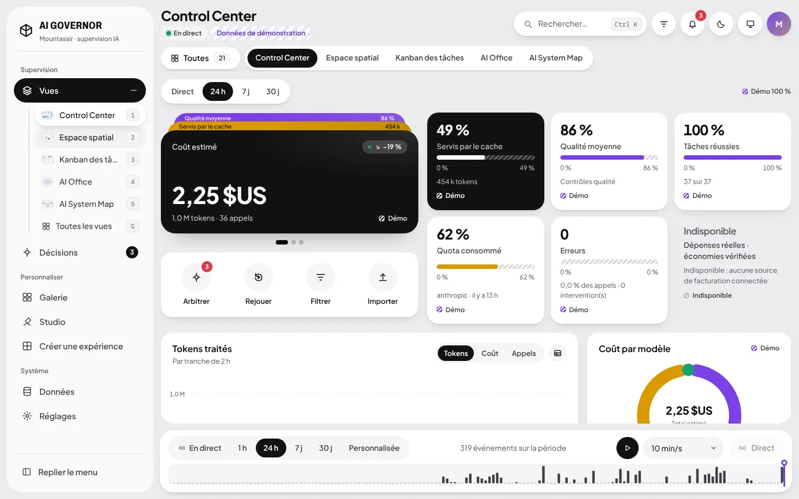
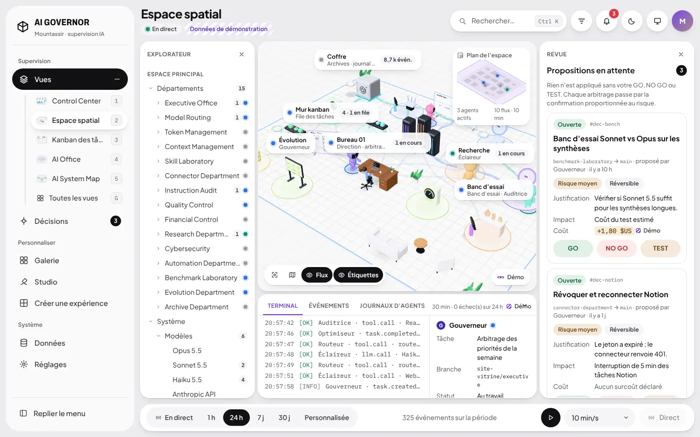
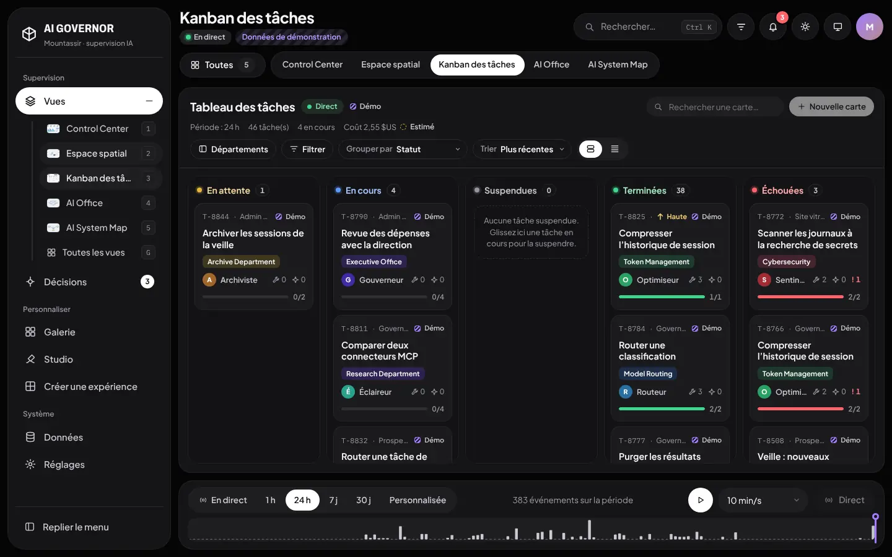
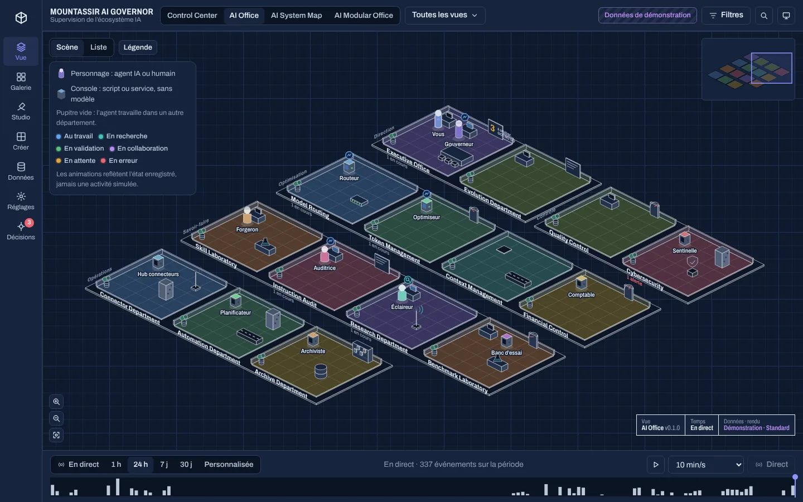
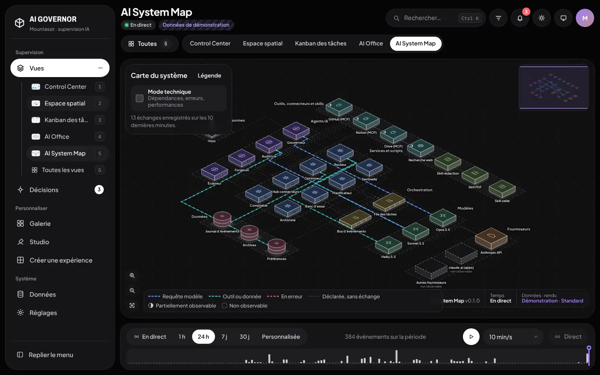
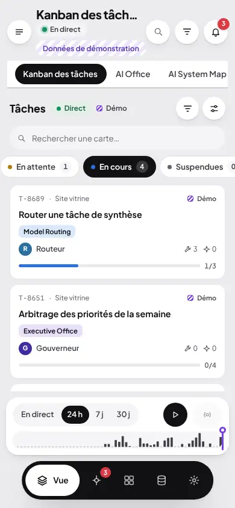
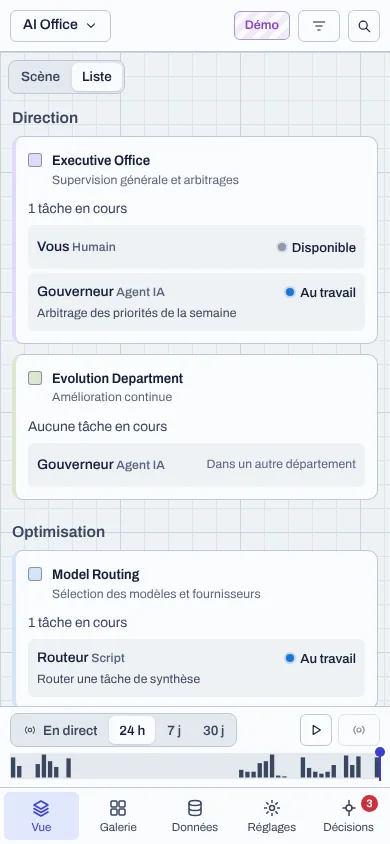

# Captures du prototype

Captures du prototype interactif (thème Lumière, 1440×900 ; Onyx pour le sombre ; 390 px pour le mobile), données de **démonstration** (bandeau hachuré visible). Elles sont régénérées depuis la build de production avec Playwright ; l'Espace spatial est rendu sans GPU (rendu logiciel). Les 5 vues partagent le même journal, la même sélection, la même période et les mêmes filtres.

## Basculer entre les vues

Touches **1 à 5**, sélecteur de l'en-tête, ou lanceur (touche **G**). Sur téléphone, l'onglet « Vue » de la barre du bas ouvre le lanceur.

## Thème clair (Lumière)

### Control Center

### Espace spatial

### Kanban des tâches

### AI Office

### AI System Map

## Thème sombre (Onyx)

| | |
|---|---|
| **Control Center** | **Espace spatial** |
|  |  |
| **Kanban des tâches** | **AI Office** |
|  |  |
| **AI System Map** | |
|  | |

## Mobile (390 px)

| Control Center | Espace spatial | Kanban des tâches | AI Office | AI System Map |
|---|---|---|---|---|
|  |  |  |  |  |
