# Maquettes haute fidélité (captures du prototype)

Captures du prototype interactif, données de **démonstration** (bandeau et badges hachurés visibles). Régénérables via Playwright (voir `docs/TESTING.md`).

## Bureau — thème clair « Plan d'atelier »

| Control Center | AI Office |
|---|---|
|  | 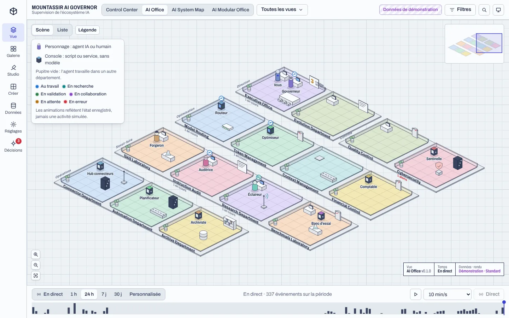 |
| **AI System Map** | **AI Modular Office** |
| 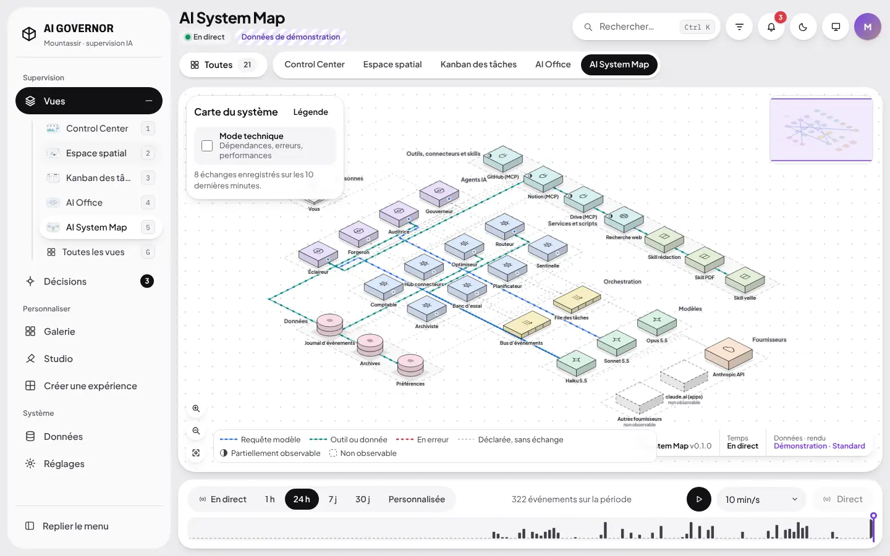 |  |
| **Journal opérationnel (5e expérience)** | **Inspecteur d'agent** |
|  | 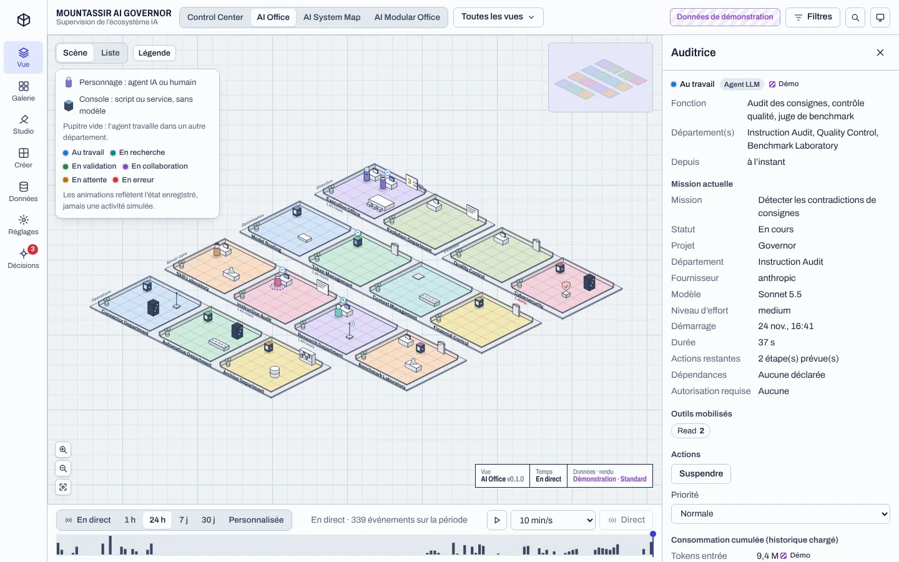 |
| **Centre GO / NO GO / TEST** | **Galerie** |
| 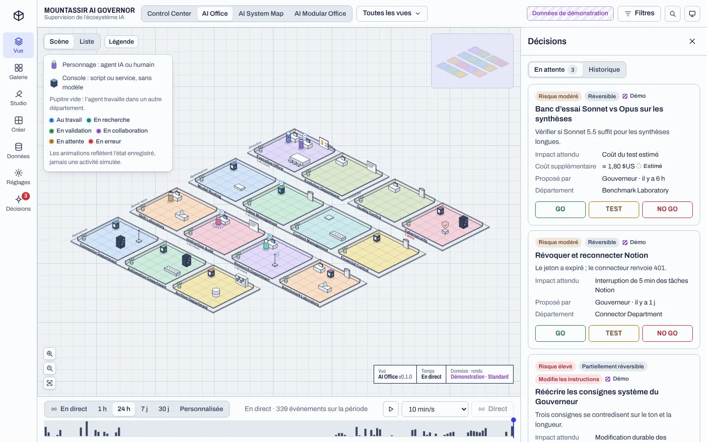 | 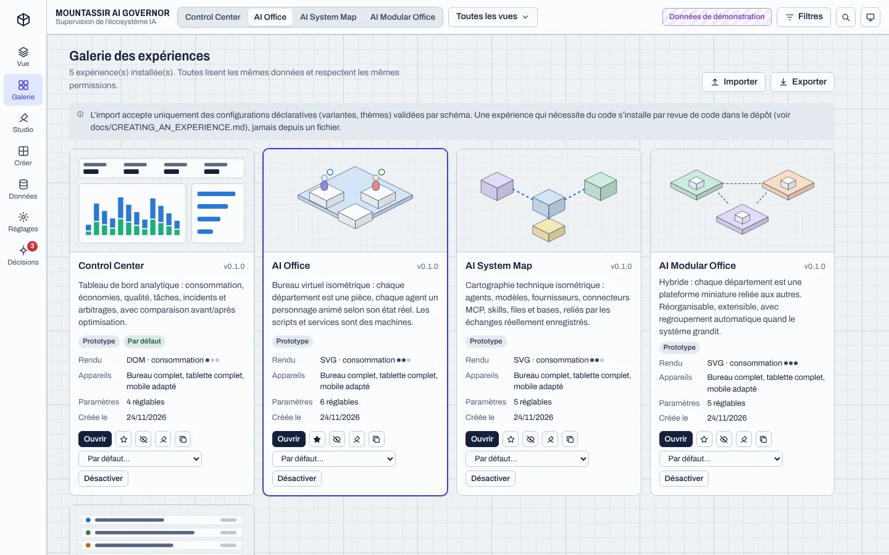 |
| **Experience Studio** | **Custom Experience Builder** |
| 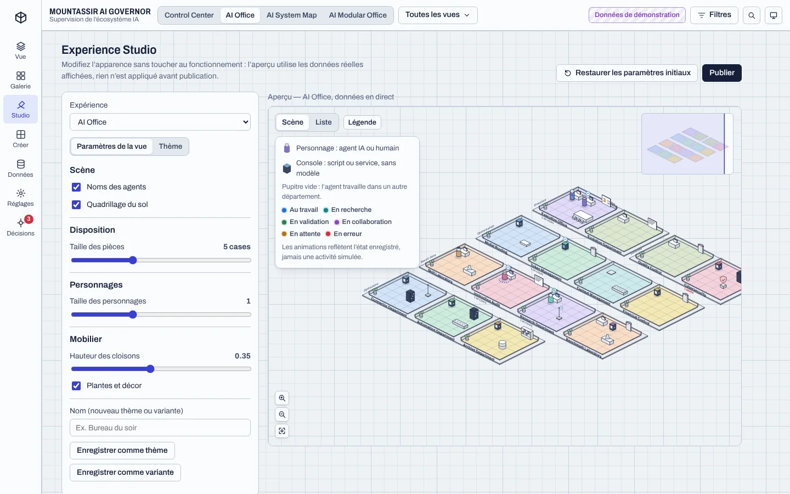 | 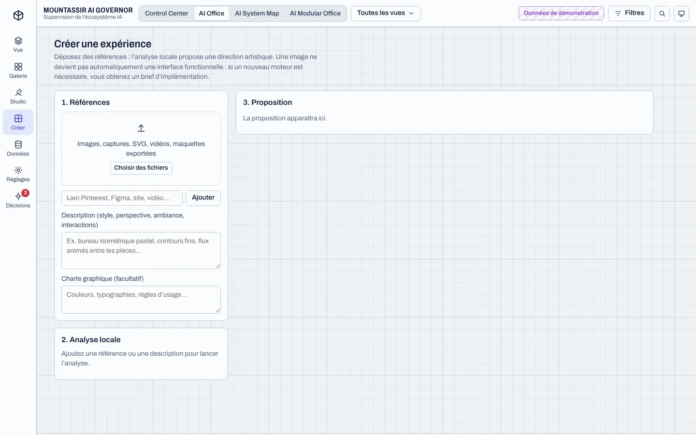 |
| **Sources de données** | |
| 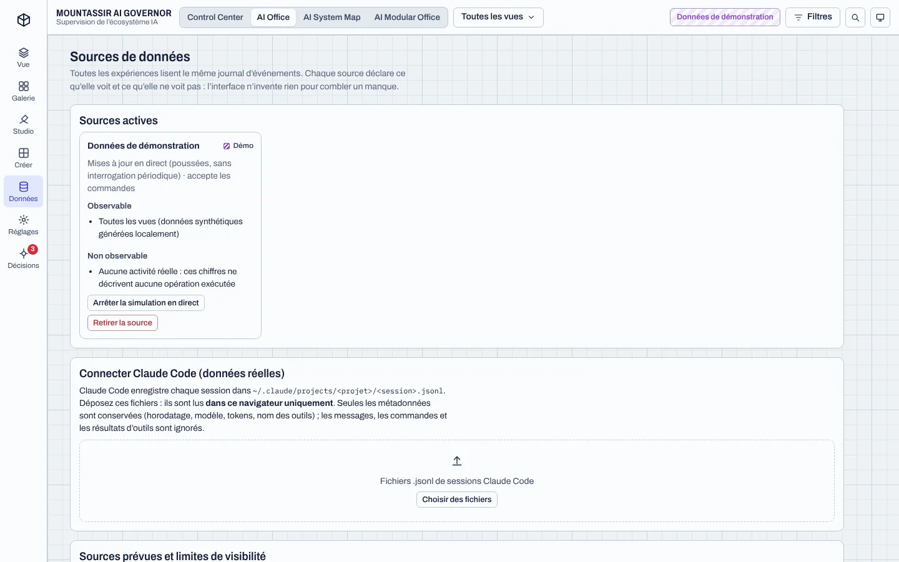 | |

## Bureau — thème sombre « Atelier de nuit »

| Control Center | AI Office |
|---|---|
|  |  |
| **AI System Map** | **AI Modular Office** |
|  | 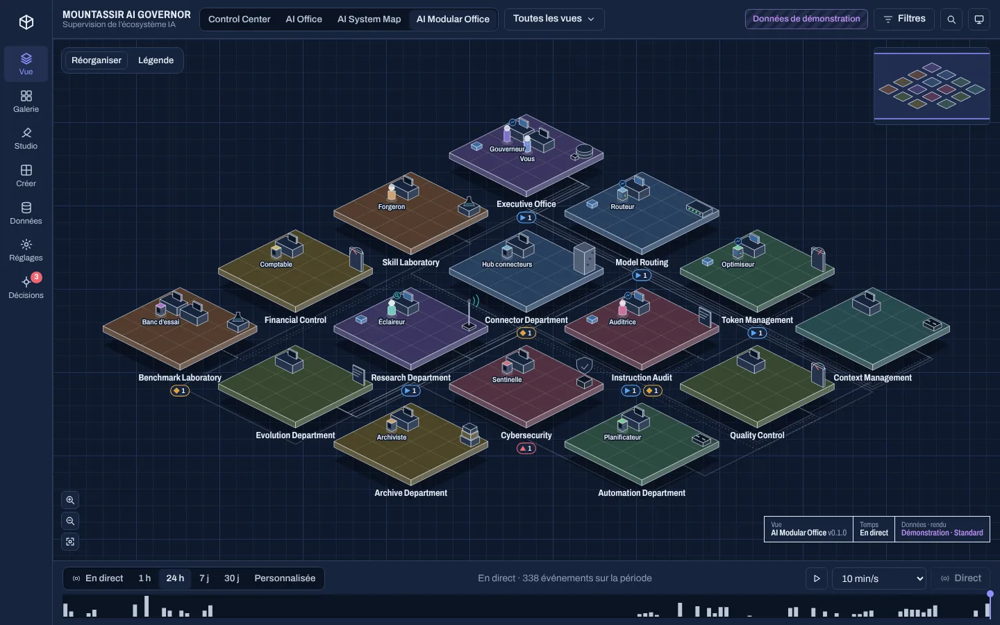 |

## Mobile (390 px)

| Control Center | AI Office | System Map | Modular Office | Journal |
|---|---|---|---|---|
| 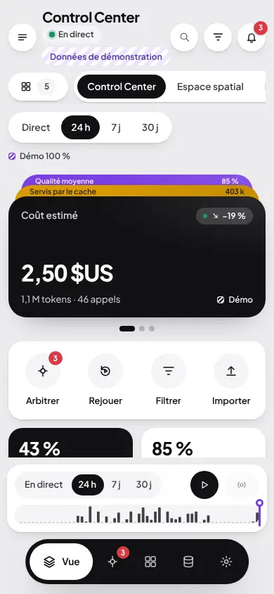 |  | 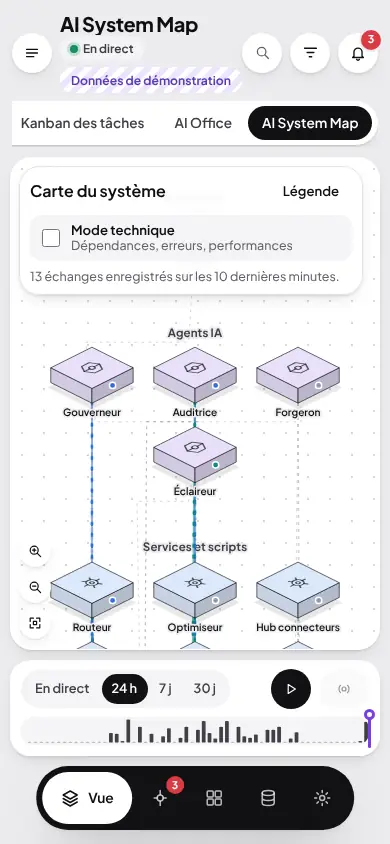 | 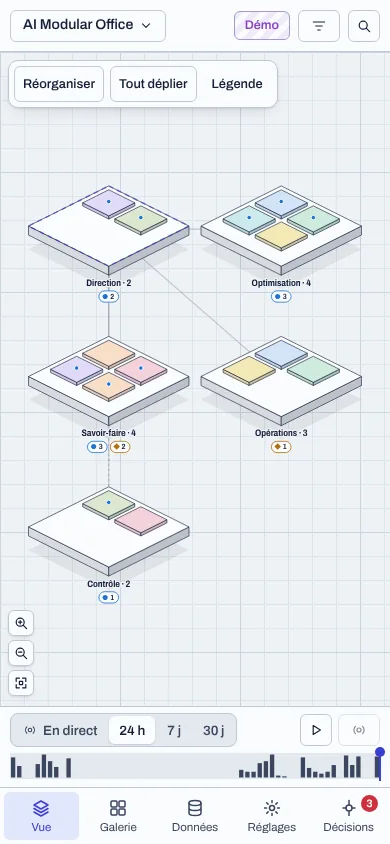 | 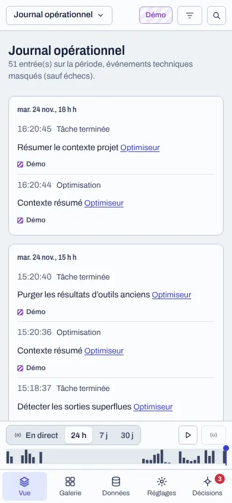 |
