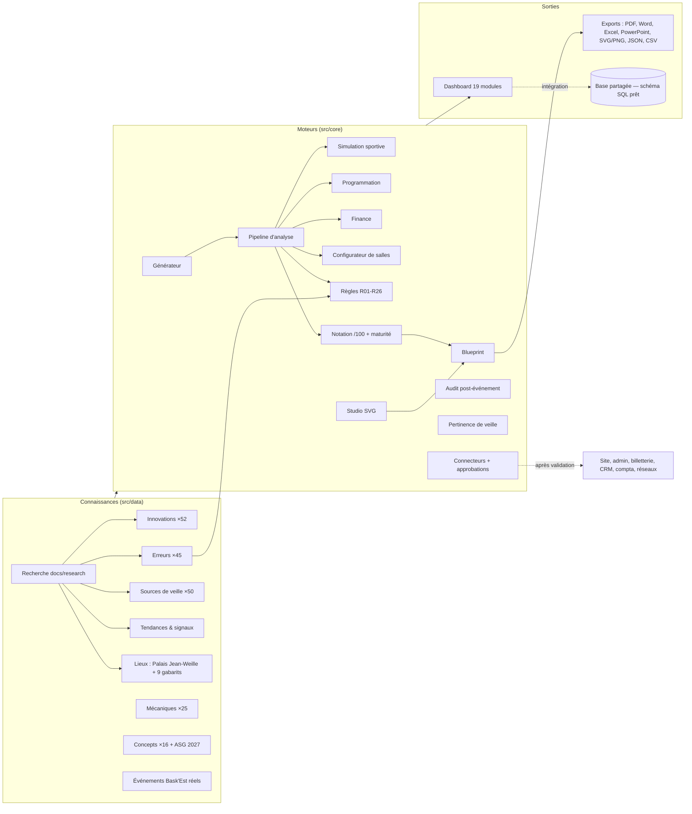

# 01 — Architecture de BASK'EST LAB

> Le département R&D événementiel de Bask'Est, sous forme d'outil : de l'idée à l'événement documenté, sans multiplier les outils.

## 1. Principes d'architecture

| Principe | Traduction technique |
|---|---|
| **Modulaire, montée en puissance progressive** | Un cœur de moteurs *purs* (TypeScript sans dépendance navigateur) réutilisés par l'interface, les scripts d'export et, demain, un serveur. Chaque module peut être remplacé sans toucher aux autres. |
| **Faits ≠ hypothèses** | Toute donnée externe porte une `Provenance` (`verifie`, `probable`, `estimation`, `hypothese`, `non_trouve`) avec sa source et sa date. |
| **Déterministe et testable** | Générateur pseudo-aléatoire à graine (`src/core/rng.ts`) : une simulation se rejoue à l'identique. 27 tests automatisés (`npm test`). |
| **Privé par défaut, validation humaine** | Les concepts sont `private: true` ; publication, dépense, commande, réservation et modification opérationnelle passent par une `ApprovalRequest` (`src/core/integration/contracts.ts`). |
| **Fonctionne hors ligne, sans serveur** | Le dashboard est une application statique (Vite + React). Les données de l'association restent dans le navigateur tant que la base partagée n'est pas branchée. |
| **Coûts quasi nuls au départ** | Aucun service payant requis pour l'usage actuel. Les intégrations (base partagée, billetterie, CRM…) sont optionnelles et progressives. |

## 2. Vue d'ensemble



## 3. Couches et dossiers

```
baskest-lab/
├── src/core/                 ← moteurs purs (aucune dépendance UI)
│   ├── model.ts              ← modèle de données (contrat commun)
│   ├── rng.ts                ← aléatoire reproductible
│   ├── pipeline.ts           ← chaîne complète d'analyse d'un concept
│   ├── simulation/           ← match par possessions, tournois, analyse Monte-Carlo, préréglages
│   ├── scheduler/            ← programmation, conflits, replanification, charge de publication
│   ├── finance/              ← budget, 3 scénarios, point mort, trésorerie, gabarits
│   ├── venue/                ← implantation 2D, capacités, évacuation (indicatif), rendu SVG
│   ├── rules/                ← 26 règles de conception issues de l'observatoire
│   ├── scoring/              ← notation /100, portes, maturité
│   ├── generator/            ← générateur, bibliothèques combinatoires, labo (mutations)
│   ├── studio/               ← identité visuelle (logo, affiche, maillot, billet, accréditation…)
│   ├── blueprint/            ← BASK'EST EVENT BLUEPRINT (8 parties) + rendus MD/HTML
│   ├── audit/                ← audit post-événement
│   ├── watch/                ← pertinence de veille, synthèse hebdomadaire
│   └── integration/          ← connecteurs, garde-fou d'approbation
├── src/data/                 ← bases de connaissances et données Bask'Est (sourcées)
├── src/ui/                   ← dashboard React (19 modules, statut affiché sur chaque page)
├── scripts/                  ← génération du Blueprint, exports Office, captures, sondes
├── tests/                    ← tests Vitest des moteurs
├── db/schema.sql             ← schéma PostgreSQL/Supabase (validé sur PostgreSQL 16)
└── docs/                     ← livrables écrits, recherche, Blueprint, captures
```

## 4. La chaîne d'analyse (cœur du système)

`analyzeConcept(concept)` (`src/core/pipeline.ts`) enchaîne, pour **chaque** concept généré ou modifié :

1. **Paramètres opérationnels** par défaut conformes aux règles (`defaultOps`) : terrains dimensionnés selon le nombre de matchs estimé, arbitres, créneaux, repos, tarifs, points de restauration, points de contrôle…
2. **Simulation sportive** Monte-Carlo (150 à 500 tournois) → équité, suspense, durée, stratégies dominantes, risques de manipulation.
3. **Programmation** complète (terrains, horaires, arbitres, blocs fixes) → conflits.
4. **Budget** (gabarit d'échelle) → 3 scénarios, point mort, trésorerie.
5. **Implantation** dans le lieu → capacités, zones non placées, évacuation et PMR indicatifs.
6. **Règles de conception R01-R26** → `ok` / `alerte` / `bloquant` / `non évaluable`.
7. **Notation /100** + portes sécurité / équité / conformité + **maturité** sur preuves.

Le générateur exécute cette chaîne sur chaque candidat, répare automatiquement les formats trop longs pour la journée, puis classe les candidats (éligibles d'abord).

## 5. Statut des fonctionnalités (exigence §23)

| Module | Statut | Ce qui manque pour le statut suivant |
|---|---|---|
| Tableau de bord | Opérationnel | — |
| Tableau de notation (surcharge jury) | Opérationnel | Historique partagé des surcharges (base) |
| Projets, calendrier, versions | Prototype | Base partagée + comptes |
| Analyse post-événement | Opérationnel | Saisie des données réelles 2025-2026 par l'association |
| Observatoire des tendances | Prototype | Collecte automatique |
| Veille basket et multisport | Prototype | Ingestion RSS/API + synthèses planifiées |
| Bibliothèque des innovations | Opérationnel | — |
| Registre des erreurs + règles | Opérationnel | Révision des seuils après audits réels |
| Générateur de concepts | Opérationnel | Enrichissement rédactionnel par IA (option) |
| Laboratoire créatif | Opérationnel | — |
| Studio de design | Prototype | Finalisation par un graphiste, polices de marque |
| Configurateur de salles | Opérationnel | Relevés réels des salles (plans, accès, jauges) |
| Simulateur sportif | Opérationnel | Calibrage sur statistiques des éditions Bask'Est |
| Simulateur financier | Opérationnel | Remplacer les estimations par des devis |
| Programmation sportive | Opérationnel (publication : intégration) | Connecteur site / écrans |
| Bibliothèque des dossiers (Blueprint) | Opérationnel | Exports Office depuis l'interface (aujourd'hui via scripts) |
| Intégrations et validations | Dépend d'une intégration | Choix des outils, clés d'API |
| Notifications | Prototype | Push / e-mail |
| Espaces collaboratifs | Dépend d'une intégration | Base partagée + authentification |

## 6. Choix techniques

| Besoin | Choix | Raison |
|---|---|---|
| Langage | TypeScript strict | Contrat de données vérifié à la compilation entre moteurs, UI et exports. |
| UI | React 19 + Vite 7, CSS natif à jetons | Léger, sans framework CSS, build en < 1 s, fichier unique possible (`npm run build:demo`). |
| Tests | Vitest | Rapide, même configuration que Vite. |
| Exports Office | Python (python-docx, openpyxl, python-pptx) | Formats natifs Word/Excel/PowerPoint, formules Excel vivantes. |
| PDF / PNG | Chromium (Playwright) | Rendu fidèle du HTML et des SVG. |
| Base partagée (à venir) | PostgreSQL / Supabase | Schéma relationnel + JSONB, sécurité par ligne, offre gratuite adaptée à une association. |

## 7. Évolution vers la version « équipe »

1. Appliquer `db/schema.sql` sur une base Supabase ; activer l'authentification.
2. Remplacer `useLocal` (`src/ui/ui.tsx`) par un client de base de données — c'est le seul point de persistance de l'interface.
3. Brancher les connecteurs un par un (`src/core/integration/contracts.ts`), toujours derrière `requireApproval`.
4. Planifier la veille (collecte + synthèse hebdomadaire) via une tâche programmée.

Voir `docs/12-integration-ecosysteme.md` et `docs/16-roadmap.md`.
