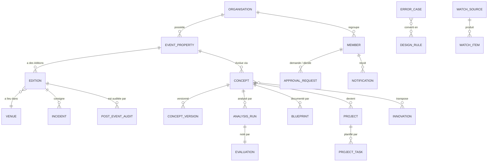

# 03 — Modèle de données

Source de vérité : `src/core/model.ts` (types TypeScript). Persistance partagée : depuis la v0.4, schéma unique EVENT LAB en migrations `supabase/migrations/` (testé par `npm run db:test` sur PostgreSQL 16 avec une simulation de l'authentification Supabase ; voir `event-lab/docs/14-socle-saas.md`). L'ancien `db/schema.sql` (21 tables, v0.3) n'est plus qu'un renvoi ; les tables propres au basket qu'il décrivait ne sont pas encore reprises.

## 1. Règle transverse : la provenance

Chaque fait importé de l'extérieur porte une `Provenance` :

| Niveau | Sens | Exemple |
|---|---|---|
| `verifie` | Source publique identifiée et datée | Capacité du Palais Jean-Weille : 6 000 places (sports.gouv.fr) |
| `probable` | Source unique ou extrait de recherche non lu en entier | Dimensions 44 × 24 m de la salle principale |
| `estimation` | Ordre de grandeur calculé ou d'usage | Coût d'un DPS, panier moyen buvette |
| `hypothese` | Choix de modélisation à confirmer | Accès et issues du Palais (non publics) |
| `non_trouve` | Absent des sources publiques : à fournir par l'association | Affluence de l'ASG 2026 |

## 2. Diagramme des entités

## 3. Entités principales

### Organisation et propriétés
| Entité | Champs clés | Notes |
|---|---|---|
| `BrandSystem` | marque mère, signature « by Bask'Est », palette, typographies, invariants | Proposition (aucune charte publique trouvée) |
| `EventProperty` | id, nom, type, marque (accent, motif), statut, **maturité**, éditions | `asg-grand-est`, `bask-cup`, `king-of-the-court` |
| `Edition` | date, lieu, budget, recettes, dépenses, participants, affluence, billetterie, partenaires, bénévoles, programme, résultats, digital, retours, incidents, matériel, **dataCompleteness** | Les 14 champs exigés au §8, chacun avec sa provenance |

### Sport
| Entité | Champs clés |
|---|---|
| `CompetitionFormat` | taille d'équipe (1-5), effectif, nombre d'équipes, **phases** (`StageSpec`), règles de match, composition (mixité, âge, handicap, niveau), **tableaux parallèles** (`divisions`, ex. féminin / masculin) |
| `StageSpec` | type (poules, élimination directe, double élimination, suisse, King of the Court, échelle, course aux points), poules, qualifiés, rondes, tirage, `advance` |
| `MatchRules` | fin (temps, score cible, Elam, temps ou score), possession, **zones de tir** (points, réussite de calibrage), prolongation, mécaniques, officiel ou non |
| `Mechanic` | famille (sélection, structure, scoring, temps, narration, public), paramètres, effets, risques, incompatibilités, simulée ou qualitative, compatible officiel |
| `FairnessReport` | P(meilleure gagne), τ de Kendall, surprises, matchs serrés, durées, matchs/équipe, stratégies dominantes, risques de manipulation, situations injustes, verdict |

### Lieux et implantation
| Entité | Champs clés |
|---|---|
| `Venue` | type (10 types), aire, terrains, paniers, places fixes (+ provenance), jauge, vestiaires, **accès** (largeur, PMR), espaces annexes, équipements AV, contraintes, sources |
| `Layout` | espaces, zones (type, rectangle, surface demandée/obtenue), flux (entrée, sortie, joueurs, secours), capacités (assis, debout, PMR), **évacuation** (dégagements et unités de passage requis/disponibles), alertes, zones non placées |

### Programmation
`Court` (disponibilités, terrain principal), `Official` (rôle, disponibilités, équipe liée), `FixedBlock` (cérémonie, animation, sponsor, pause, concours), `ScheduledMatch` (dépendances « W:M012 », « 1:A »), `ScheduleConflict` (8 types), `Schedule` (stats : attente max, repos min, occupation), `Disruption` (retard, terrain indisponible, absence équipe / officiel).

### Économie
| Entité | Champs clés |
|---|---|
| `CostLine` | 17 catégories (§16), base (fixe, par spectateur, par participant, par équipe), unitaire, quantité, **en nature**, échéancier de paiement (J-x) |
| `RevenueLine` | 15 flux, **nature** (commerciale, don, subvention, apport, emprunt), probabilité, sécurisé, échéancier |
| `ScenarioResult` | charges, produits par nature, résultat, marge, **point mort**, trésorerie jour par jour, besoin de trésorerie, dépendances (subventions, premier partenaire, part sécurisée), alertes |

### Connaissances
`Innovation` (matrice de transposition complète, §4), `ErrorCase` (observé, source, causes, conséquences, prévention, règles), `DesignRule` (R01-R26, seuil, catégorie), `WatchSource`, `WatchItem` (pertinence, statut nouveau → qualifié → transposé / écarté).

### Concepts, notation, pilotage
| Entité | Champs clés |
|---|---|
| `Concept` | identité (nom, signature, palette, motif, vérifications PI), objectifs, publics, lieu, échelle, format, **activité centrale** (match, concours, show, communautaire, mixte), parcours spectateur (8 phases), contenus, innovations, budget, sécurité (DPS, assurance, autorisations, image des mineurs, accessibilité, dégagement), **maturité + preuves**, version, **privé** |
| `OpsPlan` | paramètres opérationnels vérifiés par les règles (communication, inscriptions, contrôle d'accès, ambiance, écrans, interactions, captation, conducteur, bénévoles, activations, restauration, créneaux, terrains, tarifs…) |
| `Evaluation` | 9 critères (points, max, raisons), total /100, portes, éligibilité, grade, maturité, prochaines étapes, surcharges jury motivées |
| `MaturityEvidence` | documenté, simulations, sessions prototype, éditions pilotes, éditions réussies, réplications, territoires |
| `Project` / `ProjectTask` / `VersionEntry` | étape, responsable, date, visibilité (privé / équipe / publié), tâches J-x, historique |
| `ApprovalRequest` | action sensible, charge utile, rôle requis, statut |
| `PostEventTargets` / `AuditLine` | 10 indicateurs objectifs vs réalisé (§22) |

## 4. Correspondance TypeScript → SQL

| Type | Table | Stockage |
|---|---|---|
| `EventProperty` | `event_property` | colonnes + `brand` JSONB |
| `Edition` | `edition` (+ `incident`) | colonnes filtrables + `data`, `data_completeness` JSONB |
| `Venue` | `venue` | colonnes clés + `data` JSONB |
| `Concept` | `concept` (+ `concept_version`) | colonnes de filtre + `data`, `evidence` JSONB, `is_private` |
| `FairnessReport`, `Schedule`, `Budget`, `ScenarioResult[]`, `Layout`, `RuleResult[]` | `analysis_run` | JSONB (rejouable : `runs` + `seed`) |
| `Evaluation` | `evaluation` | total, grade, portes + `criteria`, `overrides` JSONB |
| `Blueprint` | `blueprint` | `data` JSONB + chemins des exports |
| `ApprovalRequest` | `approval_request` | contrainte sur les actions sensibles, RLS par rôle |

## 5. Sécurité des données

- **Privé par défaut** : `concept.is_private = true` ; passer en public exige le rôle président / bureau (politique `concept_publish`) **et** une demande d'approbation.
- **Mineurs** : aucune donnée nominative de mineur n'est nécessaire au fonctionnement de l'outil ; profils et classements joueurs ne seront activés qu'avec base légale, consentement des représentants légaux et durées de conservation définies (voir `docs/research/R3-cadre-reglementaire-financements.md`).
- **Aucune donnée personnelle dans le dépôt** : les sources publiques citées n'incluent ni nom de dirigeant ni adresse.
