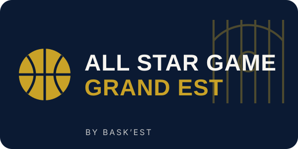
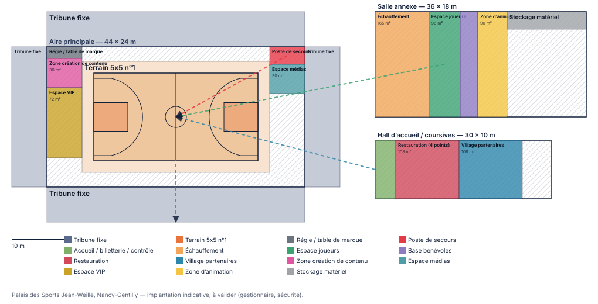

# All Star Game Grand Est — BASK’EST EVENT BLUEPRINT

**Édition 2 — 2027 · Samedi 12 juin 2027, 18h-minuit (proposition) · Palais des Sports Jean-Weille, Nancy-Gentilly** — Statut : Événement pilote · 72/100 — Généré le 2026-11-24 par BASK’EST LAB

## Sommaire

- **Partie stratégique**
  - Résumé exécutif
  - Présentation du concept
  - Objectifs
  - Proposition de valeur
  - Positionnement
  - Étude de marché
  - Benchmark
  - Sources d’inspiration
  - Analyse concurrentielle
  - Public cible
  - Évaluation BASK’EST LAB
- **Partie sportive**
  - Règlement complet
  - Conditions d’inscription
  - Format des compétitions
  - Système de scoring
  - Qualifications
  - Classements
  - Calendrier et programme sportif
  - Récompenses
  - Arbitrage
  - Simulations sportives
- **Partie créative**
  - Naming
  - Logo et logotype
  - Direction artistique
  - Charte graphique
  - Moodboard
  - Maillots
  - Scénographie
  - Trophées et médailles
  - Affiches et visuels digitaux
  - Maquettes UX/UI
  - Visuels de projection
- **Partie opérationnelle**
  - Plans du lieu
  - Implantation
  - Conducteur minute par minute
  - Rétroplanning
  - Organigramme
  - Répartition des responsabilités (RACI)
  - Fiches de poste bénévoles
  - Inventaire matériel
  - Gestion des prestataires
  - Gestion des flux
  - Plans de secours
  - Analyse des risques
  - Checklists
- **Partie économique**
  - Budget
  - Plan de trésorerie
  - Seuil de rentabilité
  - Politique tarifaire
  - Stratégie commerciale
  - Dossier de sponsoring
  - Offres partenaires
  - Financements potentiels
- **Partie médiatique**
  - Stratégie digitale
  - Calendrier éditorial
  - Plan de captation
  - Storyboards
  - Formats vidéos
  - Relations presse
  - Indicateurs de performance
- **Partie juridique et réglementaire**
  - Autorisations à obtenir
  - Assurances nécessaires
  - Protection des données (RGPD)
  - Droit à l’image
  - Conditions de participation
  - Règlements applicables
  - Accessibilité
  - Obligations de sécurité
  - Propriété intellectuelle
- **Partie développement**
  - Manuel de duplication
  - Potentiel de croissance
  - Stratégie d’implantation territoriale
  - Évolutions possibles
  - Historique des versions
  - Retours d’expérience

# Partie stratégique

## Résumé exécutif

Le 13 juin 2026, Bask’Est a organisé la première édition de l’All Star Game Grand Est au Palais des Sports Jean-Weille. L’édition 2 a un objectif simple : transformer un premier succès d’estime en rendez-vous annuel installé, rentable et reproductible — le sommet d’une saison Bask’Est (Bask’Cup, Échelle de l’Est, formats de quartier) plutôt qu’un événement isolé.

> ⚠️ Les données de l’édition 2026 (affluence, recettes, dépenses, partenaires, retours) ne sont pas publiques : les objectifs et budgets de ce dossier sont des hypothèses à recaler dès que l’association les saisit dans BASK’EST LAB.

All Star Game Grand Est — « Les étoiles de l’Est. ». La nuit des étoiles du basket de l’Est, version 2 : deux tableaux à parité (féminin et masculin) de 4 équipes de All-Stars N1-N3 draftées en direct, demi-finales et finales au score cible (chaque match se termine sur un panier), concours à 3 points mixte, dunk contest par équipes, finale « Road to ASG » qui qualifie les champions de la Bask’Cup et de l’Échelle de l’Est, et un public qui décide de la zone bonus. Même lieu, même créneau 18h-minuit et même ADN que l’édition 2026 — avec un format plus lisible, plus d’enjeu et une saison qui y mène.

- **Organisateur** : Association Bask’Est (SIREN 940 128 069), Nancy
- **Édition** : Édition 2 — 2027
- **Date** : Samedi 12 juin 2027, 18h-minuit (proposition)
- **Lieu** : Palais des Sports Jean-Weille, Nancy-Gentilly
- **Public attendu** : 1500 spectateurs, 8 équipes (4 féminin + 4 masculin)
- **Durée** : 6 h
- **Budget (réaliste)** : 26 191 € de charges · résultat -1 181 €
- **Note BASK’EST LAB** : 72/100 (B) — éligible
- **Maturité** : Événement pilote (prochaine étape : Format validé : ≥ 2 éditions atteignant leurs objectifs)

> ⚠️ Ce dossier est généré par BASK’EST LAB à partir de simulations et d’estimations. Les montants marqués « estimation » doivent être remplacés par des devis ; les plans validés par le gestionnaire du lieu et les services de sécurité.

## Présentation du concept

La nuit des étoiles du basket de l’Est, version 2 : deux tableaux à parité (féminin et masculin) de 4 équipes de All-Stars N1-N3 draftées en direct, demi-finales et finales au score cible (chaque match se termine sur un panier), concours à 3 points mixte, dunk contest par équipes, finale « Road to ASG » qui qualifie les champions de la Bask’Cup et de l’Échelle de l’Est, et un public qui décide de la zone bonus. Même lieu, même créneau 18h-minuit et même ADN que l’édition 2026 — avec un format plus lisible, plus d’enjeu et une saison qui y mène.

- Allée des clubs — Haie de maillots des clubs du Grand Est à l’entrée ; chaque club présent a son drapeau. Bracelets colorés par département.
- Check-in sans attente — Billet QR (contrôle + vote + jeu concours), portes à 17h, tram T2 conseillé.
- Ouverture lumière + DJ — Noir salle, compte à rebours écran, mix DJ 5 min, hymne par un artiste nancéien.
- Walkout des Étoiles — Chaque All-Star entre sur sa musique, annonce speaker + carte joueur à l’écran ; révélation de la draft.
- Speaker pédagogue + règles à l’écran — Les deux règles spéciales (score cible, zone du public) expliquées en 3 pictos avant chaque match.
- Zone du public — Toutes les 4 minutes, le public vote (QR, en salle uniquement) la zone qui compte double pendant 60 s.

## Objectifs

| Objectif | Indicateur | Cible |
|---|---|---|
| Remplir la salle | Spectateurs comptés | 1500 |
| Équilibre financier | Résultat (scénario réaliste) | ≥ 0 € |
| Expérience spectateur | Satisfaction (questionnaire QR) | ≥ 8/10 |
| Expérience joueur | Matchs garantis / équipe | ≥ 1 |
| Visibilité | Vues cumulées des contenus J-30 → J+14 | ≥ 100 000 |
| Impact | Participants issus des publics prioritaires | ≥ 30 % |

- Objectif stratégique : spectacle
- Objectif stratégique : detection
- Objectif stratégique : communaute
- Objectif stratégique : visibilite partenaires
- Objectif stratégique : territoire

## Proposition de valeur

| Pour… | La valeur |
|---|---|
| Spectateurs | Un spectacle compréhensible sans connaître le basket : règles affichées, speaker pédagogue, temps forts toutes les 10 minutes. |
| Joueurs | Au moins 1 matchs, une scène, des contenus personnels (carte, highlight) et une passerelle vers les autres formats Bask’Est. |
| Partenaires | Une activation par partenaire, un public local qualifié, un bilan chiffré sous 15 jours. |
| Territoire | Un événement qui fédère quartiers, clubs et familles du Grand Est autour du basket. |

## Positionnement

Positionnement : événement regionale « show sportif » du basket du Grand Est, accessible (dès 6 €), conçu comme un format reproductible signé Bask’Est.

| Axe | Choix |
|---|---|
| Prix | 10 € plein tarif, gratuit -12 ans |
| Niveau sportif | Ouvert, avec têtes de série |
| Ton | Urbain, premium, chaleureux, ancré Lorraine |
| Différenciation | Innovations transposées : Fin au score cible (Elam Ending) ; Draft en direct sur scène par des légendes locales ; Concours de dunk par équipes (Dunk Mania) ; Basket féminin en prime time et dotation égale ; Entrées individuelles des joueurs (walkouts) ; Cartes joueurs « façon 2K » mises à jour après chaque match |

## Étude de marché

| Fait | Source | Fiabilité |
|---|---|---|
| Édition 1 : samedi 13 juin 2026, 18h-minuit, Palais des Sports Jean-Weille, billetterie Billetweb | billetweb.fr | vérifié |
| Programme 2026 : joueuses et joueurs N2/N3, matchs féminin et masculin, concours de tirs et de dunks, DJ | RCN Radio (source unique) | probable |
| Palais des Sports Jean-Weille : ≈ 6 000 places, accès tram T2 | sports.gouv.fr, Wikipédia | vérifié |
| Collecte HelloAsso de la Bask’Cup : 130 € sur 5 000 € au moment du relevé | helloasso.com | probable (instantané) |
| All Star Game Alsace 2026 (Gries) : billets observés 5-15 €, pass VIP 50 € | recherche | probable |
| LNB All-Star Game : prochaine édition le 2 janvier 2027 (Paris) | benchmark R2 | vérifié |

Données de marché disponibles (sources publiques, voir docs/research) :

- Nancy dispose d’une salle de référence (Palais des Sports Jean-Weille, ≈ 6 000 places) et d’un club professionnel (SLUC Nancy, Betclic Élite + FIBA Europe Cup 2026-27) : la culture basket locale est établie.
- Comparable régional : All Star Game Alsace (Beyond The Bounce), édition 2026 à Gries, billets observés de 5 à 15 € et pass VIP à 50 € (prix à confirmer).
- Le 3x3 grand public reste fragile en extérieur l’été : l’Open Plus 3x3 de Nancy a été annulé en 2026 pour cause de chaleur (source FFBB).
- Tendance nationale/internationale : formats courts, fins au score cible, expériences « show » (benchmark R2).

> ⚠️ Hypothèse à valider : volonté de payer du public nancéien entre 5 et 15 € pour un show basket régional. Test proposé : prévente « early bird » limitée à 200 billets à J-60.

## Benchmark

| Référence | Ce qu’on retient | Adaptation Bask’Est |
|---|---|---|
| NBA All-Star (format 2026 à 3 équipes) | Mini-tournoi court, rivalité identitaire | Mini-tournoi « Grand Est vs Monde » |
| TBT / Elam Ending | Chaque match finit sur un panier | Fin au score cible sur les matchs à enjeu |
| FIBA 3x3 | Format court, lisible, 12 s de possession | Base des tournois ouverts |
| Quai 54 | Street culture + mode + musique | Direction artistique urbaine et musique live |
| Sports de combat (walkouts) | Entrées individuelles théâtralisées | Walkout de chaque joueur |
| All Star Game Basket Fauteuil (FFH) | Inclusion visible et spectaculaire | Manche fauteuil ouverte à tous |

## Sources d’inspiration

| Innovation | Origine | Adaptation |
|---|---|---|
| Fin au score cible (Elam Ending) | The Basketball Tournament (TBT), CEBL, NBA G League, Unrivaled | Tournois Bask’Cup / King of the Court : 8 à 10 min de chrono, puis cible = leader + 5 (3x3) ou + 7 (5x5). Ardoise géante ou écran pour afficher la cible, annonce du speaker. |
| Draft en direct sur scène par des légendes locales | WNBA All-Star 2026 (Team Coop vs Team Spoon) ; LNB All-Star (vote public + jury) | ASG Grand Est : vote du public (formulaire / stories Instagram) puis draft sur scène par deux anciens du basket nancéien, chrono de 30 s par choix, commentée par le speaker. Diffusée en live. |
| Concours de dunk par équipes (Dunk Mania) | FIBA « Dunk Mania » (Coupe du monde 3x3 2026, Varsovie) ; DUNKMAN (ligue de dunk, 2026) | ASG Grand Est : 2 équipes de 3 dunkers, 3 manches, 60 s par essai, jury de 3 avec ardoises, DJ ; trampoline et panier réglable autorisés pour une catégorie jeunes. |
| Basket féminin en prime time et dotation égale | Croissance du basket féminin 2025-2026 (WNBA, Unrivaled, Women’s Series, Project B) | Programmer le match féminin de l’ASG en prime time (pas en ouverture) ; 1 contre 1 féminin doté comme le masculin ; inviter une joueuse de l’équipe de France 3x3 (titrée Women’s Series 2026). |
| Entrées individuelles des joueurs (walkouts) | UFC (walkouts : musique choisie, lumière, caméra qui suit) | ASG Grand Est et finales : entrée individuelle de chaque joueur (musique choisie à l’inscription, 15 s max), lumières de salle baissées, poursuite ou projecteur, fumée froide en option, clip vertical pour chaque joueur. |
| Cartes joueurs « façon 2K » mises à jour après chaque match | NBA 2K (révélation des notes comme feuilleton, mises à jour en saison) | Carte par joueur (photo, note, 4 stats, surnom) générée par BASK’EST LAB, publiée avant l’événement et mise à jour après ; critères de notation transparents et publiés. |

## Analyse concurrentielle

| Concurrent pour l’attention du public | Force | Réponse |
|---|---|---|
| Matchs du SLUC Nancy | Haut niveau, habitudes | Programmer hors calendrier SLUC ; proposer un partenariat (joueurs/coachs invités) |
| Autres tournois 3x3 / streetball du Grand Est | Communautés existantes | Format différenciant + passerelles + contenus personnalisés |
| Sorties familiales du week-end | Offre large | Tarif famille, animations enfants, durée maîtrisée |
| Écrans (streaming, réseaux) | Gratuit, immédiat | Vivre ce que l’écran n’offre pas : proximité, participation, souvenirs |

> ⚠️ Risque calendrier : juin = période de playoffs Betclic Élite. Si le SLUC Nancy joue les playoffs, le Palais peut être indisponible. Négocier une date de repli (fin mai / fin juin) dès la demande de mise à disposition.

## Public cible

| Public | Attente | Réponse du concept |
|---|---|---|
| Familles | Sortie abordable et sûre | Pack famille, horaires raisonnables, zone calme |
| Enfants | S’amuser, approcher les joueurs | Gratuit -12 ans, mini-basket sur le parquet, meet & greet |
| Passionnés | Niveau, enjeu, nouveauté | Format inédit, simulation publiée, statistiques |
| Supporters | Ambiance, appartenance | Bracelets par quartier, chants, MVP du public |
| Entreprises | Visibilité, relations | Packs partenaires, afterwork |
| VIP | Confort, accès privilégié | Courtside, accueil dédié |
| Femmes | Place égale, scène dédiée | Tableau ou mixité garantie, même scène |
| Jeunes | Jouer, être vu, progresser | Contenus personnalisés, passerelles |
| Personnes en situation de handicap | Accès, confort, participation | Places réservées, parcours accessible, manche fauteuil |

## Évaluation BASK’EST LAB

| Critère | Points | Justification |
|---|---|---|
| Innovation sportive | 7.3 / 12 | 1 mécanique(s) de match non standard ; règles de composition (mixité, âge, inclusion) ; activité centrale « mixte » (au-delà du match) ; 6 innovations transposées |
| Expérience spectateur | 13.6 / 15 | 8/8 phases du parcours spectateur conçues ; parcours spécifiques : enfants, familles, pmr, entreprises, vip ; 21 % de matchs serrés (simulation) |
| Expérience joueur | 7.8 / 10 | au moins 1 match(s) garanti(s) par équipe ; situations injustes détectées ; contenus personnalisés pour les joueurs |
| Faisabilité opérationnelle | 11.7 / 15 | budget standard ; 40 bénévoles nécessaires ; 1 alerte(s) de conception ; disponibilité d’une grande salle contrainte |
| Rentabilité potentielle | 4 / 15 | marge réaliste -5 % ; résultat prudent -13553 € ; point mort à 1624 spectateurs |
| Potentiel médiatique | 9 / 10 | 7 séquences à fort potentiel, potentiel moyen 3.7/5 ; innovations à potentiel médiatique 4.3/5 |
| Reproductibilité | 6.3 / 10 | lieu type « palais des sports » |
| Cohérence avec Bask’Est | 8 / 8 | 4 objectif(s) alignés avec la mission (lien social, inclusion, dynamisation locale) ; ancrage territorial dans l’identité ; rattaché à l’écosystème Bask’Est |
| Impact territorial et social | 4.3 / 5 | publics prioritaires : femmes, pmr, jeunes, enfants, familles |

- **Total** : 72/100 (B)
- **Sécurité** : conforme
- **Équité** : conforme
- **Conformité** : conforme
- **Maturité** : Événement pilote

| Niveau | Exigence |
|---|---|
| Idée | — |
| Concept documenté | Fiche concept complète (format, public, lieu, budget, sécurité) |
| Concept en simulation | ≥ 100 simulations Monte-Carlo du format |
| Prototype | ≥ 1 test terrain à petite échelle (séance, joueurs réels) |
| Événement pilote | ≥ 1 édition réelle auditée |
| Format validé | ≥ 2 éditions atteignant leurs objectifs |
| Format reproductible | ≥ 1 édition réussie par une autre équipe / un autre lieu avec le manuel |
| Format exportable | ≥ 1 édition dans un autre territoire (licence / partenariat) |

| Règle | Résultat | Message |
|---|---|---|
| R01 Règles compréhensibles en 30 secondes | ok | 1 règle(s) spéciale(s) en match. |
| R02 Pas de temps mort sur le terrain principal | ok | Creux maximal 0 min sur le terrain principal. |
| R03 Attente des équipes entre deux matchs | ok | Attente maximale 0 min. |
| R04 Temps de récupération des joueurs | ok | Repos minimal 20 min. |
| R05 Marge anti-retard dans le planning | ok | Marge de 55 min. |
| R06 Plan d’ambiance (speaker + musique) | ok | Speaker et DJ prévus. |
| R07 Inscription en ligne simple | ok | Inscription en ligne, clôture anticipée, check-in rapide. |
| R08 Capacité des entrées (files d’attente) | ok | 3 point(s) de contrôle pour un pic de 900 entrées. |
| R09 Lisibilité du score et du jeu pour le public | ok | Affichage adapté au public attendu. |
| R10 Restauration dimensionnée | ok | 4 point(s) de vente. |
| R11 Tarification cohérente | ok | Grille tarifaire définie. |
| R12 Récompenses motivantes | ok | Récompenses : Trophée / titre, Carte joueur et highlight, Invitation à un autre format Bask’Est. |
| R13 Communication anticipée | ok | Lancement de la communication à J-60. |
| R14 Engagement du public | ok | 4 interactions/heure. |
| R15 Stratégie audiovisuelle | ok | Plan de captation prévu. |
| R16 Bénévoles suffisants et ménagés | ok | 40 bénévoles, postes de 4 h. |
| R17 Conducteur minute par minute | ok | Conducteur prévu. |
| R18 Maîtrise des dépenses | alerte | Scénario prudent : déficit de 13553 € (53 % des coûts). |
| R19 Partenaires activés (pas seulement un logo) | ok | 9 activation(s) pour 8 partenaire(s). |
| R20 Accessibilité | ok | 4 mesures d’accessibilité. |
| R21 Dispositif de secours | ok | DPS prévu (à dimensionner avec une association agréée). |
| R22 Jauge et évacuation | ok | Jauge et dégagements cohérents (indicatif). |
| R23 Droit à l’image et données des mineurs | ok | Autorisations parentales prévues (image + participation). |
| R24 Zones de dégagement autour des terrains | ok | Dégagement de 2 m. |
| R25 Équité sportive simulée | ok | Format équilibré en simulation. |
| R26 Plan météo / canicule | ok | Événement en intérieur. |

# Partie sportive

## Règlement complet

Compétition NON officielle : les règles ci-dessous dérogent volontairement aux règles FIBA/FFBB et sont acceptées par chaque participant à l’inscription.

- Art. 1 — Format : 5 contre 5, 8 équipes (4 féminin + 4 masculin), effectif maximum 8 joueur(s) par équipe.
- Art. 2 — Durée et fin de match : 10 minutes chronométrées, puis le chrono s’arrête : score cible = score du leader + 9. Le match se termine toujours sur un panier (fin type « Elam »).
- Art. 3 — Possession : 24 secondes pour tirer.
- Art. 4 — Valeur des paniers : Raquette (2 pts) ; Mi-distance (2 pts) ; Tir à 3 pts.
- Art. 5 — Zone du public : toutes les 4 minutes, le public désigne par vote une zone de tir qui compte double pendant 60 secondes.
- Composition — Parité des tableaux : Tableau féminin et tableau masculin au même format, sur la même scène, en alternance aux heures de grande écoute
- Composition — All-Stars sélectionnés : Joueuses et joueurs de N1 à N3 / Régionale élite du Grand Est, sélection par un comité + 2 places par vote du public + 1 place « Road to ASG »
- Déroulement : Phase 1 — Demi-finales et finale : élimination directe.
- Départage (poules) : victoires, puis différence de points, puis points marqués, puis tirage au sort.
- Fair-play : toute contestation passe par le capitaine ; une faute antisportive = 2 lancers + possession ; exclusion définitive en cas de violence (verbale ou physique) ou de discrimination.
- Forfait : équipe absente 5 min après l’appel = forfait (score 0-21 ou équivalent) ; le moteur de programmation réorganise le tableau.
- Réclamations : à la table de marque, avant la signature de la feuille de match ; décision du juge-arbitre sans appel.

## Conditions d’inscription

- Inscription en ligne uniquement (formulaire unique : identité, paiement gratuit, décharge, autorisation droit à l’image, questionnaire/attestation de santé selon l’âge).
- Clôture à J-3 ; liste d’attente automatique.
- Mineurs : autorisation des deux représentants légaux (participation + image) obligatoire.
- Têtes de série : établies sur critères vérifiables (niveau de championnat, résultats Bask’Est précédents).
- Check-in : QR code, 2 min par équipe maximum, ouverture 60 min avant le premier match.

## Format des compétitions

1. Phase 1 — Demi-finales et finale : élimination directe.

- **Matchs programmés** : 6
- **Terrains** : 1
- **Créneau par match** : 30 min
- **Repos minimum** : 20 min

## Système de scoring

| Zone / action | Points | Réussite de calibrage (hypothèse) |
|---|---|---|
| Raquette (2 pts) | 2 | 55 % |
| Mi-distance (2 pts) | 2 | 40 % |
| Tir à 3 pts | 3 | 34 % |

- Zone du public : toutes les 4 minutes, le public désigne par vote une zone de tir qui compte double pendant 60 secondes.

## Qualifications

Phase unique, pas de qualification.

Passerelle : les meilleurs joueurs sont invités aux autres formats Bask’Est (classement régional, All Star Game).

## Classements

- Classement de l’événement (final).
- Classement individuel (points marqués, MVP du public, prix du fair-play).
- Contribution au classement régional Bask’Est (points selon le rang final, critères publiés à l’avance).

## Calendrier et programme sportif

*Planning généré automatiquement (ouverture 18:00, 0 conflit(s) détecté(s)).*

| Heure | Terrain | Match | Rencontre |
|---|---|---|---|
| 18:35 | C1 | Féminin · Demi-finale 1 | Équipe 1 – Équipe 4 |
| 19:05 | C1 | Féminin · Demi-finale 2 | Équipe 2 – Équipe 3 |
| 19:45 | C1 | Masculin · Demi-finale 1 | Équipe 5 – Équipe 8 |
| 20:15 | C1 | Masculin · Demi-finale 2 | Équipe 6 – Équipe 7 |
| 22:05 | C1 | Féminin · Finale | Vainq. F-M001 – Vainq. F-M002 |
| 22:35 | C1 | Masculin · Finale | Vainq. H-M001 – Vainq. H-M002 |

## Récompenses

- Trophée / titre
- Carte joueur et highlight
- Invitation à un autre format Bask’Est
- Pas de cash prize : récompenses en visibilité, équipement et expériences.

## Arbitrage

- 4 arbitres, 2 par match ; affectation automatique sans conflit d’intérêts (un arbitre lié à une équipe ne l’arbitre pas).
- Un juge-arbitre (décisions finales, réclamations).
- Officiels de table : chrono, score, possession — formés aux règles spéciales la veille.
- Briefing arbitres J-1 (règles spéciales, signaux Money Time / Joker).

## Simulations sportives

- **Simulations Monte-Carlo** : 500 tournois complets
- **Probabilité que la meilleure équipe gagne** : 57 %
- **Corrélation classement / niveau réel (τ de Kendall)** : 0.627
- **Matchs serrés** : 21 %
- **Durée moyenne d’un match (réelle estimée)** : 20.7 min (p95 : 24.5 min)
- **Matchs par équipe** : 1 à 2
- **Verdict** : équilibré

- Vote du public : risque de mobilisation massive d’une communauté. Plafonner le poids du vote, vote en salle uniquement (QR code + billet), ou jury mixte.
- Certaines équipes ne jouent qu’un seul match : mauvaise expérience joueur (déplacement, inscription payée). Prévoir une consolante ou des poules.

# Partie créative

## Naming

- **Nom** : All Star Game Grand Est
- **Signature** : Les étoiles de l’Est.
- **Endossement** : by Bask’Est (obligatoire sur tous les supports)

- À vérifier avant commercialisation : Recherche d’antériorité INPI sur « All Star Game Grand Est » (un événement homonyme a existé à Metz vers 2019) — envisager un signe distinctif déposable (ex. logo + « by Bask’Est »)
- À vérifier avant commercialisation : « All-Star » est un terme d’usage courant : la protection portera sur l’ensemble (nom + logo), pas sur le mot seul
- À vérifier avant commercialisation : Disponibilité des comptes @asggrandest / équivalents sur Instagram, TikTok, YouTube
- À vérifier avant commercialisation : Nom de domaine dédié ou sous-page du site Bask’Est

## Logo et logotype

*Proposition de logotype (maquette de direction artistique).*

## Direction artistique

Univers : basket urbain premium ancré en Lorraine. Motif signature : grille de la place Stanislas. Contrastes forts (fond nuit, accent orange ballon), typographie condensée et massive pour les titres, photographie en lumière dure et grain léger.

- Lumière : salle sombre, terrain éclairé, accents de couleur aux entrées.
- Musique : hip-hop, afro, électro, artistes locaux en ouverture.
- Photo : contre-plongée, sueur, réactions du public, enfants au premier plan.

## Charte graphique

| Rôle | Couleur |
|---|---|
| Fond principal | #0B1A33 |
| Accent | #C9A227 |
| Accent secondaire | #F26B1D |
| Clair | #F7F5F0 |

- **Titres** : Archivo Black (ou équivalent condensé, licence libre)
- **Texte** : Inter
- **Règle** : Le logo Bask’Est apparaît en signature sur 100 % des supports

## Moodboard

- Parquet orangé sous projecteurs, tribunes dans l’ombre.
- Détails Art nouveau nancéiens (ferronneries, verrières) réinterprétés en grille de la place Stanislas.
- Textures : béton, grillage de playground, néons.
- Personnes : joueuses et joueurs de tous âges, familles, bénévoles en tenue.
- Objets : ballon, sifflet, trophée verre/métal, bracelets colorés.

## Maillots

*Maillot domicile (maquette).*

*Maillot extérieur (maquette).*

## Scénographie

- Entrée : arche aux couleurs de l’événement + allée des clubs.
- Terrain central : sol brandé (logo au rond central, dans le respect des contraintes du gestionnaire), éclairage resserré.
- Tunnel d’entrée des joueurs avec fumée légère (si autorisé) et écran.
- Zone contenu : photocall + spot interview face au public.
- Signalétique : pictogrammes universels, gros caractères, contrastes AA.

## Trophées et médailles

- Trophée principal en verre et métal façonné avec un artisan / une école d’art du territoire (clin d’œil à l’Art nouveau).
- Médailles en bois ou métal recyclé gravé (coût estimé 5-15 €/pièce).
- Trophée MVP du public et prix du fair-play.

## Affiches et visuels digitaux

*Affiche A4 (maquette).*

*Visuel réseaux sociaux 1:1 (maquette).*

*Billet (maquette).*

*Accréditation bénévole (maquette).*

## Maquettes UX/UI

- Page événement sur le site Bask’Est : programme live, billetterie, plan d’accès, règles en 3 pictos.
- Espace joueur : inscription, check-in QR, planning de son équipe, carte de performance.
- Écran géant : habillage score, vote MVP, règles actives.
- Tableau de bord organisateur : planning des terrains, retards, replanification avec validation.

Les écrans de l’outil BASK’EST LAB (dossier docs/screenshots) servent de base aux maquettes.

## Visuels de projection

*Habillage écran géant (maquette).*

# Partie opérationnelle

## Plans du lieu

*Implantation show — Palais des Sports Jean-Weille, Nancy-Gentilly (indicative, à valider).*

## Implantation

| Zone | Espace | Surface | Dimensions |
|---|---|---|---|
| Terrain 5x5 n°1 | Aire principale | 608 m² | 32.0 × 19.0 m |
| Régie / table de marque | Aire principale | 12 m² | 6.0 × 2.0 m |
| Poste de secours | Aire principale | 18 m² | 6.0 × 3.0 m |
| Accueil / billetterie / contrôle | Hall d’accueil / coursives | 35 m² | 3.5 × 10.0 m |
| Échauffement | Salle annexe | 165 m² | 9.2 × 18.0 m |
| Espace joueurs (check-in, repos) | Salle annexe | 96 m² | 5.3 × 18.0 m |
| Base bénévoles | Salle annexe | 54 m² | 3.0 × 18.0 m |
| Restauration (4 points) | Hall d’accueil / coursives | 108 m² | 10.8 × 10.0 m |
| Village partenaires (8 stands) | Hall d’accueil / coursives | 108 m² | 10.8 × 10.0 m |
| Zone création de contenu (photocall, interviews) | Aire principale | 30 m² | 6.0 × 5.0 m |
| Espace médias | Aire principale | 30 m² | 6.0 × 5.0 m |
| Espace VIP (60 invités) | Aire principale | 72 m² | 6.0 × 12.0 m |
| Zone d’animation (concours, enfants) | Salle annexe | 90 m² | 5.0 × 18.0 m |
| Stockage matériel | Salle annexe | 41 m² | 13.5 × 3.0 m |

- **Capacité assise** : 6000
- **Capacité debout (zones ouvertes, 1 pers./m², indicatif)** : 198
- **Places PMR à prévoir (indicatif)** : 20
- **Dégagements requis / recensés (indicatif)** : 4 / 5
- **Unités de passage requises / disponibles (indicatif)** : 17 / 27

## Conducteur minute par minute

| Heure | Durée | Séquence | Responsable |
|---|---|---|---|
| 14:00 | 180 min | Montage, tests son/lumière/écran, implantation des zones | Logistique / régie |
| 17:00 | 15 min | Briefing général bénévoles et arbitres | Direction |
| 17:00 | 60 min | Ouverture des portes, check-in joueurs, musique d’accueil | Accueil |
| 18:00 | 20 min | Ouverture & présentation des équipes | Speaker / régie |
| 18:20 | 15 min | Walkout des Étoiles + révélation de la draft | Speaker / régie |
| 18:35 | 30 min | Féminin — début de la ronde 1 | Resp. sportif |
| 19:35 | 10 min | Skills challenge des écoles de basket | Animation |
| 20:45 | 25 min | Concours à 3 points mixte | Animation |
| 21:10 | 15 min | Show mi-temps (DJ, danse, tir du public) | Animation |
| 21:25 | 15 min | Finale « Road to ASG » 3x3 (Bask’Cup vs Échelle de l’Est) | Animation |
| 21:40 | 25 min | Dunk contest par équipes | Animation |
| 22:05 | 30 min | Féminin — début de la ronde 2 | Resp. sportif |
| 23:05 | 20 min | Remise des trophées, MVP du public, photo officielle | Speaker / partenaires |
| 23:25 | 20 min | Meet & greet, sortie du public | Accueil |
| 23:45 | 120 min | Démontage, état des lieux | Logistique |

## Rétroplanning

| Échéance | Tâche | Responsable | Livrable |
|---|---|---|---|
| J-180 | Validation du concept (note ≥ 65, portes de sécurité/équité/conformité) | Bureau | Blueprint v1 |
| J-150 | Demande de mise à disposition du lieu | Direction | Convention |
| J-120 | Prospection partenaires + dépôt des demandes de subvention | Partenariats | Dossier sponsoring |
| J-90 | Devis DPS, sécurité, sono/écran, captation | Logistique | Devis signés |
| J-75 | Recherche d’antériorité et dépôt de la marque | Direction | Dépôt INPI |
| J-60 | Annonce publique + teaser + prévente early bird | Contenus | Teaser, billetterie |
| J-45 | Ouverture des inscriptions, recrutement bénévoles | Resp. sportif | Formulaire, fiches de poste |
| J-30 | GO / NO-GO : recettes sécurisées ≥ 60 %, préventes, DPS confirmé | Bureau | Décision écrite |
| J-21 | Commandes : trophées, impression, merchandising | Logistique | Bons de commande (validés) |
| J-14 | Simulation finale du format avec les équipes inscrites | Resp. sportif | Rapport de simulation |
| J-7 | Publication du planning (après validation), briefing bénévoles, conducteur figé | Direction | Planning v1, conducteur |
| J-3 | Clôture des inscriptions, check-list matériel | Resp. sportif | Liste définitive |
| J-1 | Briefing arbitres, tests techniques | Régie | PV de test |
| J0 | Événement | Tous | Main courante |
| J+1 | Résumé vidéo, remerciements | Contenus | Résumé 60 s |
| J+15 | Bilan partenaires + audit post-événement | Direction | Audit BASK’EST LAB |
| J+45 | Comptes de l’événement, justificatifs subventions | Trésorier | Compte-rendu financier |

## Organigramme

| Pôle | Rôle | Effectif |
|---|---|---|
| Direction | Directeur·rice de l’événement (décision, go/no-go) | 1 |
| Sport | Responsable sportif + juge-arbitre + table de marque | 3 |
| Spectacle | Régisseur, speaker, DJ | 3 |
| Accueil & billetterie | Contrôle, check-in joueurs, information | 6 |
| Logistique | Montage, matériel, propreté | 8 |
| Restauration | Buvette / snack | 12 |
| Partenaires & VIP | Accueil partenaires, activations | 3 |
| Contenus | Vidéaste, photographe, community manager | 3 |
| Sécurité & secours | Référent sécurité (lien DPS / agents) | 1 + prestataires |

## Répartition des responsabilités (RACI)

| Livrable | Réalise | Valide | Consulté | Informé |
|---|---|---|---|---|
| Réservation du lieu | Direction | Bureau | Gestionnaire | Équipe |
| Règlement et formats | Resp. sportif | Direction | Arbitres | Joueurs |
| Budget et trésorerie | Trésorier | Bureau | Direction | Partenaires |
| Sécurité / DPS | Référent sécurité | Direction | Gestionnaire, mairie | Équipe |
| Communication | Resp. contenus | Direction | Partenaires | Public |
| Publication du planning | Resp. sportif | Direction (validation obligatoire) | Arbitres | Joueurs, public |

## Fiches de poste bénévoles

| Poste | Mission | Horaires | Profil | Brief |
|---|---|---|---|---|
| Accueil / contrôle | Scanner les billets, orienter, compter | Créneaux de 4 h | Souriant, à l’aise avec un smartphone | J-7 + J0 H-1 |
| Check-in joueurs | Vérifier identités, autorisations, remettre bracelets | Ouverture → fin des poules | Rigoureux | J-7 |
| Table de marque | Chrono, score, feuille de match | Par terrain | Connaît le basket | J-1 (règles spéciales) |
| Animation | Concours public, tirage au sort, enfants | Temps morts | Énergique | Avec le speaker |
| Buvette | Vente, hygiène, réassort | Créneaux de 4 h | Formé hygiène de base | J0 H-1 |
| Logistique | Montage / démontage, propreté | H-4 et après la finale | Physique | J0 H-4 |
| Contenus | Stories, interviews, collecte des moments | Toute la journée | Créatif | Plan de captation |

## Inventaire matériel

| Matériel | Quantité | Source |
|---|---|---|
| Paniers (ou paires de paniers) | 2 | Lieu / location |
| Ballons de match | 4 | Achat / partenaire |
| Tableaux de score / tablettes | 1 | Lieu / prêt |
| Chronos de possession | 1 | Lieu / location |
| Chasubles | 8 | Stock association |
| Sono + micros (dont HF speaker) | 1 | Prestataire |
| Écran / vidéoprojecteur | 1 | Lieu / prestataire |
| Barrières / balisage | 15 | Mairie / location |
| Tables + chaises (accueil, marque, buvette) | 10 | Lieu |
| Tentes / stands partenaires | 8 | Partenaires |
| Défibrillateur + trousse | 1 | Lieu / DPS |
| Talkies-walkies | 7 | Location |
| Bracelets / accréditations | 1540 | Impression |

## Gestion des prestataires

| Prestation | Statut | Échéance devis |
|---|---|---|
| DPS (association agréée de sécurité civile) | Devis à demander | J-90 |
| Sécurité (agents) | Obligatoire si palpations (> 300 spectateurs) | J-75 |
| Sono / lumière / écran | Devis | J-75 |
| Captation vidéo | Devis ou partenariat école | J-60 |
| Impression | Devis | J-50 |
| Trophées | Commande | J-45 |

## Gestion des flux

- Entrée public : 3 file(s) de contrôle, ouverture des portes 60 min avant, billets QR (capacité ≈ 24 pers./min).
- Joueurs : accès séparé, check-in en zone joueurs, circulation vers les terrains sans traverser le public.
- Secours : cheminement dégagé du poste de secours au terrain et à l’extérieur.
- Sortie : annonce speaker + musique de sortie ; ouverture de toutes les portes à la fin.
- PMR : accès dédié, places réservées, accompagnement à la demande.

## Plans de secours

- DPS dimensionné selon le référentiel national (calcul du ratio d’intervenants à partir de l’effectif et des risques) par une association agréée.
- Défibrillateur sur place, emplacement connu de tous les responsables.
- Procédure d’évacuation : coupure musique, annonce speaker, ouverture des issues, point de rassemblement.
- Plan B planning : le moteur de programmation recalcule le tableau en cas de retard, forfait ou terrain indisponible (publication après validation).

## Analyse des risques

| Risque | Probabilité | Impact | Mesure | Responsable |
|---|---|---|---|---|
| Affluence inférieure aux prévisions | Moyenne | Élevé | Prévente, go/no-go J-30, partenariats clubs/écoles | Direction |
| Retards en cascade | Élevée | Moyen | Marge de planning, replanification automatique validée, matchs de 30 min | Resp. sportif |
| Blessure d’un joueur | Moyenne | Élevé | DPS, dégagements ≥ 2 m, repos minimum, sol vérifié | Référent sécurité |
| Défection d’un partenaire | Moyenne | Moyen | Contrats signés avant engagement des dépenses, diversification | Partenariats |
| Manque de bénévoles le jour J | Moyenne | Moyen | Sur-recrutement de 20 %, postes ≤ 4 h, repas et tenue | Coordination bénévoles |
| Incident de sécurité / tension | Faible | Élevé | Agents habilités, procédure d’exclusion, médiation | Référent sécurité |
| Image d’un mineur diffusée sans accord | Faible | Élevé | Bracelets, validation avant publication | Contenus |

## Checklists

| Moment | Points de contrôle |
|---|---|
| J-30 | Lieu confirmé · assurance · DPS commandé · 60 % des recettes sécurisées (go/no-go) · règlement publié |
| J-7 | Planning publié (validé) · briefing bénévoles · conducteur figé · matériel réservé · autorisations reçues |
| J-1 | Briefing arbitres · test sono/écran · impression feuilles de match · caisse et TPE |
| J0 H-2 | Tour sécurité · issues dégagées · poste de secours opérationnel · check-in ouvert |
| J+1 | Démontage · remerciements · collecte retours (QR) · sauvegarde des contenus |
| J+15 | Bilan partenaires · audit post-événement dans BASK’EST LAB · comptes de l’événement |

# Partie économique

## Budget

| Poste | Montant (réaliste, hors dérive) |
|---|---|
| Location des infrastructures | 5 000 € |
| Fluides (électricité, eau, chauffage) | 600 € |
| Assurance | 250 € |
| Sécurité | 1 080 € |
| Secours (DPS) | 2 200 € |
| Arbitrage et officiels | 135 € |
| Matériel | 1 250 € |
| Communication | 1 500 € |
| Restauration | 3 760 € |
| Récompenses | 500 € |
| Transport | 400 € |
| Hébergement | 300 € |
| Audiovisuel | 5 000 € |
| Personnel | 800 € |
| Prestataires | 850 € |
| Imprévus | 1 826 € |

| Produit | Nature | Montant | Probabilité | Sécurisé |
|---|---|---|---|---|
| Billetterie (panier moyen) | Recettes commerciales | 11 250 € | 100 % | non |
| Buvette / snacking (panier moyen) | Recettes commerciales | 7 500 € | 90 % | non |
| Merchandising (marge nette) | Recettes commerciales | 900 € | 70 % | non |
| Partenaire principal (naming) | Recettes commerciales | 3 000 € | 60 % | non |
| Partenaires officiels (pack) | Recettes commerciales | 3 200 € | 50 % | non |
| Subvention collectivité (manifestation sportive) | Subventions | 2 500 € | 50 % | non |
| Hospitalités / courtside | Recettes commerciales | 1 050 € | 60 % | non |
| Dons (cagnotte en ligne) | Dons et mécénat | 500 € | 60 % | non |
| Matériel prêté par partenaires (apport en nature) | Apports (nature / fonds propres) | 800 € | 100 % | oui |

| Scénario | Charges | Produits | Résultat | Point mort (spectateurs) |
|---|---|---|---|---|
| prudent | 25 603 € | 12 050 € | -13 553 € | 2332 |
| realiste | 26 191 € | 25 010 € | -1 181 € | 1624 |
| ambitieux | 26 715 € | 36 595 € | 9 880 € | 990 |

> ⚠️ Montants unitaires = estimations d’ordre de grandeur (France 2025-2026) à remplacer par des devis. Le budget modifiable est fourni au format Excel.

## Plan de trésorerie

| Jour | Solde cumulé |
|---|---|
| J-60 | -2 317 € |
| J-45 | -1 390 € |
| J-30 | -259 € |
| J-20 | 366 € |
| J-15 | -406 € |
| J-7 | 2 811 € |
| J0 | 4 147 € |
| J+15 | 5 847 € |
| J+30 | -1 806 € |
| J+90 | -1 181 € |

Trésorerie à mobiliser avant l’événement (scénario réaliste) : 2 317 €, au plus bas à J-60.

## Seuil de rentabilité

Scénario réaliste : point mort à 1624 spectateurs pour 1500 attendus. Scénario prudent : 2332 ; ambitieux : 990.

## Politique tarifaire

| Tarif | Prix | Note |
|---|---|---|
| Moins de 12 ans | 0 € | Gratuit accompagné : lève le frein familial |
| Licenciés / étudiants | 6 € |  |
| Plein tarif | 10 € |  |
| Pack famille (2 adultes + enfants) | 16 € | Moins cher que 2 pleins tarifs |
| Prévente (J-30 à J-7) | 8 € | Sécurise la trésorerie et réduit la file |
| Courtside / Premium | 40 € | Places bord terrain + accès zone joueurs |

Billetterie spectacle sportif : TVA à taux réduit à vérifier avec l’expert-comptable selon le régime fiscal de l’association.

## Stratégie commerciale

- Prévente « early bird » J-60 → J-30 (sécurise la trésorerie et mesure la demande).
- Packs clubs (10 billets) et packs entreprises (afterwork).
- Upsell sur place : merchandising édition limitée, photo souvenir, courtside.
- Partenaires : prospection dès J-120, signature cible à J-45.

## Dossier de sponsoring

| Offre | Prix (HT) | Nb | Contreparties |
|---|---|---|---|
| Partenaire titre (naming) | 5 000 € | 1 | Nom associé à l’événement, logo central terrain/écran, activation exclusive (ex. concours de tir), 10 places VIP, bilan chiffré |
| Partenaire officiel | 1 500 € | 4 | Logo affiches/écran, un moment parrainé (MVP, Money Time…), stand village, 4 places VIP |
| Fournisseur officiel | 0 € | 4 | Apport en nature (boissons, matériel, impression) contre visibilité et stand |
| Club des supporters (TPE / commerces) | 400 € | 10 | Logo mur des partenaires, mention réseaux, 2 places |

> ℹ️ Sponsoring (contreparties commerciales, facturé) ≠ mécénat (don, contreparties limitées, reçu fiscal uniquement si l’association est éligible — rescrit recommandé).

## Offres partenaires

- Partenaire titre (naming) — Nom associé à l’événement, logo central terrain/écran, activation exclusive (ex. concours de tir), 10 places VIP, bilan chiffré
- Partenaire officiel — Logo affiches/écran, un moment parrainé (MVP, Money Time…), stand village, 4 places VIP
- Fournisseur officiel — Apport en nature (boissons, matériel, impression) contre visibilité et stand
- Club des supporters (TPE / commerces) — Logo mur des partenaires, mention réseaux, 2 places

## Financements potentiels

| Dispositif | Pertinence | Calendrier (à vérifier) |
|---|---|---|
| Contrat de ville (Grand Nancy) — appel à projets | Publics des quartiers prioritaires | Souvent oct.-déc. pour N+1 |
| ANS — Projet sportif fédéral (via FFBB) | Nécessite l’affiliation FFBB | Souvent févr.-avr. |
| FDVA 2 (Meurthe-et-Moselle) | Fonctionnement / projets innovants | Souvent janv.-mars |
| Ville de Nancy / Métropole | Subvention + mise à disposition de salle | Campagne à l’automne N-1 |
| Région Grand Est / Département 54 | Manifestations sportives | Plusieurs mois avant |
| Fondations d’entreprise (sport, inclusion) | Projets inclusifs / jeunesse | Selon appels |

> ⚠️ Ne pas déformer l’événement pour coller artificiellement aux critères d’un financeur.

# Partie médiatique

## Stratégie digitale

| Plateforme | Rôle | Formats |
|---|---|---|
| Instagram | Communauté, billetterie | Reels, carrousels cartes joueurs, stories live |
| TikTok | Portée chez les 13-25 ans | Walkouts, dunks, challenge #BaskEst |
| YouTube | Mémoire et longs formats | Résumé, mini-doc, Shorts |
| LinkedIn | Partenaires, collectivités | Bilan d’impact, études de cas partenaires |

## Calendrier éditorial

| Échéance | Publication |
|---|---|
| J-60 | Annonce + date + teaser 15 s |
| J-45 | Ouverture billetterie / inscriptions |
| J-30 | Révélation des têtes d’affiche / équipes |
| J-21 | Règles expliquées en 3 pictos (vidéo) |
| J-14 | Portraits joueurs (série) |
| J-7 | Compte à rebours + programme |
| J-1 | Coulisses montage |
| J0 | Live stories, scores, moments forts |
| J+1 | Résumé 60 s + photos |
| J+3 | Cartes de performance personnalisées |
| J+14 | Mini-documentaire + bilan partenaires |

## Plan de captation

| Moment | Plateforme | Format | Potentiel |
|---|---|---|---|
| Walkout des Étoiles | tiktok | Reel 15 s par joueur (32 contenus) | 4/5 |
| Dunk contest | instagram | Reel multi-angles + ralenti | 5/5 |
| Panier de la victoire (score cible) | instagram | Reel buzzer + réaction tribune | 5/5 |
| Draft révélée | youtube | Vidéo « Draft Night » 6 min | 3/5 |
| Cartes joueurs | instagram | Carrousel cartes de performance partageables | 4/5 |
| Road to ASG | youtube | Mini-série « La route vers les étoiles » (4 épisodes) | 3/5 |
| Bilan partenaires | linkedin | Étude de cas chiffrée par partenaire | 2/5 |

- Liste de plans : entrée du public, walkouts, dunks, tirs décisifs, réactions banc et tribunes, enfants, remise du trophée, bénévoles.
- Besoins techniques : 2 caméras (dont 1 stabilisée), 1 smartphone vertical dédié, micro-cravate interviews, stockage double.
- Droits à l’image : collectés à l’inscription ; zone « pas de photo » signalée par bracelet.

## Storyboards

*Teaser 15 s (J-60)*

| Plan | Image | Son | Durée |
|---|---|---|---|
| 1 | Noir → ballon qui rebondit sur le parquet | Battement de cœur | 2 s |
| 2 | Lumières qui s’allument sur la salle | Drop musical | 2 s |
| 3 | Walkout d’un joueur au ralenti | Annonce speaker | 3 s |
| 4 | Dunk / tir décisif | Explosion du public | 3 s |
| 5 | Enfants qui célèbrent en tribune | Musique | 2 s |
| 6 | Logo All Star Game Grand Est + date + « by Bask’Est » | Signature sonore | 3 s |

## Formats vidéos

- Teaser 15 s (vertical + horizontal).
- Résumé 60 s publié sous 24 h.
- Série « Portraits » (4 × 45 s).
- Mini-documentaire 8-12 min.
- Cartes de performance personnalisées pour chaque participant (avec accord).

## Relations presse

- Communiqué J-30 (concept, date, impact territorial) puis J-3 (programme, invités).
- Cibles : presse quotidienne régionale, radios locales, médias basket nationaux, médias étudiants.
- Accréditations médias via formulaire, espace médias sur place.
- Kit presse : visuels HD, chiffres clés, contacts.

## Indicateurs de performance

| Indicateur | Cible | Source |
|---|---|---|
| Spectateurs | 1500 | Billetterie + comptage |
| Taux de remplissage | ≥ 85 % | Billetterie |
| Satisfaction | ≥ 8/10 | Questionnaire QR |
| Attente max. joueurs | ≤ 75 min | Moteur de programmation |
| Vues contenus J-30 → J+14 | ≥ 100 000 | Statistiques plateformes |
| Abonnés gagnés | ≥ 10 % du public | Instagram / TikTok |
| Résultat financier | ≥ 0 € | Comptes de l’événement |
| Satisfaction partenaires | ≥ 8/10 | Entretien bilan |
| Incidents | 0 grave | Main courante |

# Partie juridique et réglementaire

## Autorisations à obtenir

- Convention de mise à disposition du Palais des Sports Jean-Weille (gestionnaire : Métropole du Grand Nancy — à confirmer)
- Déclaration en mairie si effectif > 1 500 personnes (au moins 1 mois avant)
- Agents de sécurité privée habilités pour les palpations (> 300 spectateurs)
- Débit de boissons temporaire / buvette selon les règles applicables aux enceintes sportives
- Déclaration SACEM (DJ, musiques de walkout)
- Autorisations parentales pour les enfants du skills challenge (participation + image)

> ⚠️ Information générale, pas un conseil juridique personnalisé : faire valider auprès de la mairie, de la préfecture et du gestionnaire du lieu ; consulter un avocat pour les contrats et le règlement.

## Assurances nécessaires

- Responsabilité civile de l’organisateur couvrant l’association, ses préposés et les pratiquants (obligation légale, Code du sport L321-1).
- Information des participants sur l’intérêt d’une assurance individuelle accident (Code du sport L321-4).
- Vérifier les exclusions : structures temporaires, cash prize, matériel prêté, annulation météo.

## Protection des données (RGPD)

- Base légale définie pour chaque traitement (inscription = exécution du contrat ; newsletter = consentement).
- Mineurs de moins de 15 ans : consentement conjoint du représentant légal pour les traitements fondés sur le consentement.
- Durées de conservation définies (ex. données d’inscription supprimées après la saison ; statistiques anonymisées pour les classements).
- Profils et classements joueurs : critères transparents, droit d’opposition et de rectification.

## Droit à l’image

- Autorisation écrite à l’inscription (adultes) ; pour les mineurs, accord des représentants légaux.
- Bracelet « pas de photo » et floutage par défaut des mineurs non autorisés.
- Retrait d’une image sur simple demande.

## Conditions de participation

- Acceptation du règlement sportif non officiel et de ses règles spéciales.
- Attestation / questionnaire de santé selon l’âge et le cadre (à vérifier selon la réglementation en vigueur).
- Engagement de fair-play et charte anti-discriminations.
- Politique de remboursement (annulation par l’organisateur = remboursement intégral).

## Règlements applicables

- Règlement de la salle / convention de mise à disposition.
- Règles FIBA/FFBB pour tout ce qui n’est pas modifié par le règlement de l’événement.
- Réglementation ERP du lieu et éventuelles prescriptions de la commission de sécurité.
- Réglementation des débits de boissons temporaires et des jeux-concours (tirages au sort).

## Accessibilité

- Places PMR en bord de parquet et accompagnement à la demande
- Parcours sans marche jusqu’aux tribunes et sanitaires accessibles
- Annonces sous-titrées sur écran et zone d’audiodescription
- Zone calme (hypersensibilité sensorielle) pendant les séquences lumière/son

Places PMR à prévoir (indicatif) : 20.

## Obligations de sécurité

- Respect de la jauge autorisée et du plan d’évacuation du lieu.
- Palpations uniquement par agents de sécurité privée habilités (au-delà de 300 spectateurs).
- Déclaration en mairie pour les manifestations de plus de 1 500 personnes (à anticiper ≥ 1 mois).
- Posture Vigipirate en vigueur à vérifier à J-7.
- Zones de dégagement autour des terrains : 2 m.

## Propriété intellectuelle

- Dépôt de la marque (nom + logo) à l’INPI dans les classes pertinentes (ex. 41 : organisation d’événements sportifs ; 25 : vêtements ; 28 : articles de sport) après recherche d’antériorité.
- Règlement, manuel de duplication et charte : protégés par le droit d’auteur (dater et conserver les versions).
- Contrats de licence pour les éditions organisées par des tiers (cahier des charges, redevance, contrôle qualité, retrait).
- Musiques et visuels : licences et droits d’auteur des créatifs cédés par contrat.

# Partie développement

## Manuel de duplication

| Élément | Statut |
|---|---|
| Nom, logo, signature « by Bask’Est » | Obligatoire |
| Format sportif et règles spéciales | Obligatoire — non modifiable |
| Durée des matchs, nombre d’équipes | Personnalisable dans les bornes du manuel |
| Parcours spectateur (8 phases) | Obligatoire (contenu personnalisable) |
| Animations, artistes, restauration | Optionnel / personnalisable |
| Sécurité, DPS, assurance, droit à l’image | Obligatoire — non négociable |

- **Besoins humains minimums** : 24 bénévoles + 4 arbitres
- **Besoins matériels minimums** : 1 terrain(s), paniers, scoring, sono, poste de secours
- **Lieux compatibles** : Gymnase (≥ 44 × 24 m), complexe, palais des sports
- **Contrôle qualité** : Audit BASK’EST LAB post-édition ≥ 70 % d’objectifs atteints pour renouveler la licence
- **Autorisation d’une nouvelle édition** : Dossier candidat + visite + budget prudent à l’équilibre + référent formé

*Budgets par échelle (estimations générées)*

| Échelle | Charges (réaliste) | Résultat (réaliste) | Public |
|---|---|---|---|
| Édition locale | 2 855 € | -268 € | 250 |
| Édition régionale | 26 140 € | -1 130 € | 1500 |
| Édition nationale / internationale | 68 912 € | -3 622 € | 3000 |

## Potentiel de croissance

| Saison | Ce qui mène à l’ASG |
|---|---|
| Septembre-mars | L’Échelle de l’Est (défis 3x3 sur les city-stades) + vote du public pour 2 places All-Star |
| Avril-mai | Bask’Cup : le champion gagne sa place en finale « Road to ASG » |
| Juin | All Star Game Grand Est : sommet de la saison |
| Juillet-août | City Tour 54 dans les quartiers (formats courts, gratuits) |

- Année 1 : édition pilote auditée, contenus et partenaires de référence.
- Année 2 : 2 éditions (dont une hors Nancy) → statut « format validé » si objectifs atteints.
- Année 3 : licences à des clubs / associations du Grand Est ; finale régionale à Nancy.

## Stratégie d’implantation territoriale

- Priorité aux villes du Grand Est disposant d’un club partenaire et d’une salle ≥ 500 places (Metz, Strasbourg, Reims, Mulhouse, Épinal…).
- Partenariat type : club local (sport) + collectivité (lieu) + Bask’Est (format, marque, outils).
- Qualifications locales → finale régionale : un calendrier interconnecté plutôt que des événements isolés.

## Évolutions possibles

- Version digitale : votes, pronostics, cartes joueurs évolutives.
- Version inclusive renforcée (tableau fauteuil, sport adapté).
- Version premium en grande salle avec plateau TV.

## Historique des versions

| Version | Date | Modification |
|---|---|---|
| 2 | 2026-11-24 | Génération du Blueprint par BASK’EST LAB |

## Retours d’expérience

| Règle | Constat | Action |
|---|---|---|
| R18 Maîtrise des dépenses | Scénario prudent : déficit de 13553 € (53 % des coûts). | Point go/no-go à J-30 : n’engager les dépenses variables qu’au-delà d’un seuil de préventes et de partenaires signés. |

À compléter après l’événement par l’audit post-événement (module Analyse post-événement).
