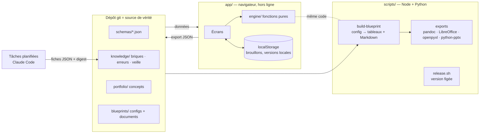
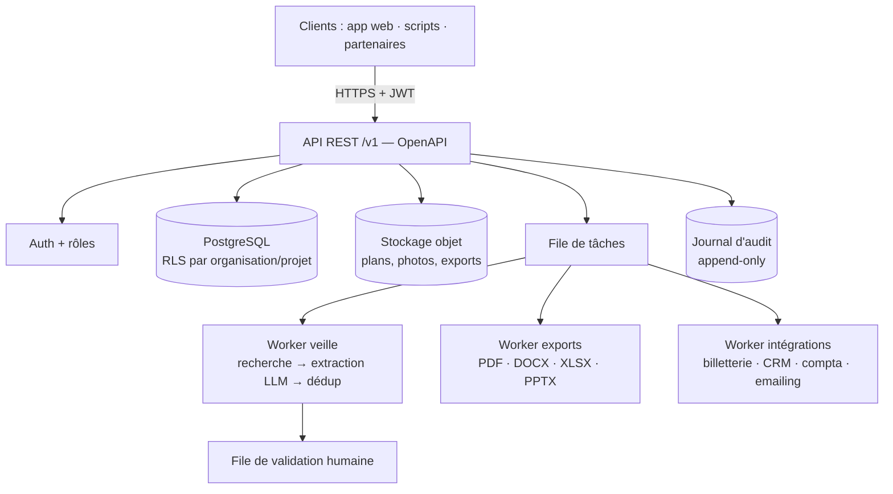
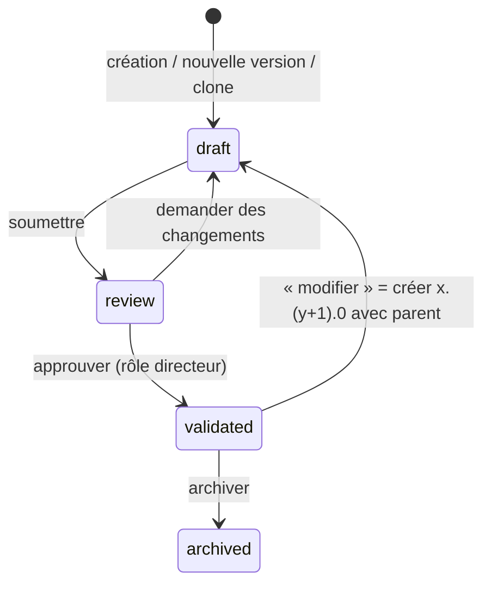

# 02 — Architecture technique

> Principe directeur : **la plus petite architecture qui tient**. Le MVP n'a pas de serveur ; il valide le modèle de données, les algorithmes et la méthode blueprint sur de vrais projets. La V1 n'introduit un backend qu'une fois la valeur prouvée sur le marché (voir `09-roadmap.md`).

## 1. Vue d'ensemble par phase

| Couche | MVP (v0.x) | V1 | V2 |
|---|---|---|---|
| Interface | SPA statique, JavaScript natif (modules ES), sans framework ni build | Même base, enrichie ; framework léger si la complexité l'exige | Configurateur 3D (WebGL), collaboration temps réel |
| Logique métier | `app/engine/` : fonctions pures (notation, génération, simulations, rendu blueprint), partagées navigateur + Node | Identique, exécutée aussi côté serveur (API) | Recalibrage statistique, modèles prédictifs |
| Données | Fichiers JSON versionnés dans git + `localStorage` (brouillons) + import/export JSON | PostgreSQL (configurations en JSONB + tables relationnelles), stockage objet pour fichiers | Multi-organisation, entrepôt analytique |
| Identité et droits | Aucun (mono-utilisateur, local) | Authentification + rôles + Row Level Security | SSO organisations, rôles par projet |
| Veille | Tâches planifiées Claude Code → fiches JSON commitées → validation humaine | Pipeline programmé (recherche → extraction structurée par LLM → déduplication → file de validation) | Sources supplémentaires, alertes ciblées |
| Exports | Navigateur : JSON, Markdown. Dépôt : scripts pandoc / LibreOffice / openpyxl / python-pptx → PDF, DOCX, XLSX, PPTX | Service d'export côté serveur | Modèles personnalisés par licencié |
| Intégrations | Aucune (import/export de fichiers) | Billetterie, CRM, compta, emailing, réseaux sociaux (API) | Webhooks bidirectionnels, place de marché |
| Hébergement | Fichiers statiques (GitHub Pages / Cloudflare Pages / page Artifact) | Backend managé en région UE | Idem + CDN, redondance |

## 2. Architecture MVP

### 2.1 Modules du moteur (`baskest-lab/src/core/eventlab/`)

> **v0.3 (fusion, voir `11-fusion-et-application.md`)** : le moteur JavaScript `app/engine/` est retiré ; il est porté à l'identique en **TypeScript** dans le cœur de l'application (`baskest-lab/src/core/eventlab/`). L'application React (`baskest-lab/`) et les scripts d'EVENT LAB (`scripts/build-blueprint.ts`, `scripts/validate.ts`, exécutés avec `tsx` depuis `baskest-lab/`) importent ce même module : il n'existe plus qu'une implémentation. Les sections 1 et 2 ci-dessus décrivent l'architecture MVP d'origine (SPA sans build) ; l'interface v0.3 est l'application React/Vite de `baskest-lab/`.

| Module | Rôle | Référence |
|---|---|---|
| `types.ts` | Types dérivés des schémas (`EventConfig`, `Evaluation`, `BuildingBlock`, `WatchEntry`, `ErrorEntry`, `Venue`…) | 03, `schemas/` |
| `scoring.ts` | Score /100, grade, confiance, portes, recommandations | 07 §1 |
| `generator.ts` | Filtrage des briques, squelettes par direction, tirage reproductible, diversité | 07 §2–3 |
| `competition.ts` | Durée des étapes de compétition | 07 §4 |
| `flows.ts` | Files d'attente, occupation, densités | 07 §5 |
| `staffing.ts` | Besoins en personnel, chemin critique du montage | 07 §6 |
| `finance.ts` | Scénarios, seuil, trésorerie, sensibilité | 07 §7 |
| `incidents.ts` | Transformations d'incident et ré-simulation | 07 §8 |
| `variants.ts` | Application des variantes (économique, premium, secours…) | 03 |
| `versioning.ts` | Création de version, clonage, adaptation, diff, immutabilité | §5 ci-dessous |
| `blueprint.ts` | Rendu Markdown des sections générées, assemblage de `BLUEPRINT.md`, analyses structurées (flux, trésorerie par jour, incidents types) réutilisées par l'application | 08 |
| `validate.ts` | Contrôle minimal des objets contre les schémas (champs requis, énumérations) | 03 |
| `index.ts` | Point d'entrée unique (réexporte les modules) | — |

Toutes les fonctions sont **pures** (entrée → sortie, sans effet de bord), donc testables (Vitest : `cd baskest-lab && npx vitest run`) et utilisables à l'identique par les scripts de génération documentaire. C'est ce qui garantit que les chiffres d'un blueprint et ceux de l'application sont les mêmes.

### 2.2 Persistance MVP
- **Dépôt git** : seule source de vérité partagée. Une version validée = un fichier JSON nommé `<id>@<version>.json` (ou `event.json` dans un dossier de blueprint versionné) + entrée dans `history[]`.
- **localStorage** : brouillons et versions locales de l'utilisateur, toujours exportables. Lecture/écriture encapsulées (`try/catch`) : l'application fonctionne même si le stockage est indisponible.
- **Sauvegarde** : git (historique complet) + archives zip figées à chaque version du projet (`archives/`).

### 2.3 Ce qui est volontairement absent du MVP
Comptes, collaboration simultanée, notifications, intégrations tierces, analyse automatique de plans PDF ou de photos, 3D. Ces fonctions supposent un backend et des coûts récurrents qui ne se justifient qu'après validation par le marché.

## 3. Architecture V1 (API-first)

### 3.1 Choix recommandé
Backend managé de type **Supabase** (PostgreSQL, authentification, Row Level Security, stockage, fonctions planifiées) en région UE : un seul fournisseur, pas d'infrastructure à opérer, sortie possible (Postgres standard). Alternative si contrainte de souveraineté ou de coût : PostgreSQL managé + API Node (Fastify) sur un hébergeur européen. Les tarifs comparés sont dans `10-couts.md`.

### 3.2 Ressources de l'API (extrait)

| Ressource | Opérations | Notes |
|---|---|---|
| `/events` | list, create | Création = version 0.1.0 `draft` |
| `/events/{id}/versions` | list, create | Nouvelle version depuis une existante (jamais d'écrasement) |
| `/events/{id}/versions/{v}` | get, patch (si `draft`), transition | Transitions : `submit` → review, `approve` → validated, `archive` |
| `/events/{id}/versions/{v}/clone` | post | `relation` : clone / city_adaptation / venue_adaptation |
| `/events/{id}/versions/{v}/simulate` | post | Corps : type de simulation + paramètres ; résultat non persisté par défaut |
| `/events/{id}/versions/{v}/score` | post | Calcul et persistance de `evaluation.computed` |
| `/events/{id}/versions/{v}/exports` | post, get | Formats : pdf, docx, xlsx, pptx, md, json |
| `/venues` | CRUD | Documents attachés (plans, photos) |
| `/watch-entries` | list (filtres), create, merge, validate | Statut : `a_valider` / `publie` / `rejete` |
| `/errors` | CRUD | Liens vers fiches de veille et événements |
| `/blocks` | CRUD | Bibliothèque de briques |
| `/post-event-reviews` | create, get | Déclenche la proposition de nouvelle version |
| `/webhooks` | CRUD | Intégrations sortantes |

Conventions : JSON, pagination par curseur, ETag + `If-Match` pour l'écriture concurrente, erreurs au format RFC 9457 (Problem Details), idempotence par en-tête `Idempotency-Key` sur les POST d'intégration.

### 3.3 Rôles et droits (V1)

| Rôle | Droits principaux |
|---|---|
| Administrateur | Organisation, utilisateurs, intégrations, paramètres de modèle `[param]` |
| Directeur de projet | Crée, soumet, **approuve** les versions de ses projets |
| Contributeur | Crée et modifie des brouillons, lance simulations et exports |
| Analyste veille | Crée, fusionne, valide les fiches de veille et les erreurs |
| Partenaire licencié | Lit les versions validées qui lui sont licenciées, crée des adaptations (city/venue) soumises au studio |
| Lecteur externe | Lecture d'exports partagés (sponsor, collectivité) |

Toute approbation et tout changement de statut sont tracés dans le journal d'audit (qui, quand, quoi, version).

### 3.4 Intégrations prévues (V1, **externe requis**)

| Domaine | Cibles possibles | Usage | À vérifier avant intégration |
|---|---|---|---|
| Billetterie / inscriptions | HelloAsso, Weezevent, Billetweb | Import des ventes et inscriptions réelles → recettes `secured`, effectifs | Existence et conditions de l'API, frais, RGPD |
| CRM / prospection sponsors | HubSpot ou équivalent | Pipeline sponsors → certitude des recettes | Plan gratuit/payant |
| Comptabilité / banque | Logiciel comptable du porteur | Dépenses réelles → bilan post-événement | Format d'export |
| Emailing | Brevo ou équivalent | Parcours avant/après événement | Consentement, désinscription |
| Réseaux sociaux | API des plateformes | Mesure des contenus (KPIs médias) | Conditions des API, quotas |

## 4. Sécurité, conformité, sauvegardes

- **MVP** : aucune donnée personnelle collectée par l'outil ; les fiches de veille ne stockent pas d'identité d'auteurs d'avis. Les configurations ne contiennent que des rôles et des effectifs, pas de listes nominatives.
- **V1** : hébergement UE, chiffrement en transit et au repos, RLS sur toutes les tables, secrets hors dépôt, principe du moindre privilège, journal d'audit append-only, registre des traitements RGPD, durée de conservation par type de donnée, sauvegarde quotidienne avec restauration à un instant donné et test de restauration trimestriel.
- **Validation réglementaire** : l'outil produit des **aides à la décision**. Plans d'implantation, jauges et dispositifs de sécurité sont soumis aux autorités compétentes, à l'exploitant du lieu et aux prestataires agréés. Cet avertissement figure sur chaque export concerné.

## 5. Versionnement des événements

Règles implémentées par `versioning.js` :
1. Une version `validated` est **immuable** ; toute tentative de modification retourne une erreur et propose de créer une nouvelle version.
2. Nouvelle version : `parent = {id, version, relation: "new_version"}`, incrément mineur par défaut, majeur si le format change (règles, structure de compétition).
3. Clonage / adaptation : nouvel `id` (clone) ou même `id` avec suffixe de lieu (adaptation), `parent.relation` renseigné, `venue` remplacé, simulations relancées, notation repassée en `previsionnelle`.
4. Diff entre versions : comparaison champ à champ (chemins JSON) affichée avant approbation.
5. Le bilan post-événement ne modifie jamais la version exécutée : il crée une proposition de version suivante.

## 6. Qualité et tests

- Tests unitaires du moteur (`baskest-lab/tests/eventlab-*.test.ts`, Vitest : `cd baskest-lab && npx vitest run`) sur chaque formule de `07-algorithmes.md`, avec cas chiffrés calculés à la main, et test de non-régression du blueprint LA GRILLE 3x3 (chiffres de `generated/summary.json` et `BLUEPRINT.md` reproduits à l'identique).
- Validation des JSON du dépôt contre les schémas avant chaque version (`cd baskest-lab && npm run eventlab:validate`, script `scripts/validate.ts`).
- Un blueprint n'est versionné que si ses tableaux générés sont reproductibles (régénération à l'identique).

## 7. Statut réel des fonctionnalités

Le statut à jour (Opérationnel / Simulé / Externe requis / Prévu) de chaque fonctionnalité est tenu dans `01-cahier-des-charges.md` et rappelé dans `CHANGELOG.md` à chaque version.
