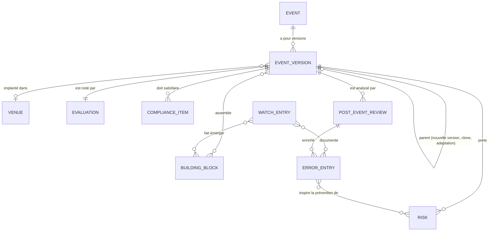

# 03 — Modèle de données

> Les schémas JSON de `schemas/` font foi. Ce document en donne la lecture métier, les relations, les conventions de stockage MVP et le schéma relationnel cible V1.

## 1. Entités

| Entité | Schéma | Rôle |
|---|---|---|
| **EventConfig** | `event-config.schema.json` | Concept ou événement complet, versionné, clonable. Contient format, programme, compétition, ressources, budget, scénarios, risques, conformité, KPIs, médias, gamification, évaluation, sources, historique. |
| **Evaluation** | `evaluation.schema.json` | Notation /100 (10 critères), portes éliminatoires, confiance, verdict. Incluse dans EventConfig. |
| **Venue** | `venue.schema.json` | Lieu réel : espaces positionnés, accès, réseaux, contraintes, documents. Réutilisable par plusieurs événements. |
| **BuildingBlock** | `building-block.schema.json` | Brique fonctionnelle (13 types) avec attributs normalisés pour le générateur. |
| **WatchEntry** | `watch-entry.schema.json` | Fiche de veille sourcée, affirmations qualifiées, fiabilité, dédoublonnage. |
| **ErrorEntry** | `error-entry.schema.json` | Erreur à ne pas reproduire : causes, signes, prévention, plan correctif, points de checklist. |
| PostEventReview | (V1) | Prévu vs réel par KPI, incidents, retours, propositions de recalibrage. |
| Project / Task | (V1) | Gestion de projet adossée au rétroplanning d'une version. |

## 2. Relations



## 3. Lecture métier d'EventConfig

| Bloc | Questions auxquelles il répond | Utilisé par |
|---|---|---|
| `identity` | Quoi, pour qui, pourquoi, inspiré de quoi | Blueprint §2–10 |
| `format` | Comment ça marche, quelles briques | Générateur, blueprint §11–12 |
| `participants`, `audience` | Combien, comment ils arrivent, combien de temps ils restent | Simulateurs flux et finance |
| `venue_requirements`, `venue` | De quel lieu a-t-on besoin, lequel a-t-on | Configurateur, flux, implantation |
| `program` | Quoi se passe quand, où, sous la responsabilité de qui | Conducteur, rétroplanning, incidents |
| `competition` | Combien de matchs/passages, en combien de temps | Simulateur de compétition |
| `resources` | Qui et quel matériel | Personnel, budget, incidents |
| `budget`, `scenarios` | Combien ça coûte et rapporte, avec quelle certitude | Simulateur financier |
| `risks`, `compliance` | Qu'est-ce qui peut mal tourner, qu'est-ce qui est obligatoire | Portes éliminatoires, plans de continuité |
| `kpis` | Comment mesurer le succès, avant/pendant/après | Bilan post-événement |
| `media`, `gamification` | Ce qui se partage, ce qui engage | Blueprint §11–12, §30, §36 |
| `evaluation` | Vaut-il la peine d'être fait | Portefeuille, décision |
| `hypotheses`, `sources` | Sur quoi repose ce qu'on affirme | Toutes les sorties |
| `history` | Qui a décidé quoi, quand | Blueprint §40, audit |

### 3.1 Règles de certitude (transverses)
- Dépenses : `devis` (chiffre d'un fournisseur) > `estimation` (raisonnée) > `hypothese` (ordre de grandeur).
- Recettes : `secured` (signé/encaissé) > `probable` (accord oral, reconduction) > `hypothetical` (à prospecter).
- Affirmations de veille : `fait_verifie` > `estimation` > `hypothese` ; fiabilité des sources A > B > C > D.
L'interface et les exports affichent toujours ces niveaux (voir `08-modeles-documentaires.md`).

### 3.2 Temps
- `program[].start_min` : minutes depuis 00:00 du jour J (ex. 600 = 10:00 ; négatif = veille). `audience.arrival_profile` est relatif à `audience.doors_open_min`.
- `*_offset_days` : jours relatifs à J (négatif = avant).
- Dates absolues au format ISO 8601.

## 4. Conventions de stockage MVP (dépôt git)

```
knowledge/
  building-blocks.json        tableau de BuildingBlock
  registre-erreurs.json       tableau d'ErrorEntry
  veille/AAAA/MM/W-AAAAMMJJ-slug.json   une fiche par fichier
  veille/index.json           index généré (id, nom, date, secteur, fiabilité, statut) — dérivé, jamais édité à la main
  veille/validations.json     décisions humaines de validation (a_valider / publie / rejete / fusionne) — édité par l'humain seulement
  veille/digests/<cadence>/   synthèses Markdown de chaque passage de veille
  veille/sources.json         catalogue de sources
portfolio/concepts/<id>.json  EventConfig maturity=concept
blueprints/<id>/event.json    EventConfig maturity=blueprint (version courante)
blueprints/<id>/versions/<id>@<version>.json   versions figées
venues/<id>.json              Venue (quand un lieu réel est documenté)
```

Règles : encodage UTF-8, indentation 2 espaces, clés en `snake_case`, identifiants en `kebab-case`, montants en euros TTC sauf mention contraire `budget.currency` / note de ligne. **Hypothèse à confirmer par l'expert-comptable de l'organisateur** : le traitement HT/TTC dépend de l'assujettissement à la TVA de la structure organisatrice (une association non assujettie raisonne en TTC).

## 5. Schéma relationnel cible (V1, PostgreSQL)

Approche hybride : les objets métier riches restent en **JSONB validé** (souplesse, alignement avec les schémas), les éléments interrogés ou soumis à droits sont **relationnels**.

```sql
create table organization (
  id uuid primary key default gen_random_uuid(),
  name text not null,
  created_at timestamptz not null default now()
);

create table app_user (
  id uuid primary key,                       -- = identifiant du fournisseur d'authentification
  organization_id uuid not null references organization(id),
  display_name text not null,
  role text not null check (role in ('admin','directeur','contributeur','analyste','licencie','lecteur'))
);

create table venue (
  id uuid primary key default gen_random_uuid(),
  organization_id uuid not null references organization(id),
  data jsonb not null,                       -- Venue (schéma venue.schema.json)
  city text generated always as (data->>'city') stored
);

create table event (
  id text primary key,                       -- slug stable
  organization_id uuid not null references organization(id),
  created_at timestamptz not null default now()
);

create table event_version (
  event_id text not null references event(id),
  version text not null check (version ~ '^[0-9]+\.[0-9]+\.[0-9]+$'),
  status text not null check (status in ('draft','review','validated','archived')),
  maturity text not null check (maturity in ('concept','blueprint','executed')),
  parent_event_id text,
  parent_version text,
  parent_relation text check (parent_relation in ('new_version','clone','city_adaptation','venue_adaptation')),
  venue_id uuid references venue(id),
  config jsonb not null,                     -- EventConfig complet, validé contre le schéma
  score numeric generated always as ((config #>> '{evaluation,computed,score}')::numeric) stored,
  verdict text generated always as (config #>> '{evaluation,computed,verdict}') stored,
  created_by uuid references app_user(id),
  approved_by uuid references app_user(id),
  approved_at timestamptz,
  created_at timestamptz not null default now(),
  primary key (event_id, version),
  foreign key (parent_event_id, parent_version) references event_version(event_id, version)
);

-- Immutabilité : aucune mise à jour du contenu d'une version validée ou archivée
create function forbid_validated_update() returns trigger language plpgsql as $$
begin
  if old.status in ('validated','archived') and new.config is distinct from old.config then
    raise exception 'Version % de % figée : créer une nouvelle version', old.version, old.event_id;
  end if;
  return new;
end $$;
create trigger trg_event_version_immutable before update on event_version
  for each row execute function forbid_validated_update();

create table building_block (
  id text primary key,
  type text not null,
  data jsonb not null
);

create table watch_entry (
  id text primary key,
  dedupe_key text not null,
  status text not null default 'a_valider' check (status in ('a_valider','publie','rejete','fusionne')),
  reliability char(1) not null check (reliability in ('A','B','C','D')),
  sector_family text,
  published_at date,
  data jsonb not null,
  validated_by uuid references app_user(id)
);
create index on watch_entry (dedupe_key);
create index on watch_entry using gin ((data->'tags'));

create table error_entry (
  id text primary key,
  domain text not null,
  severity text not null check (severity in ('mineure','majeure','critique')),
  data jsonb not null
);

create table post_event_review (
  id uuid primary key default gen_random_uuid(),
  event_id text not null,
  version text not null,
  data jsonb not null,                       -- KPIs prévu/réel, incidents, retours, propositions
  proposed_version text,                     -- version draft créée en conséquence
  created_at timestamptz not null default now(),
  foreign key (event_id, version) references event_version(event_id, version)
);

create table audit_log (
  id bigserial primary key,
  at timestamptz not null default now(),
  actor uuid references app_user(id),
  action text not null,                      -- create_version, submit, approve, archive, export, merge_watch...
  target text not null,                      -- ex. 'event_version:la-grille-3x3@1.0.0'
  details jsonb
);
```

Row Level Security (principe) : chaque table porteuse d'`organization_id` (directement ou via `event`) n'est lisible que par les membres de l'organisation ; les licenciés n'accèdent qu'aux versions `validated` qui leur sont attribuées (table de droits `license_grant(event_id, version, organization_id)` à ajouter en V1).

## 6. Exemple minimal valide

```json
{
  "id": "exemple-tournoi",
  "version": "0.1.0",
  "status": "draft",
  "maturity": "concept",
  "parent": null,
  "identity": {
    "name": "Exemple",
    "tagline": "Exemple fictif pour illustrer le schéma",
    "disciplines": ["basketball 3x3"],
    "directions": ["accessible"]
  },
  "format": {
    "summary": "Exemple fictif.",
    "building_blocks": [{ "type": "qualification", "label": "Passages chronométrés" }]
  },
  "evaluation": {
    "type": "previsionnelle",
    "ratings": {
      "originalite": { "rating": 3, "justification": "…" },
      "experience_utilisateur": { "rating": 3, "justification": "…" },
      "faisabilite_technique": { "rating": 4, "justification": "…" },
      "viabilite_economique": { "rating": 2, "justification": "…" },
      "potentiel_mediatique": { "rating": 3, "justification": "…" },
      "reproductibilite": { "rating": 4, "justification": "…" },
      "adaptabilite_lieux": { "rating": 3, "justification": "…" },
      "accessibilite_inclusion": { "rating": 3, "justification": "…" },
      "potentiel_commercial": { "rating": 2, "justification": "…" },
      "responsabilite_environnementale": { "rating": 3, "justification": "…" }
    }
  }
}
```
Score calculé : 12×3/5 + 15×3/5 + 15×4/5 + 15×2/5 + 10×3/5 + 10×4/5 + 8×3/5 + 5×3/5 + 5×2/5 + 5×3/5 = 7,2 + 9 + 12 + 6 + 6 + 8 + 4,8 + 3 + 2 + 3 = **61** (grade C).
