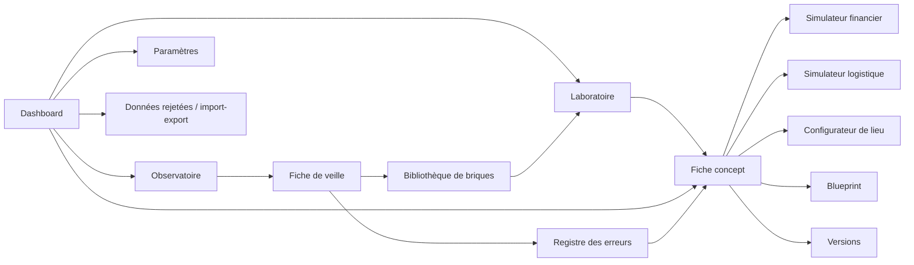

# 04 — Maquettes UX/UI

> Version du document : 0.1 — 2026-11-24 — brouillon soumis au porteur.
> Références : `01-cahier-des-charges.md` (exigences F-xxx et NF-xxx), `05-workflows-utilisateurs.md`, `07-algorithmes.md` (« A§n »), `schemas/`.
> L'application MVP v0.3 implémente ces maquettes. Les simplifications prévues sont listées au §10.
> **Toutes les valeurs des wireframes sont fictives et illustratives** (marquées `[démo]`). Elles ne décrivent aucun événement réel.

---

## 1. Principes de design

1. **Le verdict d'abord.** Le statut des portes éliminatoires (sécurité, conformité, risques critiques) est visible en permanence sur tout écran lié à un concept, **avant** le score, dans l'ordre visuel comme dans l'ordre de lecture des lecteurs d'écran (F-195).
2. **Chaque valeur avoue son niveau de certitude.** Ferme, estimé ou supposé : pictogramme, style de trait et libellé, jamais la couleur seule (F-005, cahier §4.2).
3. **Densité maîtrisée.** Les écrans de travail montrent beaucoup de données en tableaux alignés, chiffres tabulaires. Le détail s'ouvre sur demande (panneau latéral, ligne dépliable), sans défilement horizontal au-dessus de 1 280 px.
4. **Comparer côte à côte.** Directions, scénarios, versions et configurations partagent la même structure de lignes, pour une lecture horizontale.
5. **Aucune fausse promesse.** Les fonctions V1/V2 sont visibles mais désactivées et étiquetées. Les aides au dimensionnement portent leur mention de non-validation (F-010).
6. **Réversible ou explicite.** Toute action irréversible (valider, archiver) passe par une confirmation qui énonce ses conséquences. Une version validée affiche un verrou.
7. **Le texte prime sur l'icône.** Chaque pictogramme a un libellé visible ou un nom accessible.

## 2. Carte de navigation



| Route (hachage) | Écran |
|---|---|
| `#/` | E01 Dashboard |
| `#/veille?onglet=publiees\|inbox&…filtres` | E02 Observatoire |
| `#/veille/<W-id>` | E03 Fiche de veille |
| `#/erreurs`, `#/erreurs/<E-id>` | E04 Registre des erreurs |
| `#/briques`, `#/briques/<B-id>` | E05 Bibliothèque de briques |
| `#/labo/generateur\|combinaison\|transpositions` | E06 Laboratoire |
| `#/concepts` | Liste des concepts (tableau filtrable, variante de E02) |
| `#/concept/<id>/<version>/<onglet>` | E07 Fiche concept |
| `#/concept/<id>/<version>/finances` | E08 Simulateur financier |
| `#/concept/<id>/<version>/logistique/<onglet>` | E09 Simulateur logistique |
| `#/concept/<id>/<version>/lieu/<configuration>` | E10 Configurateur de lieu |
| `#/concept/<id>/<version>/blueprint` | E11 Blueprint |
| `#/concept/<id>/versions` | E12 Versions |
| `#/parametres`, `#/donnees`, `#/aide` | Paramètres, données rejetées et import-export, aide et statuts |

## 3. Inventaire des écrans

| ID | Écran | Module (cahier §5) | Wireframe | Statut v0.3 |
|---|---|---|---|---|
| E01 | Dashboard | 1 | oui | Op. |
| E02 | Observatoire | 2 | oui | Op. (collecte Ext.) |
| E03 | Fiche de veille | 2 | oui | Op. |
| E04 | Registre des erreurs | 4 | oui | Op. |
| E05 | Bibliothèque de briques | 3 | oui | Op. |
| E06 | Laboratoire (générateur, combinaison, transpositions) | 5, 6 | oui | Op. |
| E07 | Fiche concept (8 onglets) | Notation, parcours, médias | oui (Notation) | Op. |
| E08 | Simulateur financier | 10 | oui | Op. |
| E09 | Simulateur logistique | 8 | oui | Op. |
| E10 | Configurateur de lieu | 7 | oui | Op. |
| E11 | Blueprint | 13 | oui | Op. ; exports bureautiques hors navigateur |
| E12 | Versions | Versionnement | oui | Op. |
| E13 | Paramètres `[param]` | Transverse | non (tableau éditable) | Op. |
| E14 | Données rejetées / import-export | Transverse | non (liste et deux boutons) | Op. |
| E15 | Aide et statuts des fonctions | Transverse | non (page de texte) | Op. |

## 4. Gabarit commun et légende

Le gabarit E01 vaut pour tous les écrans : en-tête (version de l'appli, jauge de stockage local NF-007, recherche Ctrl+K, export de l'espace), navigation latérale, zone de contenu. Les écrans E07 à E12 ajoutent le **bandeau concept** fixe : nom, version, statut, maturité, lignée ; verdict et trois portes ; score, grade, confiance, nombre d'hypothèses et de paramètres modifiés.

**Légende des wireframes.**
`[F]` ferme · `[E]` estimé · `[H]` supposé (hypothèse, jugement) · `[P]` paramètre de modélisation · `[=]` calculé · `[OK]` `[A VÉRIF]` `[BLOQ]` statuts de porte · `[!]` alerte · `[Bouton]` · `[valeur v]` liste déroulante · `( )` `(o)` boutons radio · `[ ]` `[x]` cases à cocher.

**États communs à tous les écrans.**
- *Chargement* : squelette gris aux dimensions finales (pas de saut de mise en page), annonce « Chargement… » dans la région `aria-live`.
- *Erreur de chargement* : message indiquant le fichier attendu (`knowledge/watch/index.json`), la cause probable (serveur local non lancé, fichier absent ou invalide) et un lien vers E14.
- *Données rejetées* : compteur dans la navigation. L'écran concerné affiche « n objets écartés (schéma invalide) » avec un lien vers E14.
- *Fonction non disponible* : bouton désactivé, étiquette `Prévu V1`, `Prévu V2` ou `Externe requis`, explication accessible au clavier.

## 5. Écrans

### E01 — Dashboard

```text
+------------------------------------------------------------------------------------+
| EVENT LAB v0.3 (MVP) | Espace local 1,2/5 Mio | [Rechercher  Ctrl+K] [Exporter]    |
+----------------+-------------------------------------------------------------------+
| Dashboard      | Dashboard [données de démo]        Dernier export : il y a 9 j    |
| Observatoire   | +-- Alertes (3) ------------------------------------------------+ |
| Erreurs        | | [BLOQ] concept-b 0.3.0 : risque critique sans plan   [Ouvrir] | |
| Briques        | | [A VÉRIF] relais-quartier 1.3.0 : 2 pts obligatoires [Ouvrir] | |
| Laboratoire    | | [!] Modifications non exportées depuis 9 jours     [Exporter] | |
| Concepts       | +---------------------------------------------------------------+ |
| Lieux          | +-- Veille (Ext.) -----------+ +-- Portefeuille ----------------+ |
| Blueprints     | | À valider (_inbox)      12 | | draft 4  review 1  validated 2 | |
| -------------- | | Publiées               148 | | Éligible 1  Sous réserve 1     | |
| Paramètres     | | Dernière collecte    21/11 | | Éliminé 1                      | |
| Données rej. 2 | | Hebdo active, quotid. off  | | [Laboratoire]  [Concepts]      | |
| Aide & statuts | | [Voir à valider]           | |                                | |
|                | +----------------------------+ +--------------------------------+ |
|                | +-- Couverture de la veille (fiches publiées) ------------------+ |
|                | | sport 61  esport 9  musique_festival 14  spectacle 7  ...     | |
|                | | association 0  independant 12  startup 2  grande_org. 71      | |
|                | +---------------------------------------------------------------+ |
|                | +-- Activité récente -------------------------------------------+ |
|                | | 24/11 relais-quartier 1.3.0 créée (new_version de 1.2.0)      | |
|                | | 23/11 W-20261121-exemple publiée (fiabilité B)                | |
|                | +---------------------------------------------------------------+ |
+----------------+-------------------------------------------------------------------+
```

- **Objectif.** Voir en 10 secondes ce qui bloque, ce qui attend une décision et où en est la veille.
- **Données.** Verdict et portes de chaque version non archivée (`evaluation.computed.verdict`, `gates`). `compliance[]` en `a_verifier` ou `non_conforme`. Compteurs de `_inbox/` et de `watch/`. Plus récente `collected_at`. Répartition par `sector_family` et `organizer_scale`. Derniers `history[]`. Date du dernier export local.
- **Actions.** Ouvrir l'objet d'une alerte. Exporter l'espace. Aller à « À valider ». Ouvrir le Laboratoire.
- **États.** *Vide* (premier lancement) : trois cartes d'amorçage, « Charger les données de démonstration (Simulé) », « Lancer une veille (Externe requis — voir Aide) », « Créer un brief ».
- **Attention UX.** Les alertes sont triées par gravité (`BLOQ` > `A VÉRIF` > `!`), puis par date. Une catégorie à zéro reste affichée (« association 0 ») pour rendre visibles les angles morts de la veille.

### E02 — Observatoire

```text
+-- E02 Observatoire ----------------------------------------------------------------+
| Observatoire                          [PUBLIÉES (148)]  [À valider (12)]           |
|                                                                                    |
| +-- Filtres -------------+ +-- 37 résultats  Tri [Publication v] ----------------+ |
| | Recherche [.........]  | | Événement        Org.    Pays Pub.  Fiab F/E/H Pot  | |
| | Famille   [sport    v] | | --------------------------------------------------  | |
| | Discipl.  [tout     v] | | Exemple 1 [démo] Assoc.  FR   20/10 B    2/1/0 4    | |
| | Pays      [FR       v] | |   Innovation : qualification par tour chronométré   | |
| | Échelle   [tout     v] | | Exemple 2 [démo] Indép.  BE   14/10 C    0/2/1 3    | |
| | Cadence   [tout     v] | |   [!] Doublon potentiel : W-20261002-exemple-2      | |
| | Fiabilité [>= B     v] | | Exemple 3 [démo] Startup FR   02/10 A    3/0/0 5    | |
| | Période   [01-11/26]   | |                                                     | |
| | Potentiel [>= 3     v] | |                                                     | |
| | Tags      [dim:..   v] | |                 [< Préc.]  page 1/4  [Suiv. >]      | |
| | [Réinitialiser]        | |                                                     | |
| +------------------------+ +-----------------------------------------------------+ |
+------------------------------------------------------------------------------------+
```

- **Objectif.** Retrouver, filtrer et comparer les fiches de veille, et repérer les doublons.
- **Données.** `event_name`, `organizer`, `country`, `city`, `discipline`, `sector_family`, `organizer_scale`, `published_at`, `cadence`, `reliability`, `transposition.potential`, `tags`, `main_innovation` (extrait), compteurs de `claims[].status`, alerte de doublon (A§9).
- **Actions.** Filtrer (filtres conservés dans l'URL). Trier. Basculer entre Publiées et À valider. Ouvrir une fiche. Exporter la sélection en JSON.
- **États.** *Vide (publiées)* : « Aucune fiche publiée. La collecte repose sur des tâches planifiées (Externe requis). » avec un lien vers l'Aide. *Vide (filtres)* : « 0 résultat », bouton « Réinitialiser les filtres ». *À valider* : bandeau « Ces fiches ne sont pas validées : ne pas les citer. »
- **Attention UX.** La fiabilité s'affiche en lettre avec un libellé en infobulle (A = source officielle ou primaire…). Le nombre de résultats est annoncé en `aria-live`. Les fiches `_inbox` ont un fond hachuré distinct.

### E03 — Fiche de veille

```text
+-- E03 Fiche de veille -------------------------------------------------------------+
| < Observatoire   W-20261020-exemple-1                 [Exporter JSON] [Exp. MD]    |
| Exemple 1 [démo]   Fiabilité B   Cadence hebdomadaire   PUBLIÉE                    |
| Organisateur Association X   Ville Non renseigné   Pays FR   Discipline 3x3        |
| Événement 2026-10-12   Publication 2026-10-20   Collecte 2026-11-21                |
| +-- Format ----------------------------------------------------------------------+ |
| | Description du format : ...                                                    | |
| | Innovation principale : ...                                                    | |
| | Public cible : Non renseigné        Modèle économique : Non renseigné          | |
| | Résultats observés : Non renseigné                                             | |
| +--------------------------------------------------------------------------------+ |
| +-- Affirmations (3)  F = fait vérifié  E = estimation  H = hypothèse -----------+ |
| | [F] « ... »                                              source [1] (A)        | |
| | [E] « ... »                                              source [2] (B)        | |
| | [H] « ... »                                              aucune source         | |
| +--------------------------------------------------------------------------------+ |
| +-- Forces / faiblesses par dimension -----------+ +-- Transposition ------------+ |
| | + dim:temps_morts   ...                        | | Potentiel 4/5               | |
| | - dim:files_attente ...                        | | Idées : ...                 | |
| | - dim:accessibilite ...                        | | Cibles : basket, futsal     | |
| +------------------------------------------------+ +-----------------------------+ |
| +-- Sources ---------------------------------------------------------------------+ |
| | [1] Titre - Éditeur - officiel - consultée 2026-11-21 - https://...            | |
| | [2] Titre - Éditeur - presse - consultée 2026-11-21 - https://...              | |
| +--------------------------------------------------------------------------------+ |
| Briques extraites B-qualification-tour-chrono [ouvrir]   Erreurs liées E-004       |
| Fusionnée depuis : W-20261018-exemple-1b                                           |
| [Proposer une brique]  [Proposer une erreur]  [Signaler un doublon]                |
+------------------------------------------------------------------------------------+
```

- **Objectif.** Lire une fiche en séparant ce qui est vérifié de ce qui ne l'est pas, et en tirer des briques et des erreurs.
- **Données.** Tous les champs de `watch-entry`. `claims[]` avec `status` et `source_index` → `sources[]` (`title`, `publisher`, `type`, `accessed_at`, `url`). `extracted_blocks`, `error_refs`, `merged_from`, `tags dim:*`.
- **Actions.** Ouvrir une source (nouvel onglet). Créer un brouillon de brique ou d'erreur pré-rempli (F-045, F-053). Signaler un doublon. Exporter en JSON ou Markdown.
- **États.** Champ `null` : « Non renseigné » en gris foncé, jamais vide (F-006). Affirmation sans source : marquée `[H]` « aucune source ».
- **Attention UX.** Les affirmations sont la zone principale : les textes de synthèse (`format_description`) ne portent pas de chiffres non qualifiés (F-025). Une URL n'est cliquable que si elle est en `https`.

### E04 — Registre des erreurs

```text
+-- E04 Registre des erreurs --------------------------------------------------------+
| Registre des erreurs (24)                                   [Nouvelle entrée]      |
| Domaine [tous v]  Gravité [critique v]  Échelle [local v]  Preuve [toutes v]       |
|                                                                                    |
| +-- Liste (4/24) ------------+ +-- E-004 Saturation du contrôle d'entrée --------+ |
| | E-004 files_attente  CRIT. | | Gravité CRITIQUE   Échelle local, régional      | |
| | E-011 billetterie    MAJ.  | | Causes probables (preuve : recoupée presse)     | |
| | E-017 sequencage     MIN.  | |   - ...                                         | |
| | E-021 benevoles      MAJ.  | | Conséquences        - ...                       | |
| |                            | | Signes précurseurs  - ...                       | |
| |                            | | Prévention          - ...                       | |
| |                            | | Plan correctif      - ...                       | |
| |                            | | Checklist (3)  [Injecter dans un concept   v]   | |
| |                            | | Sources [1] Titre - Éditeur (B) - https://...   | |
| |                            | | Événements cités : ...                          | |
| +----------------------------+ +-------------------------------------------------+ |
+------------------------------------------------------------------------------------+
```

- **Objectif.** Consulter les erreurs à ne pas reproduire et les injecter dans les checklists des concepts.
- **Données.** `id`, `title`, `domain`, `severity`, `applies_to_scale`, `description`, `probable_causes` et `cause_status`, `consequences`, `warning_signs`, `preventive_measures`, `corrective_plan`, `checklist_items`, `events[]`, `sources[]` avec fiabilité.
- **Actions.** Filtrer. Ouvrir. Injecter la checklist dans un concept choisi (F-043). Créer une entrée. Exporter en JSON.
- **États.** *Vide* : « Registre vide. Les entrées naissent des fiches de veille (E03) ou des retours post-événement (W6). »
- **Attention UX.** L'intitulé des causes dépend de `cause_status` : « Causes établies (rapport officiel) », « Causes recoupées (presse) » ou « Causes probables ». La gravité s'affiche en texte (CRITIQUE, MAJEURE, MINEURE), avec la couleur en renfort.

### E05 — Bibliothèque de briques

```text
+-- E05 Bibliothèque de briques -----------------------------------------------------+
| Bibliothèque de briques (86)   Type [tous v]  Famille [toutes v]  Palier [<= T1 v] |
| Technologies [aucune, sono v]  Cadre [indifférent v]  Tri [Nouveauté v]            |
|                                                                                    |
| +-- B-qualification-tour-chrono -------+ +-- B-interaction_public-vote-libre ---+  |
| | Qualification - origine : sport      | | Interaction public - orig. tv_media  |  |
| | « Ordre de passage fixé par un tour  | | « Vote gratuit du public sur un      |  |
| |   chronométré individuel »           | |   choix non sportif »                |  |
| | Nouv. 3  UX 3  Coût 1  Média 3 (/5)  | | Nouv. 2  UX 4  Coût 1  Média 4 (/5)  |  |
| | Palier T0 - staff 2 - tech : chrono  | | Palier T0 - staff 1 - tech : app_web |  |
| | Adéquation acc 3 opt 4 exp 2 com 2   | | Adéquation acc 3 com 5 hyb 4         |  |
| | IP : logique seule, ni nom ni visuel | | Incompatible : B-recompenses-...     |  |
| | [Détail]  [+ Laboratoire]            | | [Détail]  [+ Laboratoire]            |  |
| +--------------------------------------+ +--------------------------------------+  |
+------------------------------------------------------------------------------------+
```

- **Objectif.** Explorer les briques réutilisables et en alimenter le Laboratoire.
- **Données.** `id`, `type`, `name`, `mechanic`, `origin.sector_family`, `requirements` (`budget_tier_min`, `staff_min`, `tech`, `setting`, `min_area_m2`), `attributes` (0–5), `direction_fit`, `compatible_with`, `incompatible_with`, `risks`, `ip_note`.
- **Actions.** Filtrer et trier par attribut. Ouvrir le détail. Ajouter à la sélection du Laboratoire. Comparer 2 ou 3 briques (tableau). Créer une brique locale.
- **États.** Brique sans `ip_note` : badge « Note PI manquante — non utilisable par le générateur » (F-051).
- **Attention UX.** Les attributs sont affichés en chiffres (« 3/5 ») et non en jauges seules. Une brique incompatible avec la sélection en cours est signalée sur sa carte.

### E06 — Laboratoire : brief → 6 directions

```text
+-- E06 Laboratoire - générateur ----------------------------------------------------+
| Laboratoire :  [GÉNÉRATEUR]  [Combinaison libre]  [Transpositions]                 |
|                                                                                    |
| +-- Brief (16 entrées, toutes facultatives) -------------------------------------+ |
| | Discipline   [basket 3x3        ]   [ ] Événement sans discipline              | |
| | Objectif     [Fidéliser un public de quartier                      ]           | |
| | Localisation [Ville moyenne, FR ]   Infrastructure [Gymnase existant   v]      | |
| | Budget (EUR) [         ]  -> [H] 10 000 / (20 000) / 30 000  dérivé de H2      | |
| | Participants [ 48 ]   Capacité [ 400 ]   Durée (h) [ 6 ]                       | |
| | Public       [Familles, 15-30 ans   ]   RH (pers. x h) [ 12 ] x [ 8 ]          | |
| | Matériel     [sono, chrono        v]   Partenaires [club, mairie      ]        | |
| | Contraintes  [Fin à 22 h          ]   Objectifs éco. [Équilibre      v]        | |
| | Innovation ν  1  2 (3) 4  5            Ambition média μ  1 (2) 3  4  5         | |
| | Hypothèses posées : 3 [H] (budget, ...)                 [Voir / modifier]      | |
| | Graine [4821] [Aléatoire]                               [Générer 6 directions] | |
| +--------------------------------------------------------------------------------+ |
|                                                                                    |
| Résultats - 6 directions (graine 4821 ; N candidats [P] ; 3 réparés, 1 abandonné)  |
| +-----------+----------+----------+----------+----------+----------+----------+    |
| |           | Access.  | Optimisé | Premium  | Expérim. | Hybride  | Commun.  |    |
| +-----------+----------+----------+----------+----------+----------+----------+    |
| | Règles    | B-reg-a  | B-reg-b  | -        | B-reg-c  | -        | -        |    |
| | Slot 2    | B-mes-a  | B-qua-a  | B-mes-b  | B-mec-a  | B-dig-a  | B-int-a  |    |
| | Slot 3    | B-mon-a  | B-int-b  | B-sce-a  | -        | B-con-a  | B-fid-a  |    |
| | Pré-score | 58 [H]   | 66 [H]   | 61 [H]   | 54 [H]   | 63 [H]   | 64 [H]   |    |
| | Portes    | non éval.| non éval.| non éval.| non éval.| non éval.| non éval.|    |
| | Palier    | T0       | T1       | T1       | T1       | T1       | T0       |    |
| | Besoin RH | 70 % H   | 85 % H   | 104 % H !| 90 % H   | 80 % H   | 75 % H   |    |
| | Durée     | 5h10/6h  | 5h40/6h  | 5h50/6h  | 4h30/6h  | 5h20/6h  | 5h00/6h  |    |
| | Dist. min | 0,56     | 0,61     | 0,52     | 0,70     | 0,58     | 0,56     |    |
| | Alertes   | -        | -        | RH > H   | -        | -        | -        |    |
| +-----------+----------+----------+----------+----------+----------+----------+    |
| |           | [Retenir]| [Retenir]| [Retenir]| [Retenir]| [Retenir]| [Retenir]|    |
| |           | [Régén.] | [Régén.] | [Régén.] | [Régén.] | [Régén.] | [Régén.] |    |
| +-----------+----------+----------+----------+----------+----------+----------+    |
| Une ligne par type de slot ; « - » = slot absent de la direction.                  |
| Dist. min = distance de Jaccard minimale aux autres retenus (exigence >= 0,5)      |
+------------------------------------------------------------------------------------+
```

- **Objectif.** Passer d'un brief, même incomplet, à 6 directions comparables, puis en retenir une ou plusieurs.
- **Données.** Entrées du brief (A§2.1) et hypothèses générées (`hypotheses[]`, basse/médiane/haute). Graine. Pour chaque direction : briques par slot (`format.building_blocks[]`), pré-score `[H]` (A§2.8), palier `T`, besoin en personnel / `H`, durée du programme / durée disponible, distance de Jaccard minimale, alertes de cohérence (A§2.6), nombre de réparations.
- **Actions.** Générer. Changer la graine. Ouvrir et modifier les hypothèses. Retenir une direction (concept `draft 0.1.0`, F-083). Régénérer une direction. Verrouiller une brique (F-080). Ouvrir une brique. Onglets *Combinaison libre* (sélection manuelle, F-057) et *Transpositions* (fiche « logique empruntée → adaptation → non repris », F-055).
- **États.** *En calcul* : bouton désactivé, « Génération… », sans blocage de l'interface (NF-003). *Échec d'une direction* : la colonne affiche le motif (« aucune brique admissible pour le slot Monétisation au palier T0 »). *Diversité insuffisante* : bandeau `[!]` (F-077).
- **Attention UX.** La ligne « Portes » affiche « non évaluées » tant qu'aucun risque n'est saisi : un pré-score n'est jamais présenté comme un verdict. Les hypothèses sont rappelées au-dessus des résultats. Le tableau garde sa première colonne figée en cas de défilement horizontal sous 1 280 px.

### E07 — Fiche concept (onglet Notation)

```text
+-- E07 Fiche concept - onglet Notation ---------------------------------------------+
| +-- Bandeau concept (fixe en haut des écrans E07 à E12) -------------------------+ |
| | Relais de quartier [démo] - v1.3.0 DRAFT - blueprint - parent 1.2.0 [Versions] | |
| | SOUS RÉSERVE   Sécurité [OK]   Conformité [A VÉRIF] 2 pts   Risques crit. [OK] | |
| | Score 71/100 (B) - Confiance 0,38 [H] - Hypothèses 12 - Paramètres modifiés 1  | |
| +--------------------------------------------------------------------------------+ |
| Synthèse | NOTATION | Format & programme | Parcours | Médias & gamification        |
| | Risques & conformité | Hypothèses & sources | Historique                         |
|                                                                                    |
| +-- Verdict (lu avant le score) ---------+ +-- Radar ----------------------------+ |
| | SOUS RÉSERVE                           | | Radar SVG, 10 axes, échelle 0-5     | |
| | Sécurité            [OK]               | | Série : notes actuelles             | |
| | Conformité          [A VÉRIF] 2 pts >  | | Série pointillée : version parent   | |
| | Risques critiques   [OK]               | |                                     | |
| | Score 71/100 (B)    Confiance 0,38 [H] | | [Afficher le tableau]               | |
| | Évaluation : prévisionnelle            | |                                     | |
| +----------------------------------------+ +-------------------------------------+ |
| +-- Grille de notation ----------------------------------------------------------+ |
| | Critère            Poids Note  Pts   Preuve     Justification       Gain       | |
| | Originalité          12  [3,5]  8,4  jugement   « ... » [ancres]     3,6       | |
| | Expérience util.     15  [3  ]  9,0  benchmark  « ... » [ancres]     6,0       | |
| | Faisabilité tech.    15  [4  ] 12,0  jugement   « ... » [ancres]     3,0       | |
| | Viabilité éco.       15  [3  ]  9,0  jugement   « ... » [ancres]     6,0       | |
| | ... 6 autres critères                                                          | |
| | Total                            71  (calculé, jamais saisi)                   | |
| +--------------------------------------------------------------------------------+ |
| +-- Améliorations prioritaires --------------------------------------------------+ |
| | 1. Expérience utilisateur  +6,0  -> réduire les temps morts sous 10 %          | |
| | 2. Viabilité économique    +6,0  -> sécuriser 40 % des recettes avant J-30     | |
| | 3. Originalité             +3,6  -> ...                                        | |
| | Score atteignable si chaque note gagne +1 (plafond 5) : 89 (A)                 | |
| +--------------------------------------------------------------------------------+ |
+------------------------------------------------------------------------------------+
```

- **Objectif.** Noter le concept critère par critère, avec justification et ancre, et voir ce qui l'élimine ou le limite.
- **Données.** `evaluation.type`, `ratings.<critère>` (`rating`, `justification`, `evidence`, `improvements`), poids (A§1.1), `computed` (score, grade, confiance, verdict), `gates.*` (`status`, `notes`), gains `g_i` et score atteignable (A§1.6). Autres onglets : `identity`, `format`, `program`, parcours, `media`, `gamification`, `risks`, `compliance`, `hypotheses`, `sources`, `history`.
- **Actions.** Saisir une note (pas de 0,5, flèches haut/bas). Ouvrir les ancres 1/3/5 du critère (A§1.3). Saisir la justification. Choisir le niveau de preuve. Ouvrir le point de conformité qui fait passer une porte en `A VÉRIF`. Afficher le radar en tableau.
- **États.** Note sans justification : contour d'alerte et message « Justification requise avant revue » (F-191). Version validée : champs en lecture seule, verrou, bouton « Créer une nouvelle version ». *Éliminé* : bandeau rouge « ÉLIMINÉ — porte Sécurité », score grisé après la mention.
- **Attention UX.** Le total est rendu en texte non éditable, avec « calculé, jamais saisi ». Le radar compare à la version parente en pointillés. Les deux séries ont un libellé, et le tableau équivalent est à un clic.

### E08 — Simulateur financier

```text
+-- E08 Simulateur financier --------------------------------------------------------+
| +-- Bandeau concept (fixe en haut des écrans E07 à E12) -------------------------+ |
| | Relais de quartier [démo] - v1.3.0 DRAFT - blueprint - parent 1.2.0 [Versions] | |
| | SOUS RÉSERVE   Sécurité [OK]   Conformité [A VÉRIF] 2 pts   Risques crit. [OK] | |
| | Score 71/100 (B) - Confiance 0,38 [H] - Hypothèses 12 - Paramètres modifiés 1  | |
| +--------------------------------------------------------------------------------+ |
| Finances   Scénario mis en avant [Central v]   [P] Réalisations, dérives, 10 %     |
|                                                                                    |
| +-- Synthèse par scénario -------------------------------------------------------+ |
| |                           Prudent        Central       Ambitieux               | |
| | Spectateurs [H]               250            400             550               | |
| | Recettes totales [=]      9 800 €       14 300 €        18 900 €               | |
| | Dépenses + cont. [=]     17 200 €       16 100 €        15 600 €               | |
| | Résultat [=]             -7 400 €       -1 800 €        +3 300 €               | |
| | Seuil A* [=]                    -    520 spect.               -                | |
| | Besoin de trésorerie [=]        -   6 200 € (J-21)            -                | |
| +--------------------------------------------------------------------------------+ |
| +-- Recettes du scénario central ------------------------------------------------+ |
| | Sécurisées [F] 4 000 €  |  Probables [E] 6 100 €  |  Hypothétiques [H] 4 200 € | |
| | Ratio sécurisées / dépenses engagées : J-60 0,22 - J-30 0,41 - J 0,63          | |
| +--------------------------------------------------------------------------------+ |
| +-- Trésorerie (central) ------------------+ +-- Tornade (écart de résultat) ----+ |
| | +4 k |                         ...       | | Fréquentation ±20 %  ####|####    | |
| |    0 |---.             ....''            | | Sponsoring ±30 %      ###|###     | |
| | -4 k |    '.        .''                  | | Dépenses ±15 %         ##|##      | |
| | -8 k |      '......'  min -6,2 k à J-21  | | Prix ±10 %              #|#       | |
| |       J-90   J-30   J    J+60            | | Élasticités [Tableau]             | |
| | [Tableau des flux]                       | |                                   | |
| +------------------------------------------+ +-----------------------------------+ |
| [Simuler une réduction de budget]   [Exporter MD]   [Exporter XLSX : script]       |
+------------------------------------------------------------------------------------+
```

- **Objectif.** Tester la viabilité sous trois scénarios, connaître le seuil, le besoin de trésorerie et les leviers qui pèsent le plus.
- **Données.** `budget.expenses[]` et `revenues[]` (base, certitude, `pay_offset_days`, `cash_offset_days`), `scenarios.*` (réalisation, dérive), `contingency_rate`, `audience.attendance`, `paying_share`, `participants.count`. Sorties A§7 : résultat par scénario, `A*`, courbe de solde et minimum, tornade et élasticités, colonnes sécurisées, probables et hypothétiques.
- **Actions.** Choisir le scénario mis en avant. Ouvrir les lignes de budget (tableau éditable). Modifier un paramètre (renvoi vers E13, F-007). Simuler une réduction de budget (incident A§8). Afficher les graphiques en tableaux. Exporter en Markdown (navigateur) ou en XLSX (script).
- **États.** *Budget vide* : « Ajoutez au moins une dépense et une recette » avec un modèle de lignes types (catégories seules, sans montants). `m ≤ 0` : la cellule du seuil affiche « Pas de seuil : chaque spectateur supplémentaire coûte ».
- **Attention UX.** Les trois colonnes de scénarios sont toujours visibles, sans onglets. Une valeur calculée à partir d'hypothèses porte `[=]` et le détail « dépend de n hypothèses ». Les montants sont alignés à droite, en chiffres tabulaires. Le signe négatif est un vrai signe moins, pas seulement une couleur.

### E09 — Simulateur logistique

```text
+-- E09 Simulateur logistique -------------------------------------------------------+
| +-- Bandeau concept (fixe en haut des écrans E07 à E12) -------------------------+ |
| | Relais de quartier [démo] - v1.3.0 DRAFT - blueprint - parent 1.2.0 [Versions] | |
| | SOUS RÉSERVE   Sécurité [OK]   Conformité [A VÉRIF] 2 pts   Risques crit. [OK] | |
| | Score 71/100 (B) - Confiance 0,38 [H] - Hypothèses 12 - Paramètres modifiés 1  | |
| +--------------------------------------------------------------------------------+ |
| [COMPÉTITION] [Files] [Occupation] [Personnel & montage] [Incidents]               |
| Aide au dimensionnement - ne vaut pas validation réglementaire ou technique        |
|                                                                                    |
| +-- Onglet Compétition ----------------------------------------------------------+ |
| | Étape    Type          n   Grp  d+c   Unités  Créneaux  Durée    Fin           | |
| | Poules   round_robin   16  4    10+2  2       12        166 min  16:46         | |
| | Finale   single_elim.  8   -    10+2  2       4         56 min   17:42         | |
| | Occupation terrains : poules 100 % - finale 88 %   Marge 0,15 [P]              | |
| | Attente moyenne d'une équipe entre deux matchs : 36 min [=]                    | |
| +--------------------------------------------------------------------------------+ |
| +-- Onglet Files ----------------------------------------------------------------+ |
| | Effectif central 400 [H]   Arrivées 0-30 min 50 %, 30-120 min 50 % [H]         | |
| | Contrôle [billet + sac v]  μ = 3 pers/min/file [P]   Cible <= 10 min [P]       | |
| | 1 file  -> attente max 36,7 min [!]                                            | |
| | 2 files -> attente max  3,3 min  = minimum recommandé [=]                      | |
| +--------------------------------------------------------------------------------+ |
| +-- Onglet Occupation -----------------------------------------------------------+ |
| | P(t) max 372 à 15:10 - effectif autorisé 800 [déclaré]                         | |
| | Zone debout buvette : 2,4 p/m² à 16:50 [ORANGE] (répartition [H])              | |
| | Dimensionnement, pas sécurité de foule : ne remplace ni le chargé de           | |
| | sécurité ni la réglementation ERP/préfectorale.                                | |
| +--------------------------------------------------------------------------------+ |
| +-- Onglet Incidents ------------------------------------------------------------+ |
| | ( ) Retard [+30] min        ( ) Désistement [-4]      ( ) Prestataire [sono v] | |
| | ( ) Panne informatique      (o) Défaillance élec.     ( ) Météo défavorable    | |
| | ( ) Affluence [+20] %       ( ) Budget [-15] %              [Appliquer]        | |
| | Indicateur        Base         Incident      Écart                             | |
| | Durée programme   5 h 10       5 h 40        +30 min                           | |
| | Chronométrage     numérique    manuel        mode dégradé                      | |
| | Résultat central  -1 800 €     -2 300 €      -500 €                            | |
| | Continuité : R-07 « Groupe de secours loué » [voir]                            | |
| | [!] R-11 (non critique) sans plan de continuité -> [Rédiger]                   | |
| +--------------------------------------------------------------------------------+ |
+------------------------------------------------------------------------------------+
```

- **Objectif.** Dimensionner la compétition, les files, l'occupation, le personnel et le montage, puis éprouver le plan face aux 8 incidents.
- **Données.** `competition.stages[]`, `program[]` (`kind`, `start_min`, `duration_min`, `depends_on`, `critical`), `audience.arrival_profile`, `avg_dwell_min`, `venue.erp.effectif_autorise`, `resources.staff[]` et `equipment[]` (`power_w`), `risks[].continuity_plan`, paramètres `[P]` (débits, marge, cible d'attente, ratios).
- **Actions.** Modifier une étape ou un paramètre (recalcul en ≤ 300 ms, NF-002). Choisir le type de contrôle d'entrée. Appliquer un incident et son ampleur. Ouvrir ou rédiger un plan de continuité. *Personnel & montage* : tableau par fonction (la ligne « Sécurité / secours » affiche « Externe requis », F-125) et chemin critique (tâches critiques en gras, marges).
- **États.** Étape `custom` ou `battle_royale` : saisie manuelle des paliers (F-121). Cycle dans `depends_on` : erreur bloquante qui nomme les séquences en cause (F-126).
- **Attention UX.** La mention de non-validation reste visible sans défilement (F-124). L'alerte rouge d'effectif porte le libellé « BLOQUANT » et figure aussi dans le bandeau. La courbe P(t) a son tableau minute par minute, regroupé par pas de 5 min.

### E10 — Configurateur de lieu

```text
+-- E10 Configurateur de lieu -------------------------------------------------------+
| +-- Bandeau concept (fixe en haut des écrans E07 à E12) -------------------------+ |
| | Relais de quartier [démo] - v1.3.0 DRAFT - blueprint - parent 1.2.0 [Versions] | |
| | SOUS RÉSERVE   Sécurité [OK]   Conformité [A VÉRIF] 2 pts   Risques crit. [OK] | |
| | Score 71/100 (B) - Confiance 0,38 [H] - Hypothèses 12 - Paramètres modifiés 1  | |
| +--------------------------------------------------------------------------------+ |
| Lieu : Gymnase exemple [démo] - intérieur - ERP X cat. 3 [déclaré] - 800 pers.     |
| Configuration : [Économique] [STANDARD] [Premium] [Capacité max] [Secours]         |
|                                                                                    |
| +-- Espaces -------------+ +-- Plan 2D (SVG) ------------------------------------+ |
| | [+ Ajouter un espace]  | | Croquis non à l'échelle (le plan SVG l'est)         | |
| | aire_de_jeu   28x15    | | +-------------------------------------------------+ | |
| |   x[8] y[3] fixe[ ]    | | | ACC.  |     AIRE DE JEU 28 x 15       | TRIB. F | | |
| | tribune       30x6  F  | | | E1 => |                               |         | | |
| | accueil        8x6     | | |-------+-------------------------------+---------| | |
| | restauration  10x6     | | | REST. | ZONE PHOTO ! | VEST. F |SAN. F| P1      | | |
| | zone_photo     6x4  !  | | +---S1-----------------------------------------S2-+ | |
| | vestiaire      8x6  F  | | E = entrée public  S = sortie de secours  P = PMR   | |
| | sanitaire      6x4  F  | | F = fixe  ! = chevauchement ou débord               | |
| |                        | |                                                     | |
| | Accès : E1 S1 S2 P1    | |                                                     | |
| +------------------------+ +-----------------------------------------------------+ |
| +-- Indicateurs - configuration Standard ----------------------------------------+ |
| | Capacité 400 [=] / max 740 [H : personnel compté]   Surface 1 020/1 200 m²     | |
| | Densité zone debout 1,3 p/m² [=]   PMR 2 accès   Sanitaires 8 dont 2 PMR       | |
| | Puissance 9,6 / 12 kW   [!] Chevauchement zone_photo / circulation             | |
| | Aide au dimensionnement - ne vaut pas validation réglementaire ou technique    | |
| +--------------------------------------------------------------------------------+ |
| [Pré-remplir par les règles]  [Dupliquer vers...]  [Exporter SVG]                  |
+------------------------------------------------------------------------------------+
```

- **Objectif.** Décrire le lieu réel et y implanter l'événement selon cinq configurations comparables.
- **Données.** `venue` (`type`, `setting`, `erp.*`, `dimensions`, `spaces[]` avec `x_m`, `y_m`, `width_m`, `length_m`, `fixed`, `access_points[]`, `utilities`, `constraints`, `documents[]`), `venue_requirements`. Par configuration : espaces placés, capacité, surface, densité, puissance, alertes (F-103 à F-106).
- **Actions.** Ajouter, modifier ou supprimer un espace. Déplacer un rectangle à la souris, avec les flèches (pas de 0,5 m, Maj = 5 m) ou par saisie de x et y. Pré-remplir une configuration par les règles (doc 05, W3). Dupliquer une configuration vers une autre. Exporter en SVG (F-108).
- **États.** *Lieu vide* : formulaire d'emprise (largeur × longueur) avant tout plan. `effectif_autorise` absent : « Capacité maximale : Non renseigné — à obtenir de l'exploitant ». Rectangle en chevauchement ou en débord : contour d'alerte, pictogramme et message dans la liste.
- **Attention UX.** Le plan a une alternative complète : la liste des espaces, éditable au clavier. Les éléments `fixed` sont verrouillés (cadenas). L'onglet de configuration actif est rappelé dans le titre des indicateurs. La mention de non-validation figure à l'écran et dans l'export.

### E11 — Blueprint

```text
+-- E11 Blueprint - sommaire et exports ---------------------------------------------+
| +-- Bandeau concept (fixe en haut des écrans E07 à E12) -------------------------+ |
| | Relais de quartier [démo] - v1.3.0 DRAFT - blueprint - parent 1.2.0 [Versions] | |
| | SOUS RÉSERVE   Sécurité [OK]   Conformité [A VÉRIF] 2 pts   Risques crit. [OK] | |
| | Score 71/100 (B) - Confiance 0,38 [H] - Hypothèses 12 - Paramètres modifiés 1  | |
| +--------------------------------------------------------------------------------+ |
| Blueprint - 40 sections   Complétude 27/40   Obligatoires 16/18 (F-215)            |
| Filtre [toutes v]     [Exporter JSON]  [Exporter Markdown]  [Prévisualiser]        |
|                                                                                    |
| +----+----------------------------------+----------+--------------------------+    |
| | N° | Section                          | État     | Source des données       |    |
| +----+----------------------------------+----------+--------------------------+    |
| |  1 | Page de couverture               | Auto     | identity, version        |    |
| |  2 | Résumé exécutif *                | Partiel  | texte rédigé             |    |
| |  6 | Benchmark des événements         | Partiel  | fiches de veille liées   |    |
| | 15 | Identité visuelle                | Prévu V1 | intentions rédigées      |    |
| | 21 | Plans d'implantation *           | Complet  | configurations, SVG      |    |
| | 27 | Conducteur minute par minute *   | Complet  | program[].cues           |    |
| | 28 | Budget prévisionnel *            | Complet  | budget, scenarios        |    |
| | 34 | Plans de continuité *            | Vide     | risks[].continuity_plan  |    |
| | 40 | Historique des versions *        | Auto     | history, parent          |    |
| +----+----------------------------------+----------+--------------------------+    |
| * obligatoire pour valider. Clic sur une ligne : édition de la section.            |
| +-- Exports bureautiques (hors navigateur) --------------------------------------+ |
| | 1. Exporter le JSON dans blueprints/<id>/<version>/                            | |
| | 2. Lancer : scripts/export-blueprint <id> <version> pdf|docx|xlsx|pptx         | |
| |    [Copier la commande]   (pandoc, LibreOffice, openpyxl, python-pptx requis)  | |
| +--------------------------------------------------------------------------------+ |
+------------------------------------------------------------------------------------+
```

- **Objectif.** Piloter la complétude des 40 sections et produire les exports.
- **Données.** État par section (vide, partiel, complet, auto, prévu V1) et source (champs du schéma ou texte rédigé). Liste des sections obligatoires (F-215). Métadonnées d'export (F-218).
- **Actions.** Filtrer par état. Éditer une section. Prévisualiser le Markdown. Exporter en JSON et en Markdown. Copier la commande d'export bureautique.
- **États.** Concept au stade `concept` : bandeau « Créer une version blueprint pour activer les 40 sections » (W3). Section alimentée par une fonction V1 : `Prévu V1` et zone de texte libre pour les intentions.
- **Attention UX.** La commande affichée est exacte et copiable. Le navigateur ne prétend pas produire de PDF. Le nom du script `scripts/export-blueprint` est une proposition à aligner sur le doc 02.

### E12 — Versions

```text
+-- E12 Versions --------------------------------------------------------------------+
| +-- Bandeau concept (fixe en haut des écrans E07 à E12) -------------------------+ |
| | Relais de quartier [démo] - v1.3.0 DRAFT - blueprint - parent 1.2.0 [Versions] | |
| | SOUS RÉSERVE   Sécurité [OK]   Conformité [A VÉRIF] 2 pts   Risques crit. [OK] | |
| | Score 71/100 (B) - Confiance 0,38 [H] - Hypothèses 12 - Paramètres modifiés 1  | |
| +--------------------------------------------------------------------------------+ |
| Versions de relais-quartier   [Nouvelle version] [Cloner] [Adapter v] [Archiver]   |
|                                                                                    |
| +-- Lignée --------------------------+ +-- Diff 1.2.0 -> 1.3.0 ------------------+ |
| | 1.3.0 DRAFT   blueprint  24/11     | | ~ budget.expenses[e-04].amount          | |
| |   ^ new_version de 1.2.0           | |     1 200 -> 1 450 (+20,8 %)            | |
| | 1.2.0 VALIDATED [verrou]  02/11    | | + risks[r-11]                           | |
| |   approuvée : Porteur              | | - format.building_blocks[3] B-mes-a     | |
| |   sha256 3f2a...9c1e  [intègre]    | | ~ evaluation...experience_utilisateur   | |
| | 1.1.0 ARCHIVED                     | |     3 -> 3,5                            | |
| | relais-quartier--nantes 0.1.0      | | Score 69 -> 71 (+2)  Verdict inchangé   | |
| |   DRAFT ^ city_adaptation 1.2.0    | | [Exporter le diff MD]                   | |
| +------------------------------------+ +-----------------------------------------+ |
| +-- Approbation de 1.3.0 --------------------------------------------------------+ |
| | [x] Notes justifiées 10/10        [x] Portes non bloquantes                    | |
| | [x] Hypothèses listées (12)       [x] Sources présentes                        | |
| | [ ] Sections obligatoires F-215 : 16/18 (2 partielle, 34 vide)                 | |
| | Décisions [.............................................................]      | |
| | [Soumettre en revue]   [Valider]  (désactivé : 1 condition non remplie)        | |
| +--------------------------------------------------------------------------------+ |
+------------------------------------------------------------------------------------+
```

- **Objectif.** Voir la lignée, comparer deux versions, approuver, créer une nouvelle version, cloner ou adapter.
- **Données.** Pour chaque version : `version`, `status`, `maturity`, `parent` (`relation`), `history[]` (`author`, `date`, `summary`, `decisions`, `approved_by`), empreinte SHA-256 et résultat du contrôle d'intégrité. Diff par chemin JSON. Checklist d'approbation (F-236).
- **Actions.** Choisir deux versions et voir le diff. Soumettre en revue. Valider (dialogue : « Cette version deviendra immuable. Toute modification ultérieure créera une nouvelle version. » + nom + décisions). Nouvelle version. Cloner. *Adapter* : assistant en 4 étapes (choix de la ville ou du lieu → champs dépendants du lieu → remise à zéro de la conformité et de la notation → récapitulatif, F-234). Archiver. Exporter le diff.
- **États.** Empreinte non conforme : bandeau `[BLOQ]` « Version altérée hors de l'application — édition bloquée », version comparable mais non approuvable. Conflit d'import : dialogue qui liste les deux empreintes (F-238).
- **Attention UX.** « Valider » reste désactivé tant qu'une condition manque, et chaque condition manquante est nommée. Une version validée n'offre aucun champ éditable, seulement « Nouvelle version ».

## 6. Design tokens

### 6.1 Couleurs

Contrastes calculés avec la formule de luminance relative de WCAG 2.1, sur le fond indiqué. Exigences : ≥ 4,5:1 pour le texte (1.4.3), ≥ 3:1 pour les composants et les graphiques (1.4.11).

| Jeton | Hex | Usage | Contraste |
|---|---|---|---|
| `--color-bg` | `#FFFFFF` | Fond de page | — |
| `--color-surface` | `#F5F6F8` | Panneaux, en-têtes de tableau | — |
| `--color-surface-2` | `#EEF0F3` | Badges neutres, lignes alternées | — |
| `--color-text` | `#1B2230` | Texte principal | 15,93 (bg) · 14,73 (surface) |
| `--color-text-muted` | `#4B5565` | Texte secondaire, « Non renseigné » | 7,54 (bg) · 6,97 (surface) · 6,60 (surface-2) |
| `--color-border` | `#D0D5DD` | Séparateurs **décoratifs** seulement | 1,47 — jamais pour délimiter un champ |
| `--color-border-strong` | `#6B7280` | Contour des champs et des cartes interactives | 4,83 (bg) |
| `--color-primary` | `#1D4ED8` | Liens, bouton principal, focus | 6,70 (bg) ; texte blanc dessus 6,70 |
| `--color-nav-bg` / `--color-nav-text` | `#1B2230` / `#E5E7EB` | Navigation latérale | 12,87 |
| `--color-nav-muted` | `#AEB6C4` | Séparateurs et libellés secondaires de navigation | 7,81 (nav-bg) |
| `--color-nav-active` | `#2B3445` + texte `#FFFFFF` | Entrée active | 12,50 |
| `--color-ok` / `-bg` | `#166534` / `#E8F5EC` | Porte OK, éligible | 7,13 (bg) · 6,35 (ok-bg) |
| `--color-warn` / `-bg` | `#8A4B00` / `#FDF0DB` | À vérifier, sous réserve, alerte orange | 6,80 · 6,05 |
| `--color-block` / `-bg` | `#B42318` / `#FDECEA` | Bloquant, éliminé, alerte rouge | 6,57 · 5,75 ; texte blanc dessus 6,57 |
| `--color-info` / `-bg` | `#1E40AF` / `#E8EEFC` | Information | 8,72 (bg) · 7,50 (info-bg) |
| `--color-firm` / `-bg` | `#0E6672` / `#E6F3F4` | Niveau **ferme** | 6,64 · 5,85 |
| `--color-estimated` / `-bg` | `#4338CA` / `#ECEBFB` | Niveau **estimé** | 7,90 · 6,71 |
| `--color-assumed` / `-bg` | `#86198F` / `#F8E9F9` | Niveau **supposé** | 8,24 · 7,07 |
| `--chart-prudent` | `#9A3412` | Série prudente (trait tireté) | 7,31 |
| `--chart-central` | `#1D4ED8` | Série centrale (trait plein, 3 px) | 6,70 |
| `--chart-ambitieux` | `#047857` | Série ambitieuse (trait pointillé) | 5,48 |
| `--chart-negative` / `--chart-positive` | `#B42318` / `#047857` | Tornade | 6,57 / 5,48 |
| `--chart-grid` | `#9AA3B2` | Grilles des graphiques, plan (décoratif) | 2,54 — les valeurs sont portées par des libellés en `--color-text-muted` |

Sur les sept fonds teintés (`-bg`), le texte principal atteint au moins 13,54:1 (minimum sur `estimated-bg`) et le texte secondaire au moins 6,40:1. Pas de thème sombre en MVP.

### 6.2 Codes visuels

| Information | Code (cumulatif, jamais la couleur seule) |
|---|---|
| Ferme | Marque à trait **plein**, pictogramme « coche dans un cercle », libellé « Ferme » ou libellé d'origine (Devis, Sécurisée, Fait vérifié) |
| Estimé | Trait **tireté**, pictogramme « environ », libellé « Estimé » ou « Probable » |
| Supposé | Trait **pointillé**, pictogramme « point d'interrogation », libellé « Hypothèse », « Hypothétique » ou « Jugement » |
| Paramètre | Pastille `P` + lien vers E13 ; « modifié localement » si surchargé |
| Calculé | Préfixe « = » + infobulle « dépend de n hypothèses » |
| Portes | Pastille texte `OK` / `À VÉRIFIER` / `BLOQUANT` + pictogramme (coche, triangle, octogone) |
| Verdict | Bandeau texte en capitales : `ÉLIGIBLE`, `SOUS RÉSERVE`, `ÉLIMINÉ` |
| Statut de fonction | Étiquette rectangulaire : `Opérationnel` (fond neutre), `Simulé` (motif rayé), `Externe requis` (pictogramme prise), `Prévu V1/V2` (contour seul) |
| Statut de version | `DRAFT`, `REVIEW`, `VALIDATED` + cadenas, `ARCHIVED` grisé |

### 6.3 Typographie

| Usage | Police | Licence (vérifiée le 2026-11-24) |
|---|---|---|
| Interface, textes, chiffres (`font-variant-numeric: tabular-nums`) | **Inter** | SIL Open Font License 1.1 (`LICENSE.txt` du dépôt rsms/inter). Le README du projet mentionne les chiffres tabulaires |
| Identifiants, JSON, diff, commandes | **IBM Plex Mono** | SIL Open Font License 1.1, nom réservé « Plex » (`LICENSE.txt` du dépôt IBM/plex) |

Conditions retenues : fichiers WOFF2 publiés par les projets, embarqués **sans modification ni sous-ensemble** (une version modifiée ne peut pas porter un nom réservé, clause 3 de l'OFL). Le texte de la licence est livré à côté des fichiers, dans `app/assets/fonts/` (clause 2). Pile de repli : `system-ui, -apple-system, "Segoe UI", sans-serif` et `ui-monospace, monospace`.

| Jeton | Taille / interligne | Usage |
|---|---|---|
| `--font-xs` | 13 px / 1,4 | Métadonnées, étiquettes (jamais pour un texte courant) |
| `--font-sm` | 14 px / 1,45 | Tableaux denses |
| `--font-md` | 16 px / 1,5 | Texte courant, formulaires |
| `--font-lg` | 20 px / 1,3, graisse 600 | Titres de panneau |
| `--font-xl` | 24 px / 1,25, graisse 600 | Titre d'écran |
| `--font-2xl` | 32 px / 1,2, graisse 700 | Chiffre clé (score, résultat) |

### 6.4 Espacement, formes, ruptures, mouvement

- Espacement (base 4 px) : `--space-1` 4 · `-2` 8 · `-3` 12 · `-4` 16 · `-5` 24 · `-6` 32 · `-7` 48 · `-8` 64.
- Rayons : 4 px (champs, boutons), 8 px (cartes, dialogues). Ombre unique pour les dialogues, aucune ailleurs.
- Ruptures : `--bp-sm` 600 px · `--bp-md` 900 px · `--bp-lg` 1 280 px. Navigation latérale de 224 px. Contenu limité à 1 440 px.
- Focus : contour de 2 px `--color-primary`, décalé de 2 px, sur tout élément interactif.
- Mouvement : transitions de 150 ms au plus, supprimées si `prefers-reduced-motion: reduce`.

## 7. Composants

| Composant | Comportement clé | Accessibilité |
|---|---|---|
| `AppShell` | En-tête, navigation, lien d'évitement « Aller au contenu » | Repères `header`, `nav`, `main` |
| `ContextBar` | Bandeau concept fixe, verdict avant score | `role="region"`, nom « Statut du concept » |
| `VerdictBadge`, `GateChip` | Texte + pictogramme + couleur | Le texte suffit sans la couleur |
| `CertaintyTag` | Ferme, estimé, supposé, paramètre, calculé (§6.2) | Nom accessible complet (« valeur supposée ») |
| `FeatureStatus` | Étiquette de statut de fonction | Infobulle accessible au clavier |
| `DataTable` | Tri, filtre, pagination, ligne dépliable, première colonne figée | `th scope`, `caption`, tri annoncé par `aria-sort` |
| `FilterPanel` | Filtres synchronisés avec l'URL | Résultat annoncé par `aria-live` |
| `DirectionMatrix` | 6 colonnes alignées (E06) | Tableau HTML, pas une grille de cartes |
| `RatingInput` | 0 à 5 par pas de 0,5, ancres en popover | `input type="number"` avec `step`, ancres liées par `aria-describedby` |
| `RadarChart`, `TornadoChart`, `LineChart` | SVG statique, tableau équivalent | `role="img"` + `aria-label` résumant la donnée clé |
| `PlanCanvas` | SVG à l'échelle, sélection, déplacement, chevauchements | Synchronisé avec la liste éditable des espaces |
| `DiffView` | Chemin JSON, ancienne et nouvelle valeur, écart | Symboles `+`, `−`, `~` doublés d'un texte |
| `Wizard` | Assistant d'adaptation en 4 étapes | Étape courante annoncée, retour arrière possible |
| `ConfirmDialog` | Validation, archivage | Focus piégé, `Échap` annule, conséquences énoncées |
| `EmptyState`, `ErrorState`, `Skeleton` | États du §4 | Message en texte, jamais une image seule |

## 8. Responsive

| Largeur | Comportement |
|---|---|
| ≥ 1 280 px (cible principale) | Gabarit complet, tableaux sans défilement horizontal, panneaux côte à côte |
| 900–1 279 px | Navigation réduite aux pictogrammes avec libellés en infobulle. Panneaux empilés. `DirectionMatrix` défilable horizontalement, première colonne figée |
| 600–899 px | Navigation en tiroir. Graphiques remplacés par défaut par leurs tableaux |
| < 600 px (lecture) | Une colonne, tableaux transformés en listes de fiches. Plan 2D, simulateurs et notation **en lecture seule**, avec le message « Édition disponible sur ordinateur ». Le bandeau concept se réduit au verdict et au score |

## 9. Accessibilité (cible RGAA 4.1.2 / WCAG 2.1 AA, NF-013 à NF-016)

- `lang="fr"`, titres hiérarchisés (un seul `h1` par écran), titre de page unique par route (« Notation — Relais de quartier 1.3.0 — EVENT LAB »).
- Tous les champs ont une étiquette visible. Les erreurs sont reliées au champ (`aria-describedby`) et résumées en tête de formulaire avec des liens.
- Onglets selon le motif ARIA *tabs* (flèches gauche/droite, `Origine`, `Fin`).
- Plan 2D : chaque rectangle est atteignable au clavier depuis la liste des espaces. Sélectionner un espace dans la liste le met en évidence dans le plan. Le déplacement par flèches est annoncé (« Zone photo déplacée à x 12 m, y 4 m »).
- Graphiques : un tableau équivalent et une phrase de synthèse (« Solde minimal −6 200 € à J-21 »).
- Recalculs annoncés une seule fois par une région `aria-live="polite"`, après temporisation, pour ne pas saturer les lecteurs d'écran.
- Zoom à 200 % et redistribution à 320 px de large en lecture, sans perte d'information.

## 10. Simplifications prévues pour la v0.3

| Élément | v0.3 | Cible ultérieure |
|---|---|---|
| Radar, tornade, courbes | SVG statiques, sans animation ni zoom | Interactions (survol, isolement de série) |
| Plan 2D | Rectangles alignés sur les axes, sans rotation. Circulation : tracés simples (F-107, Could) | Formes libres, import de plan (V1), 3D (V2) |
| Laboratoire | Boutons « Retenir » et « Verrouiller », sans glisser-déposer | Glisser-déposer de briques |
| Diff | Liste par chemin JSON | Vue côte à côte par section |
| Incidents | Un incident à la fois | Combinaisons d'incidents |
| Recherche Ctrl+K | Correspondance de sous-chaîne, sans pondération | Recherche floue |
| Thème | Clair uniquement | Thème sombre (tokens à dériver) |
| Mobile | Lecture seule | Édition légère (V1) |
| File de validation de la veille | Onglet « À valider » en lecture. Publication via git | Boutons publier/rejeter (V1) |

## Sources (consultées le 2026-11-24)

- W3C, *WCAG 2.1* — 1.4.3 *Contrast (Minimum)*, 1.4.11 *Non-text Contrast*, définition de *large scale text* : https://www.w3.org/TR/WCAG21/. Texte vérifié dans le dépôt source `w3c/wcag`.
- DINUM, *RGAA* : https://accessibilite.numerique.gouv.fr/. Version 4.1.2 constatée par recherche web, à reconfirmer avant la recette (voir doc 01, Sources).
- Inter, licence : https://github.com/rsms/inter (`LICENSE.txt`, SIL OFL 1.1). README : mention des chiffres tabulaires.
- IBM Plex, licence : https://github.com/IBM/plex (`LICENSE.txt`, SIL OFL 1.1, nom réservé « Plex »).
