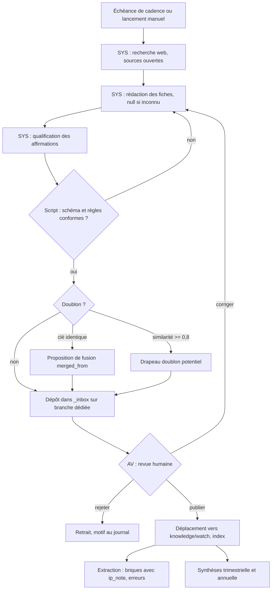
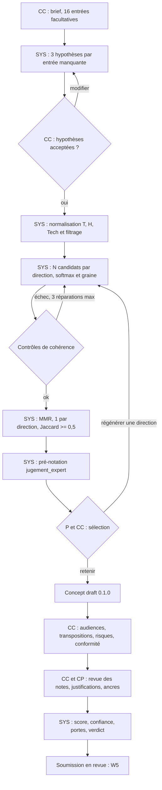
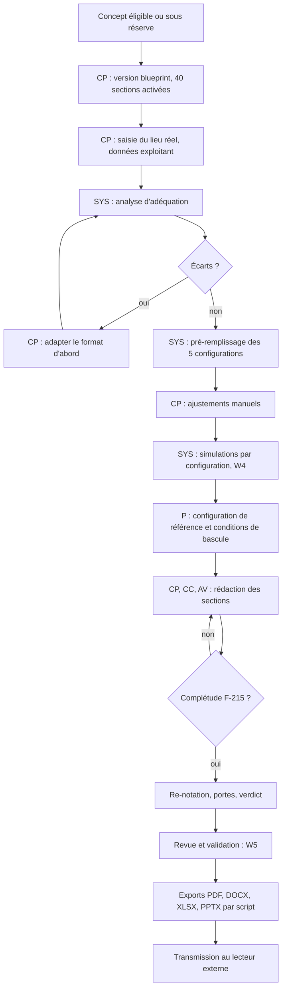
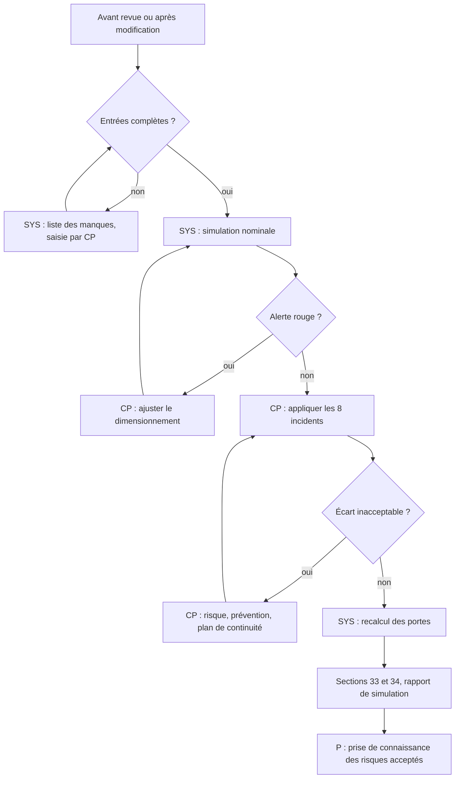
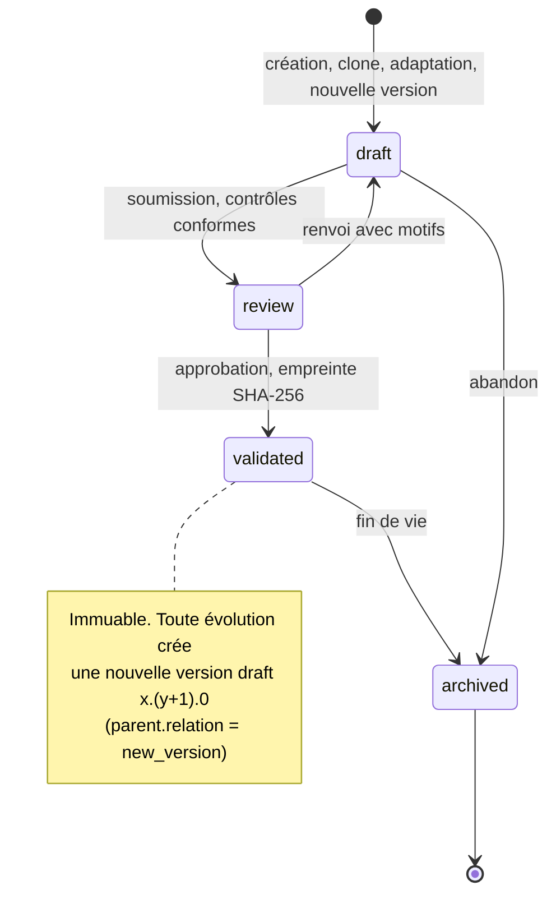
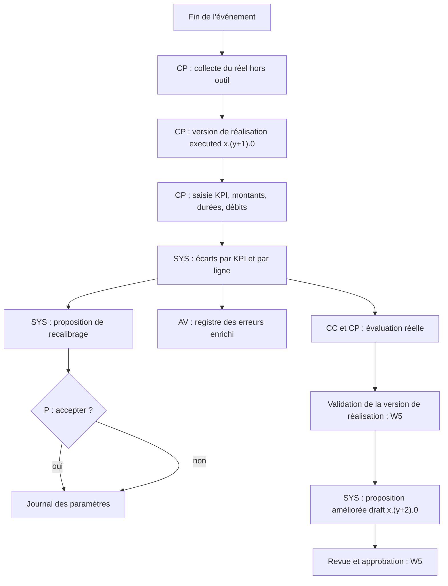
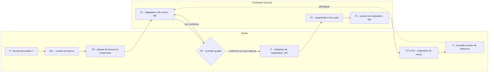

# 05 — Workflows utilisateurs

> Version du document : 0.1 — 2026-11-24 — brouillon soumis au porteur.
> Références : `01-cahier-des-charges.md` (F-xxx, NF-xxx, dépendances D-xx), `04-maquettes-ux-ui.md` (écrans Exx), `07-algorithmes.md` (« A§n »), `schemas/`.

## Conventions

**Acteurs.** P = porteur / directeur de projet · CP = chef de production · AV = analyste veille · CC = contributeur créatif · PL = partenaire licencié · LE = lecteur externe (sponsor, collectivité) · SYS = automate (tâche planifiée Claude Code ou moteur `app/engine/`).
**RACI.** R = réalise · A = approuve et rend compte (un seul par activité) · C = consulté · I = informé. Un automate peut réaliser une activité, jamais l'approuver.
**Statuts.** Op. = Opérationnel · Sim. = Simulé · Ext. = Externe requis · V1 / V2 = Prévu V1 / Prévu V2 (cahier §4.1).
En MVP, P, CP, AV et CC sont une seule personne (cahier §3). La RACI décrit la cible et sert de base aux droits de la V1.

---

## W1 — Veille : de la collecte à l'extraction

- **Acteurs.** SYS (tâche planifiée), AV, CC, P.
- **Déclencheur.** Échéance d'une cadence active (hypothèse MVP : hebdomadaire et mensuelle, F-022) ou lancement manuel (`cadence = manuelle`).

**Étapes.**
1. SYS lit la consigne versionnée de sa cadence (axes du brief §3, familles et échelles prioritaires, en commençant par les catégories à zéro du dashboard) et la liste des `dedupe_key` existantes.
2. SYS recherche et **ouvre** chaque source. N'est citée qu'une source réellement consultée, avec `accessed_at` (F-026).
3. SYS rédige une fiche `watch-entry` par événement : champ inconnu = `null` ; aucune donnée personnelle ; avis publics agrégés et paraphrasés (F-033).
4. SYS qualifie chaque affirmation chiffrée ou factuelle (`claims[]`) : `fait_verifie` seulement avec une source A ou deux sources B indépendantes, sinon `estimation` ou `hypothese` (A§9). En attendant l'arbitrage D-04, la seconde source B est citée en fin de texte de l'affirmation : « (sources 1 et 3) ».
5. SYS exécute le script de validation (schéma complet, règles F-024 à F-026). Une fiche non conforme est corrigée ou abandonnée, jamais déposée en l'état.
6. SYS déduplique (A§9) : à clé identique, il propose une fiche fusionnée (`merged_from`) ; à similarité ≥ 0,8 avec même pays et dates à ±30 j, il pose le drapeau « doublon potentiel ».
7. SYS dépose les fiches dans `knowledge/watch/_inbox/`, régénère l'index et commite sur une branche `veille/<cadence>-<AAAAMMJJ>`, avec un journal d'exécution : fiches créées, sources consultées, abandons et motifs.
8. AV revoit chaque fiche dans E02 (onglet « À valider ») et dans le diff git : ouverture des sources, contrôle de chaque `fait_verifie`, de la fiabilité et de l'absence de données personnelles. Décision : **publier**, **corriger** ou **rejeter**, avec motif.
9. Publication : AV déplace la fiche vers `knowledge/watch/`, régénère l'index et fusionne la branche. Le commit de publication porte le nom de l'analyste.
10. AV et CC extraient les briques (`extracted_blocks` : identifiant existant ou brouillon `building-block` avec `ip_note`) et les erreurs (`error_refs` : brouillon `error-entry` avec `cause_status`), exportées en JSON puis commitées (F-045, F-053).
11. Cadences trimestrielle et annuelle : SYS produit une synthèse Markdown **à partir des seules fiches publiées**, chaque affirmation renvoyant à un identifiant `W-…` (F-031).

**Sorties.** Fiches publiées et index. Brouillons de briques et d'erreurs. Journal d'exécution. Synthèses périodiques.

**Règles de gestion.**
- RG1-1 Aucune fiche n'est publiée sans décision humaine nominative.
- RG1-2 Un champ inconnu reste `null`. Une estimation n'est jamais présentée comme un fait.
- RG1-3 Une URL inaccessible à la revue fait rétrograder l'affirmation (`fait_verifie` → `estimation`), ou rejeter la fiche si elle était la seule source.
- RG1-4 Une fiche rejetée n'est pas conservée (D-18). Son motif reste dans le journal d'exécution.
- RG1-5 Une note `benchmark_source` dans une évaluation doit citer une fiche publiée de fiabilité A ou B.
- RG1-6 Au-delà de 30 fiches non traitées dans `_inbox/` `[param]`, la tâche suivante ne dépose que des fiches de fiabilité A ou B et le signale dans son journal.

**Statut.** Collecte, rédaction, dépôt, synthèses : **Ext.** · Contrôles par script, déduplication, Observatoire : **Op.** · Revue humaine : **Op.** (manuelle, via git) · File de validation intégrée : **V1**.

| Activité | P | CP | AV | CC | PL | LE | SYS |
|---|---|---|---|---|---|---|---|
| Configurer cadences et consignes | A | – | R | C | – | – | – |
| Collecter et rédiger les fiches | I | – | A | – | – | – | R |
| Contrôles automatiques et déduplication | – | – | A | – | – | – | R |
| Revue et publication | I | – | A/R | – | – | – | – |
| Extraction de briques et d'erreurs | A | C | R | R | – | – | – |
| Synthèses périodiques | I | I | A | I | – | – | R |

---

## W2 — Génération : du brief au concept noté

- **Acteurs.** CC, P, CP, SYS (moteur).
- **Déclencheur.** Besoin identifié (commande interne, appel à projets, demande de partenaire) ou exploration du portefeuille.

**Étapes.**
1. CC saisit le brief dans E06 (16 entrées facultatives, F-070).
2. SYS propose 3 hypothèses (basse, médiane, haute) pour chaque entrée absente. CC les accepte ou les modifie, et chaque hypothèse garde sa justification (F-071).
3. SYS normalise (`T`, `H`, `Tech`) et filtre les briques admissibles. Le nombre de briques retenues et les motifs d'exclusion sont consultables (A§2.2–2.3).
4. SYS génère N candidats `[param]` par direction (softmax, graine affichée), applique les contrôles de cohérence et au plus 3 réparations (A§2.5–2.6).
5. SYS retient une proposition par direction par MMR, distance de Jaccard ≥ 0,5, ou affiche « diversité insuffisante » (F-077).
6. SYS pré-note chaque proposition (`jugement_expert`, A§2.8). La ligne « Portes » affiche « non évaluées ».
7. P et CC comparent les 6 colonnes. Ils retiennent une ou plusieurs directions, ou en régénèrent une en verrouillant des briques (F-080).
8. SYS crée un concept `draft 0.1.0` par direction retenue : nom provisoire, `format.building_blocks`, `hypotheses`, brief et graine dans `history[0].decisions` (D-19).
9. CC complète le minimum : `audiences` (motivation par rôle, F-084), inspirations et fiches de transposition (F-055), premiers `risks` (sécurité, santé, météo si cadre extérieur) et points `compliance` connus en `a_verifier`. Les portes deviennent calculables.
10. CC, avec CP en appui sur la faisabilité, revoit chaque pré-note : note, justification, ancre, niveau de preuve. SYS calcule score, grade, confiance, portes, verdict et améliorations (A§1).
11. CC soumet en revue (W5) une fois les contrôles passés.

**Sorties.** Concepts `draft` avec évaluation prévisionnelle, hypothèses explicites, journal de génération (graine, N, réparations, abandons).

**Règles de gestion.**
- RG2-1 Même brief et même graine donnent la même sortie (NF-029).
- RG2-2 Aucun chiffre de marché, aucune source et aucun retour d'expérience ne sont générés. Ces champs restent vides tant que la veille ne les fournit pas (A§2.9).
- RG2-3 Une pré-note n'est jamais affichée comme une note revue. Aucun verdict n'est affiché tant que `risks` et `compliance` sont vides.
- RG2-4 Un concept éliminé peut passer en revue pour discussion, jamais en `validated` (F-236).
- RG2-5 Toute logique empruntée à une organisation existante passe par une fiche de transposition (« non repris » obligatoire). Aucune marque ni identité n'est reprise.

**Statut.** **Op.** (MVP) · Rédaction du nom et du pitch par LLM : **V1**.

| Activité | P | CP | AV | CC | PL | LE | SYS |
|---|---|---|---|---|---|---|---|
| Brief et hypothèses | A | C | – | R | – | – | R (propositions) |
| Génération et pré-notation | I | – | – | A | – | – | R |
| Sélection des directions | A | C | – | R | – | – | – |
| Enrichissement : risques, conformité, audiences | I | C | C | A/R | – | – | – |
| Notation revue | A | C | C | R | – | – | R (calculs) |

---

## W3 — Du concept au blueprint, adapté au lieu réel

- **Acteurs.** CP, P, CC, AV, SYS. LE en destinataire.
- **Déclencheur.** Décision du porteur d'approfondir un concept éligible ou sous réserve.

**Étapes.**
1. CP crée la version blueprint. Depuis une version `validated` : nouvelle version `draft x.(y+1).0`, `maturity = blueprint`. Depuis un `draft` : changement de maturité sur ce draft. Les 40 sections s'activent (E11).
2. CP saisit le **lieu réel** dans E10 : emprise, espaces fixes, accès, ERP déclaré (`effectif_autorise` et `document_ref` fournis par l'exploitant, jamais estimés), équipements, contraintes, chemins des documents.
3. SYS analyse l'adéquation (F-103) et liste les écarts entre besoins et lieu. CP traite chaque écart en **adaptant d'abord le format** (unités parallèles, horaires, emprise) avant d'envisager une location ou un autre lieu.
4. SYS pré-remplit les 5 configurations selon les règles ci-dessous. CP les ajuste à la main (déplacement, ajout, suppression d'espaces).
5. Pour chaque configuration, SYS simule capacité, files, densité, personnel et budget (W4). Le tableau comparatif s'affiche.
6. P retient la configuration de référence (Standard par défaut) et consigne les **conditions de bascule** dans `history.decisions` (exemples : préventes sous le seuil `A*` à une échéance → Économique ; alerte météo → Secours).
7. CP et CC rédigent les sections (programme et conducteur, parcours, communication, sponsoring, manuel de reproduction…). CP injecte les checklists du registre (F-043). AV fournit benchmark et sources (sections 5–7, 39).
8. SYS contrôle la complétude (F-215). Le plan SVG et le Markdown sont exportables.
9. CC re-note `adaptabilite_lieux` et `faisabilite_technique` et revoit les autres critères. SYS recalcule portes et verdict.
10. Revue et validation (W5), puis exports bureautiques par script et transmission du PDF au lecteur externe.

**Règles de pré-remplissage des configurations** (proposition de ce document : A ne les définit pas, dépendance D-02).

| Configuration | Public dimensionné | Espaces | Unités parallèles | Files d'entrée | Particularités |
|---|---|---|---|---|---|
| Économique | `attendance.prudent` | Espaces obligatoires du programme seulement | Minimum compatible avec la durée disponible | Minimum pour la cible d'attente | Dépenses `optional` exclues, matériel `possede` ou `lieu` d'abord |
| Standard | `attendance.central` | Programme complet | Valeur du concept | Dimensionnées sur le central | Configuration de référence |
| Premium | `attendance.central` | Standard + `vip`, `zone_photo`, `activation_sponsor`, scénographie, son et lumière | Valeur du concept | Dimensionnées sur l'ambitieux | Recettes `premium` activées |
| Capacité max | min(`effectif_autorise` − personnel compté, Σ capacités publiques) | Standard, capacités d'espaces au maximum | Maximum que permet la surface | Dimensionnées sur la capacité max | Alerte de densité ; sorties à confirmer avec l'exploitant |
| Secours | `attendance.prudent` | Repli (espaces intérieurs ou emprise réduite), sans équipement dépourvu d'alimentation secourue | Minimum | Minimum | Séquences `critical = false` compressées jusqu'à −30 % (A§8). Obligatoire si le lieu est `exterieur` ou `mixte` |

**Sorties.** Version blueprint (draft puis validated), 5 configurations et leurs plans SVG, tableau comparatif, sections rédigées, exports.

**Règles de gestion.**
- RG3-1 Aucune implantation n'est présentée comme validée : la mention F-010 figure sur l'écran, le SVG et chaque export.
- RG3-2 Une donnée de lieu non fournie reste « Non renseigné ». La capacité maximale n'est jamais calculée sans `effectif_autorise`.
- RG3-3 Sections 15 à 18 (identité visuelle) : intentions rédigées. Studio en V1. Aucune identité existante n'est reprise.
- RG3-4 La validation exige les sections obligatoires de F-215.

**Statut.** **Op.** (saisie en rectangles, plan 2D, configurations, exports JSON, Markdown et SVG) · Exports bureautiques : **Op.** hors navigateur · Import de plans PDF et photos : **V1** · 3D : **V2**.

| Activité | P | CP | AV | CC | PL | LE | SYS |
|---|---|---|---|---|---|---|---|
| Création de la version blueprint | A | R | – | I | – | – | – |
| Saisie et analyse du lieu | I | A/R | – | – | – | – | R (analyse) |
| Configurations et simulations | C | A/R | – | C | – | – | R |
| Choix de la configuration de référence | A/R | C | – | C | – | – | – |
| Rédaction des sections | A | R | C | R | – | – | – |
| Exports et diffusion | A | R | – | – | – | I | R (scripts) |

---

## W4 — Simulation, incidents et plans de continuité

- **Acteurs.** CP, P, SYS.
- **Déclencheur.** Avant chaque passage en revue (obligatoire). Après toute modification du lieu, du programme, de la compétition ou du budget (recommandé).

**Étapes.**
1. SYS vérifie la présence des entrées (`competition.stages`, `program`, `arrival_profile`, `avg_dwell_min`, `staff`, `equipment`, budget) et liste les manques.
2. SYS exécute la simulation nominale : compétition (A§4), files et occupation (A§5), personnel et chemin critique du montage (A§6), finances (A§7). Il affiche résultats et alertes.
3. CP ajuste le dimensionnement (files, unités parallèles, personnel, horaires) jusqu'à supprimer les alertes rouges. Les alertes orange restantes sont justifiées dans `history.decisions`.
4. CP passe les **8 incidents** d'A§8. Ampleurs proposées par défaut `[param]`, à valider par le porteur : retard +30 min, désistement −10 % des participants, absence du prestataire principal, panne informatique, défaillance électrique, météo défavorable, affluence −20 % et +20 %, budget −15 %.
5. Pour chaque écart jugé inacceptable, CP crée ou complète un risque (`risks[]`) : `prevention`, `warning_signs`, `continuity_plan`, `owner_role`, `critical` si l'incident empêche la tenue de l'événement ou met des personnes en danger.
6. SYS recalcule les portes : un risque critique sans `continuity_plan` ou un risque sécurité ou santé (impact 5, probabilité ≥ 3) sans prévention → **bloquant** (A§1.5).
7. SYS produit les sections 33 (matrice des risques) et 34 (plans de continuité), et un rapport de simulation en Markdown qui liste les paramètres utilisés, leur origine et ceux modifiés localement.
8. P prend connaissance des risques acceptés (`status = accepte`) et des plans de continuité.

**Sorties.** Rapport de simulation, `risks` et plans de continuité à jour, sections 33–34, verdict recalculé.

**Règles de gestion.**
- RG4-1 L'outil ne dimensionne jamais la sécurité ni les secours (F-125). Ces besoins figurent comme « Externe requis ».
- RG4-2 Une occupation simulée sous l'effectif autorisé ne vaut pas validation de jauge (F-124).
- RG4-3 Un incident simulé n'est pas une prévision : probabilité et impact sont des jugements saisis par un humain.
- RG4-4 Tout export de simulation porte la liste des `[param]` utilisés.

**Statut.** **Op.** · Avec les données de démonstration : **Sim.**

| Activité | P | CP | AV | CC | PL | LE | SYS |
|---|---|---|---|---|---|---|---|
| Simulation nominale et dimensionnement | I | A/R | – | – | – | – | R |
| Incidents et analyse des écarts | I | A/R | – | C | – | – | R |
| Plans de continuité | A | R | C (registre) | – | – | – | – |
| Recalcul des portes | I | A | – | – | – | – | R |

---

## W5 — Cycle de vie des versions

- **Acteurs.** Auteur de la version (CC ou CP), P (approbateur), SYS, PL (consulté pour ses adaptations).
- **Déclencheur.** Création d'un concept, clonage, adaptation, nouvelle version, soumission, approbation, archivage.

**Étapes.**
1. **Création** d'une version `draft` (concept neuf, clone, adaptation, nouvelle version).
2. **Édition libre** du draft, sans nouvelle version.
3. **Soumission en revue** : SYS contrôle les notes justifiées (F-191), les pré-notes revues (F-078), les motivations par rôle (F-084), les `fairness_note` (F-155). Si tout passe, statut `review`, en lecture seule.
4. **Revue** par P : renvoi en `draft` avec motifs, ou approbation.
5. **Approbation** : checklist F-236. Dialogue qui énonce l'immutabilité, avec nom et décisions. SYS passe la version en `validated`, ajoute l'entrée `history` (`approved_by`, date, décisions) et calcule l'empreinte SHA-256 du JSON canonique (clés triées, empreinte exclue). L'export JSON est proposé pour commit dans `portfolio/` ou `blueprints/`.
6. **Évolution** : toute modification d'une version validée passe par une nouvelle version `draft`, avec `parent.relation = new_version`.
7. **Clonage** : nouvel `id` saisi, `0.1.0`, `parent.relation = clone`. L'évaluation est copiée et marquée « à revoir ».
8. **Adaptation à une autre ville ou un autre lieu** (assistant E12, F-234) :
   a. choix de la cible ; `id` dérivé `<id>--<ville-ou-lieu>` (D-03), `0.1.0`, `parent.relation = city_adaptation` ou `venue_adaptation` ;
   b. saisie du nouveau lieu (W3, étape 2) ;
   c. champs dépendants du lieu marqués « à revoir » : `venue`, `venue_requirements`, `compliance` (tous remis en `a_verifier`, autorités locales à renseigner), lignes budgétaires de lieu, logistique et communication locale (certitude rétrogradée en `hypothese` sauf devis locaux), `audience.attendance` (hypothèses), partenaires et sources locales ;
   d. invariants du format conservés (règles, briques, mécaniques). Toute modification est signalée (D-20) ;
   e. notation repassée en `previsionnelle`, `adaptabilite_lieux` et `viabilite_economique` à re-noter. Verdict au mieux « sous réserve » tant que la conformité est `a_verifier`.
9. **Archivage** d'une version validée (fin de vie) ou d'un draft abandonné.

**Règles de gestion.**
- RG5-1 **Jamais de modification silencieuse d'une version validée.** Aucun champ éditable ; un fichier altéré hors de l'appli est détecté par l'empreinte et bloqué (F-231).
- RG5-2 Numérotation : `0.1.0` pour un concept neuf, un clone ou une adaptation ; `x.(y+1).0` par défaut pour une nouvelle version (A§10) ; `(x+1).0.0` sur choix explicite si la nature du format change (règles de compétition, directions) ; `x.y.(z+1)` pour une correction rédactionnelle. Même une correction d'une coquille crée une nouvelle version.
- RG5-3 Une version « sous réserve » peut être validée si chaque point `a_verifier` porte une échéance (`deadline_offset_days`). Une version « éliminée » ne peut pas l'être.
- RG5-4 Une version `review` n'est pas modifiable : modifier, c'est la renvoyer en `draft`.
- RG5-5 Import : un couple `id` + `version` déjà présent avec une autre empreinte est refusé (F-238).
- RG5-6 MVP mono-utilisateur : l'auteur peut approuver après confirmation explicite. En V1, l'approbateur doit être distinct de l'auteur et avoir le rôle P.

**Statut.** **Op.** · Approbateur distinct, commentaires de revue, notifications : **V1**.

| Activité | P | CP | AV | CC | PL | LE | SYS |
|---|---|---|---|---|---|---|---|
| Créer, éditer un draft | I | R | – | R | – | – | – |
| Soumettre en revue | I | R | – | R | – | – | R (contrôles) |
| Approuver ou renvoyer | A/R | C | C | C | – | – | R (empreinte) |
| Cloner, adapter ville ou lieu | A | R | – | C | C | – | R (assistant) |
| Archiver | A/R | C | – | C | – | – | – |

---

## W6 — Post-événement : du réel à la version suivante

- **Acteurs.** CP, P, AV, SYS. PL pour un événement sous licence.
- **Déclencheur.** Fin de l'événement. Saisie recommandée entre J+1 et J+30 `[param]`.

**Étapes.**
1. CP rassemble le réel hors de l'outil : export de billetterie, comptes, chronométrages, comptages aux entrées, journal des incidents, enquêtes de satisfaction (agrégées, anonymes), retombées médias.
2. CP crée la **version de réalisation** depuis la version validée exécutée : `x.(y+1).0`, `maturity = executed`, `parent.relation = new_version` (F-250). La version d'origine reste intacte.
3. CP saisit le réel :
   - `kpis[].actual` ;
   - montants réels sur chaque ligne budgétaire, avec le même `id` et un `source_ref` vers la pièce. Faute de valeur `reel` dans `certainty` (D-11), la convention provisoire est `devis` plus la mention « réel » dans le libellé ;
   - fréquentation réelle (les trois valeurs de scénario égales au réel) ;
   - durées réelles des séquences ;
   - débits observés, sous forme de KPI.
4. SYS calcule les écarts `(réel − prévu) / prévu` par KPI et par ligne, par appariement des `id` avec la version d'origine, et met en avant les écarts dont la valeur absolue dépasse 20 % `[param]` (A§10).
5. CC et CP produisent l'évaluation `reelle` : `evidence = donnees_reelles` quand la donnée existe. SYS recalcule la confiance.
6. AV traite chaque incident réel : enrichissement d'une entrée existante du registre (événement, signes observés, mesures) ou création d'une entrée `E-NNN`, dont la source est le chemin du rapport interne (D-11, F-254).
7. SYS propose un recalibrage pour chaque `[param]` observable (débit de contrôle, taux de réalisation des sponsors, dérive des coûts, temps de présence). En MVP, la valeur observée d'un seul événement est présentée comme une **observation isolée, non représentative**. P accepte ou refuse, et le journal des paramètres enregistre la décision (F-252).
8. La version de réalisation est revue puis validée (W5). Elle fige les faits.
9. SYS prépare la **proposition améliorée** : nouvelle version `draft x.(y+2).0` (D-21), `maturity = blueprint`, avec pour parent la version de réalisation et la liste des changements proposés dans `history.decisions`. Elle suit W5.

**Sorties.** Version de réalisation validée, évaluation réelle, tableau des écarts, entrées du registre, décisions de recalibrage, proposition de version suivante.

**Règles de gestion.**
- RG6-1 La version validée d'origine n'est jamais modifiée (F-253).
- RG6-2 Aucune donnée personnelle de participants ou de spectateurs n'est saisie. Les enquêtes ne sont saisies qu'agrégées.
- RG6-3 Une valeur réelle sans pièce justificative est saisie en `estimation`.
- RG6-4 Aucun recalibrage n'est automatique. Le recalibrage statistique sur N événements comparables relève de la V2.

**Statut.** **Op.** en MVP minimal (priorité *Could*, cahier §5.1) · Import de la billetterie et de la comptabilité : **V1** (**Ext.**) · Recalibrage statistique et analyse avancée : **V2**.

| Activité | P | CP | AV | CC | PL | LE | SYS |
|---|---|---|---|---|---|---|---|
| Collecte et saisie du réel | I | A/R | – | – | R (si licence) | – | – |
| Calcul des écarts | I | A | – | – | – | – | R |
| Évaluation réelle | A | R | – | R | C | – | R (calculs) |
| Enrichissement du registre | A | C | R | – | C | – | – |
| Décision de recalibrage | A/R | C | C | – | – | – | R (proposition) |
| Proposition de version suivante | A | R | – | C | I | – | R |

---

## W7 — Licence d'un format à un partenaire

- **Acteurs.** P, CP, PL, AV. Conseil juridique (**Ext.**). LE en tant que sponsors ou collectivités du licencié, informés par celui-ci.
- **Déclencheur.** Accord de principe avec un organisateur sur un format dont une version blueprint est `validated`, avec un verdict éligible ou sous réserve.

**Étapes.**
1. P vérifie que le format est licenciable : `reproductibilite` ≥ 3, section 37 (manuel de reproduction) complète, configurations Économique et Secours documentées.
2. P fait établir le contrat de licence (**Ext.**, juridique) : territoire, durée, usage du nom, redevance, obligation de retour d'expérience, propriété des adaptations.
3. CP constitue le **paquet de licence** à partir de la version de référence (identifiant, version, empreinte) :
   - configuration JSON ;
   - exports PDF, DOCX, XLSX et PPTX ;
   - plans SVG des 5 configurations ;
   - checklists ;
   - paramètres `[param]` utilisés ;
   - manuel de reproduction ;
   - liste des **invariants** (règles, briques et mécaniques non modifiables) et des **paramètres adaptables** (D-20 : section 37 rédigée en attendant un champ) ;
   - modèle de retour d'expérience (KPI attendus, format JSON de la version de réalisation) ;
   - règles d'usage du nom (identité visuelle : studio V1).
4. CP transmet le paquet : archive zip avec empreintes SHA-256 en MVP, espace partenaire en V1. PL en accuse réception.
5. PL adapte le format à sa ville et à son lieu selon W5 étape 8. En MVP, il renvoie une configuration adaptée en JSON, produite avec une copie de l'appli statique fournie par le studio ou par le studio lui-même à partir des informations transmises.
6. CP effectue le **contrôle qualité** : import (F-238), diff par rapport à la référence (F-235), puis vérification des invariants intacts, des portes non bloquantes, des points de conformité locaux renseignés (autorités, échéances), de la configuration de secours présente et du score au moins égal au seuil contractuel `[param]`. Verdict QC : **conforme**, **conforme sous réserve** (liste des réserves) ou **non conforme** (motifs).
7. P valide la version adaptée (W5). PL organise l'événement hors de l'outil, sous sa responsabilité réglementaire.
8. PL renvoie sa version de réalisation (W6). CP et AV l'intègrent : écarts, registre des erreurs, décisions de recalibrage.
9. P décide des améliorations du format de référence (nouvelle version, W5). Le diff est diffusé aux licenciés.

**Sorties.** Paquet de licence, rapport de contrôle qualité, adaptation validée, retour d'expérience intégré, version de référence améliorée.

**Règles de gestion.**
- RG7-1 Le paquet ne contient ni fiches `_inbox`, ni autres concepts du portefeuille, ni notes internes sans rapport. Les sources publiques citées sont conservées.
- RG7-2 Une adaptation ne modifie jamais la version de référence : elle en descend (`city_adaptation` ou `venue_adaptation`).
- RG7-3 Un invariant modifié rend le QC **non conforme**, sauf avenant au contrat.
- RG7-4 Le QC du studio ne vaut pas validation réglementaire locale : celle-ci incombe à l'organisateur licencié.
- RG7-5 Les retours d'expérience ne contiennent aucune donnée personnelle de participants.
- RG7-6 Le nom du format n'est utilisé que selon les règles d'usage. Aucune identité tierce n'est reprise.

**Statut.** Paquet (exports, zip, empreintes) : **Op.** · Contrat : **Ext.** · Contrôle qualité par import et diff : **Op.** · Espace partenaire et accès restreint : **V1** · Place de marché de licences : **V2**.

| Activité | P | CP | AV | CC | PL | LE | SYS |
|---|---|---|---|---|---|---|---|
| Éligibilité du format | A/R | C | – | C | – | – | – |
| Contrat de licence | A/R | C | – | – | C | – | – |
| Constitution et transmission du paquet | A | R | – | – | I | – | R (exports) |
| Adaptation locale | I | C | – | – | A/R | – | – |
| Contrôle qualité | A | R | – | – | C | – | R (diff) |
| Organisation de l'événement | I | – | – | – | A/R | I | – |
| Retour d'expérience et amélioration | A | R | R | C | R | – | R (écarts) |

---

## Synthèse des statuts par workflow

| Workflow | Opérationnel (MVP) | Externe requis | Prévu V1 | Prévu V2 |
|---|---|---|---|---|
| W1 Veille | Contrôles, déduplication, Observatoire, revue via git | Collecte et synthèses (tâches planifiées) | File de validation intégrée | — |
| W2 Génération | Tout le flux | — | Rédaction par LLM | — |
| W3 Blueprint | Lieu, plan 2D, 5 configurations, exports | — | Import de plans, studio d'identité | 3D |
| W4 Simulation | Simulateurs et incidents (démo : Simulé) | Sécurité et secours (prestataire, réglementation) | — | — |
| W5 Versions | Cycle complet, empreintes, diff, adaptation | — | Approbateur distinct, commentaires | — |
| W6 Post-événement | Saisie, écarts, registre, recalibrage manuel (Could) | Données de billetterie et de comptabilité | Imports automatiques | Recalibrage statistique, analyse avancée |
| W7 Licence | Paquet, QC par diff | Contrat | Espace partenaire | Place de marché |
