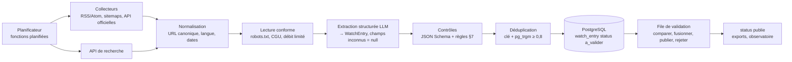

# 06 — Système de veille et d'analyse des réussites et des échecs

> **Rôle du document** : spécifier la veille du MVP (tâches planifiées Claude Code), sa relève en V1 (pipeline + PostgreSQL) et la grille d'analyse des réussites et des échecs. C'est aussi le **contrat lu par chaque tâche planifiée** : toute modification de ce document change le comportement des passages suivants.
> Contrats de données : `schemas/watch-entry.schema.json` (fiche), `schemas/error-entry.schema.json` (erreur). Algorithme de référence : `07-algorithmes.md` §9. Stockage : `03-modele-de-donnees.md` §4.
> Rédigé le 2026-11-24. Les seuils marqués `[param]` sont des hypothèses de travail configurables, pas des normes. Les volumes cibles sont des objectifs de dimensionnement, pas des mesures.
> Statuts (légende du `CHANGELOG.md`) : **Opérationnel** · **Simulé** · **Externe requis** · **Prévu V1** (spécifié ici, non construit).

## Sommaire

1. Objectifs et périmètre
2. Architecture MVP et V1, statut de chaque élément
3. Fichiers et cycle de vie d'une fiche
4. Procédure commune d'un passage
5. Les cinq cadences, leurs expressions cron et leurs prompts
6. Méthode de recherche
7. Qualification : statuts, fiabilité, chiffres clés
8. Déduplication
9. Grille d'analyse des réussites et des échecs
10. Registre des erreurs : quand et comment proposer une entrée
11. Cadre légal et éthique
12. Indicateurs de qualité de la veille
13. Limites connues
14. Coût par passage (estimation raisonnée)
- Annexe A — `veille_tools.py` (outil copié par chaque session)

---

## 1. Objectifs et périmètre

### 1.1 Objectifs

| # | Objectif | Consommateur dans EVENT LAB |
|---|---|---|
| O1 | Repérer lancements, formats, innovations et incidents dans tous les secteurs du brief §3 | Observatoire international, bibliothèque d'inspirations |
| O2 | Décomposer chaque cas en briques fonctionnelles (`extracted_blocks`) | Moteur de transposition (07 §3), `knowledge/building-blocks.json` |
| O3 | Analyser réussites et échecs avec une grille commune de 21 dimensions (§9) | Benchmark et problématiques des EVENT BLUEPRINT (sections 6 à 8) |
| O4 | Alimenter le registre des erreurs (§10) | `knowledge/registre-erreurs.json`, checklists des blueprints |
| O5 | Fournir des repères chiffrés **sourcés et qualifiés** | Simulateurs, recalibrage des `[param]` (07 §10) |
| O6 | Capter les signaux faibles des petits organisateurs | Directions « accessible » et « communautaire » du générateur (07 §2.4) |

La veille ne produit **pas** : statistiques de marché sans source, coûts d'événements tiers non publiés, retours d'expérience reconstitués, avis juridiques.

### 1.2 Périmètre sectoriel

Les familles sont celles de `watch-entry.sector_family`. La priorité fixe la fréquence minimale de couverture (décision de cadrage, ajustable).

| Famille | Disciplines et formats du brief §3 | Priorité |
|---|---|---|
| `sport` | Basket, football, tennis, rugby, handball, volley, F1 et sports mécaniques, boxe et MMA, athlétisme, cyclisme, sports urbains, sports émergents, paralympiques, amateur et professionnel | P1 |
| `esport` | E-sport, grandes compétitions | P1 |
| `musique_festival` | Festivals de musique, concerts | P1 |
| `communautaire` | Événements communautaires, associatifs | P1 |
| `spectacle` | Spectacles, compétitions artistiques | P2 |
| `tv_media` | Jeux télévisés, formats de vote | P2 |
| `parc_loisirs` | Parcs d'attractions | P2 |
| `exposition_immersive` | Expositions immersives | P2 |
| `activation_marque` | Activations marketing, pop-up stores, marques internationales | P2 |
| `jeu` | Jeux vidéo, escape games | P2 |
| `universitaire` | Événements universitaires | P2 |
| `mode_luxe` | Défilés, expériences de luxe | P3 |
| `salon_pro` | Salons professionnels | P3 |
| `cinema` | Cinéma (avant-premières, festivals, projections événementielles) | P3 |
| `tourisme` | Expériences touristiques | P3 |
| `autre` | Hors familles, à requalifier | — |

P1 : couverte à chaque passage quotidien · P2 : au moins une fois par semaine · P3 : au moins une fois par mois. P1 inclut `sport` et `communautaire` parce que le premier blueprint est un format sportif amateur urbain (hypothèse H2).

### 1.3 Périmètre d'échelle

Le brief exige de ne pas limiter la veille aux grandes organisations. Chaque fiche porte `organizer_scale`. Objectif : **au moins 30 % des fiches d'un mois** en `independant`, `association` ou `startup` `[param]`. Ce quota oriente la recherche (§6.3) ; il ne justifie jamais une fiche faible : zéro fiche vaut mieux qu'une fiche de remplissage.

### 1.4 Langues et pays

- Langues minimales par passage hebdomadaire : **français, anglais, espagnol**. Le français est prioritaire (H2 : ville française moyenne).
- Autres langues : opportunistes, via des sources anglophones ou les sites officiels multilingues.
- `country` : code ISO 3166-1 alpha-2 de l'événement. Dans `sources.json`, `INT` désigne une organisation internationale.

### 1.5 Questions de veille par secteur

Chaque passage choisit ses requêtes à partir de ces questions. Une fiche répond à au moins une question.

| Famille | Questions |
|---|---|
| `sport` | Quels formats de compétition (durée, qualification, règles) ont été lancés ou testés ? Quels changements de règles visent le rythme ou la lisibilité pour le public ? Quels formats amateurs ou urbains fonctionnent avec un petit budget (T0–T1, 07 §2.2) ? Quels incidents (billetterie, foule, météo, annulation) et quelles réponses ? |
| `esport` | Quels formats hybrides (salle + diffusion, co-diffusion par créateurs) ? Quelles qualifications ouvertes aux amateurs ? Quelles recettes hors droits (fantasy, créateurs, billetterie) ? Quelles audiences mesurées par un tiers ? |
| `musique_festival` | Comment sont gérés entrées, flux et paiement sans contact ? Quelles annulations et pour quelles causes établies ? Quelles mesures environnementales vérifiables ? Quels formats réduits ou locaux émergent ? |
| `communautaire` | Quels formats associatifs nouveaux (première édition, concept inédit) ? Comment sont recrutés et fidélisés les bénévoles ? Quels financements (appels à projets, financement participatif) ? |
| `spectacle` | Quels rapports scène / public nouveaux (participatif, déambulatoire) ? Quelles durées et quels entractes ? Quels dispositifs de compréhension pour un public non initié ? |
| `tv_media` | Quelles mécaniques de vote et de participation ? Quelle dramaturgie (révélations, éliminations, épisodes) transposable au live ? |
| `parc_loisirs` | Quelles solutions de file d'attente (virtuelle, créneaux) ? Quels événements temporaires et saisonniers ? Quelles technologies d'accès et de paiement ? |
| `exposition_immersive` | Quelles jauges et quels créneaux ? Quelle durée de visite ? Quels modèles itinérants ? Quels retours publics convergents ? |
| `activation_marque` | Quelles activations intégrées à un événement sportif ou culturel apportent une valeur au public ? Comment sont-elles mesurées ? |
| `jeu` | Quelles mécaniques (progression, missions, coopération) sont transposables à un tournoi amateur ? Quels événements de communautés de joueurs ? |
| `universitaire` | Quels challenges inter-écoles, quels formats sport U, quelles intégrations campus ? |
| `mode_luxe` | Quels défilés ouverts au public, quelles expériences premium, quels formats de contenu ? |
| `salon_pro` | Quels formats de rencontre nouveaux ? Comment est mesuré le retour pour l'exposant ? Que disent les baromètres publiés ? |
| `cinema` | Quels formats événementiels (avant-premières, ciné-concerts, plein air) et quelle fréquentation publiée ? |
| `tourisme` | Quels événements fonctionnent comme produit touristique ? Quelles retombées publiées par des institutions ? |

---

## 2. Architecture MVP et V1, statut de chaque élément

### 2.1 MVP : tâches planifiées → fiches JSON → digest → validation

```mermaid
flowchart LR
  CRON[Tâche planifiée Claude Code\ncron CRON_TZ=Europe/Paris] --> S[Session cloud neuve\nenvironnement EVENT LAB]
  S --> G[Clone + branche de travail\nclaude/event-lab-innovation-system-1ft8gk]
  G --> R[Lecture du contrat\nce document, schémas, README,\nsources.json, index.json]
  R --> Q[Recherche web\n+ lecture de pages si l'hôte est autorisé]
  Q --> X[Tri et qualification §6.4 §7]
  X --> D[Déduplication §8\nveille_tools.py check]
  D --> F[Fiches JSON\nknowledge/veille/AAAA/MM/]
  F --> V[Validation schéma\nveille_tools.py validate]
  V --> I[index.json régénéré]
  I --> M[Digest Markdown\nknowledge/veille/digests/]
  M --> P[commit + push]
  P --> H[Validation humaine\nvalidations.json : publie / rejete]
```



Principe : aucune infrastructure à opérer. Le dépôt git est la base de données, l'historique git est le journal d'audit, la validation humaine est la barrière qualité.

### 2.2 Statut des éléments (constaté le 2026-11-24)

| Élément | Statut | Constat et condition |
|---|---|---|
| Déclenchement par tâche planifiée | **Opérationnel — à activer** | L'outil de planification disponible dans les sessions Claude Code accepte une expression cron, un fuseau via le préfixe `CRON_TZ=Europe/Paris` et le mode « nouvelle session à chaque déclenchement ». Intervalle minimal indiqué par l'outil : une heure. **Aucune tâche n'est créée à ce jour.** |
| Recherche web (outil WebSearch) | **Opérationnel** | 73 requêtes réussies dans la session de rédaction. Plafond observé : 200 recherches par tour, partagé entre tous les agents du tour (message de l'outil). |
| Lecture de pages (outil WebFetch) | **Externe requis** | Environnement « EVENT LAB » : réseau `limited`, aucun domaine autorisé. Les 8 hôtes testés ont été refusés (résolution DNS bloquée) : pr.nba.com, www.fiba.basketball, nflcommunications.com, www.ufc.com, www.formula1.com, kingsleague.pro, www.olympics.com, inside.fifa.com. Remède : ajouter des domaines autorisés (§2.3). Sans cela, la veille fonctionne en **mode recherche seule** (§7.4). |
| Clonage du dépôt dans une session déclenchée | **Opérationnel — à confirmer** | L'environnement ne déclare aucun dépôt ; le prompt clone donc le dépôt lui-même. À confirmer au premier passage d'essai. |
| Push sur la branche de travail | **Externe requis — à tester** | Dépend des droits git accordés à la session déclenchée. Test obligatoire : déclencher manuellement chaque tâche une fois avant d'activer son cron. |
| Fiches JSON et validation par JSON Schema | **Opérationnel** | Python 3.13 et `jsonschema` 4.26 présents dans l'environnement de rédaction ; le prompt réinstalle `jsonschema` s'il manque (registres de paquets autorisés). |
| Déduplication (clé, trigrammes, URL) | **Opérationnel** | `veille_tools.py check` et `doublons` (annexe A), testés sur un jeu d'essai. |
| `index.json`, indicateurs | **Opérationnel** | `veille_tools.py index` et `stats`. |
| Digest Markdown | **Opérationnel** | Rédigé par la session selon le gabarit §5.7. |
| Notification de fin de passage | **Opérationnel — option** | L'outil de planification propose une notification push (et courriel sur demande explicite) pour les tâches à session neuve. |
| Validation humaine | **Opérationnel (manuel)** | Édition de `validations.json` et des fiches (procédure dans `knowledge/veille/README.md`). Pas d'interface dédiée. |
| Analyse d'avis publics | **Simulé (manuel, ponctuel)** | Lecture agrégée de pages publiques ; aucune collecte en masse (§11). |
| Réseaux sociaux (TikTok, Instagram, X) | **Externe requis** | Aucun accès programmatique ; signaux captés via la presse uniquement. |
| Base PostgreSQL, file de validation, API `/watch-entries` | **Prévu V1** | §2.4, `02-architecture-technique.md`, `03-modele-de-donnees.md` §5. |
| Collecte par flux RSS / API officielles | **Prévu V1** | §2.4. |
| Alertes ciblées | Hors MVP | Placées en V2 par `02-architecture-technique.md`. |

### 2.3 Domaines à autoriser en priorité (Externe requis)

Pour passer du mode recherche seule à la lecture des sources primaires, l'opérateur ajoute des domaines dans les réglages réseau de l'environnement « EVENT LAB » (menu de l'environnement cloud, *Edit*, *Network access*, *Allowed domains* ; documentation : https://code.claude.com/docs/en/cloud-environments#network-access — lien fourni par la documentation de l'environnement, non ouvert). Les jokers (`*.exemple.com`) ne sont pas acceptés par l'outil de modification : hôtes exacts uniquement.

Proposition de 20 hôtes (sources A et B les plus utiles, tirées de `sources.json`) :

```
about.fiba.basketball   pr.nba.com            www.fia.com            olympics.com
inside.fifa.com         www.uefa.com          www.atptour.com        esportsworldcup.com
www.sports.gouv.fr      www.culture.gouv.fr   cnm.fr                 www.cnc.fr
www.vie-publique.fr     www.unimev.fr         www.francefestivals.com www.france-esports.org
www.ufi.org             news.pollstar.com     www.sportbusiness.com  blooloop.com
```

Alternative : niveau d'accès réseau plus large pour l'environnement, décision du porteur (surface d'exposition plus grande).

### 2.4 V1 : pipeline semi-automatisé (Prévu V1)



- **Base** : table `watch_entry` définie dans `03-modele-de-donnees.md` §5 (statuts `a_valider`, `publie`, `rejete`, `fusionne`). Tables complémentaires proposées, à intégrer au modèle par son responsable : `source` (catalogue), `watch_source` (fiche ↔ URL, `accessed_at`, code HTTP, conformité robots), `watch_claim` (affirmation, statut, source), `watch_run` (cadence, début, fin, requêtes, fiches créées, fusionnées, coût mesuré), `watch_validation` (décideur, date, décision, motif).
- **Déduplication** : extension PostgreSQL `pg_trgm` pour la similarité de trigrammes, même seuil que §8 ; la clé `dedupe_key` reste indexée.
- **File de validation** : vue « à valider » triée par âge, comparaison côte à côte des doublons candidats, requalification des affirmations, journal des décisions (`audit_log`, action `merge_watch`).
- **Collecte conforme** : agent identifié, respect de `robots.txt` et des CGU, débit limité par domaine (1 requête / 5 s `[param]`), journal des accès, aucune donnée personnelle stockée.
- **Migration** : import des fiches `knowledge/veille/**/W-*.json` et de `validations.json` ; les identifiants `W-…` sont conservés.
- **Prérequis juridiques avant activation** : §11.8.

---

## 3. Fichiers et cycle de vie d'une fiche

### 3.1 Arborescence

```
knowledge/veille/
  README.md                                   mode d'emploi opérateur et validateur
  sources.json                                catalogue de sources (édité par l'humain)
  validations.json                            décisions humaines (édité par l'humain uniquement)
  index.json                                  généré à chaque passage (ne pas éditer)
  AAAA/MM/W-AAAAMMJJ-slug.json                fiches (AAAAMMJJ = date de collecte, heure de Paris)
  analyses/AAAA/MM/A-W-AAAAMMJJ-slug.json     analyses selon la grille §9
  propositions-erreurs/E-PROP-W-…-n.json      brouillons ErrorEntry (§10)
  digests/AAAA/<cadence>-<période>.md         un digest par passage
```

Noms des digests : `quotidienne-AAAA-MM-JJ.md`, `hebdomadaire-AAAA-Www.md` (semaine ISO couverte), `mensuelle-AAAA-MM.md` (mois couvert), `trimestrielle-AAAA-Tn.md`, `annuelle-AAAA.md`. Le dossier `AAAA` est l'année de la période couverte.

### 3.2 Nommage d'une fiche

- `id` = `W-AAAAMMJJ-slug`, où `slug` = `slug(event_name)` tronqué à 60 caractères (fonction §8.1). En cas de collision le même jour : suffixe `-2`, `-3`.
- Le fichier porte le nom de l'`id` et se trouve dans le dossier `AAAA/MM` de la date de collecte.
- Une édition différente du même événement est une fiche distincte (l'année fait partie de la clé). Le lien entre éditions passe par le tag `serie:<slug du nom sans année>`.

### 3.3 Statuts et cycle de vie

```
création (tâche) ──► a_valider ──► publie   (validateur)
                          │      └► rejete   (validateur, motif obligatoire, fichier conservé)
                          └► fusionne       (fiche absorbée par une autre, §8.3)
publie ──(enrichissement par un passage ultérieur, tag maj:AAAA-MM-JJ)──► a_valider (revalidation)
```

- Les tâches ne fixent jamais `publie` ni `rejete` : seul `validations.json` porte ces décisions.
- `index.json` est dérivé : fiches + `validations.json`. En cas de conflit git sur `index.json`, on le **régénère**, on ne le fusionne pas à la main.
- Une fiche rejetée reste dans le dépôt pour que la déduplication ne la recrée pas.

### 3.4 Gabarit d'une fiche

Valeurs à remplacer entre chevrons ; tout champ inconnu vaut `null` (ou tableau vide).

```json
{
  "id": "W-<AAAAMMJJ>-<slug>",
  "dedupe_key": "<slug(nom)>|<slug(organisateur) ou inconnu>|<année d'édition>",
  "event_name": "<nom exact tel que publié par la source>",
  "organizer": "<organisateur> | null",
  "country": "<ISO alpha-2> | null",
  "city": "<ville> | null",
  "discipline": "<discipline ou format>",
  "sector_family": "<famille §1.2>",
  "organizer_scale": "grande_organisation | intermediaire | independant | association | startup | inconnu",
  "event_date": "<AAAA-MM-JJ ou AAAA-MM-JJ/AAAA-MM-JJ> | null",
  "published_at": "<date de publication de l'information>",
  "collected_at": "<AAAA-MM-JJThh:mm:ss+01:00>",
  "cadence": "quotidienne | hebdomadaire | mensuelle | trimestrielle | annuelle | manuelle",
  "sources": [
    { "url": "<URL précise>", "title": "<titre de la page>", "publisher": "<éditeur>", "type": "officiel | presse | etude | reseau_social | avis_public | blog | autre", "accessed_at": "<AAAA-MM-JJ>" }
  ],
  "format_description": "<résumé du format avec nos mots, 600 caractères max>",
  "main_innovation": "<l'innovation principale, une à deux phrases>",
  "target_audience": "<public cible publié> | null",
  "business_model": "<modèle économique publié> | null",
  "observed_results": "<résultats publiés, avec leur source> | null",
  "strengths": ["<force> (source 0)"],
  "weaknesses": ["<faiblesse> (source 1)"],
  "transposition": { "potential": 3, "ideas": ["Hypothèse EVENT LAB : <idée>"], "target_disciplines": ["<discipline>"] },
  "reproduction_constraints": ["<contrainte>"],
  "claims": [ { "text": "<affirmation vérifiable>", "status": "fait_verifie | estimation | hypothese", "source_index": 0 } ],
  "reliability": "A | B | C | D",
  "extracted_blocks": ["<id de brique existante ou « proposition : <type>/<nom> »>"],
  "error_refs": [],
  "tags": ["langue:<fr|en|es|…>", "lecture:page | lecture:resultat_recherche", "lancement | incident | signal_faible | resultat"],
  "merged_from": []
}
```

Règles de rédaction :
- `format_description` et `main_innovation` résument avec nos mots ; aucune phrase copiée de la source.
- Au plus **une citation courte par fiche** (25 mots `[param]`), entre guillemets, dans `claims[].text`, avec `source_index`.
- Chaque force et faiblesse cite sa source sous la forme « (source i) ». Sans source, elle n'entre pas dans la fiche.
- `transposition.ideas` sont des hypothèses EVENT LAB et le disent.
- `extracted_blocks` reprend un identifiant de `knowledge/building-blocks.json` s'il existe ; sinon « proposition : type/nom » (types de `building-block.schema.json`).

---

## 4. Procédure commune d'un passage

Les prompts du §5 appliquent cette procédure. Chaque étape échoue de façon visible : la session s'arrête et rend compte plutôt que de produire des fiches dégradées.

| # | Étape | Détail |
|---|---|---|
| 0 | Dépôt | Cloner si nécessaire, se placer sur `claude/event-lab-innovation-system-1ft8gk`, `git pull --ff-only`. |
| 1 | Contrat | Lire ce document (§3 à §10 et annexe A), les deux schémas, `knowledge/veille/README.md`, `sources.json`, `index.json` et le dernier digest de la même cadence. |
| 2 | Outil | Extraire l'annexe A dans `/tmp/veille/veille_tools.py` (hors dépôt) ; vérifier `jsonschema`. |
| 3 | Fenêtre | Fixer la période couverte (§5) à partir des dates, jamais de la mémoire du modèle. |
| 4 | Recherche | Sources du catalogue de la cadence, puis requêtes du §6 ; respecter budget et quotas de langues ; journaliser chaque requête. |
| 5 | Tri | Appliquer les exclusions §6.4 ; journaliser le code d'exclusion. |
| 6 | Doublons | `check` pour chaque candidat ; enrichir la fiche existante si doublon (§8.3). |
| 7 | Rédaction | Gabarit §3.4, qualification §7. |
| 8 | Analyses | Selon la cadence : grille §9, propositions d'erreurs §10. |
| 9 | Contrôles | `validate` (0 erreur exigée), `doublons`, puis `index`. |
| 10 | Digest | Gabarit §5.7. |
| 11 | Git | Vérifier que seul `event-lab/knowledge/veille/` a changé ; commit ; push avec reprise. |
| 12 | Compte rendu | Dernier message de la session : chiffres du passage, échecs, chemin du digest. |

---

## 5. Les cinq cadences, leurs expressions cron et leurs prompts

### 5.1 Synthèse

| Cadence | Objectif (brief §4) | Fenêtre | Fiches nouvelles (cible) | Budget recherches / lectures | Livrable | Cron (Europe/Paris) |
|---|---|---|---|---|---|---|
| Quotidienne | Actualités, lancements, innovations, incidents | Depuis le dernier passage, 72 h max | 3–8 | 40 / 15 | Digest quotidien | `CRON_TZ=Europe/Paris 47 6 * * *` |
| Hebdomadaire | Analyse des formats et tendances émergentes | 7 jours | 8–15 + consolidation | 80 / 25 | Digest + 2 analyses grille | `CRON_TZ=Europe/Paris 13 10 * * 1` |
| Mensuelle | Benchmark stratégique et opportunités | Mois précédent | 5–10 | 100 / 30 | Benchmark thématique + indicateurs | `CRON_TZ=Europe/Paris 37 11 2 * *` |
| Trimestrielle | Évolution du marché et recommandations | Trimestre précédent | 0–5 | 120 / 40 | Rapport marché + recommandations | `CRON_TZ=Europe/Paris 19 13 5 1,4,7,10 *` |
| Annuelle | Bilan mondial des innovations | Année précédente | 0–10 (suivis) | 150 / 50 | Bilan annuel | `CRON_TZ=Europe/Paris 41 9 12 1 *` |

Choix des horaires :
- Minutes non rondes (47, 13, 37, 19, 41) : l'outil de planification signale que les déclenchements à l'heure pile peuvent être retardés.
- Aucun déclenchement entre 15 h et 18 h, heure de Paris : l'outil signale des retards possibles pour les démarrages entre 6 h et 9 h, heure du Pacifique (soit environ 15 h–18 h à Paris).
- Ordre logique : le mensuel tourne le 2 (le mois précédent est complet), le trimestriel le 5 du mois suivant le trimestre, l'annuel le 12 janvier (après le trimestriel de janvier).
- Le préfixe `CRON_TZ=Europe/Paris` gère les changements d'heure.
- Les budgets restent sous le plafond observé de 200 recherches par tour.

Volumes : ce sont des cibles de dimensionnement (hypothèses). Un passage sans fiche est valide s'il est documenté dans le digest.

### 5.2 Créer et tester une tâche

Dans une session Claude Code de l'environnement « EVENT LAB », demander la création d'une tâche planifiée avec ces paramètres (exemple pour la quotidienne) :

```
name: EVENT LAB — veille quotidienne
cron_expression: CRON_TZ=Europe/Paris 47 6 * * *
create_new_session_on_fire: true      (une session neuve à chaque passage)
notifications: {"push": true}
prompt: <prompt du §5.3, copié intégralement>
```

Puis, **avant de laisser le cron agir** : déclencher la tâche une fois manuellement, vérifier le commit sur la branche, le digest et l'absence d'erreur de push. Répéter pour chaque cadence.

### 5.3 Quotidienne

- **Objectif** : actualités, lancements, innovations, incidents.
- **Périmètre** : familles P1 à chaque passage ; P2/P3 seulement sur information marquante ; sources du catalogue à cadence `quotidienne`.
- **Volume** : 3 à 8 fiches, dont au moins une de petit organisateur si la recherche en trouve.
- **Livrable** : fiches + `digests/AAAA/quotidienne-AAAA-MM-JJ.md`.
- **Cron** : `CRON_TZ=Europe/Paris 47 6 * * *` (tous les jours à 06:47).

```text
Tu es l'agent de veille EVENT LAB. Passage : QUOTIDIEN. Tu démarres dans une session neuve sans contexte : tout est dans ce message et dans le dépôt. Langue de travail : français.

RÈGLES ABSOLUES
- N'invente jamais une statistique, un coût, un retour d'expérience, une date ou une source. Champ inconnu = null.
- Le résumé produit par l'outil de recherche n'est pas une source. Seule une URL précise dont tu as vu le titre peut être citée. Une affirmation que tu n'as pas lue sur la page elle-même a le statut "hypothese".
- Aucune donnée personnelle d'auteur d'avis ou de commentaire (nom, pseudonyme, photo, lien de profil). Aucun contournement de paywall ni de connexion. Résume avec tes mots ; au plus une citation de 25 mots par fiche.
- Tu n'écris que sous event-lab/knowledge/veille/. Tu ne modifies jamais validations.json ni sources.json.
- En cas d'échec bloquant (dépôt, outil, push), arrête-toi et rends compte de l'erreur exacte.

0. DÉPÔT
   Si le dossier courant ne contient pas event-lab/ : git clone https://github.com/Mountassir00/Mountassir00.git && cd Mountassir00
   Puis : git fetch origin claude/event-lab-innovation-system-1ft8gk && git checkout claude/event-lab-innovation-system-1ft8gk && git pull --ff-only origin claude/event-lab-innovation-system-1ft8gk
1. LECTURE, dans cet ordre : event-lab/docs/06-systeme-de-veille.md (§3 à §8, §11 et annexe A), event-lab/schemas/watch-entry.schema.json, event-lab/knowledge/veille/README.md, event-lab/knowledge/veille/sources.json, event-lab/knowledge/veille/index.json s'il existe, le dernier fichier event-lab/knowledge/veille/digests/*/quotidienne-*.md s'il existe.
2. OUTIL : mkdir -p /tmp/veille && awk '/^# --- DEBUT veille_tools.py ---$/{f=1} f{print} /^# --- FIN veille_tools.py ---$/{f=0}' event-lab/docs/06-systeme-de-veille.md > /tmp/veille/veille_tools.py
   Vérifie : python3 -c "import jsonschema" ; sinon pip install jsonschema. Toutes les commandes de l'outil se lancent depuis la racine du dépôt.
3. FENÊTRE : informations publiées depuis la date du dernier digest quotidien, 72 heures au plus. Date du jour : commande date, fuseau Europe/Paris.
4. RECHERCHE (40 recherches maximum, 15 lectures de pages maximum)
   - D'abord les sources de sources.json dont cadence_suggeree = "quotidienne" (paramètre allowed_domains), puis les requêtes types du §6.2 pour sport, esport, musique_festival et communautaire.
   - Au moins 6 requêtes en français, 6 en anglais, 4 en espagnol, et au moins 6 requêtes « signaux faibles » (§6.3).
   - Thèmes : lancements de formats, changements de règles, innovations d'expérience public, incidents (billetterie, foule, sécurité, météo, annulation).
   - Tente de lire la page des informations retenues. Si la lecture échoue (hôte non autorisé), n'insiste pas : la fiche portera le tag "lecture:resultat_recherche" et suivra le §7.4.
   - Note chaque requête (texte, langue, nombre de résultats retenus) pour le journal du digest.
5. TRI : applique les exclusions du §6.4 (note le code de chaque exclusion). Garde 3 à 8 informations. Zéro fiche est acceptable : ne complète jamais pour atteindre le volume.
6. DOUBLONS : pour chaque candidat, python3 /tmp/veille/veille_tools.py check --name "<nom>" --organizer "<org>" --country <XX> --date <AAAA-MM-JJ> --url "<url>". Doublon confirmé : enrichis la fiche existante selon le §8.3 (tag maj:<date du jour>) au lieu d'en créer une.
7. FICHES : gabarit §3.4, chemin event-lab/knowledge/veille/<AAAA>/<MM>/W-<AAAAMMJJ>-<slug>.json (date de collecte), cadence "quotidienne", fiabilité et statuts selon §7. Tags obligatoires : langue:xx, lecture:page ou lecture:resultat_recherche, et lancement / incident / signal_faible selon le cas.
8. CONTRÔLES : python3 /tmp/veille/veille_tools.py validate (0 erreur exigée, corrige puis relance) ; python3 /tmp/veille/veille_tools.py doublons (examine chaque paire signalée) ; python3 /tmp/veille/veille_tools.py index.
9. DIGEST : event-lab/knowledge/veille/digests/<AAAA>/quotidienne-<AAAA-MM-JJ>.md selon le gabarit §5.7 (sections 1, 2, 3, 4, 7, 8).
10. GIT
   - git add event-lab/knowledge/veille && git status --short : aucun fichier hors event-lab/knowledge/veille/ ne doit être modifié.
   - git commit -m "veille(quotidienne): <AAAA-MM-JJ> — <n> fiches, <m> enrichies" (ajoute les lignes d'attribution que ta session te demande d'ajouter, s'il y en a).
   - git push origin claude/event-lab-innovation-system-1ft8gk. En cas de refus : git pull --rebase origin claude/event-lab-innovation-system-1ft8gk ; si index.json est en conflit, régénère-le avec la commande index (ne le fusionne pas à la main), termine le rebase, repousse. Trois essais au plus (attentes 10 s, 30 s, 90 s).
11. COMPTE RENDU (dernier message) : recherches utilisées, lectures réussies / échouées, fiches créées, enrichies, écartées (codes), part de petits organisateurs, état du push, chemin du digest.
```

### 5.4 Hebdomadaire

- **Objectif** : analyse des formats et tendances émergentes.
- **Périmètre** : toutes les familles P1 et P2 ; consolidation des fiches quotidiennes de la semaine ; sources à cadence `hebdomadaire`.
- **Volume** : 8 à 15 fiches nouvelles, 2 analyses selon la grille §9, 3 à 5 tendances.
- **Livrable** : fiches, `analyses/…`, éventuelles `propositions-erreurs/…`, `digests/AAAA/hebdomadaire-AAAA-Www.md`.
- **Cron** : `CRON_TZ=Europe/Paris 13 10 * * 1` (lundi 10:13).

```text
Tu es l'agent de veille EVENT LAB. Passage : HEBDOMADAIRE. Tu démarres dans une session neuve sans contexte : tout est dans ce message et dans le dépôt. Langue de travail : français.

RÈGLES ABSOLUES
- N'invente jamais une statistique, un coût, un retour d'expérience, une date ou une source. Champ inconnu = null.
- Le résumé produit par l'outil de recherche n'est pas une source. Seule une URL précise dont tu as vu le titre peut être citée. Une affirmation que tu n'as pas lue sur la page elle-même a le statut "hypothese".
- Aucune donnée personnelle d'auteur d'avis ou de commentaire. Aucun contournement de paywall ni de connexion. Résume avec tes mots ; au plus une citation de 25 mots par fiche.
- Tu n'écris que sous event-lab/knowledge/veille/. Tu ne modifies jamais validations.json ni sources.json.
- En cas d'échec bloquant (dépôt, outil, push), arrête-toi et rends compte de l'erreur exacte.

0. DÉPÔT
   Si le dossier courant ne contient pas event-lab/ : git clone https://github.com/Mountassir00/Mountassir00.git && cd Mountassir00
   Puis : git fetch origin claude/event-lab-innovation-system-1ft8gk && git checkout claude/event-lab-innovation-system-1ft8gk && git pull --ff-only origin claude/event-lab-innovation-system-1ft8gk
1. LECTURE : event-lab/docs/06-systeme-de-veille.md (§3 à §11 et annexe A), event-lab/schemas/watch-entry.schema.json, event-lab/schemas/error-entry.schema.json, event-lab/knowledge/veille/README.md, sources.json, index.json, les digests quotidiens des 7 derniers jours et le dernier digest hebdomadaire. Si event-lab/knowledge/registre-erreurs.json existe, lis-le.
2. OUTIL : mkdir -p /tmp/veille && awk '/^# --- DEBUT veille_tools.py ---$/{f=1} f{print} /^# --- FIN veille_tools.py ---$/{f=0}' event-lab/docs/06-systeme-de-veille.md > /tmp/veille/veille_tools.py ; vérifie python3 -c "import jsonschema" (sinon pip install jsonschema).
3. FENÊTRE : les 7 jours précédant la date du jour (semaine ISO précédente), fuseau Europe/Paris.
4. CONSOLIDATION : pour les fiches de la semaine encore "a_valider" dans index.json, complète les champs null quand une source nouvelle le permet (tag maj:<date>), sans changer les affirmations déjà qualifiées sans nouvelle source.
5. RECHERCHE (80 recherches maximum, 25 lectures maximum)
   - Sources de sources.json à cadence "hebdomadaire" et "quotidienne", puis requêtes du §6.2 pour toutes les familles P1 et P2, et au moins deux familles P3.
   - Au moins 12 requêtes en français, 12 en anglais, 8 en espagnol ; au moins 12 requêtes « signaux faibles » (§6.3).
   - Thème de la semaine : formats émergents (règles, durée, qualification, interaction public, hybridation physique-digital).
   - Lectures : comme au §7.4 si la page ne peut pas être lue. Journalise chaque requête.
6. TRI, DOUBLONS, FICHES : exclusions §6.4 ; check avant chaque création ; 8 à 15 fiches, cadence "hebdomadaire", gabarit §3.4, qualification §7, tags obligatoires.
7. ANALYSES (2) : choisis les deux événements de la base les mieux documentés de la semaine (au moins 3 sources dont une A ou B si possible ; priorité aux incidents). Applique la grille §9 et écris event-lab/knowledge/veille/analyses/<AAAA>/<MM>/A-<id fiche>.json au format §9.4. Une dimension sans indice sourcé reste à null. Ajoute le tag analyse:A-<id fiche> à la fiche.
8. ERREURS : si les critères du §10.1 sont remplis, écris une proposition event-lab/knowledge/veille/propositions-erreurs/E-PROP-<id fiche>-<n>.json conforme à error-entry.schema.json (§10.2). Ne touche pas au registre lui-même.
9. TENDANCES : 3 à 5 tendances, chacune appuyée sur au moins 2 fiches distinctes (cite leurs id). Une tendance est une observation, pas une prévision ; formule-la comme hypothèse si elle repose sur des fiches de fiabilité C ou D.
10. CONTRÔLES : python3 /tmp/veille/veille_tools.py validate (0 erreur), doublons (examine chaque paire), index.
11. DIGEST : event-lab/knowledge/veille/digests/<AAAA>/hebdomadaire-<AAAA>-W<ss>.md selon le gabarit §5.7 (toutes sections sauf 6), avec une section « Tendances ».
12. GIT : git add event-lab/knowledge/veille ; git status --short (rien hors de ce dossier) ; git commit -m "veille(hebdomadaire): <AAAA>-W<ss> — <n> fiches, <a> analyses" (avec les lignes d'attribution demandées par ta session, s'il y en a) ; git push origin claude/event-lab-innovation-system-1ft8gk ; en cas de refus : git pull --rebase, régénère index.json s'il est en conflit, repousse ; trois essais au plus (10 s, 30 s, 90 s).
13. COMPTE RENDU (dernier message) : recherches et lectures, fiches créées / enrichies / écartées, analyses, propositions d'erreurs, tendances, part de petits organisateurs, état du push, chemin du digest.
```

### 5.5 Mensuelle

- **Objectif** : benchmark stratégique et opportunités.
- **Périmètre** : un thème de benchmark par mois (rotation ci-dessous), comblement des trous de couverture du mois, indicateurs qualité, santé du catalogue.
- **Volume** : 5 à 10 fiches ciblées, 3 analyses grille comparatives.
- **Livrable** : `digests/AAAA/mensuelle-AAAA-MM.md` (benchmark, opportunités, indicateurs §12, sources du catalogue à vérifier).
- **Cron** : `CRON_TZ=Europe/Paris 37 11 2 * *` (le 2 de chaque mois, 11:37).

Rotation des thèmes de benchmark (mois de déclenchement) : janvier — formats de compétition courts et qualifications · février — billetterie, tarification, revente · mars — files d'attente et accès · avril — durabilité · mai — expérience hybride physique-digital · juin — événements urbains en espace public · juillet — sécurité et gestion d'incident · août — bénévolat et ressources humaines · septembre — sponsoring et activations intégrées · octobre — accessibilité et inclusion · novembre — gamification et participation (votes, prédictions gratuites) · décembre — modèles économiques des petits organisateurs.

```text
Tu es l'agent de veille EVENT LAB. Passage : MENSUEL. Tu démarres dans une session neuve sans contexte : tout est dans ce message et dans le dépôt. Langue de travail : français.

RÈGLES ABSOLUES
- N'invente jamais une statistique, un coût, un retour d'expérience, une date ou une source. Champ inconnu = null.
- Le résumé produit par l'outil de recherche n'est pas une source. Seule une URL précise dont tu as vu le titre peut être citée. Une affirmation non lue sur la page elle-même a le statut "hypothese".
- Aucune donnée personnelle d'auteur d'avis. Aucun contournement de paywall. Résume avec tes mots ; au plus une citation de 25 mots par fiche.
- Tu n'écris que sous event-lab/knowledge/veille/. Tu ne modifies jamais validations.json ni sources.json.
- En cas d'échec bloquant, arrête-toi et rends compte de l'erreur exacte.

0. DÉPÔT : si event-lab/ est absent : git clone https://github.com/Mountassir00/Mountassir00.git && cd Mountassir00 ; puis git fetch origin claude/event-lab-innovation-system-1ft8gk && git checkout claude/event-lab-innovation-system-1ft8gk && git pull --ff-only origin claude/event-lab-innovation-system-1ft8gk
1. LECTURE : event-lab/docs/06-systeme-de-veille.md (intégralité), les deux schémas de event-lab/schemas/ (watch-entry, error-entry), event-lab/knowledge/veille/README.md, sources.json, index.json, les digests hebdomadaires du mois précédent et le dernier digest mensuel.
2. OUTIL : mkdir -p /tmp/veille && awk '/^# --- DEBUT veille_tools.py ---$/{f=1} f{print} /^# --- FIN veille_tools.py ---$/{f=0}' event-lab/docs/06-systeme-de-veille.md > /tmp/veille/veille_tools.py ; vérifie jsonschema (sinon pip install jsonschema).
3. FENÊTRE : le mois calendaire précédent. Thème du benchmark : celui du mois de déclenchement dans la rotation du §5.5.
4. INDICATEURS : python3 /tmp/veille/veille_tools.py index puis python3 /tmp/veille/veille_tools.py stats --since <1er jour du mois précédent> --until <dernier jour>. Compare aux cibles du §12 et liste les écarts (familles non couvertes, quota petits organisateurs, langues).
5. RECHERCHE (100 recherches maximum, 30 lectures maximum)
   - Priorité 1 : combler les écarts de l'étape 4 (familles sans fiche, quota petits organisateurs, langue sous la cible).
   - Priorité 2 : le thème du benchmark, en FR, EN et ES, grandes organisations ET petits organisateurs.
   - Sources de sources.json à cadence "mensuelle". Journalise chaque requête.
6. FICHES : 5 à 10 fiches, cadence "mensuelle", après check ; gabarit §3.4, qualification §7.
7. BENCHMARK : compare 3 à 5 événements sur le thème (fiches existantes ou nouvelles). Tableau : événement (id), pratique observée, résultat publié (avec statut), source, transposabilité (1–5, hypothèse EVENT LAB). Produis 3 analyses grille §9 (fichiers analyses/…) sur les dimensions liées au thème au minimum.
8. OPPORTUNITÉS : 3 à 6 transpositions candidates (logique empruntée → adaptation → ce qui n'est pas repris, 07 §3), chacune liée à au moins une fiche. Signale les briques proposées (« proposition : type/nom »).
9. ERREURS : propositions selon §10 si les critères sont remplis.
10. CATALOGUE : liste dans le digest les sources de sources.json qui n'ont rien donné ou semblent mortes, et celles à ajouter (avec URL vue en résultat). Ne modifie pas sources.json.
11. CONTRÔLES : validate (0 erreur), doublons, index.
12. DIGEST : event-lab/knowledge/veille/digests/<AAAA>/mensuelle-<AAAA-MM>.md (mois couvert), gabarit §5.7 complet, plus les sections « Benchmark », « Opportunités », « Catalogue ».
13. GIT : git add event-lab/knowledge/veille ; git status --short (rien hors de ce dossier) ; git commit -m "veille(mensuelle): <AAAA-MM> — benchmark <thème>" (avec les lignes d'attribution demandées par ta session, s'il y en a) ; git push origin claude/event-lab-innovation-system-1ft8gk avec reprise (pull --rebase, régénération de index.json en cas de conflit, trois essais).
14. COMPTE RENDU (dernier message) : indicateurs clés, écarts comblés ou non, fiches, analyses, opportunités, état du push, chemin du digest.
```

### 5.6 Trimestrielle et annuelle

#### Trimestrielle

- **Objectif** : évolution du marché et recommandations.
- **Périmètre** : publications des institutions et études du catalogue (cadences `trimestrielle` et `annuelle`) : baromètres, rapports officiels, études sectorielles ; synthèse des trois digests mensuels.
- **Volume** : 0 à 5 fiches (les études ne font pas l'objet de fiches : elles sont citées dans le rapport avec URL et statut de chaque chiffre) ; 3 à 7 recommandations.
- **Livrable** : `digests/AAAA/trimestrielle-AAAA-Tn.md`.
- **Cron** : `CRON_TZ=Europe/Paris 19 13 5 1,4,7,10 *` (5 janvier, avril, juillet, octobre, 13:19).

```text
Tu es l'agent de veille EVENT LAB. Passage : TRIMESTRIEL. Tu démarres dans une session neuve sans contexte : tout est dans ce message et dans le dépôt. Langue de travail : français.

RÈGLES ABSOLUES
- N'invente jamais une statistique, un coût, un retour d'expérience, une date ou une source. Un chiffre de marché n'est cité qu'avec son URL, son éditeur, sa date et son statut (§7).
- Le résumé produit par l'outil de recherche n'est pas une source. Une affirmation non lue sur la page elle-même a le statut "hypothese".
- Aucune donnée personnelle. Aucun contournement de paywall : si une étude est payante, cite uniquement son résumé public et dis-le.
- Tu n'écris que sous event-lab/knowledge/veille/. Tu ne modifies jamais validations.json ni sources.json.
- En cas d'échec bloquant, arrête-toi et rends compte de l'erreur exacte.

0. DÉPÔT : si event-lab/ est absent : git clone https://github.com/Mountassir00/Mountassir00.git && cd Mountassir00 ; puis git fetch origin claude/event-lab-innovation-system-1ft8gk && git checkout claude/event-lab-innovation-system-1ft8gk && git pull --ff-only origin claude/event-lab-innovation-system-1ft8gk
1. LECTURE : event-lab/docs/06-systeme-de-veille.md (intégralité), event-lab/schemas/watch-entry.schema.json, event-lab/knowledge/veille/README.md, sources.json, index.json, les trois digests mensuels du trimestre et le dernier digest trimestriel. Si event-lab/knowledge/registre-erreurs.json existe, lis-le.
2. OUTIL : mkdir -p /tmp/veille && awk '/^# --- DEBUT veille_tools.py ---$/{f=1} f{print} /^# --- FIN veille_tools.py ---$/{f=0}' event-lab/docs/06-systeme-de-veille.md > /tmp/veille/veille_tools.py ; vérifie jsonschema.
3. FENÊTRE : le trimestre calendaire précédent.
4. PUBLICATIONS (120 recherches maximum, 40 lectures maximum) : pour chaque source de sources.json de type "institution" ou "etude" (cadences trimestrielle et annuelle), cherche les publications parues dans la fenêtre (baromètres, rapports annuels, études). Pour chacune : titre, éditeur, date, URL, 3 à 5 chiffres ou constats clés avec leur statut (§7 : une publication A lue = fait_verifie ; non lue = hypothese), périmètre et méthode si publiés.
5. MARCHÉ : synthèse par famille P1 et P2 (5 lignes chacune au plus) : ce qui a changé, appuyé sur les publications de l'étape 4 et sur les fiches publiées du trimestre (cite les id). Distingue faits, estimations, hypothèses.
6. ERREURS RÉCURRENTES : à partir des analyses du trimestre (analyses/…), liste les dimensions de la grille le plus souvent notées 1 ou 2 et les propositions d'erreurs en attente ; propose des enrichissements du registre (§10.3).
7. RECOMMANDATIONS : 3 à 7 recommandations pour EVENT LAB (formats à explorer, briques à créer, risques à intégrer aux checklists, sources à ajouter ou retirer). Chacune cite au moins 2 éléments (fiches, publications) et indique son niveau de preuve.
8. FICHES : seulement pour des événements apparus dans les publications et absents de la base (0 à 5), après check.
9. CONTRÔLES : validate (0 erreur), doublons, index, puis stats --since <début du trimestre> --until <fin>.
10. DIGEST : event-lab/knowledge/veille/digests/<AAAA>/trimestrielle-<AAAA>-T<n>.md : sections « Synthèse », « Publications du trimestre », « Évolution par famille », « Erreurs récurrentes », « Recommandations », « Indicateurs », « Journal », « Limites ».
11. GIT : git add event-lab/knowledge/veille ; git status --short (rien hors de ce dossier) ; git commit -m "veille(trimestrielle): <AAAA>-T<n>" (avec les lignes d'attribution demandées par ta session, s'il y en a) ; git push origin claude/event-lab-innovation-system-1ft8gk avec reprise (pull --rebase, régénération de index.json, trois essais).
12. COMPTE RENDU (dernier message) : publications trouvées, recommandations, fiches, état du push, chemin du digest.
```

#### Annuelle

- **Objectif** : bilan mondial des innovations événementielles de l'année.
- **Périmètre** : la base de l'année (fiches publiées, analyses, digests trimestriels) ; recherches de suivi pour les lancements sans résultats connus (« qu'est devenu ce format ? »).
- **Volume** : 0 à 10 fiches ou enrichissements de suivi ; classement de 10 à 20 innovations.
- **Livrable** : `digests/AAAA/annuelle-AAAA.md`.
- **Cron** : `CRON_TZ=Europe/Paris 41 9 12 1 *` (12 janvier, 09:41).

```text
Tu es l'agent de veille EVENT LAB. Passage : ANNUEL. Tu démarres dans une session neuve sans contexte : tout est dans ce message et dans le dépôt. Langue de travail : français.

RÈGLES ABSOLUES
- N'invente jamais une statistique, un coût, un retour d'expérience, une date ou une source. Le bilan s'appuie d'abord sur la base existante ; toute affirmation cite une fiche (id) ou une URL.
- Le résumé produit par l'outil de recherche n'est pas une source. Une affirmation non lue sur la page elle-même a le statut "hypothese".
- Aucune donnée personnelle. Aucun contournement de paywall.
- Tu n'écris que sous event-lab/knowledge/veille/. Tu ne modifies jamais validations.json ni sources.json.
- En cas d'échec bloquant, arrête-toi et rends compte de l'erreur exacte.

0. DÉPÔT : si event-lab/ est absent : git clone https://github.com/Mountassir00/Mountassir00.git && cd Mountassir00 ; puis git fetch origin claude/event-lab-innovation-system-1ft8gk && git checkout claude/event-lab-innovation-system-1ft8gk && git pull --ff-only origin claude/event-lab-innovation-system-1ft8gk
1. LECTURE : event-lab/docs/06-systeme-de-veille.md (intégralité), les deux schémas (watch-entry, error-entry), event-lab/knowledge/veille/README.md, sources.json, index.json, les quatre digests trimestriels de l'année couverte, le précédent bilan annuel s'il existe, event-lab/knowledge/registre-erreurs.json s'il existe.
2. OUTIL : mkdir -p /tmp/veille && awk '/^# --- DEBUT veille_tools.py ---$/{f=1} f{print} /^# --- FIN veille_tools.py ---$/{f=0}' event-lab/docs/06-systeme-de-veille.md > /tmp/veille/veille_tools.py ; vérifie jsonschema.
3. FENÊTRE : l'année civile précédente.
4. INDICATEURS : index puis stats --since <1er janvier> --until <31 décembre> ; compare aux cibles §12 et à l'année précédente si disponible.
5. SUIVIS (150 recherches maximum, 50 lectures maximum) : pour les fiches de l'année taguées "lancement" et dont observed_results est null, cherche des résultats publiés (deuxième édition, bilan, arrêt). Enrichis la fiche (tag maj:<date>) ou crée une fiche de l'édition suivante (règle §3.2), après check. 10 suivis au plus.
6. CLASSEMENT : 10 à 20 innovations de l'année, choisies parmi les fiches au statut "publie" (si moins de 10 fiches publiées, dis-le et limite le classement). Critères, chacun noté 1–5 avec justification : nouveauté documentée, résultats observés (source A/B), potentiel de transposition, accessibilité aux petits budgets. Pas de note sans source ; pas de moyenne masquant une note nulle.
7. BILAN : faits marquants par famille ; échecs et erreurs de l'année (registre et propositions) ; ce que la veille a mal couvert (familles, langues, petits organisateurs) ; recommandations pour la veille de l'année suivante (sources à ajouter, retirer, requêtes à modifier) — propositions seulement, aucune modification de sources.json.
8. CONTRÔLES : validate (0 erreur), doublons, index.
9. DIGEST : event-lab/knowledge/veille/digests/<AAAA>/annuelle-<AAAA>.md (année couverte) : « Synthèse », « Indicateurs de l'année », « Classement des innovations », « Faits marquants par famille », « Échecs et erreurs », « Suivis réalisés », « Couverture et biais », « Recommandations pour la veille », « Journal », « Limites ».
10. GIT : git add event-lab/knowledge/veille ; git status --short (rien hors de ce dossier) ; git commit -m "veille(annuelle): bilan <AAAA>" (avec les lignes d'attribution demandées par ta session, s'il y en a) ; git push origin claude/event-lab-innovation-system-1ft8gk avec reprise (pull --rebase, régénération de index.json, trois essais).
11. COMPTE RENDU (dernier message) : nombre de fiches de l'année, innovations classées, suivis, état du push, chemin du digest.
```

### 5.7 Gabarit du digest

```markdown
# Veille <cadence> — <période couverte>

> Passage du <AAAA-MM-JJ hh:mm> (Europe/Paris) · mode : <lecture de pages | recherche seule> · statut : à valider

## 1. Synthèse
<5 lignes au plus : ce qui compte, avec les id de fiches.>

## 2. Fiches créées
| id | Événement | Pays | Famille | Échelle | Fiabilité | Lecture |
|---|---|---|---|---|---|---|

## 3. Fiches enrichies ou fusionnées
| id | Changement | Nouvelle source |
|---|---|---|

## 4. Points d'attention
<Incidents en cours, signaux faibles, informations à suivre au prochain passage.>

## 5. Analyses et propositions d'erreurs
<Liens vers analyses/… et propositions-erreurs/… ; une ligne de conclusion chacune.>

## 6. Indicateurs
<Sortie de veille_tools.py stats + écarts aux cibles §12 (mensuel et au-delà).>

## 7. Journal du passage
- Requêtes : <n> / budget <b> (FR <x>, EN <y>, ES <z>, signaux faibles <s>)
| # | Requête | Langue | Résultats retenus |
|---|---|---|---|
- Exclusions par code : EXC-PROMO <n>, EXC-DOUBLON <n>, …
- Lectures : <réussies> réussies, <échouées> échouées (hôtes : …)

## 8. Limites du passage
<Ce qui n'a pas pu être vérifié, sources inaccessibles, biais connus.>
```

---

## 6. Méthode de recherche

### 6.1 Principes

1. **Catalogue d'abord** : interroger les sources de `sources.json` correspondant à la cadence, avec le paramètre `allowed_domains` de l'outil de recherche. L'opérateur `site:` n'est pas pris en charge par l'outil (constat de session) ; la prise en charge des guillemets et de `OR` n'est pas garantie : si une requête combinée ne donne rien, la scinder.
2. **Une requête, une intention** : un secteur, une langue, un type d'information (lancement, incident, résultat).
3. **Dater la requête** : ajouter le mois et l'année (« novembre 2026 », « November 2026 », « noviembre 2026 »). Vérifier la date de publication sur la source, jamais dans le résumé de l'outil.
4. **Remonter à l'original** : une reprise (agrégateur, miroir, traduction) renvoie à l'article ou au communiqué d'origine, qui seul est cité.
5. **Journaliser** : chaque requête figure dans le digest (texte, langue, résultats retenus).

### 6.2 Requêtes types par famille et par langue

`{mois}` et `{année}` sont remplacés par la période couverte.

| Famille / thème | Français | Anglais | Espagnol |
|---|---|---|---|
| Sport — formats | « nouveau format de compétition » {année} · « changement de règles » ligue spectateurs {mois} {année} | "new competition format" league {year} · "rule change" fans pace of play {month} {year} | "nuevo formato de competición" liga {año} · "cambio de reglas" espectadores {mes} {año} |
| Sport — amateur et urbain | tournoi 3x3 « première édition » {année} · festival « sport urbain » ville {mois} {année} | 3x3 OR street tournament "first edition" {year} · grassroots sports festival city {year} | torneo 3x3 "primera edición" {año} · festival "deporte urbano" ciudad {año} |
| E-sport | tournoi esport « nouveau format » {année} · esport LAN co-streaming événement | esports tournament "new format" {year} · esports co-streaming event viewership | torneo esports "nuevo formato" {año} · evento esports audiencia {mes} {año} |
| Musique et festivals | festival « nouvelle formule » {année} · festival annulé cause {mois} {année} | music festival "new format" {year} · festival cancelled reason {month} {year} | festival de música "nuevo formato" {año} · festival cancelado motivo {mes} {año} |
| Spectacle et immersif | « expérience immersive » ouverture {mois} {année} · spectacle participatif public nouveau | "immersive experience" opens {month} {year} · "interactive theatre" new show | "experiencia inmersiva" inauguración {mes} {año} · teatro inmersivo nuevo espectáculo |
| TV, jeu, escape game | « jeu télévisé » nouveau format vote du public · escape game « nouveau concept » {année} | game show "new format" audience voting · "escape room" "new concept" {year} | concurso de televisión "nuevo formato" votación · "escape room" "nuevo concepto" {año} |
| Parcs et attractions | parc d'attractions nouveauté {année} file d'attente · parc « file virtuelle » | theme park "virtual queue" {year} · attraction opening {month} {year} | parque de atracciones novedad {año} colas · parque "fila virtual" |
| Salons et activations | salon professionnel « nouveau format » {année} · activation de marque événement sportif {mois} {année} | trade show "new format" {year} · brand activation sports event {month} {year} | feria profesional "nuevo formato" {año} · activación de marca evento deportivo {año} |
| Communautaire et universitaire | association « première édition » tournoi solidaire {mois} {année} · « challenge inter-écoles » {année} | community-run event "first edition" volunteers {year} · student-run festival {year} | asociación organiza "primera edición" torneo solidario {año} · festival universitario {año} |
| Incidents (transverse) | « mouvement de foule » événement {mois} {année} · billetterie panne festival {année} · festival annulé remboursement {année} | "crowd surge" event {month} {year} · ticketing outage festival {year} · festival cancelled refunds {year} | "avalancha" evento {mes} {año} · "venta de entradas" caída festival {año} · festival cancelado devolución {año} |
| Mode, cinéma, tourisme | défilé ouvert au public {année} · ciné-concert nouveau format · retombées touristiques événement étude {année} | fashion show open to public {year} · "event tourism" economic impact study {year} | desfile abierto al público {año} · "turismo de eventos" impacto económico estudio {año} |

### 6.3 Signaux faibles (petits organisateurs)

**Définition opérationnelle** : événement porté par un `independant`, une `association` ou une `startup`, ou dont le budget publié relève des paliers T0–T2 (07 §2.2). Tag `signal_faible`. L'intérêt est la **mécanique** (règle, format, financement, participation), rarement les chiffres : les affirmations chiffrées y sont souvent de fiabilité C ou D.

Où chercher (catalogue) : pages publiques d'événements HelloAsso, Ulule, France 3 Régions, Banque des Territoires (appels à projets, équipements), Animafac, FF Sport U, No Proscenium, Room Escape Artist, Recherches & Solidarités (tendances associatives).

Requêtes types :
- FR : `tournoi {mois} {année}` avec `allowed_domains=["helloasso.com"]` · « première édition » festival avec `allowed_domains=["france3-regions.franceinfo.fr"]` · « appel à projets » sport association {année} · « nouveau concept » événement village OR quartier · festival bénévoles « première année ».
- EN : community-run festival "first year" · DIY sports league local {year} · volunteer-run tournament new format · grassroots esports LAN {year}.
- ES : asociación vecinal organiza "primera edición" · "torneo popular" nuevo formato {año} · festival autogestionado {año}.

Règles : ne jamais relever de données personnelles (bénévoles, participants, organisateurs personnes physiques) ; décrire la structure (« une association de quartier ») si son nom n'apporte rien ; ne pas confondre visibilité en ligne et réussite.

### 6.4 Règles d'exclusion

Chaque information écartée reçoit un code, compté dans le journal du digest.

| Code | Exclure | Exception |
|---|---|---|
| `EXC-PROMO` | Contenu promotionnel sans fait vérifiable (annonce d'agence, « le meilleur festival… », liste sponsorisée) | Fait précis extrait (date, règle, capacité annoncée), qualifié D ou A selon l'émetteur |
| `EXC-DOUBLON` | Information déjà couverte par une fiche (§8) | Elle apporte une source ou un fait nouveau : enrichissement |
| `EXC-RUMEUR` | « Selon des rumeurs », « pourrait », « serait en discussion » sans source nommée | Annonce officielle ultérieure |
| `EXC-MIROIR` | Copie ou miroir (miroirs de Wikipédia ou de forums, sites de reprise automatique) | Aucune : remonter à l'original |
| `EXC-AGREG` | Page d'agrégateur citée comme source | Aucune : citer l'article d'origine |
| `EXC-ANCIEN` | Publication hors de la fenêtre du passage | Suivi d'un événement déjà en base |
| `EXC-HORS` | Hors périmètre (§1.2, aucune question du §1.5) | — |
| `EXC-PERSO` | Information centrée sur une personne privée ou sa vie privée | — |
| `EXC-NONSOURCE` | Contenu sans auteur ni date ni source identifiable, ou manifestement généré sans source | — |
| `EXC-ACCES` | Contenu accessible seulement après connexion ou paiement | Partie publique (titre, chapô) citée, tag `acces:partiel` |

---

## 7. Qualification : statuts, fiabilité, chiffres clés

### 7.1 Statut de chaque affirmation (`claims[].status`)

| Statut | Définition | Exemples de formulation |
|---|---|---|
| `fait_verifie` | Affirmation factuelle (date, lieu, règle, chiffre publié) lue sur une source A, ou sur deux sources B indépendantes (§7.3) | « Le règlement publié par la fédération fixe des matchs de 10 minutes. » |
| `estimation` | Chiffre ou fait issu d'une seule source B ou C ; chiffre présenté par la source comme approximatif ; calcul EVENT LAB à partir de chiffres sourcés (méthode écrite dans le texte) | « Environ … spectateurs selon le quotidien régional (source unique). » |
| `hypothese` | Interprétation, cause non établie, projection, idée de transposition, ou information vue seulement dans un résultat de recherche | « La baisse de fréquentation pourrait s'expliquer par … (hypothèse). » |

Nuance sur les chiffres annoncés par un organisateur : « L'organisateur annonce X participants » est un `fait_verifie` si la page officielle est lue (l'annonce existe) ; « X participants étaient présents » n'est qu'une `estimation` tant qu'aucune mesure indépendante ne le confirme.

### 7.2 Échelle de fiabilité A / B / C / D

| Niveau | Critères | Exemples (types de `sources[].type`) | Statut maximal des affirmations qui en dépendent |
|---|---|---|---|
| **A** | Source primaire ou officielle, **lue** : organisateur, ligue, fédération, institution publique, rapport officiel, texte réglementaire, étude publiée par son auteur avec méthode | `officiel`, `etude` (auteur) | `fait_verifie` |
| **B** | Presse reconnue (rédaction identifiée, date, correction possible) ou étude d'un tiers reconnu avec méthode, **lue** | `presse`, `etude` (tiers) | `fait_verifie` si deux B indépendantes, sinon `estimation` |
| **C** | Source secondaire non recoupée : blog spécialisé, agrégateur, reprise sans source primaire ; **ou** source A/B vue seulement en résultat de recherche | `blog`, `autre` | `estimation` (chiffre cité tel quel par la page lue) ou `hypothese` |
| **D** | Déclaratif non vérifié : communiqué d'un prestataire sur ses propres résultats, réseau social, avis isolé, dossier de candidature à un prix | `reseau_social`, `avis_public` | `hypothese` |

Fiabilité **de la fiche** : le niveau de la meilleure source effectivement lue qui établit l'existence et le format de l'événement. Une fiche fusionnée prend la fiabilité la plus haute justifiée par une source primaire (07 §9).

### 7.3 Règle du chiffre clé

Chiffres clés : fréquentation, participants, prix, budget, recettes, audience, nombre d'incidents ou de blessés, durée, capacité.

> Un chiffre clé n'est marqué `fait_verifie` que s'il provient d'une **source A lue**, ou de **deux sources B indépendantes lues**. Sinon il est `estimation` ou `hypothese`, et sa formulation dit qui l'avance.

Indépendance : éditeurs différents, aucune ne cite l'autre comme origine du chiffre, et pas une même dépêche d'agence reprise par deux titres (une dépêche reprise compte pour une seule source). Deux chiffres divergents sont conservés tous les deux, en `estimation`, avec une affirmation « chiffres divergents entre les sources i et j ».

### 7.4 Mode recherche seule (état actuel du MVP)

Tant que la lecture de pages est bloquée (§2.2) :
- la fiche porte le tag `lecture:resultat_recherche` ;
- sa fiabilité est **au plus C** ;
- toutes ses affirmations sont `hypothese` (le texte d'un résultat de recherche est une synthèse produite par l'outil, pas la source) ;
- `veille_tools.py validate` refuse A, B et `fait_verifie` sur ces fiches.

La validation humaine (README, procédure) ouvre les URL, requalifie fiabilité et affirmations, puis remplace le tag par `lecture:page`.

### 7.5 Requalification à la validation

Le validateur : ouvre chaque URL ; confirme existence, date et pertinence ; corrige la fiabilité selon §7.2 ; repasse chaque affirmation au crible §7.1 et §7.3 ; supprime ce qui n'est pas dans la source ; consigne sa décision dans `validations.json`.

---

## 8. Déduplication

Opérationnalisation de 07 §9 (seuils `[param]`). Implémentation : annexe A.

### 8.1 Normalisation et clé

- `slug(x)` : décomposition Unicode NFKD, suppression des accents, minuscules, toute suite de caractères non alphanumériques remplacée par `-`, tirets de bord retirés ; valeur vide ou absente → `inconnu`.
- `dedupe_key = slug(event_name) | slug(organizer) | année`, où l'année est celle de `event_date`, à défaut celle de `published_at`.
- URL canonique : schéma `https`, hôte en minuscules sans `www.`, suppression des paramètres `utm_*`, `fbclid`, `gclid`, du fragment et de la barre finale.

### 8.2 Détection

Une paire de fiches est **candidate à la fusion** si l'une des conditions est vraie :

1. `dedupe_key` identique ;
2. similarité de Jaccard sur les trigrammes du nom normalisé **≥ 0,8**, même `country`, dates de référence (`event_date`, à défaut `published_at`) à **±30 jours** ;
3. une même URL canonique figure dans les sources des deux fiches (indice fort, mais un article peut couvrir plusieurs événements : vérifier).

Une similarité ≥ 0,8 sans pays ou dates concordants est signalée « à examiner » sans fusion automatique. `check` s'exécute avant chaque création ; `doublons` balaie toute la base à chaque passage.

### 8.3 Fusion

| Champ | Règle |
|---|---|
| Fiche conservée | La fiche `publie` si l'une l'est, sinon la plus ancienne (`collected_at`) |
| `sources` | Union, dédoublonnée par URL canonique |
| `claims` | Union, dédoublonnée sur le texte ; divergences conservées (§7.3) |
| `reliability` | La plus haute justifiée par une source primaire lue |
| Champs texte | Ceux de la fiche conservée ; un `null` est complété par l'autre fiche |
| `strengths`, `weaknesses`, `reproduction_constraints`, `extracted_blocks`, `error_refs`, `tags` | Union |
| `transposition` | `potential` maximal justifié, union des idées |
| `merged_from` | Ajout de l'id absorbé (et de ses propres `merged_from`) |
| Fiche absorbée | Fichier supprimé (l'historique git le conserve) ; `index.json` la liste en `fusionne` avec `merged_into` |
| Traçabilité | Tag `maj:AAAA-MM-JJ` sur la fiche conservée ; si elle était `publie`, elle repasse en revalidation |

Faux positif : le validateur ajoute `distinct_de:<id>` aux deux fiches ; `doublons` ignore alors la paire.

---

## 9. Grille d'analyse des réussites et des échecs

### 9.1 Principes

- Les 21 dimensions du brief §5. Leurs codes sont ceux de `error-entry.domain`, ce qui relie directement une note faible au registre des erreurs.
- Échelle 1 à 5 : les ancres 1, 3 et 5 sont définies ; 2 et 4 sont intermédiaires.
- **Pas de note sans indice sourcé** : sinon `score = null` (« non évaluable »). On ne devine pas.
- Chaque note porte un niveau de preuve (`fait_verifie`, `estimation`, `hypothese`) et la fiabilité de sa meilleure source.
- Une note fondée uniquement sur des avis publics est au plus `estimation` et exige des avis convergents sur au moins deux plateformes `[param]` ; elle ne cite aucun auteur.
- Pas de note globale : on publie le **profil** (21 notes ou null) et la **couverture** (dimensions évaluées / 21). Une moyenne masquerait les dimensions non évaluables.
- La grille évalue des résultats observés. Elle ne juge jamais la conformité réglementaire d'un dispositif (sécurité notamment).
- Les seuils chiffrés `[param]` reprennent ceux de 07 (§1.3, §5) pour rester cohérents avec la notation des concepts ; ce sont des repères EVENT LAB, pas des normes.

### 9.2 Ancres

| # | Code | Dimension | 1 | 3 | 5 |
|---|---|---|---|---|---|
| 1 | `inscriptions` | Fluidité des inscriptions | Inscription en panne, clôturée sans information, ou plaintes publiques nombreuses | Inscription en ligne fonctionnelle, frictions ponctuelles (étapes, justificatifs, délais) | Inscription simple, confirmation immédiate, liste d'attente gérée, aucune plainte notable |
| 2 | `billetterie` | Billetterie | Panne de mise en vente, survente, fraude massive ou remboursements forcés | Vente fonctionnelle ; file virtuelle longue ou frais contestés | Vente stable, prix lisibles frais compris, revente officielle encadrée, politique de remboursement claire |
| 3 | `files_attente` | Gestion des files d'attente | Attentes > 30 min `[param]` signalées de façon récurrente, ou incident de foule | Attentes de 10 à 30 min `[param]` au pic | Attentes < 10 min au pic `[param]` (cible 07 §5), dispositifs adaptés (créneaux, files multiples) |
| 4 | `accueil` | Qualité de l'accueil | Information absente, personnel introuvable ou comportement inapproprié rapporté | Accueil correct, signalétique partielle | Accueil identifié, informations pratiques complètes avant et pendant, multilingue si public international |
| 5 | `ambiance` | Ambiance générale | Ambiance décrite comme vide ou tendue | Ambiance correcte mais inégale selon les moments | Ambiance citée comme point fort par la presse et des avis convergents, rituels collectifs |
| 6 | `sequencage` | Durée des séquences | Programme non tenu (retards > 30 min `[param]`), séquences mal calibrées | Programme globalement tenu, quelques longueurs | Rythme conçu (alternance de temps forts), horaires tenus |
| 7 | `temps_morts` | Temps morts | > 30 % du temps de présence sans action `[param]` (07 §1.3) | 10 à 30 % `[param]` | < 10 % `[param]`, transitions animées |
| 8 | `regles` | Compréhension des règles | Règles opaques, confusion du public rapportée | Règles compréhensibles avec explication préalable | Compréhensibles en moins de 2 min `[param]` (07 §1.3), aides visuelles ou commentées |
| 9 | `visibilite` | Visibilité du spectacle | Visibilité obstruée largement signalée, sans relais | Bonne visibilité sauf certaines zones | Visibilité depuis toutes les places vendues, écrans ou relais, places à visibilité réduite signalées à l'achat |
| 10 | `animations` | Qualité des animations | Absentes ou sans lien avec l'événement | Présentes, peu intégrées | Intégrées au récit, participatives, pensées pour plusieurs publics |
| 11 | `restauration` | Restauration | Ruptures, attentes très longues, offre inadaptée rapportées | Offre suffisante, attentes au pic | Offre variée, débit adapté, prix affichés, options alimentaires diverses |
| 12 | `accessibilite` | Accessibilité | Aucun dispositif ni information d'accessibilité | Accès et places PMR, information disponible | Accessibilité conçue (moteur, sensoriel, information accessible, accompagnement) et participation inclusive |
| 13 | `securite` | Sécurité | Incident grave (blessés, évacuation, interdiction administrative) ou rapport officiel critique | Aucun incident notable rapporté | Dispositif documenté publiquement, retour d'expérience publié, gestion d'incident reconnue par une source A ou B |
| 14 | `benevoles` | Gestion des bénévoles | Défections massives ou conditions dénoncées publiquement | Recrutement atteint, organisation correcte | Parcours bénévole conçu (formation, reconnaissance, fidélisation entre éditions) |
| 15 | `experience_athletes` | Expérience des sportifs et participants | Plaintes publiques de participants (conditions, sécurité, dotations) | Conditions correctes | Expérience conçue (accueil, récupération, visibilité, dotations claires), retours positifs publics |
| 16 | `satisfaction` | Satisfaction du public | Enquête publiée défavorable ou avis majoritairement négatifs et convergents | Satisfaction mitigée | Enquête publiée favorable avec méthode et taux de réponse, fidélité d'une édition à l'autre publiée |
| 17 | `communication` | Qualité de la communication | Informations contradictoires ou tardives, crise mal gérée | Informations complètes mais tardives | Informations pratiques tôt, canaux cohérents, gestion de crise transparente |
| 18 | `sponsors` | Intégration des sponsors | Présence intrusive ou conflit public | Visibilité classique (logos, annonces) | Activations intégrées qui apportent une valeur au public, renouvellement annoncé |
| 19 | `rentabilite` | Rentabilité | Déficit ou pertes publiés, faillite, annulation pour raison financière | Équilibre annoncé | Excédent publié, modèle récurrent documenté (comptes ou rapports) |
| 20 | `medias` | Retombées médiatiques | Couverture quasi nulle ou négative dominante | Couverture locale ou spécialisée | Couverture nationale ou internationale, audiences mesurées par un tiers |
| 21 | `environnement` | Impact environnemental | Atteintes documentées (déchets, dégradations), aucune mesure | Mesures de base (tri, contenants réutilisables, matériel loué) | Empreinte mesurée et publiée, mobilités douces incitées, certification indépendante |

### 9.3 Indices à chercher et sources légales utilisables

| Code | Indices à chercher | Sources légales utilisables |
|---|---|---|
| `inscriptions` | Étapes, pièces demandées, délai de confirmation, pannes, clôture anticipée, liste d'attente | Page d'inscription et règlement officiels, presse, avis publics agrégés |
| `billetterie` | Incidents de mise en vente, frais, revente, remboursements | Conditions de vente publiées, communiqués, presse, décisions d'autorités publiques le cas échéant |
| `files_attente` | Durées rapportées, photos de presse, dispositifs (créneaux, files virtuelles) | Presse, rapports officiels (incidents), communication de l'organisateur, avis agrégés |
| `accueil` | Signalétique, points d'information, langues, informations pratiques | Pages pratiques officielles, presse, avis agrégés |
| `ambiance` | Descriptions convergentes, rituels, chants, animations collectives | Presse, vidéos publiques (observation), avis agrégés |
| `sequencage` | Programme publié comparé au déroulé rapporté, durée totale | Programme officiel, presse, diffusions publiques |
| `temps_morts` | Entractes, changements de plateau, attentes entre manches | Programme, diffusions publiques (chronométrage par observation), presse |
| `regles` | Règlement, explications à l'écran, confusion rapportée | Règlement officiel, presse spécialisée, diffusions |
| `visibilite` | Plans de salle, places à visibilité réduite, écrans | Plans et conditions de vente officiels, presse, avis agrégés |
| `animations` | Programme d'animations, participation du public | Programme officiel, presse |
| `restauration` | Offre, attentes, ruptures, prix | Pages officielles, presse, avis agrégés |
| `accessibilite` | Page accessibilité, dispositifs, accompagnement, retours d'associations | Page accessibilité officielle, presse, publications d'associations spécialisées |
| `securite` | Incidents, évacuations, décisions administratives, retours d'expérience | Rapports officiels (Parlement, préfecture, Cour des comptes) via vie-publique.fr, communiqués, presse B |
| `benevoles` | Appels à bénévoles, nombre annoncé, formation, défections rapportées | Pages bénévoles officielles, rapports d'activité associatifs, presse |
| `experience_athletes` | Déclarations publiques de participants, conditions, dotations | Presse, déclarations publiées d'organisations représentatives, règlement |
| `satisfaction` | Enquêtes publiées (méthode, échantillon), réinscription, avis convergents | Enquêtes publiées, études indépendantes, agrégats d'avis publics |
| `communication` | Calendrier, cohérence des canaux, délais d'information, gestion de crise | Site et communiqués officiels, presse |
| `sponsors` | Nature des activations, renouvellements, conflits | Communiqués des partenaires, presse spécialisée |
| `rentabilite` | Comptes, déficits, subventions, prix | Comptes et rapports publiés, rapports de la Cour des comptes ou des chambres régionales, communiqués financiers de sociétés cotées |
| `medias` | Audiences mesurées, couverture | Mesures tierces (Médiamétrie, Esports Charts), presse |
| `environnement` | Bilan carbone, tri, mobilités, certification | Rapports RSE publiés, certifications (ex. A Greener Future), guides ADEME et ministère des Sports |

Sources légales en général : pages officielles, presse, rapports et décisions publics, études publiées, diffusions publiques observées (sans copie), avis publics **lus de façon agrégée** (§11.5). Exclues : contenus derrière connexion ou paiement, groupes privés, données personnelles.

### 9.4 Format de sortie

Fichier `knowledge/veille/analyses/AAAA/MM/A-<id fiche>.json` (pas de schéma formel au MVP ; contrôles minimaux dans `validate`) :

```json
{
  "id": "A-<id fiche>",
  "watch_entry_id": "<id fiche>",
  "analysed_at": "<AAAA-MM-JJThh:mm:ss+01:00>",
  "cadence": "hebdomadaire | mensuelle | manuelle",
  "edition": "<année ou édition analysée>",
  "coverage": { "evaluated": "<nombre de notes non null>", "total": 21 },
  "dimensions": [
    {
      "code": "<code §9.2>",
      "score": "<1..5 ou null>",
      "evidence_status": "fait_verifie | estimation | hypothese | null",
      "reliability": "A | B | C | D | null",
      "indices": ["<indice observé, avec nos mots>"],
      "source_urls": ["<URL>"],
      "justification": "<pourquoi cette ancre ; si null : pourquoi non évaluable>"
    }
  ],
  "summary": {
    "strengths": ["<point fort sourcé>"],
    "weaknesses": ["<point faible sourcé>"],
    "lessons": ["Hypothèse EVENT LAB : <leçon transposable>"]
  },
  "error_proposals": ["E-PROP-<id fiche>-1"]
}
```

Les 21 dimensions figurent toujours dans `dimensions`, notées ou à `null`. La fiche analysée reçoit le tag `analyse:A-<id fiche>`.

---

## 10. Registre des erreurs : quand et comment proposer une entrée

Le registre (`knowledge/registre-erreurs.json`, tableau d'`ErrorEntry`, cf. 03 §4) est tenu par un humain. La veille **propose**, elle n'écrit pas dans le registre.

### 10.1 Critères de proposition

Une proposition `E-PROP` est créée si **(a) et (b)**, ou si **(c)** :

- **(a)** une dimension est notée 1 ou 2 avec un niveau de preuve `fait_verifie` (source A, ou deux B indépendantes) ;
- **(b)** la défaillance a une conséquence notable établie : atteinte aux personnes, annulation ou report, remboursements, sanction ou interdiction administrative, perte financière publiée, couverture négative dans au moins deux sources B indépendantes ;
- **(c)** la même défaillance est observée sur au moins deux événements distincts (deux fiches), même mineure.

Si une entrée E-NNN couvre déjà le schéma de défaillance, la veille propose un **enrichissement** (événement et source à ajouter) dans le digest, pas une nouvelle entrée.

### 10.2 Correspondance avec `error-entry.schema.json`

| Champ | Règle |
|---|---|
| `id` | `E-PROP-<id fiche>-<n>` ; l'humain attribue le E-NNN définitif |
| `domain` | Code de la dimension (§9.2) ou `gouvernance` |
| `severity` | `critique` : atteinte à la sécurité ou à la santé, ou annulation · `majeure` : perte financière ou réputationnelle notable, remboursements · `mineure` : gêne sans conséquence durable |
| `cause_status` | `etablie_rapport_officiel` si un rapport officiel l'établit · `recoupee_presse` si deux sources B indépendantes · sinon `probable` |
| `probable_causes` | Formulées comme causes probables, sauf rapport officiel |
| `consequences` | Uniquement celles qui sont sourcées |
| `warning_signs`, `preventive_measures`, `corrective_plan`, `checklist_items` | Recommandations EVENT LAB, rédigées comme telles, à valider par un humain |
| `events` | Nom, date, ville, pays de l'événement (aucune personne nommée) |
| `sources` | URL, titre, éditeur, fiabilité |

Prudence : décrire des défaillances d'organisation, jamais des fautes individuelles ; s'en tenir aux faits sourcés et au conditionnel pour les causes.

### 10.3 Promotion par l'humain

Relire la proposition, vérifier les sources, attribuer le prochain E-NNN, l'ajouter à `knowledge/registre-erreurs.json`, mettre à jour `error_refs` de la fiche, supprimer le fichier `E-PROP`, committer.

---

## 11. Cadre légal et éthique

> **Information générale, pas un avis juridique.** Les références ci-dessous n'ont **pas pu être relues dans la session de rédaction** (lecture de pages bloquée, budget de recherche épuisé) : elles sont à vérifier sur legifrance.gouv.fr, cnil.fr et eur-lex.europa.eu avant de s'y fier. Avant la V1 (collecte automatisée, base de données, avis à grande échelle), consulter un **avocat en propriété intellectuelle et droit du numérique** et un **délégué à la protection des données (DPO)**.

### 11.1 Droit d'auteur : résumer, citer court

- Les articles, photos, vidéos et textes de communiqués sont protégés. La fiche **résume avec nos mots** ; elle ne reproduit pas.
- Citation : au plus une citation courte par fiche, entre guillemets, avec la source. Référence à vérifier : exception de courte citation du code de la propriété intellectuelle (art. L122-5).
- Images et vidéos : ni stockées ni intégrées ; seul le lien est conservé.

### 11.2 Bases de données et catalogues

- Ne pas extraire de manière systématique le contenu d'agendas, de billetteries ou d'annuaires (droit du producteur de bases de données, CPI art. L342-1 et suivants — à vérifier). La veille cite des événements individuels, elle ne recopie pas de catalogues.

### 11.3 Fouille de textes et de données

- L'exception de fouille de textes et de données (CPI art. L122-5-3, transposition de la directive (UE) 2019/790 — à vérifier) peut être écartée par le titulaire des droits (opposition exprimée notamment par des moyens lisibles par machine). Une opposition affichée (CGU, `robots.txt`, métadonnées) est respectée.

### 11.4 Conditions d'utilisation et `robots.txt`

- Lire les CGU des plateformes avant tout usage récurrent ; beaucoup interdisent la collecte automatisée. Les plateformes communautaires (Reddit, forums) : lecture manuelle uniquement au MVP.
- `robots.txt` (protocole d'exclusion des robots, normalisé par l'IETF — référence à vérifier) : respecté par toute lecture automatisée. En V1, l'agent de collecte s'identifie et limite son débit.

### 11.5 RGPD et avis publics

- Un avis public reste une donnée personnelle quand il est rattachable à son auteur (nom, pseudonyme, photo). Règles EVENT LAB :
  - **aucun** nom, pseudonyme, photo ni lien de profil d'auteur d'avis n'est enregistré ;
  - lecture **agrégée** : « plusieurs avis publics sur deux plateformes signalent des attentes à l'entrée » ;
  - citation d'avis : exceptionnelle, courte, anonymisée, sans élément identifiant ;
  - minimisation : on ne garde que ce qui sert la grille ;
  - aucune donnée de bénévoles, participants ou organisateurs personnes physiques (courriel, téléphone) : `validate` bloque les motifs de courriel et de téléphone.
- Références à vérifier : règlement (UE) 2016/679 (principes, base légale, information des personnes) ; recommandations de la CNIL sur l'intérêt légitime et le moissonnage de données (« web scraping »).
- Le dépôt est **public** (risque signalé dans le `CHANGELOG.md`) : toute fiche est publiée de fait. Raison de plus pour ces règles, et pour migrer vers un dépôt privé avant diffusion commerciale.

### 11.6 Paywalls et accès

- Aucun contournement (cache, archive, extension, identifiants). La partie publique (titre, chapô) peut être citée, avec le tag `acces:partiel`.

### 11.7 Marques et propriété intellectuelle des formats

- Conformément au brief §6 : on analyse la **logique** d'un format, on ne reprend ni nom, ni identité visuelle, ni élément protégé. Chaque transposition indique ce qui n'est pas repris (07 §3).

### 11.8 Prérequis juridiques de la V1

Avant d'activer une collecte automatisée : analyse juridique (droit d'auteur, bases de données, CGU des sources retenues) ; inscription du traitement au registre des activités de traitement ; analyse de l'intérêt légitime et, si nécessaire, analyse d'impact (AIPD) ; politique de conservation et de purge ; procédure de retrait sur demande.

---

## 12. Indicateurs de qualité de la veille

Calculés par `veille_tools.py stats` à partir de `index.json`, publiés dans le digest mensuel. Les cibles sont des hypothèses de pilotage `[param]`, à ajuster après trois mois de mesures.

| Indicateur | Définition | Cible MVP `[param]` |
|---|---|---|
| Couverture sectorielle | Familles (hors `autre`) ayant au moins une fiche sur le mois / 15 | ≥ 10/15 par mois ; chaque P1 chaque semaine |
| Couverture d'échelle | Part des fiches `independant`, `association`, `startup` | ≥ 30 % |
| Couverture linguistique | Part des fiches par tag `langue:` | FR ≥ 30 %, EN ≥ 20 %, ES ≥ 10 % |
| Fraîcheur | Médiane de `collected_at − published_at` | Quotidienne ≤ 2 j ; hebdomadaire ≤ 7 j |
| Taux A/B | Part des fiches publiées en A ou B | ≥ 60 % |
| Taux de lecture | Part des fiches `lecture:page` | Mesure l'effet du réseau ; 0 % en mode recherche seule |
| Chiffres clés vérifiés | Part des affirmations chiffrées en `fait_verifie` après validation | Suivi, pas de cible au MVP |
| Taux de doublons résiduels | Fusions décidées en validation / fiches créées | ≤ 5 % |
| Taux de traitement | (publie + rejete) / fiches créées | ≥ 80 % sous 14 jours |
| Backlog | Fiches `a_valider` depuis plus de 14 jours | 0 en régime établi |
| Taux de rejet | Rejets / décisions, par motif | Suivi ; > 30 % = revoir requêtes ou exclusions |
| URL mortes | URL non accessibles au contrôle de validation | ≤ 5 % |
| Respect des budgets | Recherches et lectures utilisées / budget | ≤ 100 % |
| Couverture de la grille | Moyenne des dimensions évaluées / 21 sur les analyses | Suivi (beaucoup de dimensions restent non évaluables sans source) |

---

## 13. Limites connues

| Limite | Nature | Effet et parade |
|---|---|---|
| Lecture de pages bloquée | Fait constaté (2026-11-24) : environnement `limited`, aucun domaine autorisé | Mode recherche seule (§7.4) ; ouvrir des domaines (§2.3) |
| Géolocalisation de la recherche | **À vérifier** : la description de l'outil de recherche indique « US-only » ; l'effet sur les résultats français et espagnols n'est pas mesuré | Lors du premier passage mensuel, tester 10 requêtes témoins FR et ES sur des sources connues du catalogue et consigner le taux de réponse |
| Domaines absents des résultats | Fait constaté : sur 73 requêtes, 14 nommaient un domaine précis et n'ont renvoyé aucune page de ce domaine, en français, anglais et espagnol (p. ex. sportune.fr, evenementiel.net, actu.fr, sportspromedia.com, gamesindustry.biz, tomorrowland.com, palco23.com) ; cause non établie (le paramètre `allowed_domains` n'était pas utilisé) | Ne pas conclure à l'absence d'information ; utiliser `allowed_domains` ; marquer la source « non vérifiée » |
| Résumés de recherche générés | Le texte renvoyé par l'outil est une synthèse ; des dates incohérentes y ont été signalées par l'outil lui-même | Jamais citable (§7.4) |
| Plafond de recherches | Fait constaté : 200 par tour, partagé entre agents | Budgets §5.1 ; éviter de lancer deux cadences dans le même tour |
| Paywalls | Plusieurs sources spécialisées sont partiellement payantes | Tag `acces:partiel`, recoupement |
| Réseaux sociaux | Aucun accès programmatique | Signaux via la presse ; Externe requis |
| Sous-représentation des petits organisateurs | Moins de presse, sites peu indexés | Quota §1.3, sources §6.3 ; le biais demeure |
| Couverture espagnole | 5 sources ES sur 70 au catalogue (dont 1 non vérifiée) | À renforcer au premier bilan trimestriel |
| Catalogue vérifié par recherche seulement | Les URL ont été confirmées par résultats de recherche, non ouvertes | Le premier validateur ouvre chaque URL (README) |
| Droits de push d'une session déclenchée | Non testés | Passage d'essai manuel (§5.2) |
| Date courante | Le modèle peut se tromper sur « aujourd'hui » | Les prompts imposent la commande `date` et les dates des sources |
| Capacité de validation humaine | Goulot du système | Volumes plafonnés ; indicateur de backlog |
| Dépôt public | Les fiches sont publiques | §11.5 ; migration vers un dépôt privé recommandée |

---

## 14. Coût par passage (estimation raisonnée)

Aucun tarif n'est cité ici : les tarifs n'ont pas pu être vérifiés dans la session de rédaction de ce document. Les tarifs, leur statut de vérification et le chiffrage mensuel de la veille relèvent de `10-couts.md` (§6 pour la veille V1). Le coût se calcule à partir d'unités mesurables et des tarifs en vigueur au moment du calcul, lus sur la page officielle du fournisseur.

### 14.1 Unités par passage (estimations)

| Cadence | Recherches (budget) | Lectures (budget) | Fiches | Durée de session estimée | Validation humaine estimée |
|---|---|---|---|---|---|
| Quotidienne | ≤ 40 | ≤ 15 | 3–8 | 20–40 min | 15–50 min |
| Hebdomadaire | ≤ 80 | ≤ 25 | 8–15 + 2 analyses | 40–80 min | 60–150 min |
| Mensuelle | ≤ 100 | ≤ 30 | 5–10 + 3 analyses | 60–100 min | 60–120 min |
| Trimestrielle | ≤ 120 | ≤ 40 | 0–5 | 60–120 min | 60–90 min |
| Annuelle | ≤ 150 | ≤ 50 | 0–10 | 90–150 min | 120–180 min |

Raisonnement et hypothèses :
- **H-C1** — un résultat de recherche occupe de l'ordre de 0,5 à 1,5 k tokens (estimation d'après la longueur des réponses observées pendant la rédaction).
- **H-C2** — une page lue occupe de 2 à 8 k tokens selon sa longueur (estimation).
- **H-C3** — le contrat lu à chaque passage (ce document, deux schémas, README, `sources.json`) pèse environ 160 ko (mesuré le 2026-11-24), soit de l'ordre de 40 à 45 k tokens à raison de 3,5 à 4 caractères par token (estimation) ; `index.json` grossit d'environ 0,4 k tokens par fiche.
- **H-C4** — une fiche rédigée représente 1 à 2 k tokens produits ; une analyse grille 3 à 5 k.
- **H-C5** — une session agentique relit son contexte à chaque étape : le volume total traité est un multiple du volume nouveau, atténué par la mise en cache du contexte. Ce multiple n'est pas connu : il se **mesure**.
- **H-C6** — validation humaine : 4 à 8 minutes par fiche (ouvrir les URL, requalifier), 20 à 40 minutes par analyse (hypothèse à mesurer).

Ordre de grandeur pour un passage quotidien en lecture de pages : 45 k (contrat) + 40 × 1 k (recherches) + 15 × 5 k (lectures) + 8 × 1,5 k (fiches) ≈ **170 k tokens de contenu nouveau**, avant le multiplicateur H-C5. En mode recherche seule, retirer les lectures (≈ 100 k).

### 14.2 Formule

```
Coût passage ≈ N_recherches × p_recherche
             + T_entrée × p_entrée + T_entrée_cache × p_cache + T_sortie × p_sortie
             + h_validation × coût horaire interne
```

- **Abonnement Claude** : les tâches planifiées consomment les limites d'usage du plan ; le coût marginal se lit en part de quota consommée, à relever sur les cinq premiers passages.
- **Facturation à l'usage (API)** : appliquer les tarifs officiels en vigueur aux volumes mesurés.
- Mesure : consigner pour chaque passage (digest, section journal) le nombre de recherches et de lectures ; relever la consommation affichée par la plateforme sur les cinq premiers passages de chaque cadence, puis corriger les hypothèses H-C1 à H-C6.

Le poste dominant attendu est le **temps humain de validation** (hypothèse) : c'est lui qui borne les volumes du §5.1.

---

## Annexe A — `veille_tools.py`

Outil sans dépendance autre que `jsonschema`. Chaque session l'extrait dans `/tmp/veille/` (hors dépôt) avec :

```bash
mkdir -p /tmp/veille && awk '/^# --- DEBUT veille_tools.py ---$/{f=1} f{print} /^# --- FIN veille_tools.py ---$/{f=0}' event-lab/docs/06-systeme-de-veille.md > /tmp/veille/veille_tools.py
```

Commandes (depuis la racine du dépôt) : `slug`, `check`, `doublons`, `validate`, `index`, `stats`. Testé le 2026-11-24 sur un jeu d'essai hors dépôt (détection de doublon par clé, trigrammes et URL ; refus de A/B et de `fait_verifie` en mode recherche seule ; détection de courriel ; index avec statuts issus de `validations.json` ; indicateurs).

```python
# --- DEBUT veille_tools.py ---
#!/usr/bin/env python3
"""EVENT LAB - outils de veille (docs/06-systeme-de-veille.md, annexe A).

A lancer depuis la racine du depot (le dossier qui contient event-lab/).
  python3 veille_tools.py slug "Texte"
  python3 veille_tools.py check --name NOM [--organizer ORG] [--country XX] [--date AAAA-MM-JJ] [--url URL]
  python3 veille_tools.py doublons
  python3 veille_tools.py validate
  python3 veille_tools.py index
  python3 veille_tools.py stats [--since AAAA-MM-JJ] [--until AAAA-MM-JJ]
Code retour : 0 = OK, 1 = erreurs (validate) ou doublons detectes (check, doublons).
"""
import argparse
import datetime as dt
import json
import re
import statistics
import sys
import unicodedata
from pathlib import Path
from urllib.parse import parse_qsl, urlencode, urlsplit, urlunsplit

ROOT = Path("event-lab")
VEILLE = ROOT / "knowledge" / "veille"
SCHEMAS = ROOT / "schemas"
SIM_THRESHOLD = 0.8      # [param] docs/07 section 9
DATE_WINDOW_DAYS = 30    # [param] docs/07 section 9
SMALL = {"independant", "association", "startup"}
GRID = ["inscriptions", "billetterie", "files_attente", "accueil", "ambiance", "sequencage", "temps_morts",
        "regles", "visibilite", "animations", "restauration", "accessibilite", "securite", "benevoles",
        "experience_athletes", "satisfaction", "communication", "sponsors", "rentabilite", "medias", "environnement"]
PERSONAL = [re.compile(r"[\w.+-]+@[\w-]+\.[\w.]+"), re.compile(r"(?:\+33|\b0)[1-9](?:[ .-]?\d{2}){4}\b")]


def slug(s):
    if not s:
        return "inconnu"
    s = unicodedata.normalize("NFKD", s).encode("ascii", "ignore").decode()
    return re.sub(r"[^a-z0-9]+", "-", s.lower()).strip("-") or "inconnu"


def trigrams(s):
    t = "  " + slug(s).replace("-", " ") + " "
    return {t[i:i + 3] for i in range(len(t) - 2)}


def jaccard(a, b):
    x, y = trigrams(a), trigrams(b)
    return len(x & y) / len(x | y) if (x | y) else 0.0


def year_of(date_str):
    return date_str[:4] if date_str and re.match(r"\d{4}", date_str) else "inconnu"


def dedupe_key(name, organizer, year):
    return f"{slug(name)}|{slug(organizer)}|{year}"


def canon_url(u):
    p = urlsplit((u or "").strip())
    q = [(k, v) for k, v in parse_qsl(p.query) if not k.lower().startswith("utm_") and k.lower() not in {"fbclid", "gclid"}]
    host = p.netloc.lower()
    host = host[4:] if host.startswith("www.") else host
    return urlunsplit(("https", host, p.path.rstrip("/") or "/", urlencode(q), ""))


def parse_date(s):
    try:
        return dt.date.fromisoformat((s or "")[:10])
    except ValueError:
        return None


def ref_date(e):
    return parse_date(e.get("event_date")) or parse_date(e.get("published_at"))


def load_entries():
    out = []
    for p in sorted(VEILLE.glob("[0-9][0-9][0-9][0-9]/[0-9][0-9]/W-*.json")):
        try:
            out.append((p, json.loads(p.read_text(encoding="utf-8"))))
        except json.JSONDecodeError as ex:
            out.append((p, ex))
    return out


def load_json(path, default):
    return json.loads(path.read_text(encoding="utf-8")) if path.exists() else default


def distinct(e, other_id):
    return f"distinct_de:{other_id}" in (e.get("tags") or [])


def compare(name, country, d0, url, e):
    reasons = []
    sim = jaccard(name, e.get("event_name", ""))
    d1 = ref_date(e)
    if sim >= SIM_THRESHOLD:
        if country and e.get("country") == country and d0 and d1 and abs((d0 - d1).days) <= DATE_WINDOW_DAYS:
            reasons.append(f"similarite_{sim:.2f}_meme_pays_dates")
        else:
            reasons.append(f"similarite_{sim:.2f}_a_examiner")
    if url and any(canon_url(s.get("url")) == canon_url(url) for s in e.get("sources", [])):
        reasons.append("url_deja_citee")
    return reasons


def cmd_slug(a):
    print(slug(a.text))
    return 0


def cmd_check(a):
    key = dedupe_key(a.name, a.organizer, year_of(a.date))
    d0 = parse_date(a.date)
    hits = 0
    print(f"dedupe_key candidate : {key}")
    for p, e in load_entries():
        if not isinstance(e, dict):
            continue
        reasons = (["cle_identique"] if e.get("dedupe_key") == key else []) + compare(a.name, a.country, d0, a.url, e)
        if reasons:
            hits += 1
            print(f"DOUBLON POSSIBLE {e.get('id')} ({p}) : {', '.join(reasons)}")
    if not hits:
        print("Aucun doublon detecte.")
    return 1 if hits else 0


def cmd_doublons(a):
    items = [e for _, e in load_entries() if isinstance(e, dict)]
    found = 0
    for i, x in enumerate(items):
        for y in items[i + 1:]:
            if distinct(x, y.get("id")) or distinct(y, x.get("id")):
                continue
            reasons = (["cle_identique"] if x.get("dedupe_key") == y.get("dedupe_key") else [])
            reasons += compare(x.get("event_name", ""), x.get("country"), ref_date(x), None, y)
            urls_x = {canon_url(s.get("url")) for s in x.get("sources", [])}
            if urls_x & {canon_url(s.get("url")) for s in y.get("sources", [])}:
                reasons.append("url_commune")
            if reasons:
                found += 1
                print(f"{x.get('id')} <-> {y.get('id')} : {', '.join(reasons)}")
    print(f"{found} paire(s) a examiner.")
    return 1 if found else 0


def validator(name):
    try:
        import jsonschema
    except ImportError:
        sys.exit("jsonschema absent : pip install jsonschema")
    schema = json.loads((SCHEMAS / name).read_text(encoding="utf-8"))
    return jsonschema.Draft202012Validator(schema)


def cmd_validate(a):
    errors, warnings = [], []
    wv, ev = validator("watch-entry.schema.json"), validator("error-entry.schema.json")
    for p, e in load_entries():
        if not isinstance(e, dict):
            errors.append(f"{p} : JSON invalide ({e})")
            continue
        for err in wv.iter_errors(e):
            errors.append(f"{p} : schema : {err.message}")
        fid = e.get("id", "")
        if not re.fullmatch(r"W-\d{8}-[a-z0-9-]+", fid) or p.stem != fid:
            errors.append(f"{p} : id '{fid}' invalide ou different du nom de fichier")
        elif fid[2:6] != p.parent.parent.name or fid[6:8] != p.parent.name:
            errors.append(f"{p} : dossier AAAA/MM different de la date de l'id")
        expected = dedupe_key(e.get("event_name"), e.get("organizer"), year_of(e.get("event_date") or e.get("published_at")))
        if e.get("dedupe_key") != expected:
            warnings.append(f"{p} : dedupe_key '{e.get('dedupe_key')}' attendu '{expected}'")
        tags = e.get("tags") or []
        if not any(t.startswith("langue:") for t in tags):
            errors.append(f"{p} : tag langue:xx manquant")
        if "lecture:page" not in tags and "lecture:resultat_recherche" not in tags:
            errors.append(f"{p} : tag lecture:page ou lecture:resultat_recherche manquant")
        n = len(e.get("sources", []))
        for c in e.get("claims", []):
            si = c.get("source_index")
            if si is not None and not 0 <= si < n:
                errors.append(f"{p} : claim source_index {si} hors limites")
            if c.get("status") == "fait_verifie" and "lecture:resultat_recherche" in tags:
                errors.append(f"{p} : fait_verifie interdit sans lecture de page (section 7.4)")
        if e.get("reliability") in {"A", "B"} and "lecture:resultat_recherche" in tags:
            errors.append(f"{p} : fiabilite {e.get('reliability')} interdite sans lecture de page (section 7.4)")
        text = json.dumps(e, ensure_ascii=False)
        for rx in PERSONAL:
            if rx.search(text):
                errors.append(f"{p} : donnee personnelle possible (courriel ou telephone)")
    for p in sorted((VEILLE / "analyses").glob("*/*/A-*.json")):
        try:
            d = json.loads(p.read_text(encoding="utf-8"))
        except json.JSONDecodeError as ex:
            errors.append(f"{p} : JSON invalide ({ex})")
            continue
        for dim in d.get("dimensions", []):
            if dim.get("code") not in GRID:
                errors.append(f"{p} : dimension inconnue {dim.get('code')}")
            s = dim.get("score")
            if s is not None and (not isinstance(s, int) or not 1 <= s <= 5):
                errors.append(f"{p} : note hors 1-5 pour {dim.get('code')}")
            if s is not None and not dim.get("source_urls"):
                errors.append(f"{p} : note sans source pour {dim.get('code')}")
    for p in sorted((VEILLE / "propositions-erreurs").glob("E-PROP-*.json")):
        try:
            d = json.loads(p.read_text(encoding="utf-8"))
        except json.JSONDecodeError as ex:
            errors.append(f"{p} : JSON invalide ({ex})")
            continue
        for err in ev.iter_errors(d):
            errors.append(f"{p} : schema erreur : {err.message}")
    for w in warnings:
        print("AVERTISSEMENT", w)
    for e in errors:
        print("ERREUR", e)
    print(f"{len(errors)} erreur(s), {len(warnings)} avertissement(s).")
    return 1 if errors else 0


def cmd_index(a):
    validations = load_json(VEILLE / "validations.json", {})
    rows = []
    for p, e in load_entries():
        if not isinstance(e, dict):
            continue
        v = validations.get(e.get("id"), {})
        status = v.get("status", "a_valider")
        updates = sorted(t[4:] for t in (e.get("tags") or []) if t.startswith("maj:"))
        revalidation = bool(v and updates and updates[-1] > v.get("at", ""))
        if revalidation:
            status = "a_valider"
        rows.append({
            "id": e.get("id"), "path": str(p.relative_to(VEILLE)), "event_name": e.get("event_name"),
            "organizer": e.get("organizer"), "country": e.get("country"), "sector_family": e.get("sector_family"),
            "organizer_scale": e.get("organizer_scale"), "event_date": e.get("event_date"),
            "published_at": e.get("published_at"), "collected_at": e.get("collected_at"), "cadence": e.get("cadence"),
            "reliability": e.get("reliability"), "dedupe_key": e.get("dedupe_key"),
            "language": next((t[7:] for t in (e.get("tags") or []) if t.startswith("langue:")), None),
            "read": "lecture:page" in (e.get("tags") or []),
            "small_organizer": e.get("organizer_scale") in SMALL,
            "status": status, "revalidation": revalidation,
            "validated_by": v.get("by"), "validated_at": v.get("at"), "merged_into": None,
        })
        for old in e.get("merged_from") or []:
            rows.append({"id": old, "path": None, "event_name": e.get("event_name"), "status": "fusionne",
                         "merged_into": e.get("id")})
    rows.sort(key=lambda r: r["id"] or "")
    index = {"generated_at": dt.datetime.now(dt.timezone.utc).isoformat(timespec="seconds"),
             "schema": "schemas/watch-entry.schema.json", "count": len(rows), "entries": rows}
    (VEILLE / "index.json").write_text(json.dumps(index, ensure_ascii=False, indent=2) + "\n", encoding="utf-8")
    print(f"index.json : {len(rows)} entree(s).")
    return 0


def pct(n, d):
    return f"{100 * n / d:.0f} %" if d else "n/a"


def cmd_stats(a):
    idx = load_json(VEILLE / "index.json", {"entries": []})
    since, until = parse_date(a.since) or dt.date.min, parse_date(a.until) or dt.date.max
    rows = [r for r in idx["entries"] if r.get("path") and since <= (parse_date(r.get("collected_at")) or dt.date.min) <= until]
    merged = [r for r in idx["entries"] if r.get("status") == "fusionne"]
    n = len(rows)
    fams = {r.get("sector_family") for r in rows if r.get("sector_family") and r.get("sector_family") != "autre"}
    pub = [r for r in rows if r["status"] == "publie"]
    fresh = [((parse_date(r["collected_at"]) - parse_date(r["published_at"])).days) for r in rows
             if parse_date(r.get("collected_at")) and parse_date(r.get("published_at"))]
    today = dt.date.today()
    backlog = [r for r in rows if r["status"] == "a_valider" and parse_date(r.get("collected_at"))
               and (today - parse_date(r["collected_at"])).days > 14]
    langs = {}
    for r in rows:
        langs[r.get("language")] = langs.get(r.get("language"), 0) + 1
    print("| Indicateur | Valeur |\n|---|---|")
    print(f"| Fiches sur la periode | {n} |")
    print(f"| Familles couvertes (hors autre) | {len(fams)}/15 : {', '.join(sorted(fams))} |")
    print(f"| Part petits organisateurs | {pct(sum(r['small_organizer'] for r in rows), n)} |")
    print(f"| Langues | {', '.join(f'{k}: {pct(v, n)}' for k, v in sorted(langs.items(), key=lambda kv: str(kv[0])))} |")
    print(f"| Fraicheur mediane (jours) | {statistics.median(fresh) if fresh else 'n/a'} |")
    print(f"| Fiches lues (lecture:page) | {pct(sum(r['read'] for r in rows), n)} |")
    print(f"| Publiees A ou B | {pct(sum(r['reliability'] in ('A', 'B') for r in pub), len(pub))} |")
    print(f"| Taux de traitement (publie + rejete) | {pct(sum(r['status'] in ('publie', 'rejete') for r in rows), n)} |")
    print(f"| Backlog a valider > 14 j | {len(backlog)} |")
    print(f"| Fusions (total depot) | {len(merged)} |")
    return 0


def main():
    ap = argparse.ArgumentParser(description=__doc__, formatter_class=argparse.RawDescriptionHelpFormatter)
    sub = ap.add_subparsers(dest="cmd", required=True)
    s = sub.add_parser("slug")
    s.add_argument("text")
    c = sub.add_parser("check")
    c.add_argument("--name", required=True)
    c.add_argument("--organizer")
    c.add_argument("--country")
    c.add_argument("--date")
    c.add_argument("--url")
    sub.add_parser("doublons")
    sub.add_parser("validate")
    sub.add_parser("index")
    st = sub.add_parser("stats")
    st.add_argument("--since")
    st.add_argument("--until")
    a = ap.parse_args()
    if not ROOT.is_dir():
        sys.exit("Lancer depuis la racine du depot (dossier contenant event-lab/).")
    return {"slug": cmd_slug, "check": cmd_check, "doublons": cmd_doublons, "validate": cmd_validate,
            "index": cmd_index, "stats": cmd_stats}[a.cmd](a)


if __name__ == "__main__":
    sys.exit(main())
# --- FIN veille_tools.py ---
```
