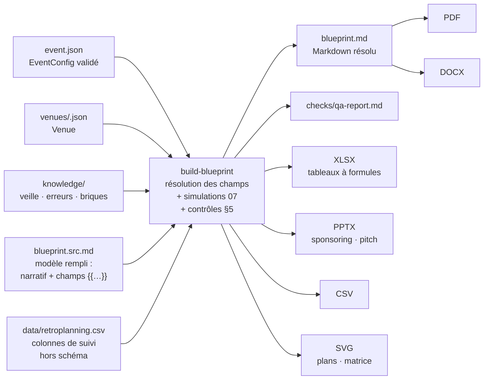

# 08 — Modèles documentaires

> Ce document est le **contrat** de la production documentaire d'EVENT LAB : ce que contient chaque document, d'où vient chaque donnée, comment elle est présentée et contrôlée. Les modèles prêts à l'emploi sont dans `templates/` (mode d'emploi : `templates/README.md`).
> Statut réel : les modèles et la spécification sont **opérationnels** (utilisables à la main). Le générateur `scripts/build-blueprint` et les scripts d'export sont **prévus, non développés** à la date de ce document. Le module `app/engine/blueprint.js` les alimentera (voir `02-architecture-technique.md` §2.1).
> Les schémas de `schemas/` font foi. Les écarts constatés entre ces modèles et les schémas sont listés au §6, sans modification des schémas.

## Sommaire
1. Principe : une source structurée, plusieurs documents
2. Spécification des 40 sections de l'EVENT BLUEPRINT
3. Règles éditoriales
4. Autres documents
5. Contrôle qualité avant validation
6. Écarts entre les modèles et le modèle de données (à arbitrer)

---

## 1. Principe : une source structurée, plusieurs documents

### 1.1 Chaîne de production



1. **La donnée chiffrée et tabulaire vit dans `event.json`** (EventConfig). Elle n'est jamais ressaisie dans un document : le document la lit.
2. **Le narratif vit dans `blueprint.src.md`**, copie remplie de `templates/BLUEPRINT-TEMPLATE.md`. On y écrit directement les sections rédigées ; les zones générées y restent sous forme de champs `{{…}}`.
3. **Le générateur** résout les champs, exécute les simulations de `07-algorithmes.md`, applique les contrôles du §5 et produit `blueprint.md` (Markdown résolu), puis les exports.
4. **En cas de conflit, `event.json` prévaut.** Un tableau modifié à la main dans un export (XLSX, DOCX) n'est pris en compte qu'après réimport dans `event.json` et nouvelle génération.

### 1.2 Arborescence d'un blueprint

Conforme aux conventions de stockage de `03-modele-de-donnees.md` §4.

```
blueprints/<id>/
  event.json                    EventConfig, version courante (maturity = blueprint)
  versions/<id>@<version>.json  versions figées (validated, archived)
  blueprint.src.md              modèle rempli (narratif + champs)
  data/
    retroplanning.csv           import/export de milestones[] + colonnes de suivi hors schéma (dependances, statut), cf. §4.6
    budget.csv, recettes.csv    import/export de budget.expenses[] et budget.revenues[]
    conducteur.csv              export de program[] (+ colonnes manuelles)
    matrice-risques.csv         import/export de risks[]
  annexes/
    reglement.md                règlement complet (section 12)
    fiches-poste/<role>.md      une fiche par rôle (section 24)
    fiches-reflexes/<risque>.md une fiche par plan de continuité (section 34)
  visuels/
    logo/*.svg|png  palette.svg  moodboard/  plans/<variants[].id>.svg  maquettes/
  exports/<version>/
    <id>_v<version>_<statut>_<AAAAMMJJ>.pdf | .docx | .xlsx
    <id>_v<version>_sponsoring.pptx  <id>_v<version>_pitch.pptx  csv/
  checks/
    qa-report.md                rapport du contrôle qualité (§5)
  bilans/<version>/
    bilan.md, bilan-donnees.xlsx  bilan post-événement de la version exécutée (§4.3)
```

### 1.3 Syntaxe des champs dans les modèles

| Syntaxe | Effet | Exemple |
|---|---|---|
| `{{chemin}}` | Valeur d'un champ d'EventConfig (notation pointée, depuis la racine) | `{{identity.name}}` |
| `{{chemin\|filtre}}` | Valeur formatée | `{{budget.contingency_rate\|pct}}` → « 10 % » |
| `{{#each chemin}} … {{/each}}` | Répète le bloc pour chaque élément ; `{{.champ}}` désigne un champ de l'élément | lignes d'un tableau |
| `{{#each chemin where .champ=valeur}}` | Idem, filtré (`=`, `!=`, `in [a,b]`, `not in [a,b]`) | `program where .kind not in [montage,demontage]` |
| `{{#if chemin}} … {{else}} … {{/if}}` | Bloc conditionnel | lieu connu / inconnu |
| `{{meta.x}}` | Métadonnée du front matter de `blueprint.src.md` (hors schéma, cf. §6) | `{{meta.organizer}}` |
| `{{data.x}}` | Lignes d'un fichier compagnon de `data/` (en-têtes CSV = noms de champs), pour les colonnes hors schéma | `{{#each data.retroplanning}}` |
| `{{sim.x}}` | Sortie de simulation calculée à la génération, jamais stockée dans `event.json` | `{{sim.finance.central.result\|eur}}` |
| `{{build.x}}` | Métadonnée de génération | `{{build.date}}`, `{{build.id}}` |

Filtres : `join` (liste → « a, b, c »), `eur` (12 500 €), `pct` (0,35 → 35 %), `hhmm` (minutes depuis 00:00 de J → « 14:30 » ; valeur négative → « J-1 22:00 »), `jrel` (−120 → « J-120 »), `count`, `yesno` (true → « oui »), `date` (ISO → « 24/11/2026 »).

Valeur absente : le générateur écrit **`[À COMPLÉTER : chemin]`** (rendu en rouge dans PDF/DOCX). Chaque occurrence est comptée dans le rapport qualité ; aucune n'est admise pour un statut `validated`.

#### Sorties de simulation exposées (`sim.*`)

Noms proposés par ce document pour le contrat entre `app/engine/` et les modèles ; les formules sont celles de `07-algorithmes.md`.

| Champ | Contenu | Réf. 07 |
|---|---|---|
| `sim.program.first_min`, `sim.program.last_min`, `sim.program.span_min` | Début de la première séquence hors montage, fin de la dernière hors démontage, écart | §4 |
| `sim.competition.stages[]` (`id`, `duration_min`, `end_min`, `occupancy_rate`, `avg_wait_min`) ; `sim.competition.total_min` | Durées simulées par étape, marge incluse | §4 |
| `sim.flow.lanes_required`, `sim.flow.max_wait_min`, `sim.flow.peak_occupancy`, `sim.flow.peak_at_min`, `sim.flow.density_alerts[]` | Files, attente, occupation de pointe (spectateurs), alertes indicatives | §5 |
| `sim.staff.required[]` (`function`, `count`) | Besoins en personnel calculés (hors sécurité/secours) | §6 |
| `sim.setup.min_duration_min`, `sim.setup.critical_tasks[]` | Chemin critique du montage | §6 |
| `sim.finance.<σ>.revenues_total`, `.expenses_total`, `.contingency`, `.result` (σ ∈ prudent, central, ambitieux) | Résultats par scénario | §7.1 |
| `sim.finance.revenues_by_certainty.secured\|probable\|hypothetical` | Recettes classées (scénario central) | §7.5 |
| `sim.finance.breakeven_attendance` | Seuil de rentabilité en spectateurs (ou « pas de seuil ») | §7.2 |
| `sim.finance.cash_need`, `sim.finance.cash_low_day` | Besoin de trésorerie et jour du point bas | §7.3 |
| `sim.finance.sensitivity[]` (`factor`, `delta_result`, `elasticity`) | Tornade | §7.4 |
| `sim.incidents[]` (`incident`, `delta_duration_min`, `delta_wait_min`, `delta_result`, `actions[]`) | Simulations d'incidents | §8 |
| `sim.risks[]` (champs de `risks[]` + `criticite` = probabilité × impact, `classe`) ; `sim.risks_top3[]` (les trois plus critiques) | Criticité des risques | — (§4.7 ci-dessous) |
| `sim.power_kw_total` | Σ (`power_w` × `qty`) / 1000 des équipements | — |
| `sim.program_lines[]` | Champs de `program[]` triés par `start_min` + `end_min`, `cues_son`, `cues_lum`, `cues_vid`, `cues_mic`, `cues_other` (répartition des tops, §4.5) | — |
| `sim.equipment_lines[]` | Champs de `resources.equipment[]` + `total_cost` (`qty × unit_cost`), `total_power_kw` | — |
| `sim.staff_lines[]` | Champs de `resources.staff[]` + `total_hours` (`count × hours`), `total_cost`, `required` (besoin simulé de la fonction, si reconnue) | §6 |
| `sim.finance.expense_lines[]`, `sim.finance.revenue_lines[]` | Champs de la ligne source + `total_prudent`, `total_central`, `total_ambitieux` | §7.1 |
| `sim.finance.by_category[]` | `category`, `total_prudent`, `total_central`, `total_ambitieux` | §7.1 |
| `sim.finance.cashflow[]` | `day` (relatif à J), `label`, `amount`, `balance` | §7.3 |
| `sim.variants[]` | Pour chaque `variants[]` appliquée : `id`, `label`, `expenses_total`, `revenues_total`, `result` (scénario central), `peak_presence` | §7.1 |
| `sim.milestone_lines[]` | `milestones[]` triés par `offset_days`, fusionnés avec les colonnes `dependances` et `statut` de `data/retroplanning.csv` (clé : `label`), plus les échéances `[auto]` issues de `compliance[]`, `budget.expenses[]`, `budget.revenues[]` | — |
| `sim.finance.secured_ratio[]` | Pour chaque jalon de `milestones[]` : `offset_days`, `label`, `secured` (recettes `secured`), `committed` (dépenses engagées, convention §6), `ratio` | §7.5 |
| `sim.peak_presence.prudent\|central\|ambitieux` | Présence simultanée maximale par scénario : spectateurs + participants + personnel (§5.2, C4) | §5 |
| `sim.checks[]` | Résultats des cohérences croisées du §5.2 | — |

### 1.4 Modes de production d'une section

| Mode | Définition | Responsabilité |
|---|---|---|
| **auto** | Entièrement produite par le générateur à partir d'`event.json`, des simulations et des fichiers compagnons. Aucune rédaction. | Exactitude = qualité des données. |
| **semi-auto** | Tableaux, chiffres et listes générés ; analyse, choix et justifications rédigés dans `blueprint.src.md`. | Le rédacteur commente les chiffres, ne les ressaisit pas. |
| **manuel** | Rédigée ou produite (visuels) par l'équipe ; peut citer des champs. | Le rédacteur source chaque affirmation (§3.2). |

### 1.5 Format d'export par type de contenu

| Format | Contenus | Justification | Outil prévu |
|---|---|---|---|
| **PDF** | Dossier blueprint complet ; règlement ; plan de sécurité prévisionnel ; fiches réflexes ; conducteur imprimable (paysage) ; bilan post-événement | Version figée, lisible partout, imprimable, archivable ; référence en cas de litige sur « ce qui avait été validé » | pandoc → PDF, ou DOCX → PDF via LibreOffice (`soffice --headless --convert-to pdf`) |
| **DOCX** | Dossier blueprint ; sections rédigées pour relecture ; dossier de demande aux autorités ou financeurs | Éditable et annotable (suivi des modifications) par des tiers sans outil spécifique ; les retours sont reportés dans `blueprint.src.md` | pandoc avec document de styles de référence (à créer) |
| **XLSX** | Budget, recettes, scénarios, trésorerie, sensibilité, matériel, personnel, conducteur, rétroplanning, risques, KPIs, benchmark | Données tabulaires à trier, filtrer, recalculer : formules **vivantes** (pas de valeurs figées) et onglet `Paramètres` modifiable, pour qu'un tiers teste ses propres hypothèses | openpyxl |
| **PPTX** | Dossier de sponsoring ; pitch (élus, financeurs, lieux) ; présentation de briefing équipe | Support de présentation orale et de négociation ; modifiable par l'équipe commerciale | python-pptx, à partir de `templates/dossier-sponsoring.md` |
| **CSV** | Budget, recettes, conducteur, rétroplanning, risques | Échange machine (tableurs, billetterie, gestion de projet), versionnable dans git, diff lisible | Export natif ; séparateur `;`, UTF-8 (cf. `templates/README.md`) |
| **SVG** | Logo et déclinaisons, palette, plans d'implantation, carte de chaleur des risques, diagrammes de flux | Vectoriel : agrandissable sans perte (impression grand format), éditable dans un logiciel de dessin, intégrable dans PDF/DOCX | Génération depuis `venue.spaces[]` (coordonnées) ; création manuelle pour l'identité |
| **JSON** | `event.json`, `venue`, fiches de veille et d'erreur | Source de vérité : clonage, adaptation à un autre lieu, validation contre les schémas, échange avec l'application | Natif |

Formats secondaires : PNG (aperçus des visuels et maquettes), ICS (jalons du rétroplanning, V1).

---

## 2. Spécification des 40 sections de l'EVENT BLUEPRINT

### 2.1 Vue d'ensemble

| N° | Section | Mode | Source principale | Exports (en plus du dossier PDF/DOCX) |
|---|---|---|---|---|
| 01 | Page de couverture | auto | `identity`, `version`, `status`, `evaluation.computed`, `meta` | PPTX (titre) |
| 02 | Résumé exécutif | semi-auto | `identity.pitch`, `sim.finance`, `evaluation` | PPTX (pitch) |
| 03 | Nom et identité du concept | semi-auto | `identity` | — |
| 04 | Origine de l'idée | semi-auto | `parent`, `history[0]`, `identity.inspirations[]` | — |
| 05 | Étude de marché | manuel | rédigé + `sources[]` | — |
| 06 | Benchmark des événements existants | semi-auto | fiches de veille W-… + `sources[]` | XLSX |
| 07 | Sources d'inspiration | auto | `identity.inspirations[]` | — |
| 08 | Problématiques identifiées | manuel | rédigé + registre des erreurs E-… | — |
| 09 | Proposition de valeur | semi-auto | `identity.audiences[]`, `identity.objectives`, `kpis[]` | PPTX |
| 10 | Publics cibles | semi-auto | `identity.audiences[]`, `audience`, `participants` | XLSX |
| 11 | Description exhaustive du format | semi-auto | `format`, `competition.stages[]` | — |
| 12 | Règles et mécaniques | semi-auto | `format.rules_summary`, `competition`, `gamification[]` | PDF règlement |
| 13 | Programme détaillé | auto | `program[]`, `sim.competition` | XLSX, CSV |
| 14 | Parcours utilisateurs | manuel | rédigé + `sim.flow` | — |
| 15 | Identité visuelle | manuel | `visuels/` | SVG, PNG |
| 16 | Logo et déclinaisons | manuel | `visuels/logo/` | SVG, PNG |
| 17 | Moodboard | manuel | `visuels/moodboard/` | — |
| 18 | Palette chromatique et typographies | manuel | `visuels/palette.svg` | SVG |
| 19 | Signalétique | semi-auto | `venue_requirements.spaces[]`, `venue.access_points[]` | XLSX |
| 20 | Scénographie | semi-auto | `media`, `format.building_blocks[]`, `resources.equipment[]` | SVG |
| 21 | Plans d'implantation | semi-auto | `venue.spaces[]`, `venue.access_points[]`, `variants[]` | SVG |
| 22 | Maquettes digitales | manuel | `visuels/maquettes/` | PNG |
| 23 | Besoins matériels | auto | `resources.equipment[]`, `venue.utilities` | XLSX, CSV |
| 24 | Ressources humaines | semi-auto | `resources.staff[]`, `sim.staff` | XLSX |
| 25 | Organisation logistique | semi-auto | `venue.constraints`, `program[kind∈{montage,demontage}]`, `sim.setup` | XLSX |
| 26 | Rétroplanning | semi-auto | `milestones[]` + `*_offset_days` + `data/retroplanning.csv` (suivi) | XLSX, CSV, ICS (V1) |
| 27 | Conducteur minute par minute | auto | `program[]` | XLSX, CSV, PDF paysage |
| 28 | Budget prévisionnel | auto | `budget.expenses[]`, `scenarios`, `sim.finance` | XLSX, CSV |
| 29 | Modèle économique | semi-auto | `budget.revenues[]`, `scenarios`, `sim.finance` | XLSX, PPTX |
| 30 | Stratégie de communication | semi-auto | `media`, `kpis[phase=avant]` | XLSX (calendrier) |
| 31 | Dossier de sponsoring | semi-auto | `sponsor_packages[]`, `budget.revenues[stream=sponsoring]`, `media`, `audience` | PPTX |
| 32 | Plan de sécurité et d'accessibilité prévisionnel | semi-auto | `venue.erp`, `compliance[]`, `risks[]` | — |
| 33 | Matrice des risques | auto | `risks[]` | XLSX, CSV, SVG |
| 34 | Plans de continuité | semi-auto | `risks[].continuity_plan`, `sim.incidents` | PDF fiches réflexes |
| 35 | Indicateurs de performance | auto | `kpis[]` | XLSX |
| 36 | Stratégie de fidélisation | semi-auto | `format.edition_cadence`, `gamification[]` | — |
| 37 | Manuel de reproduction | semi-auto | `format`, `identity`, `venue_requirements` | PDF/DOCX séparé |
| 38 | Stratégie de développement géographique | manuel | rédigé + `parent`, `sim.finance.breakeven_attendance` | — |
| 39 | Sources documentaires | auto | `sources[]` | CSV, JSON |
| 40 | Historique des versions et décisions | auto | `history[]`, `parent` | — |

Bilan : 10 sections auto, 21 semi-auto, 9 manuelles.

### 2.2 Fiches de spécification

Pour chaque section : **Objectif** · **Contenu obligatoire** · **Seuil d'exécutabilité** (niveau de détail pour qu'une équipe tierce exécute sans le concepteur) · **Source** · **Mode** · **Critère de qualité vérifiable** · **Exports**.

#### 01 — Page de couverture
- **Objectif** : identifier sans ambiguïté le dossier, sa version, son statut et son verdict.
- **Contenu obligatoire** : nom ; accroche ; version ; statut (filigrane BROUILLON / EN REVUE / VALIDÉ / ARCHIVÉ) ; maturité ; variante appliquée le cas échéant ; structure porteuse ; ville et lieu (ou « lieu à déterminer ») ; date de J (ou « à définir ») ; confidentialité ; date et identifiant de génération ; verdict des portes ; mention « Document de conception — implantation non validée réglementairement ».
- **Seuil d'exécutabilité** : un lecteur sait en quelques secondes s'il tient la bonne version et si le projet est autorisé à avancer.
- **Source** : `identity.name`, `identity.tagline`, `version`, `status`, `maturity`, `active_variant`, `evaluation.computed.verdict`, `meta.organizer`, `meta.city`, `venue.name`, `meta.event_date`, `meta.confidentiality`, `build.date`, `build.id`.
- **Mode** : auto.
- **Critère de qualité** : version et statut identiques à `event.json` ; filigrane conforme au statut ; aucun `[À COMPLÉTER]`.
- **Exports** : PDF, DOCX, PPTX (diapositive titre).

#### 02 — Résumé exécutif
- **Objectif** : permettre une décision (engager / revoir / abandonner) en une page.
- **Contenu obligatoire** : concept en trois phrases ; chiffres clés (participants et spectateurs par scénario, durée, dépenses totales et résultat des trois scénarios, seuil de rentabilité, besoin de trésorerie, part des recettes sécurisées) ; score /100, grade, indice de confiance, type d'évaluation ; **tableau des trois portes éliminatoires** (statut + motif) ; trois risques les plus critiques ; trois hypothèses structurantes ; décisions attendues du lecteur, avec échéance.
- **Seuil d'exécutabilité** : un décideur extérieur peut trancher sans lire le reste ; chaque chiffre renvoie à sa section d'origine.
- **Source** : `identity.pitch`, `format.summary`, `participants.count.*`, `audience.attendance.*`, `format.duration_hours`, `sim.finance.*`, `evaluation.type`, `evaluation.computed.*`, `evaluation.gates.*`, `risks[]` triés par `sim.risks[].criticite`, `hypotheses[]`.
- **Mode** : semi-auto (chiffres, portes, risques générés ; synthèse et décisions attendues rédigées).
- **Critère de qualité** : une page A4 hors tableau des portes ; les trois portes présentes ; chiffres identiques à ceux des sections 28–29 (contrôle automatique) ; mention « évaluation prévisionnelle » si `evaluation.type = previsionnelle`.
- **Exports** : PDF, DOCX, PPTX (pitch, diapositives 2–3).

#### 03 — Nom et identité du concept
- **Objectif** : fixer nom, promesse et positionnement pour une présentation homogène par tous.
- **Contenu obligatoire** : nom ; accroche ; pitch (≤ 60 mots) ; disciplines (ou « sans discipline ») ; secteurs ; directions créatives ; objectifs ; signification du nom ; usages autorisés et interdits du nom ; recherche d'antériorité (marques, noms de domaine, comptes de réseaux sociaux) datée, avec méthode et résultat.
- **Seuil d'exécutabilité** : une équipe tierce présente le concept dans les mêmes termes et sait si le nom est utilisable publiquement.
- **Source** : `identity.name`, `identity.tagline`, `identity.pitch`, `identity.disciplines`, `identity.sectors`, `identity.directions`, `identity.objectives` ; antériorité rédigée.
- **Mode** : semi-auto.
- **Critère de qualité** : recherche d'antériorité datée et sourcée, ou mention explicite « non réalisée — interdit de diffusion publique et de licence tant qu'elle ne l'est pas ».
- **Exports** : PDF, DOCX.

#### 04 — Origine de l'idée
- **Objectif** : tracer pourquoi et comment le concept est né, pour qu'un repreneur ne défasse pas par méconnaissance un choix fondateur.
- **Contenu obligatoire** : brief d'entrée (paramètres du générateur, `07` §2.1) ; direction(s) retenue(s) et écartées ; constats déclencheurs ; lignée (version parente, relation) ; briques et transpositions mobilisées.
- **Seuil d'exécutabilité** : chaque choix fondateur est expliqué en une phrase et rattaché à une preuve ou à une hypothèse.
- **Source** : `parent`, `history[0]`, `identity.inspirations[]`, `format.building_blocks[].block_id`, `hypotheses[]` ; récit rédigé.
- **Mode** : semi-auto.
- **Critère de qualité** : chaque constat renvoie à une fiche de veille `W-…`, une fiche d'erreur `E-…`, une source `S-…`, ou porte le marqueur `[HYPOTHÈSE]`.
- **Exports** : PDF, DOCX.

#### 05 — Étude de marché
- **Objectif** : établir que la demande existe, à quel prix et dans quelle zone.
- **Contenu obligatoire** : périmètre (zone de chalandise et sa justification) ; offre existante locale et calendrier concurrent ; demande (pratiquants, publics, tendances) ; prix pratiqués ; partenaires et financeurs potentiels ; saisonnalité ; conclusions ; **zones d'ignorance** et méthode pour les lever (enquête, entretiens, prévente test).
- **Seuil d'exécutabilité** : un tiers sait quelles données sont établies, lesquelles sont supposées, et comment vérifier les secondes avant d'engager des dépenses.
- **Source** : rédigé ; `sources[]` ; `hypotheses[]`.
- **Mode** : manuel.
- **Critère de qualité** : 100 % des chiffres portent un marqueur de statut (§3.1) ; tout chiffre qui conditionne la jauge ou le budget s'appuie sur au moins une source de fiabilité A ou B, sinon il est marqué hypothèse et repris en section 02 ; chaque donnée est datée.
- **Exports** : PDF, DOCX.

#### 06 — Benchmark des événements existants
- **Objectif** : situer le concept face aux formats comparables, y compris de petite échelle.
- **Contenu obligatoire** : tableau : événement, organisateur, pays/ville, format, public, modèle économique, forces, faiblesses, logique reprise, écueil évité, fiche `W-…`, fiabilité ; synthèse des enseignements.
- **Seuil d'exécutabilité** : un tiers comprend en quoi le concept diffère et quels écueils documentés il doit éviter.
- **Source** : fiches de veille (`knowledge/veille/…`, schéma `watch-entry`) citées par identifiant ; colonnes tirées de `event_name`, `organizer`, `country`, `city`, `format_description`, `target_audience`, `business_model`, `strengths`, `weaknesses`, `reliability`.
- **Mode** : semi-auto.
- **Critère de qualité** : chaque ligne renvoie à une fiche `W-…` ou à une source `S-…` ; au moins 5 comparables dont 2 d'organisateurs associatifs, indépendants ou à budget réduit `[param]` ; aucune cellule chiffrée sans statut.
- **Exports** : PDF, DOCX, XLSX (onglet Benchmark).

#### 07 — Sources d'inspiration
- **Objectif** : documenter les logiques empruntées à d'autres secteurs et démontrer l'absence de reprise d'éléments protégés.
- **Contenu obligatoire** : tableau : événement source, secteur, logique empruntée, adaptation, **éléments non repris** (nom, identité visuelle, signes protégés), source.
- **Seuil d'exécutabilité** : un tiers sait ce qu'il peut citer comme inspiration et ce qu'il ne doit jamais reprendre.
- **Source** : `identity.inspirations[]` (`source_event`, `source_sector`, `borrowed_logic`, `adaptation`, `source_ref`) ; `ip_note` des briques citées dans `format.building_blocks[].block_id`.
- **Mode** : auto (la colonne « éléments non repris » est rédigée si `ip_note` est absent).
- **Critère de qualité** : colonne « éléments non repris » non vide pour chaque ligne ; aucun logo ni visuel tiers dans l'ensemble du dossier.
- **Exports** : PDF, DOCX.

#### 08 — Problématiques identifiées
- **Objectif** : lister les problèmes réels que le format résout, pour chaque partie prenante.
- **Contenu obligatoire** : tableau : problématique, qui la subit, preuve (`W-…`, `E-…`, `S-…`), conséquence, réponse apportée (renvoi de section), KPI associé.
- **Seuil d'exécutabilité** : un tiers peut vérifier, après l'événement, si chaque problème a été effectivement traité.
- **Source** : rédigé ; registre des erreurs (`knowledge/registre-erreurs.json`, schéma `error-entry` : `title`, `severity`, `consequences`) ; `kpis[]`.
- **Mode** : manuel (description et gravité reprises du registre quand un `E-…` est cité).
- **Critère de qualité** : chaque problématique a une réponse et un KPI ; chaque preuve est résoluble.
- **Exports** : PDF, DOCX.

#### 09 — Proposition de valeur
- **Objectif** : formuler la valeur mesurable pour chaque partie prenante.
- **Contenu obligatoire** : par rôle (spectateur, participant, bénévole, sponsor, lieu/collectivité, organisateur) : bénéfice, alternative actuelle, différence, preuve ou mesure (KPI).
- **Seuil d'exécutabilité** : un tiers peut défendre le projet auprès de chaque interlocuteur avec un argument et un indicateur.
- **Source** : `identity.audiences[].motivation`, `identity.objectives`, `kpis[]` ; rédigé.
- **Mode** : semi-auto.
- **Critère de qualité** : chaque bénéfice est relié à un KPI existant ; aucun superlatif non étayé (« le plus grand », « unique ») sans source.
- **Exports** : PDF, DOCX, PPTX (sponsoring).

#### 10 — Publics cibles
- **Objectif** : caractériser et dimensionner les publics et les participants.
- **Contenu obligatoire** : segments (segment, rôle, motivation, consentement à payer) ; volumes par scénario ; part payante ; unité, nombre et catégories de participants, taille d'équipe ; profil d'arrivée ; durée moyenne de présence ; un persona par rôle principal ; besoins d'accessibilité attendus.
- **Seuil d'exécutabilité** : les volumes permettent de dimensionner accueil, buvette, sanitaires et communication sans autre hypothèse.
- **Source** : `identity.audiences[]` (`segment`, `role`, `motivation`, `willingness_to_pay`), `audience.attendance.*`, `audience.paying_share`, `audience.arrival_profile[]`, `audience.avg_dwell_min`, `participants.unit|count|team_size|categories`.
- **Mode** : semi-auto.
- **Critère de qualité** : Σ `arrival_profile[].share` = 1 (± 0,01) ; trois scénarios renseignés ; chaque volume sourcé ou marqué hypothèse ; `prudent ≤ central ≤ ambitieux`.
- **Exports** : PDF, DOCX, XLSX.

#### 11 — Description exhaustive du format
- **Objectif** : décrire ce qui se passe, du point de vue d'un observateur, de l'ouverture à la fermeture.
- **Contenu obligatoire** : résumé ; déroulé narratif par phase ; tableau des briques fonctionnelles (type, libellé, paramètres) ; durée ; cadence des éditions ; étapes de compétition ; variantes par configuration de lieu ; éléments distinctifs.
- **Seuil d'exécutabilité** : un tiers explique le format sans support et reconnaît une exécution non conforme.
- **Source** : `format.summary`, `format.building_blocks[]`, `format.duration_hours`, `format.edition_cadence`, `competition.stages[]`, `variants[]` (`id`, `label`, `description`) ; déroulé rédigé.
- **Mode** : semi-auto.
- **Critère de qualité** : chaque brique est rattachée à au moins une séquence du programme ou une mécanique ; aucune paire de briques incompatibles (`07` §2.6).
- **Exports** : PDF, DOCX.

#### 12 — Règles et mécaniques
- **Objectif** : fournir le règlement applicable et les mécaniques d'interaction.
- **Contenu obligatoire** : version publique des règles (lisible en moins de deux minutes) ; règlement complet en annexe (éligibilité, catégories, inscription, conditions médicales, déroulement, points, départage, sanctions, réclamations, forfaits, arbitrage, sécurité, image) ; schéma par étape de compétition ; mécaniques de gamification avec note d'équité.
- **Seuil d'exécutabilité** : un arbitre ou un responsable de table qui n'a pas participé à la conception tranche tout cas courant avec le seul règlement.
- **Source** : `format.rules_summary`, `competition.stages[]` (`type`, `entrants`, `groups`, `slot_duration_min`, `changeover_min`, `parallel_units`, `advance`), `gamification[]` (`mechanic`, `target_role`, `description`, `fairness_note`), `format.building_blocks[type ∈ {regles, qualification, recompenses, mecanique_jeu}].parameters` ; règlement rédigé dans `annexes/reglement.md`.
- **Mode** : semi-auto.
- **Critère de qualité** : règle de départage définie pour chaque étape ; chaque mécanique a une `fairness_note` ; test de compréhension de la version publique réalisé et résultat consigné ; conditions médicales conformes au règlement de la fédération concernée (à vérifier, cf. `templates/checklists/checklist-securite-accessibilite.md`).
- **Exports** : PDF, DOCX ; règlement en PDF séparé.

#### 13 — Programme détaillé
- **Objectif** : horaire de J pour le public et les participants.
- **Contenu obligatoire** : séquences hors montage et démontage : début, fin, durée, libellé, type, espace, caractère critique ; durées simulées des étapes de compétition et marge ; heure de fin ; programme public simplifié.
- **Seuil d'exécutabilité** : un participant sait à quelle heure il doit être où ; l'équipe sait quelles séquences peuvent être compressées en cas de retard.
- **Source** : `program[kind ∉ {montage, demontage}]` (`id`, `label`, `kind`, `start_min`, `duration_min`, `space`, `critical`), `sim.competition.*`, `sim.program.*`.
- **Mode** : auto.
- **Critère de qualité** : cohérence C1 (§5.2) satisfaite ; aucune séquence sans espace ; aucun chevauchement non justifié dans un même espace.
- **Exports** : PDF, DOCX, XLSX, CSV.

#### 14 — Parcours utilisateurs
- **Objectif** : concevoir l'expérience de chaque rôle avant, pendant et après.
- **Contenu obligatoire** : pour chacun des rôles spectateur, participant, bénévole, sponsor, journaliste, prestataire, VIP : tableau étape, phase, point de contact, action, attente, friction potentielle, réponse, responsable, KPI ; temps d'attente simulés ; temps morts estimés.
- **Seuil d'exécutabilité** : chaque responsable sait quelles frictions surveiller et quoi faire.
- **Source** : rédigé ; `identity.audiences[].role` ; `program[]` ; `sim.flow.max_wait_min`.
- **Mode** : manuel (attentes simulées insérées automatiquement).
- **Critère de qualité** : sept rôles couverts ou « non applicable » justifié ; chaque friction a une réponse et un responsable ; attente maximale simulée ≤ cible (10 min par défaut, `07` §5).
- **Exports** : PDF, DOCX.

#### 15 — Identité visuelle
- **Objectif** : donner les principes graphiques permettant à un tiers de produire des supports cohérents.
- **Contenu obligatoire** : concept graphique ; éléments (motifs, iconographie, style photo) ; règles d'usage ; interdits ; exemples d'application (affiche, réseau social, signalétique, maillot ou dossard) ; liste des fichiers sources ; statut de propriété de chaque élément.
- **Seuil d'exécutabilité** : un graphiste extérieur produit une affiche conforme sans échange avec le concepteur.
- **Source** : rédigé ; `visuels/`.
- **Mode** : manuel.
- **Critère de qualité** : fichiers sources éditables fournis ; droits (création interne, cession par prestataire, licence) documentés pour chaque élément ; aucune ressemblance volontaire avec une identité tierce.
- **Exports** : PDF ; SVG et PNG séparés.

#### 16 — Logo et déclinaisons
- **Objectif** : fournir un logo exploitable sur tous les supports.
- **Contenu obligatoire** : logo principal ; déclinaisons (horizontale, verticale, monochrome, négatif, avatar) ; zone de protection ; taille minimale ; fonds autorisés ; interdits ; fichiers.
- **Seuil d'exécutabilité** : un imprimeur ou un développeur trouve le bon fichier pour chaque usage.
- **Source** : `visuels/logo/`.
- **Mode** : manuel.
- **Critère de qualité** : SVG et PNG pour chaque déclinaison ; lisibilité vérifiée à la taille minimale ; propriété des droits documentée.
- **Exports** : SVG, PNG, PDF.

#### 17 — Moodboard
- **Objectif** : fixer l'ambiance visée (lumière, matières, tenues, énergie).
- **Contenu obligatoire** : visuels de référence légendés (intention de chacun) ; crédit et statut de droits par image ; mention « usage interne » pour toute image non libre.
- **Seuil d'exécutabilité** : scénographe et photographe comprennent l'ambiance attendue sans réunion.
- **Source** : `visuels/moodboard/`.
- **Mode** : manuel.
- **Critère de qualité** : chaque image a crédit et statut de droits ; aucune image sous droits dans un export destiné à des tiers.
- **Exports** : PDF (interne).

#### 18 — Palette chromatique et typographies
- **Objectif** : rendre l'identité reproductible à l'identique et accessible.
- **Contenu obligatoire** : couleurs (nom, HEX, RVB, CMJN, usage) ; couples texte/fond autorisés avec ratio de contraste ; typographies (famille, graisses, usage, licence, alternative libre).
- **Seuil d'exécutabilité** : un tiers reproduit les couleurs à l'écran et à l'impression, et sait quelles polices il peut installer.
- **Source** : `visuels/palette.svg` ; rédigé.
- **Mode** : manuel.
- **Critère de qualité** : contrastes conformes WCAG 2.1 niveau AA (4,5:1 texte courant, 3:1 grand texte) mesurés et consignés ; licence de chaque police compatible avec une diffusion aux licenciés.
- **Exports** : PDF, DOCX, SVG.

#### 19 — Signalétique
- **Objectif** : orienter et informer tous les publics sans intervention humaine permanente.
- **Contenu obligatoire** : plan de signalétique : identifiant, type (directionnel, information, règles, sécurité, partenaire), espace, message exact, format, support, quantité, critères d'accessibilité (pictogramme, contraste, hauteur de lecture), fixation, responsable pose/dépose.
- **Seuil d'exécutabilité** : un prestataire fabrique et pose l'ensemble à partir du seul tableau.
- **Source** : liste des espaces et accès générée depuis `venue_requirements.spaces[]` et `venue.access_points[]` ; messages rédigés.
- **Mode** : semi-auto.
- **Critère de qualité** : chaque espace ouvert au public et chaque accès a au moins un panneau ; la signalétique de sécurité du lieu n'est ni masquée ni remplacée.
- **Exports** : PDF, XLSX.

#### 20 — Scénographie
- **Objectif** : traduire l'intention en dispositifs physiques réalisables.
- **Contenu obligatoire** : intentions par espace ; éléments (décor, mobilier, lumière, son, vidéo) avec fiche technique ; spots photo ; mise en scène des moments forts ; contraintes (charges, accroches, protection des sols, matériaux) ; réaction au feu des matériaux « à vérifier avec l'exploitant et le chargé de sécurité » ; avertissement « implantation non validée ».
- **Seuil d'exécutabilité** : un régisseur commande, monte et exploite chaque élément.
- **Source** : rédigé ; `media.photo_spots`, `media.viral_moments`, `format.building_blocks[type ∈ {scenographie, son_lumiere, mise_en_scene}]`, `resources.equipment[]`, `venue.constraints.floor_protection`.
- **Mode** : semi-auto.
- **Critère de qualité** : chaque élément est rattaché à une ligne `resources.equipment[]` et, si payant, à une dépense ; chaque moment viral est rattaché à une séquence du programme.
- **Exports** : PDF, DOCX, SVG.

#### 21 — Plans d'implantation
- **Objectif** : positionner espaces, équipements et flux pour chaque configuration.
- **Contenu obligatoire** : un plan par configuration (économique, standard, premium, capacité maximale autorisée, secours — une par élément de `variants[]`, plus la configuration de base) : espaces, dimensions, accès (public, secours, PMR, technique), flux, équipements, zones interdites ; légende, échelle, orientation, date, version ; tableau surfaces et capacités ; **avertissement réglementaire sur chaque plan**.
- **Seuil d'exécutabilité** : une équipe de montage implante le site au mètre près à partir du plan coté.
- **Source** : `venue.dimensions`, `venue.spaces[]` (`x_m`, `y_m`, `width_m`, `length_m`, `area_m2`, `capacity`, `fixed`), `venue.access_points[]` (`kind`, `width_m`, `x_m`, `y_m`), `venue_requirements.spaces[]`, `variants[]`, `sim.variants[].peak_presence`, `sim.flow.density_alerts[]`.
- **Mode** : semi-auto (SVG généré si les coordonnées existent, sinon plan dessiné).
- **Critère de qualité** : échelle et cotes présentes ; Σ surfaces ≤ surface du lieu ; accès et issues déclarés par l'exploitant reportés et non obstrués ; avertissement présent ; configurations sans données marquées « non produite ».
- **Exports** : SVG, PDF.

#### 22 — Maquettes digitales
- **Objectif** : spécifier les supports numériques (inscription, billetterie, page événement, résultats en direct, écran, formats réseaux).
- **Contenu obligatoire** : écrans clés ; parcours ; contenus ; données collectées et consentements ; outil retenu et statut (opérationnel / simulé / externe requis) ; procédure dégradée hors ligne.
- **Seuil d'exécutabilité** : un intégrateur configure l'outil retenu ; l'équipe sait basculer en mode papier.
- **Source** : rédigé ; `format.building_blocks[type = experience_digitale]` ; `visuels/maquettes/`.
- **Mode** : manuel.
- **Critère de qualité** : chaque écran indique outil et statut ; chaque collecte de données a une finalité et une base de consentement écrites (règles à vérifier auprès de la CNIL) ; procédure dégradée liée à la section 34.
- **Exports** : PDF, PNG.

#### 23 — Besoins matériels
- **Objectif** : liste exhaustive du matériel, de sa provenance et de son coût.
- **Contenu obligatoire** : article, quantité, provenance, coût unitaire, coût total, puissance unitaire et totale, notes (fournisseur de secours) ; total de puissance comparé à la puissance disponible.
- **Seuil d'exécutabilité** : un régisseur passe toutes les commandes et réservations à partir du tableau.
- **Source** : `resources.equipment[]` (`item`, `qty`, `source`, `unit_cost`, `power_w`, `notes`), `venue.utilities.power_kw_available`, `venue_requirements.power_kw`, `sim.power_kw_total`.
- **Mode** : auto.
- **Critère de qualité** : cohérences C2 et C8 satisfaites ; chaque article nécessaire à une séquence critique a une solution de secours.
- **Exports** : PDF, XLSX, CSV.

#### 24 — Ressources humaines
- **Objectif** : dimensionner, organiser et préparer les équipes.
- **Contenu obligatoire** : rôle, effectif, statut, heures, coût horaire, coût total, note de ratio ; besoins simulés comparés aux effectifs prévus ; organigramme de J ; planning de présence ; une fiche de poste par rôle (mission, horaires, briefing, compétences, tenue, contact référent) ; mention « sécurité et secours : dimensionnement externe ».
- **Seuil d'exécutabilité** : un coordinateur recrute, affecte et briefe chaque personne sans le concepteur.
- **Source** : `resources.staff[]` (`role`, `count`, `status`, `hours`, `cost_per_hour`, `ratio_note`), `sim.staff.required[]`, `program[].owner_role` ; fiches dans `annexes/fiches-poste/`.
- **Mode** : semi-auto.
- **Critère de qualité** : chaque `owner_role` du programme et des risques existe dans `resources.staff[]` (C7) ; effectifs ≥ besoins simulés ; une fiche de poste par rôle.
- **Exports** : PDF, DOCX, XLSX.

#### 25 — Organisation logistique
- **Objectif** : planifier tout ce qui entre, sort et circule sur le site.
- **Contenu obligatoire** : fenêtres de montage et démontage ; chemin critique du montage ; livraisons et enlèvements (quoi, qui, quand, où, réceptionnaire) ; stockage ; transports ; restauration des équipes ; déchets et tri ; énergie et réseau ; clés et accès ; inventaire de retour.
- **Seuil d'exécutabilité** : un régisseur général organise montage, exploitation et démontage à partir de cette section et de la section 27.
- **Source** : `venue.constraints.setup_window|teardown_window|opening_hours`, `program[kind ∈ {montage, demontage}]` et `depends_on`, `resources.equipment[source ∈ {location, achat, pret_partenaire, sponsor}]`, `sim.setup.*`, `venue.utilities`.
- **Mode** : semi-auto.
- **Critère de qualité** : `sim.setup.min_duration_min` ≤ fenêtre de montage ; chaque livraison a un créneau et un réceptionnaire.
- **Exports** : PDF, XLSX.

#### 26 — Rétroplanning
- **Objectif** : séquencer la préparation et fixer les points de décision.
- **Contenu obligatoire** : jalons avec échéance relative à J, responsable, livrable, dépendances, statut, critère go/no-go ; jalons dérivés : échéances réglementaires, décaissements, encaissements ; ratio recettes sécurisées / dépenses engagées à chaque jalon (`07` §7.5).
- **Seuil d'exécutabilité** : un chef de projet pilote la préparation semaine par semaine.
- **Source** : `milestones[]` (`offset_days`, `label`, `owner_role`, `deliverable`, `go_no_go`) ; colonnes de suivi `dependances` et `statut` de `data/retroplanning.csv` ; échéances dérivées de `compliance[].deadline_offset_days`, `budget.expenses[].pay_offset_days`, `budget.revenues[].cash_offset_days` ; le tout fusionné dans `sim.milestone_lines[]` ; points de contrôle : `templates/checklists/checklist-J-120-a-J-1.md`.
- **Mode** : semi-auto.
- **Critère de qualité** : chaque point de conformité obligatoire a un jalon antérieur à son échéance (C5) ; au moins deux points go/no-go (financier, réglementaire) avec critère vérifiable ; aucun jalon sans responsable.
- **Exports** : XLSX, CSV, PDF (diagramme de Gantt), ICS (V1).

#### 27 — Conducteur événementiel minute par minute
- **Objectif** : piloter J en temps réel.
- **Contenu obligatoire** : toutes les séquences de J, montage et démontage compris, aux colonnes de `templates/conducteur.csv` ; contacts radio ou téléphone par fonction (annexe hors diffusion).
- **Seuil d'exécutabilité** : un régisseur qui découvre le projet le matin même conduit la journée avec le conducteur et les fiches réflexes.
- **Source** : `program[]` (`id`, `label`, `start_min`, `duration_min`, `space`, `owner_role`, `cues[]`, `critical`) ; colonnes `intervenants` et `notes` complétées à la main (§4.5).
- **Mode** : auto.
- **Critère de qualité** : aucun intervalle sans séquence (les transitions sont nommées) ; chaque séquence critique a un responsable et un renvoi vers un plan de continuité ; fin ≤ fin de la fenêtre d'exploitation du lieu.
- **Exports** : XLSX, CSV, PDF paysage.

#### 28 — Budget prévisionnel
- **Objectif** : chiffrer toutes les dépenses, par scénario, avec leur degré de certitude.
- **Contenu obligatoire** : par ligne : id, catégorie, libellé, base, montant unitaire, volume, montant par scénario, certitude, optionnel, priorité, date de décaissement, source ; contingence séparée ; totaux par scénario ; part devisée ; mention HT/TTC.
- **Seuil d'exécutabilité** : un trésorier engage les dépenses dans l'ordre et sait quelles lignes couper en premier.
- **Source** : `budget.currency`, `budget.contingency_rate`, `budget.expenses[]` (`id`, `category`, `label`, `amount`, `basis`, `certainty`, `optional`, `priority`, `pay_offset_days`, `source_ref`), `scenarios.*.cost_overrun`, `sim.finance.*`.
- **Mode** : auto.
- **Critère de qualité** : chaque ligne a une certitude ; chaque ligne `devis` a un `source_ref` résoluble ; contingence affichée séparément ; totaux XLSX = totaux PDF (contrôle automatique).
- **Exports** : XLSX (formules vivantes, onglet `Paramètres`), PDF, CSV.

#### 29 — Modèle économique
- **Objectif** : montrer comment le projet s'équilibre et à quelles conditions.
- **Contenu obligatoire** : recettes par flux (flux, libellé, montant unitaire, base, marge, certitude, encaissement) ; classement sécurisées / probables / hypothétiques ; résultats des trois scénarios ; résultat de chaque variante de configuration (`variants[]`) ; seuil de rentabilité ; trésorerie (solde cumulé, besoin, point bas) ; sensibilité ; politique tarifaire ; stratégie de billetterie ; potentiel de licence et de duplication ; paramètres `[param]` utilisés.
- **Seuil d'exécutabilité** : un financeur comprend le risque financier ; l'équipe sait quel niveau de recettes sécuriser avant chaque engagement.
- **Source** : `budget.revenues[]` (`id`, `stream`, `label`, `unit_amount`, `basis`, `margin_rate`, `certainty`, `cash_offset_days`), `scenarios.*.realization`, `audience.paying_share`, `variants[]`, `sim.finance.*`, `sim.variants[]` ; politique tarifaire rédigée.
- **Mode** : semi-auto.
- **Critère de qualité** : trois scénarios présents ; recettes classées en trois colonnes ; aucun encaissement de subvention avant J sans pièce justificative ; paramètres de calcul affichés.
- **Exports** : XLSX, PDF, PPTX.

#### 30 — Stratégie de communication
- **Objectif** : faire venir les publics visés et produire du contenu sans dégrader l'expérience réelle.
- **Contenu obligatoire** : objectifs ; cibles ; messages ; canaux ; calendrier éditorial avant / pendant / après (échéance relative à J, canal, format, contenu, responsable, KPI) ; moments viraux et formats verticaux ; contenus générés par les participants (règles, consentements) ; relations presse ; budget (renvoi section 28).
- **Seuil d'exécutabilité** : un chargé de communication exécute le calendrier sans arbitrage du concepteur.
- **Source** : `media.channels`, `media.viral_moments`, `media.photo_spots`, `kpis[phase = avant]` ; calendrier rédigé.
- **Mode** : semi-auto.
- **Critère de qualité** : chaque moment viral est rattaché à une séquence du programme ; chaque publication a un responsable ; au moins un KPI de communication par phase.
- **Exports** : PDF, DOCX, XLSX (calendrier).

#### 31 — Dossier de sponsoring
- **Objectif** : résumer l'offre partenaires (le dossier complet est un PPTX, §4.4).
- **Contenu obligatoire** : offres (palier, prix, quantité, exclusivité, contreparties, ligne de recettes liée) ; activations ; audiences annoncées avec scénario et statut ; partenaires ciblés et état (sécurisé / probable / hypothétique) ; contributions en nature et leur valorisation ; calendrier de démarchage.
- **Seuil d'exécutabilité** : un chargé de partenariats démarche, négocie et livre les contreparties sans le concepteur.
- **Source** : `sponsor_packages[]` (`id`, `name`, `price`, `quantity`, `revenue_ref`, `exclusivity`, `counterparts`), `budget.revenues[stream = sponsoring]`, `format.building_blocks[type = activation_partenaire]`, `identity.audiences[role = sponsor]`, `audience.attendance.prudent`, `media.*`, `kpis[]`, `resources.equipment[source = sponsor]`.
- **Mode** : semi-auto.
- **Critère de qualité** : cohérence C3 satisfaite ; audiences annoncées = scénario prudent, ou scénario explicitement étiqueté ; aucun logo de partenaire non signé.
- **Exports** : PPTX, PDF.

#### 32 — Plan de sécurité et d'accessibilité prévisionnel
- **Objectif** : préparer le dossier à soumettre à l'exploitant, au chargé de sécurité et aux autorités. **Ce plan ne vaut pas validation.**
- **Contenu obligatoire** : avertissement ; données du lieu déclarées par l'exploitant (type et catégorie ERP, effectif autorisé, document de référence) ; présence simultanée prévue par scénario (public + participants + personnel) ; démarches réglementaires (autorité, statut, échéance, source) ; dispositif prévisionnel de secours (effectif déclaré, association agréée contactée, dimensionnement **externe**) ; évacuation (renvoi plans) ; contrôle d'accès et sûreté ; accessibilité (accès, cheminements, sanitaires, places réservées, information accessible, accompagnement) ; risques sécurité et santé ; contacts d'urgence locaux ; visas et signatures.
- **Seuil d'exécutabilité** : un chargé de sécurité reçoit un dossier complet à instruire ; l'organisateur sait quelles démarches restent ouvertes et à quelle date.
- **Source** : `venue.erp.type_erp|categorie|effectif_autorise|document_ref`, `venue.access_points[]`, `venue_requirements.spaces[type ∈ {secours, sanitaire}]`, `venue_requirements.spaces[].accessible_pmr`, `compliance[]` (`item`, `authority`, `mandatory`, `status`, `deadline_offset_days`, `source_ref`), `risks[category ∈ {securite, sante}]`, `sim.peak_presence`, `resources.staff[]` ; `templates/checklists/checklist-securite-accessibilite.md`.
- **Mode** : semi-auto.
- **Critère de qualité** : avertissement présent ; chaque point `mandatory` a autorité, statut, échéance et source ; aucun dimensionnement de sécurité ou de secours calculé par l'outil ; cohérence C4 satisfaite.
- **Exports** : PDF, DOCX.

#### 33 — Matrice des risques
- **Objectif** : hiérarchiser les risques et attribuer leur traitement.
- **Contenu obligatoire** : tableau aux colonnes de `templates/matrice-risques.csv` ; carte de chaleur probabilité × impact.
- **Seuil d'exécutabilité** : chaque responsable connaît ses risques, leurs signes précurseurs et ses mesures.
- **Source** : `risks[]` (`id`, `category`, `description`, `probability`, `impact`, `critical`, `warning_signs`, `prevention`, `continuity_plan`, `owner_role`, `status`), `sim.risks[]`.
- **Mode** : auto.
- **Critère de qualité** : au moins un risque par catégorie applicable, ou « non applicable » justifié ; chaque risque a un responsable ; chaque risque `critical` a un `continuity_plan` (porte éliminatoire, `07` §1.5).
- **Exports** : XLSX, CSV, PDF, SVG.

#### 34 — Plans de continuité
- **Objectif** : savoir quoi faire, qui décide et dans quel ordre quand un incident survient.
- **Contenu obligatoire** : pour chaque incident type de `07` §8 et chaque risque critique : déclencheur observable, décideur (rôle), actions immédiates ordonnées, messages (public, participants, partenaires, autorités), mode dégradé, retour à la normale, impact simulé ; une fiche réflexe d'une page par plan.
- **Seuil d'exécutabilité** : un responsable de permanence applique la fiche sans consulter le concepteur.
- **Source** : `risks[].continuity_plan`, `risks[].warning_signs`, `risks[].owner_role`, `sim.incidents[]` ; fiches dans `annexes/fiches-reflexes/`.
- **Mode** : semi-auto.
- **Critère de qualité** : les huit incidents types traités ou « non applicable » justifié ; chaque plan nomme un décideur et un déclencheur ; chaque séquence `critical` du programme est couverte.
- **Exports** : PDF, DOCX ; fiches réflexes PDF (A5).

#### 35 — Indicateurs de performance
- **Objectif** : définir comment le succès sera mesuré, avant, pendant et après.
- **Contenu obligatoire** : id, libellé, phase, cible, unité, méthode de mesure, responsable, valeur réelle (après l'événement).
- **Seuil d'exécutabilité** : un tiers collecte chaque indicateur sans interprétation.
- **Source** : `kpis[]` (`id`, `label`, `phase`, `target`, `unit`, `measure`, `actual`).
- **Mode** : auto.
- **Critère de qualité** : chaque objectif de `identity.objectives` a au moins un KPI (C10) ; chaque KPI a une méthode de mesure ; cible chiffrée ou binaire.
- **Exports** : XLSX, PDF.

#### 36 — Stratégie de fidélisation
- **Objectif** : faire revenir participants, publics, bénévoles et partenaires d'une édition à l'autre.
- **Contenu obligatoire** : mécaniques entre éditions (progression, saison, passeport) ; communauté ; contenus après l'événement ; offre de réengagement ; données conservées (finalité, durée, consentement) ; calendrier ; KPIs de retour.
- **Seuil d'exécutabilité** : l'équipe de l'édition suivante sait ce qui a été promis aux participants de l'édition précédente.
- **Source** : `format.edition_cadence`, `gamification[]`, `format.building_blocks[type = fidelisation]` ; rédigé.
- **Mode** : semi-auto.
- **Critère de qualité** : au moins un KPI de fidélisation ; chaque mécanique a une note d'équité et n'est pas manipulatrice (brief §12).
- **Exports** : PDF, DOCX.

#### 37 — Manuel de reproduction
- **Objectif** : permettre à une autre équipe, dans un autre lieu, de reproduire le format fidèlement (synthèse ; manuel complet selon `templates/manuel-reproduction.md`).
- **Contenu obligatoire** : invariants du format ; variables d'adaptation et plages admises ; prérequis minimaux ; kit standard ; procédure de J-120 à J+30 ; critères de conformité au format.
- **Seuil d'exécutabilité** : test de reprise réalisé (une personne extérieure reconstitue la procédure à partir du seul manuel) et consigné.
- **Source** : invariants tirés de `identity.*`, `format.*`, `competition.*` ; variables tirées de `venue_requirements`, `audience`, `budget` ; rédigé.
- **Mode** : semi-auto.
- **Critère de qualité** : chaque invariant est vérifiable sur place ; chaque variable a une plage ; le test de reprise est daté.
- **Exports** : PDF, DOCX (document séparé).

#### 38 — Stratégie de développement géographique
- **Objectif** : définir où et comment dupliquer le format.
- **Contenu obligatoire** : critères de choix d'une ville et d'un lieu ; villes candidates avec données sourcées ; modèle de déploiement (en propre, partenariat, licence) ; séquencement ; adaptations prévisibles ; risques ; procédure de clonage (`parent.relation = city_adaptation | venue_adaptation`).
- **Seuil d'exécutabilité** : un développeur commercial qualifie une nouvelle ville avec la grille de critères.
- **Source** : rédigé ; `parent` ; `sim.finance.breakeven_attendance` (comparé à la zone de chalandise de chaque ville).
- **Mode** : manuel.
- **Critère de qualité** : chaque donnée de ville est sourcée ou marquée hypothèse ; le seuil de rentabilité est confronté à chaque ville candidate.
- **Exports** : PDF, DOCX.

#### 39 — Sources documentaires
- **Objectif** : rendre chaque affirmation vérifiable.
- **Contenu obligatoire** : id, titre, éditeur, URL, date de publication, date de consultation, fiabilité A–D, sections qui la citent.
- **Seuil d'exécutabilité** : un tiers retrouve chaque source et juge sa solidité.
- **Source** : `sources[]` (`id`, `title`, `publisher`, `url`, `published_at`, `accessed_at`, `reliability`) + index des appels `[S-…]` du texte.
- **Mode** : auto.
- **Critère de qualité** : toute référence citée existe (C11) ; toute source listée est citée, sinon signalée ; date de consultation présente pour toute URL.
- **Exports** : PDF, DOCX, CSV, JSON.

#### 40 — Historique des versions et décisions
- **Objectif** : tracer qui a décidé quoi, quand, et sur quelle version.
- **Contenu obligatoire** : version, date, auteur, résumé, décisions, approbateur ; lignée ; différences avec la version précédente (diff champ à champ, `02` §5).
- **Seuil d'exécutabilité** : un repreneur comprend l'état actuel et les arbitrages passés sans entretien.
- **Source** : `history[]` (`version`, `date`, `author`, `summary`, `decisions`, `approved_by`), `parent`, diff calculé.
- **Mode** : auto.
- **Critère de qualité** : une entrée pour la version courante ; statut `validated` ⇒ `approved_by` renseigné ; aucune entrée antérieure modifiée.
- **Exports** : PDF, DOCX.

---

## 3. Règles éditoriales

### 3.1 Distinguer fait, estimation et hypothèse

Toute donnée chiffrée ou affirmation factuelle porte un statut. Le statut est **toujours écrit en toutes lettres** (préfixe) en plus de tout style visuel : la couleur seule ne suffit pas (impression noir et blanc, accessibilité).

| Statut | Marqueur dans `blueprint.src.md` | Rendu PDF / DOCX | Correspondance dans les schémas |
|---|---|---|---|
| **Fait vérifié** | `[FAIT S-xx]` après l'affirmation | Texte normal + appel de source `[S-xx]` | `claims[].status = fait_verifie` ; dépense `certainty = devis` ; recette `certainty = secured` ; `evidence = donnees_reelles` |
| **Estimation** | `[ESTIMATION]` + base de calcul entre parenthèses | Italique, préfixe « Est. », fond gris clair | `estimation` ; recette `probable` ; `evidence = benchmark_source` |
| **Hypothèse** | `[HYPOTHÈSE H-nn]` (nn = rang dans `hypotheses[]`, base 1) | Italique, préfixe « Hyp. », filet vertical à gauche | `hypothese` ; recette `hypothetical` ; `evidence = jugement_expert` ; `hypotheses[]` |

Règles :
1. Un chiffre n'est « fait vérifié » que s'il provient d'une source de fiabilité A, ou de deux sources B indépendantes (`07` §9). Un devis signé ou une convention signée est une source A.
2. Dans les tableaux générés, la colonne « Certitude » est obligatoire ; en XLSX, elle pilote une mise en forme conditionnelle et un filtre.
3. Les recettes sont toujours présentées en trois colonnes : sécurisées / probables / hypothétiques (`07` §7.5).
4. Une évaluation prévisionnelle est intitulée « Évaluation prévisionnelle (sur hypothèses) » ; une évaluation réelle « Évaluation sur données réelles du JJ/MM/AAAA ».
5. **Exemples fictifs** : tout exemple illustratif est encadré et titré `EXEMPLE FICTIF` ; dans les CSV, ses identifiants commencent par `EX-`. Le générateur refuse de produire un export `validated` qui contient la chaîne `EXEMPLE FICTIF` ou un identifiant `EX-`.
6. Interdits : chiffres de marché, retours d'expérience, coûts ou citations sans source ; extrapolation présentée comme un fait ; reprise de noms, logos ou éléments protégés d'autres événements.

### 3.2 Mention des sources
- Appel dans le texte : `[S-03]` ; plusieurs sources : `[S-03, S-07]`. Identifiants `S-nn` = `sources[].id`.
- Fiches de connaissance : `W-AAAAMMJJ-slug` (veille), `E-NNN` (erreur), `B-<type>-<slug>` (brique), conformément aux schémas.
- Toute URL porte une date de consultation (`accessed_at`) ; la section 39 indique la fiabilité A–D.
- Un texte réglementaire est cité avec son article et l'URL officielle consultée ; la règle n'est **jamais paraphrasée comme définitive** : formule type « selon [texte], consulté le JJ/MM/AAAA — à confirmer auprès de [autorité] ».
- Les sources de fiabilité C ou D ne fondent aucun chiffre de dimensionnement (jauge, budget, effectif).

### 3.3 Numérotation des versions

| Élément | Règle |
|---|---|
| Version de l'événement | `version` d'EventConfig, SemVer : **majeure** si le format change (règles, structure de compétition, public cible) ; **mineure** pour un changement de paramètres (lieu, budget, programme, jauge), y compris la version proposée après bilan (`x.(y+1).0`, `07` §10) ; **correctif** pour une correction rédactionnelle sans effet sur les données. |
| Statut | `draft` → `review` → `validated` → `archived` (`02` §5). Une version `validated` est immuable ; toute modification crée une version `draft` avec `parent`. |
| Identifiant de génération | `build.id = <id>_v<version>_<statut>_<AAAAMMJJ>` ; il figure en pied de chaque page et dans le nom des fichiers exportés. |
| Filigrane | BROUILLON (`draft`), EN REVUE (`review`), aucun (`validated`), ARCHIVÉ (`archived`). |
| Pied de page | `{{identity.name}} — v{{version}} ({{status}}) — généré le {{build.date}} — page n/N — confidentialité : {{meta.confidentiality}}` |
| Version du logiciel | Distincte de la version de l'événement : la version d'EVENT LAB (`CHANGELOG.md`) figure dans `build.generator_version`. |

### 3.4 Page de résumé : statut des portes éliminatoires

La section 02 contient obligatoirement, en tête, le tableau suivant (rendu identique dans le PPTX de pitch) :

| Porte | Statut | Motif | Action requise | Échéance |
|---|---|---|---|---|
| Sécurité | `{{evaluation.gates.securite.status}}` | `{{evaluation.gates.securite.notes}}` | rédigé | rédigé |
| Conformité réglementaire | `{{evaluation.gates.conformite_reglementaire.status}}` | `{{evaluation.gates.conformite_reglementaire.notes}}` | rédigé | rédigé |
| Risques critiques | `{{evaluation.gates.risques_critiques.status}}` | `{{evaluation.gates.risques_critiques.notes}}` | rédigé | rédigé |
| **Verdict** | `{{evaluation.computed.verdict}}` | — | — | — |

Règles : statut `bloquant` ⇒ bandeau « PROJET ÉLIMINÉ EN L'ÉTAT » en couverture et en résumé, quel que soit le score ; statut `a_verifier` ⇒ bandeau « SOUS RÉSERVE » ; le score n'est jamais présenté sans le verdict à côté. Le générateur recalcule les portes à partir de `risks[]` et `compliance[]` (`07` §1.5) et signale tout écart avec `evaluation.gates` (C12).

### 3.5 Avertissement « implantation non validée réglementairement »

Texte normatif, reproduit à l'identique :

> **IMPLANTATION NON VALIDÉE RÉGLEMENTAIREMENT.** Ce document est une aide à la conception produite à partir de données déclaratives. Il ne vaut ni autorisation, ni avis de sécurité, ni validation technique. L'effectif admissible, l'implantation définitive, les dégagements, le dispositif de sécurité et de secours relèvent de l'exploitant du lieu, du chargé de sécurité, des prestataires agréés et des autorités compétentes (mairie, préfecture, commission de sécurité).

Placement obligatoire : chaque plan (section 21, cartouche) ; sections 20, 25 et 32 (en tête) ; pied de la page de couverture ; manuel de reproduction et paquet de licence. Les sorties du simulateur de flux portent en plus : « Simulation indicative de dimensionnement — ne remplace pas l'avis du chargé de sécurité » (`07` §5).

### 3.6 Conventions de forme
- Montants : `12 500 €` (espace insécable, pas de décimales au-delà de 1 000 €) ; devise `budget.currency` ; mention HT ou TTC dans chaque tableau budgétaire (par défaut TTC, `03` §4).
- Heures : `14:30` ; minutes du schéma converties depuis 00:00 de J (`03` §3.2) ; avant minuit de la veille : « J-1 22:00 ».
- Échéances relatives : `J-120`, `J`, `J+10`.
- Pourcentages : `35 %` ; taux du schéma (0–1) convertis.
- Rôles plutôt que noms de personnes dans tout document diffusable ; coordonnées nominatives uniquement dans des annexes à diffusion restreinte.
- Langue : français, phrases courtes, verbes d'action ; une consigne = une action vérifiable.

---

## 4. Autres documents

### 4.1 Fiche de veille
- **Modèle** : `templates/fiche-veille.md`. **Source de vérité** : JSON conforme à `schemas/watch-entry.schema.json`, stocké dans `knowledge/veille/AAAA/MM/W-AAAAMMJJ-slug.json` (`03` §4).
- **Usage** : saisie humaine ou relecture d'une fiche produite par une tâche planifiée ; la fiche Markdown est une vue, le JSON fait foi.
- **Contenu** : tous les champs du schéma, groupés en identification, sources, description, analyse, transposition, affirmations qualifiées, liens.
- **Règles** : un champ inconnu reste vide (`null`) ; chaque affirmation chiffrée est une entrée `claims[]` avec statut et index de source ; `dedupe_key` calculée selon `07` §9 avant enregistrement ; aucune donnée personnelle d'auteurs d'avis.
- **Export** : JSON (source), Markdown/PDF (lecture).

### 4.2 Fiche d'erreur
- **Modèle** : `templates/fiche-erreur.md`. **Source de vérité** : `knowledge/registre-erreurs.json` (`schemas/error-entry.schema.json`).
- **Contenu** : identification, événements concernés, description, causes et **niveau de preuve des causes** (`cause_status`), conséquences, signes précurseurs, prévention, plan correctif, points de checklist injectables, sources (au moins une).
- **Règles** : une cause n'est « établie » que par un rapport officiel ; sinon « recoupée presse » ou « probable » ; pas de mise en cause nominative de personnes ; les `checklist_items` sont rédigés comme des actions vérifiables (« Vérifier que… ») pour être injectés dans les checklists des blueprints.
- **Export** : JSON (source), Markdown/PDF.

### 4.3 Bilan post-événement (prévu vs réel)
- **Modèle** : `templates/bilan-post-evenement.md`. Entité V1 : `PostEventReview` (`03` §1).
- **Objectif** : comparer prévisions et réalité, alimenter la base de connaissances, proposer une version améliorée **soumise à approbation** (`07` §10, brief §17).
- **Contenu** : identification ; synthèse ; fréquentation (prévu par scénario / réel / écart) ; finances ligne à ligne (prévu central / réel / écart) ; programme (heure prévue / réelle / retard par séquence) ; flux (attente maximale mesurée vs simulée) ; personnel ; incidents (chacun → fiche d'erreur nouvelle ou enrichie) ; satisfaction (méthode, échantillon, résultats) ; médias ; contreparties sponsors livrées ; environnement ; KPIs (`écart = (réel − prévu) / prévu`) ; évaluation réelle (notes 0–5 avec `evidence = donnees_reelles`) ; paramètres `[param]` à recalibrer (valeur actuelle, valeur proposée, justification, validateur) ; propositions pour la version `x.(y+1).0` ; sources des données réelles.
- **Règles** : chaque valeur réelle cite sa source (export billetterie, relevé bancaire, comptage, questionnaire) ; aucune valeur réelle estimée n'est présentée comme mesurée ; la version exécutée n'est pas modifiée ; les valeurs réelles (KPIs, dépenses, recettes, fréquentation, horaires) sont saisies dans `blueprints/<id>/bilans/<version>/bilan.md` et son tableau `bilan-donnees.xlsx`, en attendant l'entité `PostEventReview` (V1) ; elles ne sont pas écrites dans `kpis[].actual` d'une version `validated` (voir §6).
- **Échéance** : premier bilan à chaud à J+3, bilan complet à J+30 (après réception des factures), proposition de version à J+45 `[param]`.
- **Export** : PDF, DOCX, XLSX (tableaux d'écarts).

### 4.4 Dossier de sponsoring (PPTX)
- **Modèle** : `templates/dossier-sponsoring.md` (structure de 12 diapositives : titre, message clé, données, visuel, notes de l'orateur).
- **Génération** : python-pptx ; données tirées d'`event.json` (`sponsor_packages[]`, audiences, programme, médias, recettes de sponsoring, KPIs) ; textes tirés de la section 31 et du modèle rempli.
- **Règles** : audiences annoncées au scénario prudent, ou scénario nommé sur la diapositive ; chaque chiffre a son statut ; aucun logo de partenaire sans contrat ; une version par cible si les offres diffèrent (le prix d'un partenaire n'apparaît jamais dans le dossier d'un autre) ; contreparties formulées de façon mesurable (nombre, durée, emplacement) ; mention de confidentialité.
- **Export** : PPTX (éditable) et PDF (envoi).

### 4.5 Conducteur minute par minute
- **Modèle** : `templates/conducteur.csv`.
- **Correspondance des colonnes** :

| Colonne | Source | Règle |
|---|---|---|
| `heure_debut` | `program[].start_min` | filtre `hhmm` |
| `heure_fin` | `start_min + duration_min` | filtre `hhmm` |
| `duree_min` | `program[].duration_min` | entier |
| `sequence` | `program[].id` + `program[].label` | « P-07 — Finale » |
| `espace` | `program[].space` | doit exister dans `venue_requirements.spaces[].id` |
| `responsable` | `program[].owner_role` | rôle, jamais un nom |
| `intervenants` | — (manuel) | rôles ou intervenants externes ; aucun champ du schéma |
| `son`, `lumiere`, `video`, `micro` | `program[].cues[]` | convention de préfixe : `SON:`, `LUM:`, `VID:`, `MIC:` ; un top sans préfixe va en `notes` |
| `notes` | `cues[]` sans préfixe + manuel | |
| `critique` | `program[].critical` | `oui` / `non` |

- **Règles** : tri par `heure_debut` ; transitions nommées ; une ligne par top important si plusieurs dans une séquence (même `sequence`, heure du top) ; version imprimée en paysage, police ≥ 10 pt, colonne `critique` en gras.
- **Export** : CSV, XLSX (filtres par espace et par responsable), PDF.

### 4.6 Rétroplanning
- **Modèle** : `templates/retroplanning.csv` ; points de contrôle détaillés dans `templates/checklists/checklist-J-120-a-J-1.md`.
- **Colonnes et correspondance** :

| Colonne | Champ | Règle |
|---|---|---|
| `jalon` | `milestones[].label` | unique : sert de clé (le schéma ne prévoit pas d'identifiant de jalon, §6) |
| `echeance_relative_J` | `milestones[].offset_days` | entier, négatif avant J |
| `responsable` | `milestones[].owner_role` | rôle |
| `livrable` | `milestones[].deliverable` | vérifiable (document, signature, paiement) |
| `dependances` | — (hors schéma) | libellés de jalons séparés par ` \| ` |
| `statut` | — (hors schéma) | `a_faire`, `en_cours`, `fait`, `bloque` ; pour un point de décision : `go` ou `no_go` |
| `go_no_go` | `milestones[].go_no_go` | critère de décision vérifiable ; vide si le jalon n'est pas un point de décision |

- **Génération** : les cinq colonnes liées au schéma sont importées dans `milestones[]` (`event.json` prévaut ensuite) ; `dependances` et `statut` restent tenues dans le CSV (colonnes de suivi). Le générateur ajoute, marquées `[auto]`, les échéances de `compliance[].deadline_offset_days`, `budget.expenses[].pay_offset_days` et `budget.revenues[].cash_offset_days`.
- **Points go/no-go minimaux** : J-90 (lieu et démarches lancés), J-60 (recettes sécurisées / dépenses engagées ≥ seuil fixé par l'organisateur), J-30 (porte conformité sans `a_verifier` obligatoire), J-7 (effectifs et prestataires confirmés).

### 4.7 Matrice des risques
- **Modèle** : `templates/matrice-risques.csv` ; correspondance directe avec `risks[]`.
- **Criticité** : `criticite = probabilite_1_5 × impact_1_5` (1–25), calculée, jamais saisie. Classes `[param]` : 1–4 faible, 5–9 modérée, 10–16 élevée, 20–25 très élevée.
- **Règles** : `critique = oui` exige un `plan_continuite` ; un risque `securite` ou `sante` d'impact 5 et de probabilité ≥ 3 sans prévention déclenche la porte « sécurité » (`07` §1.5) ; listes (signes, mesures) séparées par ` | `.
- **Export** : CSV, XLSX (mise en forme conditionnelle), SVG (carte de chaleur), PDF.

### 4.8 Plans de continuité
- **Contenu d'une fiche réflexe** (une page) : titre de l'incident ; déclencheur observable et seuil ; décideur (rôle) et suppléant ; actions immédiates numérotées (≤ 7) ; message type par public ; mode dégradé ; critère de retour à la normale ; impact simulé (`sim.incidents[]`) ; renvoi au risque `RSK-…` et aux séquences concernées.
- **Couverture minimale** : les huit incidents de `07` §8 et chaque risque `critical`.
- **Export** : PDF A5 (classeur de régie), DOCX.

### 4.9 Checklists
- **Modèles** : `templates/checklists/` — J-120 à J-1 (par jalon), jour J (ouverture, pendant, fermeture), sécurité et accessibilité (prévisionnelle), bénévoles, sponsors, post-événement.
- **Format d'un point** : `- [ ] Action vérifiable — responsable (rôle) — preuve attendue — référence (section du blueprint, source)`.
- **Injection** : les `checklist_items` des fiches d'erreur liées au blueprint sont ajoutés automatiquement à la checklist concernée, avec leur identifiant `E-…`.
- **Règles** : une checklist réglementaire rappelle que la validation appartient aux autorités et au chargé de sécurité ; un seuil ou un délai légal n'y figure que s'il a été vérifié dans une source officielle datée, sinon « à vérifier auprès de … ».

### 4.10 Manuel de reproduction
- **Modèle** : `templates/manuel-reproduction.md`.
- **Destinataire** : une équipe qui n'a jamais rencontré les concepteurs (équipe interne d'une autre ville ou licencié).
- **Contenu** : invariants (ce qui définit le format et ne se modifie pas sans accord du studio) ; variables d'adaptation et plages admises ; prérequis minimaux (lieu, équipe, budget, matériel, compétences) ; kit standard ; procédure de J-120 à J+30 ; configurations de lieu ; rôles et fiches de poste ; règlement et arbitrage ; conducteur type ; erreurs à ne pas reproduire ; contrôle de conformité au format ; retour d'expérience obligatoire ; adaptation réglementaire locale ; glossaire.
- **Critère** : test de reprise réalisé par une personne extérieure, consigné avec date et remarques.

### 4.11 Paquet de licence (ce qu'un licencié reçoit)

| Élément | Contenu | Format |
|---|---|---|
| Blueprint de référence | Version `validated` licenciée, sans données confidentielles (prix négociés, contrats, contacts nominatifs) | PDF + DOCX |
| Configuration | `event.json` de la version licenciée, nettoyé (dépenses converties en `estimation`, recettes de sponsoring en `hypothetical`, `sources` et `history` conservés), prêt à cloner en `city_adaptation` ou `venue_adaptation` | JSON |
| Manuel de reproduction | Manuel complet + résultat du test de reprise | PDF + DOCX |
| Modèles de travail | `budget.csv`, `recettes.csv`, `conducteur.csv`, `retroplanning.csv`, `matrice-risques.csv`, checklists | CSV, XLSX, Markdown |
| Règlement | Règlement de compétition et version publique | PDF + DOCX |
| Kit d'identité | Logo et déclinaisons, palette, gabarits (affiche, réseaux, signalétique), règles d'usage ; polices uniquement si leur licence permet la redistribution, sinon nom et lien d'acquisition | SVG, PNG, PDF |
| Dossier de sponsoring type | Gabarit sans prix ni partenaires de l'édition source | PPTX |
| Registre des erreurs pertinent | Fiches `E-…` liées au format | PDF + JSON |
| Fiches réflexes | Plans de continuité | PDF A5 |
| Gabarit de bilan | `bilan-post-evenement.md` + liste des données à remonter au studio | Markdown, XLSX |
| Charte de conformité | Invariants contrôlés, usages de la marque autorisés et interdits, procédure de validation des adaptations (`02` §3.3, rôle « Partenaire licencié ») | PDF |
| Avertissement réglementaire | Texte du §3.5 et rappel : les démarches locales incombent au licencié | inclus dans chaque document |

Exclus du paquet : données personnelles, contrats et devis nominatifs de l'édition source, chiffres réels confidentiels non autorisés à la diffusion. Le contrat de licence lui-même (redevances, territoire, durée, propriété intellectuelle) est rédigé par un juriste et n'est pas un modèle EVENT LAB.

---

## 5. Contrôle qualité avant validation

Le contrôle s'exécute à chaque génération ; son résultat est écrit dans `checks/qa-report.md` et résumé dans `sim.checks[]`. **Passage en `review`** : contrôles « bloquants » de la checklist de complétude au niveau `review`. **Passage en `validated`** : tout le §5 sans échec, ou chaque échec accepté par écrit par l'approbateur dans `history[].decisions` (sauf portes éliminatoires et C4, non dérogeables).

### 5.1 Checklist de complétude

Légende : **R** = exigé pour passer en `review` ; **V** = exigé pour passer en `validated`.

| N° | Section | Exigence minimale | Niveau |
|---|---|---|---|
| 01 | Couverture | Tous les champs résolus ; filigrane conforme | R |
| 02 | Résumé exécutif | Tableau des portes ; chiffres clés ; décisions attendues | R |
| 03 | Nom et identité | Pitch ≤ 60 mots ; recherche d'antériorité datée | R (antériorité : V) |
| 04 | Origine | Lignée et constats rattachés à une preuve ou une hypothèse | V |
| 05 | Étude de marché | Zone de chalandise ; chiffres porteurs sourcés ; zones d'ignorance listées | V |
| 06 | Benchmark | ≥ 5 comparables `[param]` avec fiche ou source | V |
| 07 | Inspirations | Colonne « éléments non repris » complète | R |
| 08 | Problématiques | Chaque problématique a réponse et KPI | V |
| 09 | Proposition de valeur | Six parties prenantes ; chaque bénéfice relié à un KPI | V |
| 10 | Publics | Trois scénarios ; profil d'arrivée sommant à 1 | R |
| 11 | Format | Briques tracées dans programme ou mécaniques | R |
| 12 | Règles | Règlement complet en annexe ; départage par étape ; test de compréhension | V |
| 13 | Programme | C1 satisfait | R |
| 14 | Parcours | Sept rôles couverts ou exclus avec justification | V |
| 15 | Identité visuelle | Fichiers sources et droits documentés | V |
| 16 | Logo | SVG + PNG de chaque déclinaison | V |
| 17 | Moodboard | Crédits et droits pour chaque image | V |
| 18 | Palette et typographies | Contrastes mesurés ; licences de polices | V |
| 19 | Signalétique | Un panneau par espace public et par accès | V |
| 20 | Scénographie | Éléments rattachés au matériel et au budget | V |
| 21 | Plans | Configuration standard et de secours au minimum, cotées, avec avertissement | V |
| 22 | Maquettes digitales | Outil, statut et procédure dégradée par écran | V |
| 23 | Matériel | C2 et C8 satisfaits | R |
| 24 | RH | C7 satisfait ; fiches de poste | R (fiches : V) |
| 25 | Logistique | Montage simulé ≤ fenêtre ; livraisons planifiées | V |
| 26 | Rétroplanning | C5 satisfait ; deux points go/no-go | R |
| 27 | Conducteur | Toutes séquences de J, transitions nommées | V |
| 28 | Budget | Certitude sur chaque ligne ; `devis` sourcés | R |
| 29 | Modèle économique | Trois scénarios, seuil, trésorerie, sensibilité | R |
| 30 | Communication | Calendrier éditorial complet avec responsables | V |
| 31 | Sponsoring | C3 satisfait ; PPTX généré | V |
| 32 | Sécurité et accessibilité | Avertissement ; chaque point obligatoire avec autorité, statut, échéance, source | R |
| 33 | Matrice des risques | Responsable par risque ; plan pour chaque risque critique | R |
| 34 | Continuité | Huit incidents types traités ; fiches réflexes | V |
| 35 | KPIs | Chaque objectif couvert (C10) ; méthode de mesure | R |
| 36 | Fidélisation | KPI de fidélisation ; notes d'équité | V |
| 37 | Manuel de reproduction | Test de reprise consigné | V |
| 38 | Développement géographique | Grille de critères ; villes sourcées ou marquées hypothèse | V |
| 39 | Sources | C11 satisfait | R |
| 40 | Historique | Entrée de la version courante ; approbateur si `validated` | R (approbateur : V) |

Contrôles transverses : zéro `[À COMPLÉTER]` (V) ; zéro `EXEMPLE FICTIF` ou identifiant `EX-` (V) ; `event.json` valide contre le schéma (R) ; régénération à l'identique (`02` §6) (V).

### 5.2 Cohérences croisées

| Code | Contrôle | Règle vérifiable | Champs | Sévérité |
|---|---|---|---|---|
| **C1** | Programme ↔ durée simulée | (a) Pour chaque étape de compétition, la durée simulée (`sim.competition.stages[].duration_min`, marge incluse) tient dans les séquences `kind = competition` qui la portent ; à défaut de lien explicite (§6) : Σ `duration_min` des séquences `competition` ≥ `sim.competition.total_min`. (b) `sim.program.span_min` ≤ `format.duration_hours × 60`. (c) Pour tout `depends_on` : début(B) ≥ fin(A). (d) Pas de chevauchement de deux séquences dans un même `space` sauf mention en `notes`. | `program[]`, `competition.stages[]`, `format.duration_hours` | Bloquant R |
| **C2** | Budget ↔ ressources | (a) Σ `count × hours × cost_per_hour` des `staff` de statut `salarie` ou `prestataire` = Σ des dépenses de catégorie personnel (écart à justifier en note). (b) Chaque équipement `source ∈ {location, achat}` avec `unit_cost` a une dépense correspondante ; `qty × unit_cost` = montant de la ligne. (c) `venue.rental_cost` non nul ⇒ dépense de catégorie lieu. (d) Bénévoles présents ⇒ lignes de coûts associés (repas, tenues, assurance) ou mention « pris en charge par … ». | `resources.*`, `budget.expenses[]`, `venue.rental_cost` | Bloquant R |
| **C3** | Sponsoring ↔ recettes | (a) Chaque `sponsor_packages[]` a un `revenue_ref` résoluble vers une ligne `budget.revenues[stream = sponsoring]` (ou `null` justifié : palier non mis en vente) ; `price × quantity` = `unit_amount` de la ligne liée (convention, la ligne étant forfaitaire, §6) ; Σ `budget.revenues[stream = sponsoring]` = Σ des paliers liés, par niveau de certitude. (b) Une recette `secured` correspond à un contrat ou une convention signé référencé. (c) Les apports en nature (`equipment.source = sponsor`) sont valorisés des deux côtés (recette et dépense) ou d'aucun, et le choix est écrit. (d) Les audiences annoncées aux sponsors ≤ `audience.attendance.prudent`, sauf scénario étiqueté. | `sponsor_packages[]`, `budget.revenues[]`, `resources.equipment[]`, `audience.attendance`, PPTX | Bloquant V |
| **C4** | Capacité ↔ effectif autorisé | (a) `sim.peak_presence` (pointe simultanée spectateurs `sim.flow.peak_occupancy` + participants présents + personnel présent) ≤ `venue.erp.effectif_autorise`, calculée pour les **trois** scénarios, selon la définition de l'effectif du document de l'exploitant (`venue.erp.document_ref`) ; à défaut de profil de présence, participants et personnel sont comptés intégralement présents à la pointe (§6). (b) Pour chaque espace : occupation simulée ≤ `capacity`. (c) Lieu inconnu ou `effectif_autorise` absent ⇒ porte « conformité » au moins `a_verifier`. (d) Alertes de densité de `07` §5 reportées en section 32. | `venue.erp`, `venue.spaces[]`, `sim.flow`, `participants.count`, `resources.staff[]` | Bloquant R, non dérogeable |
| C5 | Rétroplanning ↔ conformité | Chaque `compliance[mandatory = true]` a un jalon (`milestones[]`) dont `offset_days` précède `deadline_offset_days` ; au stade blueprint, aucun point obligatoire sans échéance ; chaque jalon a un `owner_role`. | `compliance[]`, `milestones[]` | Bloquant R |
| C6 | Risques ↔ continuité | Chaque `risks[critical = true]` a `continuity_plan` ; chaque risque de criticité ≥ 10 `[param]` a au moins une `prevention` ; portes recalculées (`07` §1.5). | `risks[]` | Bloquant R |
| C7 | Programme ↔ équipes ↔ espaces | Chaque `program[].owner_role` et `risks[].owner_role` existe dans `resources.staff[].role` ; chaque `program[].space` existe dans `venue_requirements.spaces[].id`. | `program[]`, `risks[]`, `resources.staff[]`, `venue_requirements.spaces[]` | Bloquant R |
| C8 | Énergie | `sim.power_kw_total` ≤ `venue.utilities.power_kw_available` (sinon groupe électrogène budgété) ; `venue_requirements.power_kw` ≥ `sim.power_kw_total`. | `resources.equipment[]`, `venue.utilities` | Bloquant V |
| C9 | Trésorerie | `sim.finance.cash_need` couvert par un financement nommé (fonds propres, avance, subvention versée avant J) ; sinon point go/no-go dédié. | `sim.finance`, rédigé | Bloquant V |
| C10 | Objectifs ↔ KPIs | Chaque élément de `identity.objectives` a au moins un KPI. | `identity.objectives`, `kpis[]` | Bloquant R |
| C11 | Sources | Chaque `source_ref` et chaque appel `[S-…]` existe dans `sources[].id` ; chaque `[HYPOTHÈSE H-nn]` existe dans `hypotheses[]`. | tous | Bloquant R |
| C12 | Évaluation | Score, grade, confiance et verdict recalculés = `evaluation.computed` ; portes recalculées = `evaluation.gates`. | `evaluation` | Bloquant R |
| C13 | Personnel simulé | Pour chaque fonction de `sim.staff.required[]`, effectif prévu ≥ besoin. | `sim.staff`, `resources.staff[]` | Avertissement R, bloquant V |
| C14 | Recettes ↔ publics | Recette de base `per_paying_attendee` ⇒ `audience.paying_share` > 0 ; prix comparé à `identity.audiences[].willingness_to_pay` et commenté en section 29. | `budget.revenues[]`, `audience`, `identity.audiences[]` | Avertissement |
| C15 | Scénarios | `prudent ≤ central ≤ ambitieux` pour `audience.attendance` et `participants.count` ; taux de réalisation croissants. | `audience`, `participants`, `scenarios` | Bloquant R |
| C16 | Versions | `history[]` contient la version courante ; `validated` ⇒ `approved_by` non nul ; version `validated` non modifiée depuis son approbation (empreinte). | `history[]`, `status` | Bloquant V |

### 5.3 Procédure de validation
1. Le rédacteur génère, lit `checks/qa-report.md`, corrige, régénère jusqu'à zéro échec bloquant de niveau R ; il passe la version en `review`.
2. Un relecteur qui n'a pas rédigé le dossier vérifie les sections manuelles (sources, statuts, exécutabilité) et consigne ses remarques.
3. Le directeur de projet approuve (`02` §3.3) : `status = validated`, `history[]` complété (`approved_by`, décisions, dérogations acceptées), version figée dans `versions/<id>@<version>.json`, exports produits avec l'identifiant de génération.
4. Toute modification ultérieure crée une version `draft` (`parent.relation = new_version`).

---

## 6. Écarts entre les modèles et le modèle de données (à arbitrer)

Les modèles de `templates/` contournent les écarts suivants sans modifier les schémas. Chaque contournement est temporaire et doit être tranché dans une version ultérieure des schémas.

| Écart | Effet sur les documents | Contournement retenu |
|---|---|---|
| Pas de date de J, d'organisateur, de ville hors `venue`, ni de niveau de confidentialité dans EventConfig | Couverture, pied de page, rétroplanning daté | Front matter `meta.*` de `blueprint.src.md` |
| `milestones[]` sans identifiant, sans statut ni dépendances | Section 26, `retroplanning.csv` | `label` sert de clé ; colonnes `dependances` et `statut` tenues dans `data/retroplanning.csv` |
| `program[].cues[]` non typés ; pas d'intervenants | Conducteur (colonnes son, lumière, vidéo, micro, intervenants) | Préfixes `SON:`, `LUM:`, `VID:`, `MIC:` ; colonne `intervenants` manuelle |
| Pas de lien entre `program[]` et `competition.stages[]` | C1 approché par sommes | Convention : `program[].id` reprenant `competition.stages[].id` lorsque la séquence porte une étape |
| Pas de valeurs réelles pour dépenses, recettes, fréquentation (seul `kpis[].actual` existe) | Bilan prévu/réel | Tableaux du bilan saisis à la main, en attendant l'entité `PostEventReview` (V1) |
| `kpis[].actual` et `maturity = executed` supposent d'écrire dans la version exécutée, alors qu'une version `validated` est immuable | Bilan, section 35 | Valeurs réelles tenues dans `bilans/<version>/` ; la colonne « réel » de la section 35 reste vide dans le blueprint |
| Pas de `source_ref` sur recettes, risques, KPIs ; `hypotheses[]` sans identifiant | Mention des sources, C11 | `recettes.csv` sans colonne source (spécification reçue) ; hypothèses référencées par rang `H-nn` |
| `sponsor_packages[].price` et `quantity` : relation avec `budget.revenues[].unit_amount` (forfaitaire) non définie | Section 31, C3 | Convention `price × quantity = unit_amount` de la ligne liée |
| `variants[]` surcharge budget, recettes et audience, mais pas les espaces ni le programme | Section 21, C4 par variante | Un SVG par variante dans `visuels/plans/<variants[].id>.svg` ; programme commun à toutes les variantes |
| `variants[].expense_additions[]` et `revenue_additions[]` typés `object` sans contrainte | Sections 28–29 | Les lignes ajoutées doivent respecter la structure de `budget.expenses[]` / `budget.revenues[]` (contrôle par le générateur) |
| Pas de structure pour identité visuelle, signalétique, calendrier éditorial, benchmark, fidélisation, développement géographique | Sections 06, 15–19, 30, 36, 38 | Sections rédigées et tableaux dans `blueprint.src.md` |
| Pas de responsable ni de pièce justificative sur `compliance[]` | Section 32, checklists | Colonnes « responsable » et « preuve » dans la checklist sécurité |
| Dépenses sans base « par spectateur payant » (`basis` : `fixed`, `per_attendee`, `per_participant`) | Frais de billetterie, section 28 | Frais ramenés au spectateur (montant par billet × part payante), noté dans le libellé |
| Une recette `per_paying_attendee` s'applique à tous les payants : pas de répartition entre plusieurs tarifs | Politique tarifaire, section 29 | Prix moyen pondéré sur une ligne ; répartition des tarifs documentée en section 29.6 |
| `venue.spaces[].type` est un texte libre alors que `venue_requirements.spaces[].type` est une énumération | Sections 19, 21, contrôle C7 | Utiliser dans `venue.spaces[].type` les valeurs de l'énumération de `event-config` |
| Pas de date d'engagement des dépenses (seulement `pay_offset_days`) | Ratio recettes sécurisées / dépenses engagées (`07` §7.5), section 26 | Convention : dépense engagée au jalon J+d si `certainty = devis` ou `pay_offset_days ≤ d` |
| Pas de profil de présence des participants et du personnel dans le temps | C4 (`sim.peak_presence`) | Hypothèse prudente : participants et personnel comptés intégralement présents à l'heure de pointe des spectateurs |
