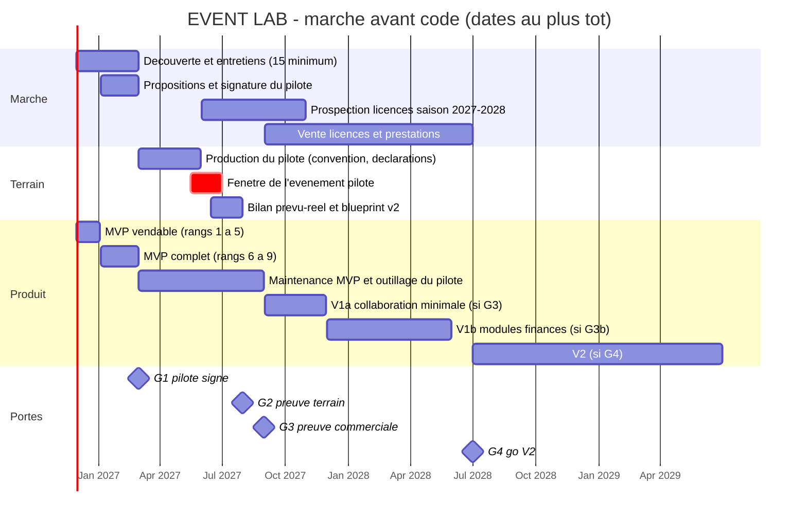

# 09 — Roadmap MVP, V1, V2

> Version du document : 0.1 — rédigé le 2026-11-24. Chiffrage associé : [`10-couts.md`](10-couts.md). Moteur : [`07-algorithmes.md`](07-algorithmes.md).
> Les seuils des portes de décision sont des **hypothèses de pilotage** fixées a priori pour éviter de les ajuster après coup. Ils se modifient par nouvelle version de ce document, jamais en cours de phase.
> Conventions : **M1** = décembre 2026, **S1** = semaine du lundi 30/11/2026, **J+90** = 28/02/2027. Les dates sont « au plus tôt » : une porte franchie en retard décale tout ce qui suit.

---

## 0. Position

1. **Ce qui se vend en 2027, ce n'est pas le logiciel.** C'est un format événementiel éprouvé, sa méthode de production et l'accompagnement. Le logiciel sert à produire ce format plus vite et plus sûrement, et à montrer cette rigueur aux clients. Il ne devient un produit en soi qu'en V2, si des organisateurs le réclament.
2. **Le marché passe avant le code.** Aucun euro de développement V1 n'est engagé avant :
   - un premier événement réel exécuté, avec un bilan prévu/réel ;
   - au moins trois organisateurs prêts à payer, ce qui se mesure par des signatures et non par des déclarations d'intérêt.
3. **Le studio n'organise pas juridiquement le premier événement.** L'organisateur pilote (association, club, collectivité) porte les déclarations, l'assurance RC organisateur, le dispositif de secours et la billetterie. Le studio intervient comme concepteur et coordinateur sous convention. C'est la principale mesure de maîtrise du risque.
4. **Dans le MVP, on construit d'abord ce qui fait vendre.** Le simulateur financier et la notation passent avant le configurateur 2D : ils répondent aux deux questions des décideurs, « combien ça coûte et rapporte » et « est-ce sérieux ».
5. **Écart par rapport au phasage décidé, à arbitrer par le porteur.** Le phasage prévoit « V1 (3–6 mois) ». Je recommande de lire ces 3–6 mois comme la **durée** de développement de V1, et non comme sa date de démarrage. Le démarrage dépend de la porte G3, dont la date au plus tôt est fin août 2027 (M9). Si cet écart est validé, il doit être tracé dans `CHANGELOG.md`, ce que ce document ne fait pas.

---

## 1. Vue d'ensemble

| Phase | Période (au plus tôt) | Objectif business | Ce qui conditionne l'entrée | Coût cash indicatif (variante recommandée, cf. 10-couts §9) |
|---|---|---|---|---|
| **MVP-A** Construire et vendre | S1–S13 (30/11/2026 → 28/02/2027) | Signer un événement pilote rémunéré et valider prix et cibles | Décision prise (H1–H3) | ≈ 9 k€ sur l'année 1 hors V1a (dont juridique, marque, identité, assurance, comptabilité) |
| **MVP-B** Pilote terrain | M4–M8 (mars → juillet 2027) | Prouver que le format tient en conditions réelles et que les prévisions sont fiables | G1 franchie | inclus ci-dessus (le budget de l'événement est porté par l'organisateur) |
| **V1a** Collaboration minimale | M10–M12 (sept. → nov. 2027) | Permettre à 2 à 5 licenciés de travailler dans l'outil et industrialiser la licence | G3 franchie | ≈ 3 k€ cash + ≈ 18–30 jours porteur |
| **V1b** Modules financés | M13–M18 (déc. 2027 → mai 2028) | Réduire le coût de production par événement et augmenter la valeur perçue de la licence | G3b, module par module | ≈ 5–6 k€ cash en année 2 |
| **V2** Produit et place de marché | M20 et au-delà (juillet 2028 →) | Vendre l'outil en libre-service et faire circuler les licences sans le porteur | G4 franchie | ≈ 75 k€ (freelance) à ≈ 114 k€ (agence) en valeurs centrales, fourchette 56–140 k€ (cf. 10-couts §4) : à financer par les revenus ou un financement dédié |

---

## 2. Portes de décision (go / no-go)

Chaque porte est **binaire** : tous les critères marqués « obligatoire » sont atteints, ou la porte n'est pas franchie. Les preuves sont archivées dans le dépôt (entretiens, conventions, bilans).

### G1 — Pilote signé (J+90, 28/02/2027)

| Critère | Seuil | Preuve | Obligatoire |
|---|---|---|---|
| Entretiens de découverte menés | ≥ 15, couvrant au moins 3 types d'organisateurs parmi associations, clubs, collectivités et agences | Comptes rendus datés | Oui |
| Convention de pilote signée | 1 organisateur porteur, lieu existant avec accord écrit de principe, date J fixée, budget de l'événement entre 10 et 30 k€ avec ≥ 60 % des financements identifiés, rémunération du studio écrite (même réduite) | Convention signée | Oui |
| Pipeline qualifié | ≥ 3 autres organisateurs avec un besoin daté et un décideur identifié | Fiches du pipeline | Oui |
| Blueprint #1 | 40 sections complètes, note ≥ 65/100 (grade B), verdict « éligible » ou « sous réserve » (07 §1.5), relu par ≥ 1 professionnel externe | Évaluation + compte rendu de relecture | Oui |
| Prix testés | Au moins 3 ancres de prix (licence, prestation) présentées en entretien, avec les réactions consignées | Grille d'entretien | Non |

**Si G1 échoue** : une seule prolongation de 45 jours, en élargissant les cibles (services des sports de collectivités, agences) et les villes. En cas de nouvel échec : arrêt du développement logiciel, conservation de la méthode et des documents, puis réexamen de H2 (autre format, autre cible). On ne compense pas un échec commercial par du code.

### G2 — Preuve terrain (J événement + 30 jours, au plus tard 31/07/2027)

| Critère | Seuil | Obligatoire |
|---|---|---|
| Événement exécuté | Oui, sans incident de sécurité grave | Oui |
| Bilan prévu/réel (07 §10) | ≥ 8 KPI comparés : fréquentation, recettes, dépenses, durée du programme, attente maximale, effectif mobilisé, satisfaction, contenus produits | Oui |
| Fiabilité budgétaire | Écart des dépenses réelles par rapport au scénario central ≤ ±15 % ; résultat de l'événement ≥ scénario prudent | Oui |
| Satisfaction | Enquête avec ≥ 100 réponses ou ≥ 15 % des participants ; seuil de recommandation fixé **avant** l'événement et atteint | Oui |
| Reconduction | L'organisateur pilote confirme par écrit son intention de faire une édition 2 | Oui |
| Capitalisation | ≥ 5 entrées réelles dans le registre des erreurs ; blueprint v2 créé comme nouvelle version (aucune modification silencieuse) | Oui |

**Si G2 échoue** sur la fiabilité ou la satisfaction : correction du format (blueprint v2), puis second pilote **avant** toute vente de licence. Une licence vendue sur un format non prouvé expose le studio à des réclamations et à une perte de réputation.

### G3 — Preuve commerciale = go V1a (au plus tôt fin août 2027)

| Critère | Seuil | Obligatoire |
|---|---|---|
| Organisateurs prêts à payer | ≥ 3, hors pilote : au moins 1 contrat de licence ou de prestation signé, et 2 autres devis signés, acomptes ou bons de commande. Une lettre d'intention sans prix ni date ne compte pas. | Oui |
| Chiffre d'affaires signé hors pilote | ≥ coût cash de V1a dans l'option retenue (≈ 3 k€ en variante recommandée, ≈ 21 k€ si V1a est confiée à un freelance), et ≥ 6 000 € HT dans tous les cas | Oui |
| Besoin de collaboration | ≥ 2 licenciés ou clients ayant un besoin documenté d'accès partagé à l'outil. Sans ce besoin, on reste en statique + exports et V1a n'est pas lancée. | Oui |
| Conversion | Part des entretiens qualifiés aboutissant à un devis ≥ 15 % | Non |

### G3b — Go V1b (module par module)

Un module V1b est développé uniquement si **les deux** conditions sont réunies :
- au moins 2 clients payants le demandent, ou un contrat le finance ;
- le chiffre d'affaires sur 12 mois glissants atteint au moins 15 000 € HT.

L'ordre de développement suit la demande, pas la liste.

### G4 — Go V2 (au plus tôt juin 2028)

| Critère | Seuil | Obligatoire |
|---|---|---|
| Licences | ≥ 10 éditions vendues sur 12 mois glissants, dans ≥ 3 villes | Oui |
| Reproductibilité | ≥ 2 éditions exécutées par un licencié **sans présence** du concepteur, avec un bilan conforme à G2 | Oui |
| Demande d'outil | ≥ 5 organisations utilisent V1 chaque mois, et ≥ 3 demandent un accès autonome payant | Oui |
| Données | ≥ 10 événements avec données réelles post-événement. En dessous, le recalibrage statistique (07 §10) est du bruit. | Oui |
| Économie | CA sur 12 mois glissants ≥ 40 000 € HT et marge contributive positive **après** rémunération du porteur | Oui |
| Financement | 100 % du coût V2 de l'option retenue couvert par la trésorerie ou un financement identifié | Oui |

---

## 3. MVP (v0.x) — construire et vendre, puis piloter

### 3.1 Objectif business
Transformer le blueprint #1 en un **événement pilote signé et rémunéré**, et apprendre auprès des organisateurs ce qu'ils achètent réellement (format clé en main, accompagnement, outil), à quel prix et à quelle saison. L'application est l'outil de production du blueprint et le support de démonstration en rendez-vous.

### 3.2 Fonctionnalités, dans l'ordre de construction (valeur commerciale décroissante)

| Rang | Module | Pourquoi à ce rang | Charge estimée (JH, cf. 10-couts §3) | Échéance |
|---|---|---|---|---|
| 1 | Socle : store JSON/localStorage, validation par schémas, import/export JSON-MD, versionnement local | Tout en dépend ; les exports protègent contre la perte de données du navigateur | 8 | S1 |
| 2 | Notation /100 + portes éliminatoires + indice de confiance | Évalue le blueprint et le portefeuille ; démontre la rigueur | 3 | S1 |
| 3 | Simulateur financier : scénarios, seuil, trésorerie, tornade | Première question d'un décideur ; sert la négociation du pilote | 6 | S2 |
| 4 | Simulateur logistique : compétition, flux, personnel, chemin critique | Crédibilité opérationnelle (durées, files, effectif) | 7 | S3 |
| 5 | Registre des erreurs, bibliothèque de briques, observatoire (fiches JSON) | Capital de connaissance ; alimente le générateur | 7 | S4 |
| 6 | Dashboard, bibliothèque documentaire | Confort d'usage | 4 | S4–S6 |
| 7 | Générateur de concepts (filtrage, utilité, softmax, MMR) | Productivité pour le portefeuille de 10 concepts ; pas indispensable pour vendre le pilote | 5 | Janvier |
| 8 | Configurateur de lieu 2D simplifié | Utile une fois le lieu pilote connu ; d'ici là, un plan coté fait à la main suffit | 6 | Janvier–février |
| 9 | Exports PDF/DOCX/XLSX/PPTX par scripts | Nécessaire pour les dossiers remis aux partenaires ; peut être confié à un freelance (≈ 5 JH) | 5 | Février |
| — | Tests, recette, documentation | En continu | 6 | Continu |

« **MVP vendable** » (rangs 1 à 5) : démontrable fin S4. « **MVP complet** » : J+90.

### 3.3 Livrables

- Application v0.x, versionnée et archivée (`scripts/release.sh`).
- Blueprint #1 complet (40 sections) et portefeuille de 10 concepts notés.
- Kit commercial : présentation de 10 pages, grille tarifaire d'essai, trame de convention de pilote, modèle de contrat de licence (relu par un avocat).
- Registre d'entretiens et pipeline.
- Après l'événement : bilan prévu/réel, blueprint v2, registre des erreurs enrichi.

### 3.4 Durée
- MVP-A : 13 semaines (J+90).
- MVP-B : de la signature à J+30, soit 4 à 5 mois. L'entre-deux sert à la production : déclarations selon le régime de la manifestation (voie publique, ERP, etc.), à vérifier en mairie et en préfecture ([sports.gouv.fr](https://www.sports.gouv.fr/organiser-une-manifestation-sportive-1243)) ; dispositif de secours ; partenaires. Une marge d'au moins 3 mois entre la signature et J est une **estimation** prudente, pas une règle.

### 3.5 Équipe et compétences

| Rôle | Qui | Charge | Remarque |
|---|---|---|---|
| Produit, commercial, production du pilote | Porteur | Plein temps | Règle : **≥ 50 % du temps sur le marché** (entretiens, propositions, terrain), mesuré chaque semaine |
| Développement | Porteur + Claude Code | ≈ 30–55 jours sur MVP-A et MVP-B (estimation, cf. 10-couts §4) | Bascule vers un freelance si le rang 3 n'est pas livré fin S2 |
| Scripts d'export, recette | Freelance (option) | ≈ 5 JH | Cf. 10-couts |
| Identité visuelle du format | Graphiste freelance | Ponctuel | Avant le dossier de sponsoring |
| Contrat de licence, convention, CGV | Avocat (propriété intellectuelle, contrats) | Ponctuel | Avant la première signature |
| Statut, TVA, facturation | Expert-comptable | Ponctuel | Avant la première facture |
| Sécurité de l'événement | Organisateur pilote + prestataire agréé | Porté par l'événement | Jamais dimensionné par l'outil (07 §6) |

### 3.6 Dépendances
- Disponibilité d'un lieu existant aux dates visées, et calendrier associatif (assemblées générales, budgets) : la saison conditionne la signature.
- Délais administratifs de la manifestation, propres au régime de l'événement.
- Le dépôt actuel est **public** (risque signalé dans `CHANGELOG.md`) : migrer vers un dépôt privé **avant** de montrer prix, contrats ou blueprint à des tiers.
- Nom du format disponible à titre de marque (recherche d'antériorité, puis dépôt INPI).

### 3.7 Critères de sortie
G1, puis G2 (§2).

### 3.8 Risques et parades

| Risque | Probabilité | Impact | Parade |
|---|---|---|---|
| Le porteur code au lieu de vendre | Élevée | Critique | Tableau hebdomadaire temps marché / temps code (seuil ≥ 50 %) ; liste de fonctionnalités gelée à S1 |
| Aucun pilote signé à J+90 | Moyenne | Élevé | Pipeline sur 2–3 villes, 4 segments ; prix pilote réduit ; prolongation unique de 45 jours, puis réexamen de H2 |
| Responsabilité juridique en cas d'incident | Faible | Critique | Organisateur = partenaire ; convention qui répartit les rôles ; RC Pro du studio ; portes éliminatoires de sécurité (07 §1.5) |
| Prévisions du simulateur fausses (paramètres non calibrés) | Élevée | Moyen | Affichage « prévisionnel » et indice de confiance ≤ 0,6 ; marge de 15 % ; bilan G2 pour corriger |
| Perte de données (localStorage) | Moyenne | Moyen | Export JSON quotidien dans le dépôt Git ; versionnement |
| Fuite de contenus commerciaux (dépôt public) | Élevée tant que le dépôt reste public | Élevé | Dépôt privé avant toute diffusion ; app non publiée en ligne ou protégée par contrôle d'accès |
| Limites d'usage de l'abonnement Claude pendant les semaines intenses | Moyenne | Faible | Formule supérieure pendant la construction (cf. 10-couts §5) |
| Nom de format indisponible | Moyenne | Moyen | Recherche d'antériorité dès S1 ; 3 noms de repli |
| Saisonnalité (fêtes, été) | Certaine | Moyen | Calendrier §5 : construction pendant les fêtes, vente en septembre pour la saison suivante |

---

## 4. V1 — backend, collaboration, intégrations

### 4.1 Objectif business
Passer de « le porteur produit chaque événement » à « des licenciés produisent avec l'outil et le porteur supervise ». V1 baisse le coût marginal d'une licence (moins de jours d'accompagnement) et augmente sa valeur perçue (outil inclus). Si les licenciés n'ont pas besoin d'un outil partagé, V1 n'a pas de raison d'exister.

### 4.2 Découpage

**V1a — collaboration minimale (déclenchée par G3)**

| Fonction | Charge (JH) |
|---|---|
| Postgres managé (migration des schémas JSON), authentification, RLS, stockage | 10 |
| Rôles et collaboration (porteur, licencié, invité) | 6 |
| File de validation de la veille (semi-automatique, validation humaine obligatoire) | 6 |
| Espace administrateur sécurisé et journal d'audit | 4 |
| Migration des données du MVP | 3 |
| Sécurité, RGPD, tests, intégration continue | 6 |
| **Total** | **35** |

**V1b — modules financés (déclenchés par G3b, un par un)**

| Fonction | Charge (JH) |
|---|---|
| Gestion de projet et calendrier | 8 |
| Notifications | 3 |
| Pipeline de veille via l'API Claude | 4 |
| Couche rédactionnelle LLM (07 §2.9 : aucun chiffre ni aucune source générés) | 6 |
| Intégrations billetterie (HelloAsso, Weezevent, Billetweb), environ 4 JH chacune, **uniquement celle utilisée par des clients** | 12 |
| CRM, comptabilité, emailing (export ou API des outils existants) | 8 |
| Import de plans et de photos | 4 |
| Studio d'identité visuelle | 8 |
| Tests et recette | 4 |
| **Total** | **57** |

Le « V1b ciblé » chiffré en année 2 (≈ 28 JH) correspond aux modules les plus probables : calendrier, notifications, une billetterie, rédaction et import de plans.

### 4.3 Livrables
Application multi-utilisateur pour un nombre restreint d'organisations ; registre RGPD et contrat de sous-traitance pour les licenciés ; procédure de sauvegarde et de restauration testée ; documentation d'onboarding d'un licencié.

### 4.4 Durée
V1a : environ 3 mois en interne à temps partiel, ou 6 à 8 semaines avec un freelance. V1b : 3 à 6 mois, étalés au fil des déclenchements.

### 4.5 Équipe et compétences
Porteur + Claude Code pour l'essentiel. Un développeur fullstack freelance senior (Postgres/RLS) intervient en binôme et pour une **revue de sécurité indépendante** avant l'ouverture à des tiers. Un avocat ou conseil intervient pour les CGU, le contrat de sous-traitance et l'information RGPD. Un designer UX est ponctuel et optionnel.

### 4.6 Dépendances
G3 franchie. Choix d'hébergement compatible avec les exigences des clients (localisation des données pour les collectivités : à recueillir en entretien). Accès aux API des billetteries (conditions à confirmer auprès de chaque éditeur). Clé API Anthropic et budget plafonné.

### 4.7 Critères de passage vers V2
G4 (§2).

### 4.8 Risques et parades

| Risque | Parade |
|---|---|
| Faille d'accès (RLS mal configurée) exposant des données de participants | Politiques RLS testées automatiquement ; revue de sécurité externe avant la mise en production ; aucune donnée nominative de participants tant que ce n'est pas nécessaire |
| Dépendance au fournisseur du backend | Schémas JSON portables (déjà en place), export SQL régulier, pas de logique métier enfermée dans des fonctions propriétaires |
| Dérive du périmètre (intégrations « au cas où ») | Règle G3b : pas de module sans 2 demandes payantes |
| Hallucinations de la couche LLM | Sortie validée contre `event-config.schema.json` ; champs chiffrés et sources verrouillés (07 §2.9) |
| Charge de support des licenciés supérieure au prévu | Mesurer les jours de support par licence ; au-delà de 2,5 jours (hypothèse de 10-couts §10), revoir le prix ou la documentation |
| Dérive des coûts d'API | Plafond de dépense mensuel côté Anthropic ; mise en cache ; petit modèle pour le tri |

---

## 5. V2 — produit, données, place de marché

### 5.1 Objectif business
Rendre la licence et l'outil vendables sans le porteur :
- abonnement à l'outil (SaaS multi-organisation) ;
- place de marché de formats licenciables ;
- analyse post-événement avancée qui améliore les prévisions à partir des données réelles accumulées.

### 5.2 Fonctionnalités et charge

| Fonction | Charge (JH, estimation) | Condition supplémentaire |
|---|---|---|
| Configurateur 3D | 35 | Seulement si des clients en font un critère d'achat, sinon reporté |
| Recalibrage statistique des paramètres | 10 | ≥ 10 événements réels |
| Multi-organisation / SaaS (cloisonnement, facturation, onboarding, CGU) | 30 | ≥ 3 demandes d'accès autonome payant |
| Place de marché de licences | 30 | ≥ 2 formats prouvés et ≥ 10 licences par an |
| Analyse post-événement avancée | 15 | — |
| Durcissement, performance, sécurité (test d'intrusion) | 15 | Obligatoire avant ouverture publique |
| **Total** | **135** | |

### 5.3 Livrables
Offre d'abonnement publiée, CGU et CGV SaaS, catalogue de formats, tableau de bord multi-organisation, rapport de test d'intrusion.

### 5.4 Durée
6 à 18 mois selon l'option de réalisation et le rythme des revenus.

### 5.5 Équipe
- 1 à 2 développeurs, dont un capable de prendre la 3D ;
- 1 profil données à temps partiel ;
- 1 personne en charge de la relation client et du support. C'est le premier recrutement à envisager, avant un développeur, si la croissance vient des licences.

### 5.6 Dépendances
- G4.
- Financement de V2 : environ 75 k€ (freelance) à 114 k€ (agence) en valeurs centrales (10-couts §4).
- Marque protégée au niveau européen si l'expansion hors de France est visée.

### 5.7 Risques et parades

| Risque | Parade |
|---|---|
| SaaS lancé sans demande réelle | Critère G4 « 3 demandes d'accès autonome payant » |
| Place de marché vide (problème de l'œuf et de la poule) | Ouvrir d'abord avec les formats du studio et des licenciés existants ; pas de recrutement de vendeurs tiers avant 10 licences par an |
| Gadget 3D | Conditionné à un critère d'achat exprimé ; le 2D reste la référence pour décider |
| Recalibrage sur échantillon trop petit | Seuil de 10 événements ; recalibrage toujours proposé et validé par un humain (07 §10) |
| Coût de V2 non couvert par les revenus | Condition de financement de G4 ; découpage de V2 en lots livrables séparément |

---

## 6. Diagramme de Gantt (dates au plus tôt)

*Les libellés sont sans accents pour garantir le rendu dans tous les moteurs Mermaid.*

---

## 7. Les 90 premiers jours

### 7.1 Semaine par semaine (S1 à S4)

| Semaine | Marché | Produit (app et documents) | Juridique / admin | Livrable et KPI de fin de semaine |
|---|---|---|---|---|
| **S1** (30/11 → 06/12) | Définir 4 segments cibles (associations/clubs, services des sports de villes moyennes, agences, ligues ou comités) ; constituer une liste de 40 contacts dans 2–3 villes moyennes ; écrire la grille d'entretien (problème, calendrier, budget, décideur, prix acceptable) ; envoyer 10 demandes de rendez-vous | Socle de l'app + module Notation (rangs 1–2) ; blueprint #1 sections 1–10 | Migrer le projet vers un dépôt privé ; rendez-vous avec un expert-comptable (statut) ; recherche d'antériorité du nom du format | 40 cibles, 10 demandes, ≥ 2 entretiens, v0.1 archivée |
| **S2** (07/12 → 13/12) | 5 entretiens (cumul ≥ 7) ; tester 3 ancres de prix ; repérer 3 lieux existants compatibles | Simulateur financier (rang 3) appliqué au blueprint ; blueprint sections 11–27 (format, règles, programme, parcours, conducteur) | Demander 2 devis de RC Pro | ≥ 7 entretiens ; budget à 3 scénarios et seuil de rentabilité du blueprint ; 1 lieu contacté |
| **S3** (14/12 → 20/12) | 4 entretiens (cumul ≥ 11) ; **1 proposition de pilote envoyée** (offre, prix, calendrier, répartition des rôles) ; 1 visite de lieu | Simulateur logistique (rang 4) ; 10 premières entrées sourcées du registre des erreurs ; blueprint sections 28–40 | Trame de convention de pilote (organisateur = partenaire) | Blueprint v0.9 noté (note et verdict des portes) ; 1 proposition envoyée |
| **S4** (21/12 → 27/12, Noël) | Pas de prospection active (décideurs peu joignables : hypothèse) ; relances programmées pour le 04/01 ; synthèse des objections et des prix entendus | Briques, observatoire (20 fiches), dashboard (rangs 5–6) ; **MVP vendable** archivé | — | **Revue S1–S4** : ≥ 10 entretiens, ≥ 1 proposition, ≥ 2 pistes chaudes. Sinon : changer de segment ou de ville dès S6 |

### 7.2 Semaines 5 à 13

| Période | Marché | Produit | Juridique / admin | Jalon |
|---|---|---|---|---|
| **S5** (28/12 → 03/01) | — | Tests, correctifs, documentation | — | — |
| **S6–S9** (janvier) | Relances ; entretiens (cumul ≥ 15) ; 3 propositions envoyées ; négociation du pilote ; dossier de sponsoring type remis à l'organisateur pilote | Générateur de concepts, configurateur 2D (rangs 7–8) ; portefeuille de 10 concepts notés | Contrat de licence type rédigé par un avocat ; dépôt de marque INPI une fois le nom validé ; RC Pro souscrite avant toute signature | **J+45 (≈ 14/01)** : ≥ 12 entretiens, ≥ 2 propositions envoyées |
| **S10–S13** (février) | **Signature de la convention de pilote** ; rétroplanning partagé ; lancement des démarches déclaratives par l'organisateur ; choix de la billetterie | Exports scripts (rang 9), recette, MVP complet archivé | Choix du statut et première facture (acompte pilote) | **G1 au 28/02/2027** |

### 7.3 Tableau de bord hebdomadaire (5 chiffres, chaque lundi)
1. Entretiens tenus (cumul).
2. Propositions envoyées et signées.
3. Part du temps consacrée au marché (cible ≥ 50 %).
4. Modules livrés par rapport au plan §3.2.
5. Trésorerie engagée par rapport au budget (10-couts §9).

---

## 8. Anti-roadmap : ce qu'on ne fait pas

| On ne fait pas | Pourquoi | Réouverture possible si |
|---|---|---|
| Une billetterie ou un système de paiement maison | HelloAsso, Billetweb et Weezevent existent, avec des frais connus (10-couts §7) ; le paiement impose des obligations réglementaires et de sécurité disproportionnées | Jamais pour le paiement ; intégration API seulement (V1b) |
| Une application mobile native | Une app web adaptée au mobile couvre les besoins d'organisation ; deux bases de code doublent la maintenance | ≥ 5 clients payants exigent une fonction impossible sur le web (hors ligne terrain, par exemple) |
| Un moteur de collecte maison (scraping massif) | Risques liés aux CGU des sites et juridiques, maintenance permanente ; la veille par tâches planifiées et recherche ciblée suffit (H3) | Flux officiels (RSS, API) seulement, jamais de scraping massif |
| Une veille publiée sans validation humaine | Le brief exige de distinguer faits vérifiés, estimations et hypothèses ; un LLM peut se tromper sur une source | Jamais : la file de validation (V1a) reste obligatoire |
| La génération par LLM de chiffres, sources ou retours d'expérience | Interdit par le contrat du moteur (07 §2.9) et par le brief (§4) | Jamais |
| La validation réglementaire ou de sécurité par l'outil | Le simulateur dimensionne, il ne valide pas (07 §5–6, brief §8) | Jamais |
| Le studio organisateur juridique d'événements en année 1 | Responsabilité civile et pénale, trésorerie et assurance hors de proportion avec un studio naissant | Après ≥ 3 éditions réussies, avec une structure et une assurance adaptées, conseil d'un avocat |
| Plusieurs formats en parallèle avant la preuve du premier | Dispersion ; aucune preuve exploitable | Après G2 sur le format #1 |
| Configurateur 3D en MVP ou en V1 | ≈ 35 JH pour un gain de décision marginal par rapport au 2D | G4 et critère d'achat exprimé |
| SaaS multi-organisation et place de marché avant G4 | Pas de preuve d'un marché « outil » ; V2 coûte 75 à 114 k€ en valeurs centrales | G4 |
| CRM, comptabilité ou emailing maison | Outils existants, gratuits ou peu chers | Jamais : intégration seulement |
| Expansion hors de France | Formats, règles et assurances différents ; marque à étendre | ≥ 3 villes françaises sous licence et marque UE déposée |
| Recrutement salarié | Charges fixes avant revenus récurrents | CA récurrent couvrant le poste sur 12 mois |
| Levée de fonds avant G3 | Inutile vu le coût de la variante recommandée (≈ 21 k€ sur 2 ans) ; dilution sur une valorisation sans preuve | Seulement si V2 est décidée et que les revenus ne la financent pas |
| Événements de plus de 30 k€ en année 1 | Hors du blueprint validé (H2) ; risque financier et opérationnel | Après 2 éditions réussies dans la fourchette H2 |
| Copier marques, noms ou identités visuelles de référence | Brief §6 ; risque de contrefaçon | Jamais : on reprend la logique, jamais les signes distinctifs |

---

## 9. Hypothèses à vérifier en priorité (avant le 28/02/2027)

| Hypothèse | Statut | Comment la vérifier |
|---|---|---|
| Des organisateurs paient pour un format clé en main entre 10 et 30 k€ de budget | Hypothèse | Signatures (G1, G3), pas des déclarations |
| Licence par édition autour de 1 500 € HT acceptable (10-couts §10) | Hypothèse | 3 ancres de prix en entretien, puis premier devis signé |
| La saison de vente des licences est septembre–novembre pour l'année suivante | Hypothèse | Question systématique en entretien |
| Un licencié a besoin d'un outil partagé (justification de V1) | Hypothèse | Critère G3 « besoin de collaboration » |
| Le porteur livre les rangs 1 à 5 avec Claude Code en 4 semaines tout en vendant | Hypothèse | KPI 4 du tableau de bord ; bascule vers un freelance sinon |
