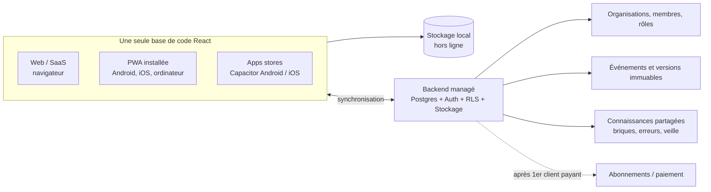

# 13 — EVENT LAB en SaaS et en application mobile

> Décisions du porteur (2026-11-24) : EVENT LAB est un **SaaS** et une **application mobile téléchargeable** ; technique mobile : **Capacitor** (le même code React que le web) ; calendrier : **socle SaaS construit maintenant sur des offres gratuites, dépenses (comptes stores, offres payantes, paiement en ligne) engagées seulement après les premiers clients payants**.
>
> Ce document révise le phasage de `09-roadmap.md` : le SaaS n'attend plus la V2 pour exister techniquement, mais **les portes de décision restent valables pour l'argent dépensé**.

## 1. Ce que cela change

| Avant | Maintenant |
|---|---|
| MVP mono-utilisateur, local ; SaaS en V2 | Une seule application React : web, installable sur téléphone (PWA), puis emballée pour l'App Store et Google Play (Capacitor), connectée à un backend multi-organisation |
| Backend seulement après la porte G3 | Socle backend construit tout de suite sur offre gratuite ; passage en offre payante seulement avec du chiffre d'affaires signé |
| Pas de facturation prévue avant V2 | Facturation (abonnements) branchée au premier client payant, pas avant |

## 2. Architecture cible

- **Hors ligne d'abord** : l'application fonctionne sans réseau (sur le terrain, le jour J) ; elle synchronise ensuite. Les versions validées sont immuables (déjà garanti par le moteur), donc les conflits portent seulement sur les brouillons : dernier enregistrement gagnant avec contrôle de version, et alerte en cas d'écart.
- **Multi-organisation** : chaque association, club, collectivité ou agence est une organisation ; isolation des données par règles de sécurité au niveau des lignes (schéma cible dans `03-modele-de-donnees.md` §5 et l'ancien `baskest-lab/db/schema.sql`, fusionnés en v0.4 dans `baskest-lab/supabase/migrations/` : voir [14-socle-saas.md](14-socle-saas.md)).
- **Connaissances partagées** : briques, registre des erreurs et sources de veille sont communs à tous les clients et en lecture seule. Ils forment l'actif du studio.
- **Exports** : JSON et Markdown sur l'appareil ; PDF, DOCX, XLSX et PPTX par un service d'export côté serveur (à construire, aujourd'hui assuré par les scripts du dépôt).

## 3. Offres (hypothèses à tester en entretien, aucun prix de marché sourcé)

| Offre | Cible | Contenu | Prix |
|---|---|---|---|
| Découverte | Associations, bénévoles | 1 organisation, 2 événements actifs, simulateurs, export JSON | Gratuit (acquisition) |
| Pro | Clubs, associations structurées | Événements illimités, versions et collaboration, exports bureautiques | Hypothèse à tester |
| Organisation | Collectivités, agences | Multi-équipes, rôles, licence de formats du portefeuille, accompagnement | Hypothèse à tester |

Le modèle de revenus de `10-couts.md` (licence de format, prestation) reste prioritaire : l'abonnement s'y ajoute, il ne le remplace pas.

## 4. Séquencement

| Version | Contenu | Coût engagé | Dépend du porteur |
|---|---|---|---|
| **v0.3** | Application fusionnée, installable (PWA), conçue d'abord pour le mobile | 0 € | — |
| **v0.4** | Socle SaaS : comptes, organisations, rôles, synchronisation des événements et versions, sur offre gratuite d'un backend managé en région UE | 0 € (offre gratuite) | Créer le projet backend et fournir l'URL et la clé publique |
| **v0.5** | Emballage Capacitor : projets Android et iOS, icônes, écran de démarrage, construction automatique (intégration continue) d'une version de test Android | 0 € | — |
| **v0.6** | Veille automatisée (tâches planifiées) | Usage de l'abonnement Claude | Autoriser les domaines réseau nécessaires |
| **Après le 1er client payant** | Comptes développeur stores, publication, offres payantes, paiement en ligne, service d'export serveur | Frais stores + offres payantes | Comptes Apple / Google, entité juridique, CGU/CGV |

## 5. Obligations à préparer avant publication (information générale, à vérifier)

- Politique de confidentialité publique, mentions légales, CGU (et CGV dès qu'il y a abonnement payant) : exigées par les stores et par le droit applicable ; relecture par un juriste recommandée.
- Suppression de compte depuis l'application quand l'application permet de créer un compte (règle des stores à vérifier dans leurs conditions en vigueur).
- RGPD : hébergement des données en UE, contrat de sous-traitance avec l'hébergeur, registre des traitements, durées de conservation (`03-modele-de-donnees.md` §5).
- Formulaires de déclaration des données collectées exigés par les stores.
- Frais d'inscription aux stores (ordre de grandeur connu : 99 $ par an pour Apple, 25 $ une fois pour Google — **à vérifier sur les pages officielles avant engagement**) ; la construction iOS exige un Mac (ou un service de construction macOS).

## 6. Risques

| Risque | Parade |
|---|---|
| Construire un SaaS sans client | Dépenses conditionnées aux portes G1–G3 ; le pilote LA GRILLE continue en parallèle (`12-plan-pilote-la-grille-nancy.md`) |
| Dispersion (plusieurs projets ouverts en parallèle) | Un seul produit : EVENT LAB, avec BASK'EST LAB comme verticale basket |
| Rejet en store (application jugée « simple site web ») | Valeur native réelle : hors ligne, notifications du jour J, partage, appareil photo pour les relevés de lieu |
| Dette de synchronisation | Versions immuables, journal d'audit, tests de synchronisation dès v0.4 |
