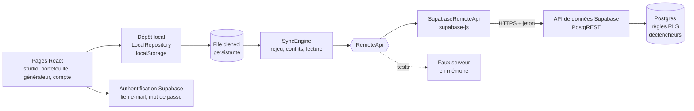

# 14 — Socle SaaS (v0.4) : comptes, organisations, rôles, synchronisation

> **Statut : v0.4 en cours, non publiée.** Ce document décrit ce qui est construit, ce qui est réellement testé et ce qui reste à vérifier sur un vrai projet Supabase. Décisions d'origine : [13-saas-et-mobile.md](13-saas-et-mobile.md). Aucune dépense, aucun paiement, aucune publication en magasin d'applications.
>
> **Ce qui n'a jamais tourné contre un vrai projet Supabase** (aucun projet n'existe encore) : la connexion, les appels à l'API de données, la suppression du compte côté Supabase, l'envoi des e-mails. Tout cela est marqué « dépend d'une intégration » dans l'application.

## 1. Ce qui est livré

| Élément | Où | Testé comment |
|---|---|---|
| Schéma unique en 5 migrations (organisations, membres, invitations, événements, versions, historique, audit, connaissances, fonctions du compte) | `baskest-lab/supabase/migrations/` | `npm run db:test` : PostgreSQL 16 local jetable, simulation de l'authentification Supabase, 155 vérifications |
| Graine des connaissances partagées (70 briques, 28 erreurs, 70 sources de veille, 10 concepts) | `baskest-lab/supabase/seed.sql`, générée par `npm run db:seed:generate` | chargée deux fois dans `db:test` (rejouable), comptée, contrôle « à jour par rapport aux JSON » |
| Couche de données hors ligne d'abord (dépôt local, file d'envoi, synchronisation, conflits, reprise des données v0.3) | `baskest-lab/src/core/sync/` | Vitest avec un faux serveur en mémoire (`tests/sync-*.test.ts`) |
| Implémentation Supabase de cette couche (`supabase-js` 2.119.0 épinglé) | `src/core/sync/remote-supabase.ts`, `account-supabase.ts` | **non testée contre Supabase** ; traduction des erreurs testée sur des formes documentées |
| Page « Compte et organisation » et indicateur de synchronisation | `src/ui/pages/Account.tsx`, `src/ui/SyncIndicator.tsx` | Playwright : 1440 et 360 px, thèmes clair et sombre, mode local réel et mode « serveur configuré » avec **réponses simulées** |
| Ancien `baskest-lab/db/schema.sql` | remplacé par un renvoi vers les migrations | — |

Sans configuration (`VITE_SUPABASE_URL`, `VITE_SUPABASE_ANON_KEY` absents), l'application fonctionne **en mode local, comme en v0.3** : le client Supabase n'est pas chargé, aucune requête n'est faite. La démo en un seul fichier (`npm run build:demo`) est toujours en mode local, même si un fichier `.env` existe (vérifié : ni le code Supabase ni l'URL n'y figurent).

## 2. Architecture retenue

- **Espaces de travail.** Chaque appareil a un espace « local » (données jamais envoyées, celles de la v0.3 y sont reprises) et un espace par organisation (copie locale synchronisée). Rien ne passe d'un espace à l'autre sans action explicite (« Copier mes versions locales vers cette organisation »).
- **Hors ligne d'abord.** Toute écriture est d'abord enregistrée sur l'appareil, puis rejouée vers le serveur. L'application reste utilisable sans réseau ; l'indicateur de la coquille dit « Mode local », « Synchronisé », « N en attente », « Hors ligne » ou « N alertes ».
- **Chargement paresseux.** Le client Supabase est un morceau séparé du paquet, chargé seulement si un serveur est configuré.
- **Navigation par `#/route` conservée.** Le lien de connexion utilise le flux PKCE : il revient avec `?code=…` dans l'adresse, puis l'application nettoie l'adresse et affiche `#/compte`.
- **Ce que la v0.4 ne synchronise pas** : projets, approbations, notifications et concepts de l'espace Basket (toujours dans le navigateur). Les tables de connaissances partagées sont créées et chargées sur le serveur, mais l'application lit encore ces connaissances dans les JSON du dépôt intégrés au paquet.

## 3. Modèle de données

| Table | Contenu | Origine |
|---|---|---|
| `organizations` | nom, SIREN, ville, marque, `row_version` | ancien `schema.sql` (organisation) |
| `memberships` | organisation, utilisateur, rôle, **fonction libre** (`function_label`), nom affiché | ancien `schema.sql` (member) |
| `invitations` | e-mail, rôle, fonction, expiration (14 jours), acceptation, révocation | nouveau |
| `events` | organisation, slug (= `EventConfig.id`), nom, provenance (studio, générateur, import) | docs/03 §5 (event) |
| `event_versions` | numéro, statut, configuration `EventConfig` en JSONB ; colonnes dérivées : nom, maturité, score, verdict, filiation | docs/03 §5 (event_version) |
| `event_version_status_history` | chaque changement de statut, en ajout seul | nouveau |
| `audit_log` | journal en ajout seul (actions serveur et actions `client.*`) | docs/03 §5 (audit_log) |
| `kb_building_blocks`, `kb_errors`, `kb_watch_sources`, `kb_watch_entries`, `kb_portfolio_concepts` | connaissances partagées, lecture seule | docs/03 §5 (building_block, error_entry, watch_entry) + catalogue de sources + portefeuille |

Identifiants générés **sur l'appareil** (UUID) pour les événements et les versions : un envoi rejoué ne crée jamais de doublon. Une version porte toujours `config.id = slug de l'événement`, `config.version = version` et `config.status = status` (contraintes vérifiées par la base). Taille maximale d'une configuration : 1 Mo.

Les tables propres au basket de l'ancien schéma (éditions, incidents, projets, approbations, notifications, concepts basket…) ne sont pas reprises en v0.4 ; la liste est dans `baskest-lab/db/schema.sql`. Le contenu d'origine reste accessible par `git show v0.3.0:baskest-lab/db/schema.sql`.

## 4. Modèle de rôles

| Action | Lecteur | Éditeur | Administrateur | Propriétaire |
|---|:-:|:-:|:-:|:-:|
| Lire l'organisation, ses membres, événements, versions, historique, journal | ✓ | ✓ | ✓ | ✓ |
| Créer un événement, créer et modifier un brouillon, le supprimer | — | ✓ | ✓ | ✓ |
| Soumettre un brouillon en revue | — | ✓ | ✓ | ✓ |
| Renvoyer en brouillon, **valider**, archiver | — | — | ✓ | ✓ |
| Supprimer une version en revue | — | — | ✓ | ✓ |
| Inviter, changer les rôles, retirer un membre (hors propriétaires) | — | — | ✓ | ✓ |
| Nommer ou retirer un propriétaire, supprimer l'organisation | — | — | — | ✓ |
| Modifier son propre nom affiché et sa fonction, quitter l'organisation | ✓ | ✓ | ✓ | ✓ (sauf dernier propriétaire) |
| Modifier ou supprimer une version **validée ou archivée** | — | — | — | — (personne, pas même le rôle de service) |

Correspondance proposée avec les anciens rôles associatifs (à ajuster par chaque organisation, la fonction restant un libellé libre) : présidence → propriétaire ; bureau, trésorerie → administrateur (fonction « trésorier ») ; responsable d'événement, bénévole référent → éditeur ; partenaire en lecture → lecteur.

## 5. Règles de sécurité (RLS) en clair

RLS est activée sur **toutes** les tables du schéma `public` (vérifié par `db:test`). Le rôle `anon` (visiteur non connecté) n'a **aucun droit** sur aucune table ni fonction. Les droits sont accordés explicitement par les migrations, sans dépendre du réglage « exposer automatiquement les nouvelles tables » du projet.

| Table | Lire | Ajouter | Modifier | Supprimer |
|---|---|---|---|---|
| organizations | membres | par la fonction `create_organization` | administrateur+ (nom, SIREN, ville, marque) | propriétaire, par `delete_organization` |
| memberships | membres de la même organisation | par `create_organization` ou `accept_invitation` seulement | soi-même (nom, fonction) ; administrateur+ (rôles, sauf propriétaires) ; propriétaire (tout) | soi-même (quitter) ; administrateur+ (hors propriétaires) ; propriétaire |
| invitations | administrateur+ ; la personne invitée (même e-mail que son jeton) | administrateur+ (rôle propriétaire : propriétaire seulement) | administrateur+ : révocation seulement | administrateur+ |
| events | membres | éditeur+ | éditeur+ (nom) | éditeur+ si seulement des brouillons ; administrateur+ sinon ; jamais avec une version figée |
| event_versions | membres | éditeur+ (brouillon ou en revue) ; administrateur+ (tout statut) | éditeur+ sur un brouillon ; administrateur+ ; le déclencheur vérifie chaque transition | éditeur+ (brouillon) ; administrateur+ (brouillon, en revue) ; jamais une version figée |
| event_version_status_history | membres | déclencheur seulement | personne | personne (sauf purge de l'organisation) |
| audit_log | membres | membres, actions `client.*` de leur organisation (auteur et date fixés par le serveur) | personne | personne (sauf purge de l'organisation) |
| kb_* (connaissances) | tout utilisateur connecté | rôle de service | rôle de service | rôle de service |

Les fonctions d'aide des règles (`private.orgs_with_role`, `private.has_role`) sont dans un schéma `private` non exposé par l'API ; elles sont `SECURITY DEFINER` avec `search_path` vide et ne renvoient que des informations sur l'utilisateur connecté. Les fonctions appelables par l'application (`create_organization`, `my_invitations`, `accept_invitation`, `delete_organization`, `account_deletion_preview`, `delete_my_account`) vérifient elles-mêmes l'identité et les droits, et ne sont exécutables que par `authenticated`.

## 6. Versions immuables, transitions, concurrence

- Transitions acceptées (déclencheur `event_versions_10_guard`, même règle que le moteur `versioning.ts`) : brouillon → en revue (éditeur+), en revue → brouillon, en revue → validée, validée → archivée (administrateur+). Le contenu (configuration hors statut et historique) ne change pas pendant une transition ; seul un brouillon voit son contenu modifié.
- **Version validée ou archivée** : toute modification ou suppression est refusée (code `PT423`), pour tous, y compris le propriétaire, le rôle de service et l'administrateur de la base. Seule exception : l'archivage, sans changement de contenu, avec un historique seulement prolongé. Toute évolution passe par une nouvelle version brouillon.
- **Concurrence optimiste** : chaque écriture renvoie la `row_version` lue ; si elle a changé, la base refuse (code `PT409`). Limite : un client qui n'envoie pas `row_version` n'est pas contrôlé (l'application l'envoie toujours).
- **Journal d'audit et historique de statut** : ajout seul, y compris pour le rôle de service et l'administrateur de la base (déclencheurs), vidage interdit. Seule la purge d'une organisation (suppression par son propriétaire ou par le compte de son dernier membre) les efface, au moyen d'une demande inscrite dans une table privée pour la seule transaction en cours.

## 7. Synchronisation et conflits

| Situation | Comportement | Test |
|---|---|---|
| Hors ligne | tout est enregistré sur l'appareil ; la file attend ; l'indicateur affiche « Hors ligne · N » | `sync-engine` : envoi différé |
| Retour du réseau | la file est rejouée dans l'ordre (création, modifications regroupées, transitions) puis le serveur est relu | rejeu dans l'ordre |
| Réponse perdue après enregistrement | le rejeu reconnaît sa propre écriture (même identifiant, même contenu) : ni doublon ni conflit | idempotence |
| Brouillon modifié sur deux appareils | le serveur garde la première modification ; la seconde est conservée dans un **nouveau brouillon** (« copie de conflit », filiation vers la version du serveur) ; alerte | conflit |
| Même transition faite deux fois | pas de copie, simple information | même transition |
| Même numéro créé hors ligne sur deux appareils | les deux versions sont gardées, la seconde est renumérotée ; alerte | collision de numéro |
| Brouillon validé entre-temps sur le serveur | la version validée n'est pas touchée ; la modification locale devient un nouveau brouillon | version validée jamais réécrite |
| Version figée différente côté serveur (anomalie) | la copie locale n'est pas réécrite ; alerte d'intégrité | intégrité |
| Action refusée par le rôle (lecteur qui crée, éditeur qui valide) | la copie locale est gardée (création) ou ramenée à l'état du serveur (transition) ; alerte « refus » ; la file n'est pas bloquée | refus selon le rôle |
| Suppression hors ligne d'un brouillon modifié ailleurs | suppression annulée, version restaurée ; alerte | suppression annulée |

Le blueprint LA GRILLE 3x3 et le concept du même nom partagent l'identifiant `la-grille-3x3` : le studio de configuration affiche donc les mêmes versions pour les deux sources, et le numéro suivant tient compte des deux (en v0.3, deux sources pouvaient produire le même numéro).

**Reprise des données v0.3** (`migrate-v03.ts`, au premier lancement) : les clés `baskest-lab:eventlab:versions:*` (studio) et `baskest-lab:eventlab:portefeuille-local` (générateur) sont copiées dans l'espace local, un événement par identifiant. Un numéro déjà pris pour le même événement est renuméroté (la version issue d'un concept cède devant celle du blueprint) et la remarque l'indique. Les clés v0.3 **ne sont ni modifiées ni supprimées** (sauvegarde). Une entrée illisible est ignorée et signalée, sans bloquer le reste. La reprise est rejouable sans doublon.

## 8. Suppression de son propre compte

Depuis la page « Compte et organisation » (exigence des magasins d'applications pour toute application qui permet de créer un compte — règle à revérifier dans leurs conditions en vigueur avant publication).

Règle, organisation par organisation (bilan affiché avant confirmation par `account_deletion_preview`) :

1. vous en êtes **le seul membre** : l'organisation et **toutes** ses données (versions validées et journal compris) sont supprimées ;
2. vous en êtes **le seul propriétaire** et d'autres membres restent : **refus** ; nommez d'abord un autre propriétaire (ou supprimez l'organisation) ;
3. sinon (co-propriétaire, autre rôle) : votre adhésion est retirée ; l'organisation et vos contributions restent (identifiant d'auteur conservé, sans lien vers une personne une fois le compte supprimé).

La confirmation exige de saisir `SUPPRIMER`. Les invitations en attente adressées à votre e-mail sont supprimées. Une ligne `account.delete` (identifiant seul) est ajoutée au journal. Sur l'appareil, les copies des organisations sont effacées et la session fermée (un jeton d'accès déjà émis reste valable jusqu'à son expiration : comportement connu de Supabase). L'espace local de l'appareil n'est pas touché.

**Point à vérifier sur le projet réel** : la fonction `delete_my_account` supprime la ligne de `auth.users` ; il faut que le rôle propriétaire de la fonction (celui qui applique les migrations, normalement `postgres`) en ait le droit sur Supabase. Si ce n'est pas le cas, la suppression échoue entièrement (rien n'est supprimé) ; il faudra alors remplacer cette ligne par une fonction Edge qui appelle l'API d'administration (`auth.admin.deleteUser`, avec la clé de service, côté serveur uniquement). La même vérification vaut pour un compte supprimé depuis le tableau de bord : s'il est le seul propriétaire d'une organisation qui a d'autres membres, la base refuse (règle 2).

## 9. Ce qui est réellement testé, et ce qui reste à vérifier

**Testé dans le dépôt :**
- `npm run db:test` : création d'un cluster PostgreSQL temporaire (socket privée, aucune écoute réseau), **simulation minimale** de Supabase (`db/tests/00-simulation-auth-supabase.sql` : rôles `anon`, `authenticated`, `service_role`, `auth.users`, `auth.uid()` lu depuis `request.jwt.claims`, privilèges par défaut larges comme sur un projet Supabase), application des 5 migrations et de la graine (deux fois), puis 155 vérifications : isolation entre organisations, lecteur en lecture seule, éditeur sans validation, administrateur, immutabilité des versions validées (propriétaire, rôle de service, administrateur de la base), concurrence optimiste, journal en ajout seul, `anon` sans aucun droit, connaissances en lecture seule, contrôles du catalogue (RLS partout, `search_path` des fonctions privilégiées), suppression du compte selon les trois cas. Arrêt et nettoyage du cluster même en cas d'échec ou d'interruption.
- Vitest : dépôt local, reprise v0.3 avec de vraies données d'`event-lab/`, copie vers une organisation, synchronisation avec faux serveur (13 scénarios), traduction des erreurs.
- Playwright : nouvelle page et coquille en 1440 et 360 px, thèmes clair et sombre, sans erreur console ni débordement, cibles tactiles ≥ 44 px ; mode « serveur configuré » avec réponses de l'API **simulées** par Playwright (affichage seulement).

**Ce que la simulation ne couvre pas — à vérifier sur un vrai projet :**
1. Connexion par lien e-mail (flux PKCE, retour `?code=` avec la navigation `#/route`), connexion et création de compte par mot de passe, envoi des e-mails (limites de l'expéditeur par défaut sur l'offre gratuite).
2. Codes d'erreur réellement renvoyés par l'API (`PT409`, `PT423`, `42501`, `23505`) et leur code HTTP ; comportement de `upsert(..., { ignoreDuplicates: true })` avec RLS.
3. Droit de supprimer dans `auth.users` depuis `delete_my_account` (§8).
4. Revendication `email` présente dans le jeton d'accès (utilisée pour les invitations).
5. Pagination par défaut de l'API (1 000 lignes) et performances des règles RLS sur de vrais volumes.
6. Conseils de sécurité et de performance du tableau de bord (« Advisors ») après application des migrations.
7. Rafraîchissement du jeton hors ligne et au retour du réseau, sur téléphone.

## 10. Procédure pour le porteur, pas à pas

> Les intitulés des menus de Supabase évoluent : en cas de doute, chercher l'intitulé dans la documentation officielle. Ne jamais copier la clé de service dans l'application, un fichier versionné ou un message.

1. **Créer le projet.** Sur supabase.com, créer un compte puis un projet sur l'offre gratuite. Choisir une **région de l'Union européenne** (par exemple Francfort, Paris ou Irlande selon la liste proposée). Noter le mot de passe de la base dans un gestionnaire de mots de passe.
2. **Appliquer les migrations**, dans l'ordre des numéros, au choix :
   - sans rien installer : *SQL Editor* → coller le contenu de chaque fichier de `baskest-lab/supabase/migrations/` (5 fichiers, du plus petit numéro au plus grand) → *Run* ;
   - ou avec l'outil en ligne de commande : `npx supabase login`, `npx supabase link --project-ref <référence du projet>`, `npx supabase db push` (si l'outil demande `supabase init`, l'accepter : il ajoute un fichier de configuration sans toucher aux migrations).
3. **Charger la graine** : *SQL Editor* → coller `baskest-lab/supabase/seed.sql` (environ 470 Kio ; si l'éditeur refuse la taille : `psql "<chaîne de connexion>" -f baskest-lab/supabase/seed.sql`). Contrôle : `select count(*) from kb_building_blocks;` doit donner 70 (28 pour `kb_errors`, 70 pour `kb_watch_sources`, 10 pour `kb_portfolio_concepts`). Après une mise à jour des JSON d'`event-lab/` : `npm run db:seed:generate`, puis recharger la graine (rejouable).
4. **Lancer les conseils** : *Advisors* (sécurité, performance) ; signaler tout avertissement avant d'inviter des utilisateurs.
5. **Régler l'authentification** :
   - fournisseur *Email* activé (lien magique et mot de passe), **confirmation de l'e-mail activée** ;
   - **connexions anonymes désactivées** (sinon un visiteur anonyme aurait le rôle `authenticated` et lirait les connaissances partagées) ;
   - *URL Configuration* : *Site URL* = adresse HTTPS où l'application est publiée ; *Redirect URLs* = cette même adresse exacte (avec le chemin, sans `#/…`), plus `http://localhost:5173/` pour les essais en développement ;
   - expéditeur des e-mails : celui fourni par défaut est limité (quelques messages par heure, à vérifier) ; pour un usage réel, configurer un serveur SMTP (choix et coût éventuel à décider).
6. **Vérifier l'API de données** : le schéma `public` est exposé (valeur par défaut) ; le schéma `private` **ne doit pas** l'être.
7. **Renseigner l'application** : copier `baskest-lab/.env.example` en `baskest-lab/.env` (fichier ignoré par git) et remplir `VITE_SUPABASE_URL` (URL du projet) et `VITE_SUPABASE_ANON_KEY` (clé **publique**, « anon » ou « publishable »).
8. **Construire et publier** : `npm run build`, puis publier `dist/` sur un hébergement statique en HTTPS (l'adresse doit être celle de l'étape 5).
9. **Premiers essais sur le projet réel** (à faire avant tout usage par des bénévoles) : connexion par lien e-mail sur ordinateur et sur téléphone ; création d'une organisation ; invitation d'un second compte et acceptation ; changement de rôle ; création d'une version sur un appareil, visible sur l'autre ; modification hors ligne (mode avion) puis retour du réseau ; conflit volontaire sur un brouillon ; validation par un administrateur puis tentative de modification ; suppression d'un compte de test (§8). Noter chaque écart.
10. **Sauvegardes** : l'offre gratuite ne garantit pas de sauvegarde exploitable par le client (à vérifier) ; exporter régulièrement la base (`pg_dump`) et la conserver hors du dépôt. Un projet gratuit inactif peut être mis en pause (durée à vérifier sur la page des offres).

## 11. RGPD : points à préparer (information générale)

> Ce qui suit n'est pas un avis juridique : à faire valider par un juriste ou un délégué à la protection des données avant d'ouvrir le service à des tiers.

- **Rôles** : chaque organisation cliente (ou le porteur) est responsable du traitement de ses données ; l'hébergeur (Supabase et ses propres prestataires) est sous-traitant. Signer l'accord de sous-traitance proposé par l'hébergeur et consulter la **liste de ses sous-traitants** : un projet en région UE n'exclut pas que certains services (envoi d'e-mails, assistance, supervision) soient hors UE ; vérifier les garanties de transfert.
- **Données traitées** : adresse e-mail, nom affiché, fonction, rôle, journal d'audit (identifiant, action, date) ; contenu des configurations (qui peut contenir des noms de personnes dans l'historique, le personnel ou les partenaires). Recommander de ne saisir que des fonctions, pas des noms, dans les configurations.
- **Registre des traitements**, finalités, base légale (exécution du service ; intérêt légitime pour le journal d'audit) à rédiger.
- **Durées de conservation** à fixer : comptes inactifs, journal d'audit (aujourd'hui sans limite), invitations expirées. Rien n'est purgé automatiquement en v0.4.
- **Droits des personnes** : accès, rectification (nom affiché modifiable), effacement (suppression du compte, §8). Tension à arbitrer : une version validée est immuable et peut contenir un nom saisi par un utilisateur ; prévoir une procédure (nouvelle version anonymisée, ou purge exceptionnelle encadrée) avec le juriste.
- **Information** : politique de confidentialité publique, mentions légales, conditions d'utilisation (exigées aussi par les magasins). Le stockage de la session dans le navigateur relève normalement des traceurs « strictement nécessaires » (à confirmer).
- **Sécurité et violations** : procédure de notification à la CNIL sous 72 heures en cas de violation de données ; comptes administrateurs du projet Supabase protégés par une double authentification.
- **Mineurs** : réserver la création de compte aux adultes (bénévoles, organisateurs) tant que la question n'est pas traitée.

## 12. Limites et risques

| Limite ou risque | Conséquence | Parade |
|---|---|---|
| Jamais testé contre Supabase | des écarts sont probables à la première connexion (codes d'erreur, suppression du compte, redirection du lien) | essais de l'étape 9 avant tout usage réel ; statut « dépend d'une intégration » maintenu jusque-là |
| Simulation de l'authentification dans `db:test` | ne prouve rien sur GoTrue, PostgREST ni les droits réels du schéma `auth` | §9, liste des points à vérifier |
| Stockage de l'appareil limité (quelques Mo dans un navigateur) | plusieurs organisations et beaucoup de versions peuvent saturer | message « stockage plein » ; passer à IndexedDB dans une version suivante |
| Deux onglets ouverts sur la même organisation | écritures concurrentes dans le stockage local (le dernier gagne) | un seul onglet actif recommandé ; rechargement sur l'évènement `storage` |
| Copies de conflit | peuvent s'accumuler ; pas d'écran de fusion | les alertes renvoient vers les deux versions ; fusion manuelle |
| `row_version` non envoyée par un client tiers | pas de contrôle de concurrence pour ce client | seul ce client applicatif est prévu |
| Invitations sans e-mail automatique | l'invité doit être prévenu et se connecter avec la même adresse | envoi par fonction Edge plus tard |
| Modules basket (projets, approbations, notifications) | restent dans le navigateur | migrations suivantes |
| Connaissances partagées sur le serveur non lues par l'application | deux sources (JSON du dépôt dans le paquet, tables `kb_*`) | la graine est générée depuis les mêmes JSON et vérifiée à jour par `db:test` |
| Offre gratuite | mise en pause en cas d'inactivité, quotas, pas de sauvegarde garantie (à vérifier) | sauvegardes manuelles ; passage payant seulement avec du chiffre d'affaires (13 §4) |
| Service hors ligne | le paquet hors ligne (PWA) contient aussi le client Supabase (~226 Kio), même en mode local | coût accepté pour pouvoir ouvrir une session hors ligne |
